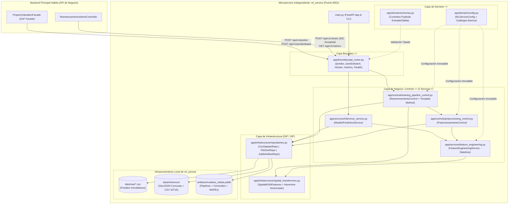
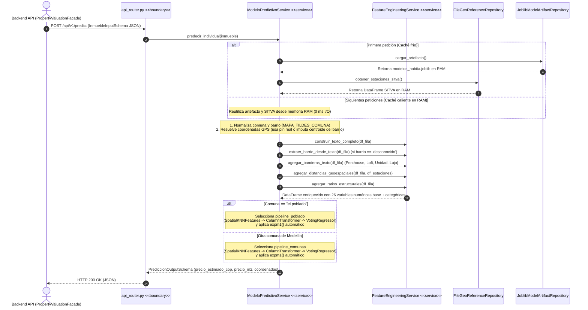
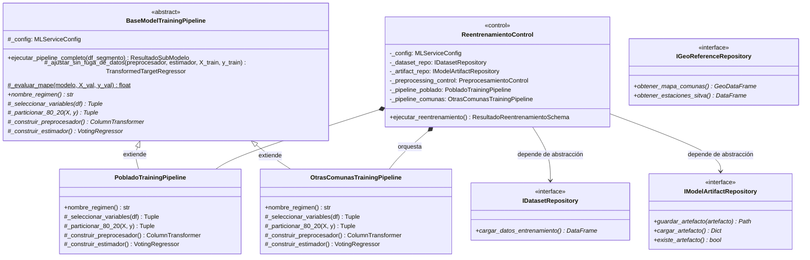
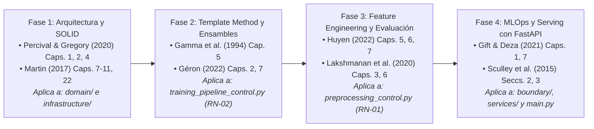

# Arquitectura y Diseño del Microservicio de Machine Learning (`ml_service`) — Proyecto Habita

**Proyecto:** Plataforma Web de Estimación de Cánones de Arrendamiento y Detección de Ofertas Inmobiliarias en Medellín  
**Módulo:** Servicio Independiente de Machine Learning (`ml_service`)  
**Estándares Arquitectónicos:** Modelo C4 (Nivel 4 BCE + Service), Principios SOLID, Patrones de Diseño GoF (*Template Method*), Prevención de *Training-Serving Skew* y *Data Leakage*  

---

## 1. Arquitectura del Microservicio y Justificación de Diseño

### 1.1. ¿Qué arquitectura se implementó?
El servicio `ml_service` fue diseñado bajo una **Arquitectura en Capas Desacoplada (Layered / Clean Architecture adaptada a sistemas de Machine Learning)** combinada con los estereotipos tácticos **BCE + Service (`<<boundary>>`, `<<control>>`, `<<service>>`, `<<entity>>`)** definidos en el Nivel 4 del Modelo C4 del proyecto y el patrón de diseño **Template Method (GoF)**.

La estructura física del microservicio dentro de `Proyecto_Habita/ml_service` se organiza en cinco capas con responsabilidades estrictamente segregadas:

```text
ml_service/
├── app/
│   ├── domain/                  # Capa 1: Entidades de Dominio, Configuración y Contratos (<<entity>>)
│   │   ├── config.py
│   │   └── schemas.py
│   ├── infrastructure/          # Capa 2: Persistencia, Repositorios e Infraestructura Matemática
│   │   ├── repositories.py
│   │   └── spatial_transformers.py
│   ├── services/                # Capa 3: Servicios de Aplicación e Inferencia en RAM (<<service>>)
│   │   ├── feature_engineering.py
│   │   └── inference_service.py
│   ├── controls/                # Capa 4: Orquestadores de Negocio y Template Method (<<control>>)
│   │   ├── preprocessing_control.py
│   │   └── training_pipeline_control.py
│   └── boundary/                # Capa 5: Frontera HTTP REST y Workers Asíncronos (<<boundary>>)
│       └── api_router.py
├── artifacts/                   # Almacenamiento del artefacto compilado (.joblib)
├── data/                        # Catálogos de referencia (GeoJSON, SITVA) y datasets crudos
└── main.py                      # Punto de entrada del servidor ASGI (FastAPI) y CLI administrativo
```

---

### 1.2. Justificación Técnica: ¿Por qué se eligió esta arquitectura en lugar de un script monolítico?

En proyectos tradicionales de ciencia de datos suele cometerse el antipatrón conocido como **"Script Monolítico de Entrenamiento"** (todo el código de lectura de CSV, limpieza, transformación, entrenamiento y predicción mezclado en un solo archivo). Al llevar un modelo a producción como servicio independiente para una API transaccional, un script monolítico falla por cuatro razones críticas que nuestra arquitectura resuelve de raíz:

1. **Aislamiento de Carga Computacional y Concurrencia Asíncrona (RNF-05 y RNF-08):**
   * **El problema:** El entrenamiento de ensambles (`XGBoost` + `ExtraTrees` + `SpatialKNNFeatures` + cruces espaciales `GeoPandas`) consume el 100% de los núcleos de CPU y varios cientos de megabytes de RAM durante varios minutos. Si conviviera dentro del mismo proceso del Backend Principal (API de usuarios), cada reentrenamiento congelaría las búsquedas de inmuebles de los arrendatarios.
   * **La solución arquitectónica:** Al aislar `ml_service` como un microservicio independiente con **ejecución en segundo plano (`BackgroundTasks` — HTTP `202 Accepted`)** y mantener el artefacto compilado en memoria RAM, las inferencias responden en milisegundos (**RNF-05 `< 3s`**) mientras cualquier reentrenamiento corre en un hilo secundario sin bloquear el tráfico (**RNF-08**).

2. **Eliminación del *Training-Serving Skew* (Asimetría entre Entrenamiento y Producción):**
   * **El problema:** Si el script de entrenamiento calcula distancias al Metro o banderas de texto de una forma, y luego en la API se reescribe esa lógica de otra manera para predecir un inmueble nuevo, el modelo recibe datos distorsionados en producción y sus predicciones se degradan silenciosamente.
   * **La solución arquitectónica:** Se extrajo toda la lógica determinista de transformación a una clase sin estado (`FeatureEngineeringService` en la capa `services/`). Tanto el flujo de entrenamiento (`PreprocesamientoControl`) como el flujo de predicción en tiempo real (`ModeloPredictivoService`) invocan **exactamente los mismos métodos** de `FeatureEngineeringService`.

3. **Garantía Estructural contra Fuga de Datos (*Data Leakage* — RN-02) mediante *Template Method*:**
   * **El problema:** Escalar variables (`StandardScaler`), codificar barrios (`TargetEncoder`) o buscar vecinos cercanos (`KNN`) sobre todo el dataset antes de dividir en `80% Train / 20% Validation` contamina la validación con precios del futuro.
   * **La solución arquitectónica:** La clase abstracta `BaseModelTrainingPipeline` implementa el patrón GoF **Template Method**, fijando un método plantilla inmutable (`ejecutar_pipeline_completo`) que obliga a realizar primero el `train_test_split` (80/20) y luego ajustar (`fit`) los transformadores estadísticos **exclusivamente sobre `X_train`**.

4. **Compuerta de Calidad Automatizada (*Quality Gate* — RN-01) y *Hot-Reload* en Memoria:**
   * **El problema:** Un reentrenamiento automático con datos corruptos de un *crawler* podría empeorar el modelo en producción.
   * **La solución arquitectónica:** `ReentrenamientoControl` evalúa automáticamente si ambos submodelos (*El Poblado* y *Otras Comunas*) cumplen $\text{MAPE} \le 16\%$ (**RN-01**). Si alguno supera el umbral, aborta el despliegue y protege el archivo `.joblib` vigente; si ambos aprueban, actualiza el archivo en disco y dispara `recargar_modelo_en_caliente()` para refrescar la memoria RAM sin apagar el servidor.

---

## 2. Cómo se Conectan las Capas (Flujo de Dependencias e Inyección SOLID)

La comunicación entre capas respeta estrictamente el **Principio de Inversión de Dependencias (DIP)** y la **Regla de Dependencia de Clean Architecture**: *las dependencias de código fuente siempre apuntan hacia adentro (hacia el dominio y las abstracciones), nunca hacia los detalles de infraestructura*.

### 2.1. Matriz de Conexión entre Capas

| Capa Origen | Se conecta con (Depende de) | Mecanismo de Conexión | Propósito de la Conexión |
| :--- | :--- | :--- | :--- |
| **Backend Principal Habita** *(Externo)* | `boundary` (`api_router.py`) | Peticiones HTTP REST (`JSON`) a través de `PropertyValuationFacade` | Solicitar predicciones individuales (`/predict`), en lote (`/predict/batch`), métricas (`/metrics`) o disparar reentrenamientos (`/retrain`). |
| **1. `boundary`** (`api_router.py`) | `services` (`ModeloPredictivoService`), `controls` (`ReentrenamientoControl`) y `domain` (`schemas.py`) | Inyección de Dependencias de FastAPI (`Depends(...)`) | Recibir el payload HTTP, validarlo con Pydantic, delegar la operación al controlador/servicio y devolver el código HTTP (`200 OK` o `202 Accepted`). |
| **2. `controls`** (`training_pipeline_control.py`, `preprocessing_control.py`) | `services` (`FeatureEngineeringService`), Abstracciones de `infrastructure` (`IDatasetRepository`, `IGeoReferenceRepository`, `IModelArtifactRepository`, `SpatialKNNFeatures`) y `domain` (`MLServiceConfig`) | Inyección por constructor (`__init__`) | Orquestar el ETL de limpieza de dominio, ejecutar el *Template Method* de entrenamiento 80/20, validar **RN-01** y persistir el artefacto si aprueba. |
| **3. `services`** (`inference_service.py`, `feature_engineering.py`) | Abstracciones de `infrastructure` (`IGeoReferenceRepository`, `IModelArtifactRepository`, `min_haversine_vectorizado`) y `domain` (`MLServiceConfig`, `schemas.py`) | Inyección por constructor (`__init__`) | Mantener el modelo `.joblib` en caché RAM, enriquecer los inmuebles entrantes con las mismas variables del entrenamiento y retornar la estimación en $< 3\text{s}$. |
| **4. `infrastructure`** (`repositories.py`, `spatial_transformers.py`) | `domain` (`MLServiceConfig`) y librerías externas (`geopandas`, `joblib`, `scikit-learn`, `pandas`) | Implementación de interfaces abstractas (`ABC`) | Leer los archivos CSV/GeoJSON del disco, serializar/deserializar el binario `.joblib` y ejecutar el cálculo matricial de Haversine y `SpatialKNNFeatures`. |
| **5. `domain`** (`config.py`, `schemas.py`) | **Ninguna otra capa interna** (Capa núcleo 100% independiente) | Importación directa de constantes, `@dataclass(frozen=True)` y modelos `BaseModel` | Proveer las reglas de negocio inmutables (**RN-01**, **RN-02**), rutas dinámicas, catálogos de barrios de Medellín y esquemas de datos. |

---

## 3. Funcionamiento Detallado de Cada Capa y sus Componentes

### 3.1. Capa de Dominio (`app/domain/`) — Estereotipo `<<entity>>`
Es el corazón de las reglas de negocio del microservicio. No sabe si los datos vienen de un CSV, de PostgreSQL o de una petición web.

* **`config.py` (`MLServiceConfig`, `LISTA_BARRIOS_MEDELLIN`, `DICCIONARIO_RESCATE_BARRIOS`):**
  * Calcula dinámicamente la raíz del proyecto usando `Path(__file__).resolve().parents[2]`, eliminando rutas absolutas quemadas (*hardcoded paths*).
  * Define un `@dataclass(frozen=True)` inmutable con los hiperparámetros de negocio: umbral máximo de error (`max_allowed_mape`), proporción de partición `test_size = 0.20` (**RN-02**), límites físicos de saneamiento (`min_area_m2 = 15.0`, `max_area_m2 = 500.0`, `min_precio_cop = 500_000`, exclusión del comodín falso `1_111_111`) y las coordenadas GPS de los **4 Polos de Valorización de Medellín** (*Parque Lleras, Milla de Oro, Parque de Laureles, Ciudad del Río*).
  * Contiene el catálogo de más de 70 barrios de Medellín ordenados de mayor a menor longitud para evitar colisiones parciales en expresiones regulares, y el diccionario de rescate geográfico para corregir anuncios mal georreferenciados.
* **`schemas.py` (`InmuebleInputSchema`, `BatchPredictionRequestSchema`, `PrediccionOutputSchema`, `ResultadoReentrenamientoSchema`):**
  * Define los contratos de entrada y salida con **Pydantic**. Valida automáticamente restricciones de dominio antes de ejecutar cualquier cálculo matemático (por ejemplo: `area > 0`, `1 <= estrato <= 6`, `banos >= 1`, `habitaciones >= 0`).

---

### 3.2. Capa de Infraestructura (`app/infrastructure/`) — Persistencia y Transformadores Matemáticos
Aísla el acceso al sistema de archivos y los motores matemáticos personalizados de Scikit-Learn.

* **`repositories.py`:**
  * Aplica el **Principio de Segregación de Interfaces (ISP)** dividiendo el acceso a datos en tres contratos independientes:
    1. `IDatasetRepository` $\rightarrow$ Implementado por `CsvDatasetRepository`: lee y concatena los CSV de *Ciencuadras*, *FincaRaíz* y *Metrocuadrado* inyectando la columna `portal`. Cuando el sistema migre a PostgreSQL, bastará con crear `SqlDatasetRepository(IDatasetRepository)` sin tocar una sola línea de los controladores (**Principio OCP**).
    2. `IGeoReferenceRepository` $\rightarrow$ Implementado por `FileGeoReferenceRepository`: carga `comunas_y_corregimientos_.geojson` (asegurando proyección `EPSG:4326`) y `estaciones_sitva_medellin.csv`, manteniéndolos en **caché en memoria RAM** (`_mapa_cache`, `_sitva_cache`) para evitar lecturas repetitivas de disco.
    3. `IModelArtifactRepository` $\rightarrow$ Implementado por `JoblibModelArtifactRepository`: encapsula la lectura y escritura del diccionario compilado `artifacts/modelos_habita.joblib`.
* **`spatial_transformers.py`:**
  * `min_haversine_vectorizado`: Calcula mediante *NumPy broadcasting* matricial $(N \times M)$ la distancia esférica mínima en kilómetros desde $N$ inmuebles hacia $M$ estaciones de transporte o polos urbanos en una sola operación vectorizada.
  * `SpatialKNNFeatures(BaseEstimator, TransformerMixin)`: Transformador compatible con `sklearn.pipeline` que calcula 3 variables de contexto micro-zonal (`knn_log_pm2`, `knn_log_precio_est`, `knn_log_y_sim`) basadas en los 20 vecinos más cercanos con ponderación inversa suavizada $w = \frac{1}{d + 0.05}$.
    * **Prevención de Fuga de Datos (RN-02):** En `fit_transform(X_train, y_train)` utiliza validación cruzada interna `KFold(n_splits=5)` (*Out-of-Fold*) entrenando cada fold únicamente con puntos de GPS real (`es_rescatado == 0`), impidiendo que un inmueble de entrenamiento use su propio precio al calcular el promedio de sus vecinos. En `transform(X_val)` consulta únicamente los vecinos aprendidos en `X_train`.

---

### 3.3. Capa de Servicios (`app/services/`) — Estereotipo `<<service>>`
Contiene la lógica reutilizable de ingeniería de características y el motor de inferencia de baja latencia.

* **`feature_engineering.py` (`FeatureEngineeringService`):**
  * Servicio **Stateless** (sin estado) invocado tanto en el entrenamiento como en la predicción en vivo:
    1. `normalizar_texto` y `construir_texto_completo`: Une el título y el *slug* de la URL original, convierte a minúsculas y elimina tildes mediante descomposición Unicode `NFD`.
    2. `extraer_barrio_desde_texto`: Identifica el barrio exacto del inmueble mediante expresiones regulares compiladas.
    3. `agregar_banderas_texto`: Genera 4 variables binarias de valorización (`es_penthouse_duplex`, `es_estudio_loft`, `es_unidad_cerrada`, `es_remodelado_lujo`).
    4. `agregar_distancias_geoespaciales`: Calcula la distancia general al SITVA, las distancias desglosadas por subsistema (`dist_metro_km`, `dist_cable_km`, `dist_tranvia_bus_km`) y las distancias a los 4 polos de valorización de Medellín.
    5. `agregar_ratios_estructurales`: Calcula relaciones físicas (`area_por_habitacion`, `banos_por_habitacion`, `parqueaderos_por_habitacion`, `total_espacios`, `tiene_parqueadero`, `log_area`, `area_x_estrato`).
* **`inference_service.py` (`ModeloPredictivoService`):**
  * Mantiene el artefacto `.joblib` cargado en memoria RAM (`_artefacto_memoria`).
  * Expone `predecir_individual` (para RF-03) y `predecir_lote` (para ordenar búsquedas por *"Mejor Oferta"* en RF-02).
  * Normaliza nombres de comunas (`MAPA_TILDES_COMUNA`), resuelve coordenadas GPS (si el usuario o el anuncio no envía latitud/longitud, imputa automáticamente el centroide mediano real del barrio o comuna aprendido en el entrenamiento), ejecuta `FeatureEngineeringService` y enruta el registro hacia `pipeline_poblado` o `pipeline_comunas`.
  * Incluye `recargar_modelo_en_caliente()` para actualizar la referencia en RAM inmediatamente después de un reentrenamiento exitoso.

---

### 3.4. Capa de Controladores (`app/controls/`) — Estereotipo `<<control>>`
Orquesta los flujos complejos de preparación de datos (Actividad F2) y reentrenamiento con validación de calidad (Actividad F3).

* **`preprocessing_control.py` (`PreprocesamientoControl`):**
  * Ejecuta la limpieza y enriquecimiento de dominio antes de la partición estadística:
    1. **Cumplimiento de RN-06:** Descarta cualquier registro que carezca de `url_origen` válida o tenga nulos en variables críticas.
    2. **Geocodificación Inversa (`_asignar_comuna_geografica`):** Realiza un *Spatial Join* (`gpd.sjoin(..., predicate="within")`) cruzando las coordenadas `(longitud, latitud)` contra los polígonos oficiales de `comunas_y_corregimientos_.geojson`.
    3. **Saneamiento de Rangos Físicos (`_filtrar_rangos_fisicos`):** Filtra áreas, precios, habitaciones, baños y estratos fuera de rango.
    4. **Rescate por *Fuzzy Matching* (`_rescatar_o_descartar_gps_falsos`):** Detecta inconsistencias socio-espaciales (ej. estrato $\ge 4$ cuyo pin GPS cayó por error en Popular, Manrique o Aranjuez), rescata su verdadera comuna/barrio desde el título con `rapidfuzz` ($\text{score} \ge 90$) y excluye municipios externos al perímetro de Medellín (`"otro"`, como Envigado, Sabaneta, Bello o Itagüí).
    5. **Deduplicación Cross-Portal:** Elimina anuncios idénticos publicados simultáneamente en varios portales antes de imputar centroides.
    6. **Imputación de Centroides Reales (`_imputar_centroides_reales`):** Calcula la mediana de latitud y longitud de cada barrio y comuna usando exclusivamente anuncios con GPS verificado (`es_rescatado == 0`) y reemplaza las coordenadas erróneas de los inmuebles rescatados.
    7. **Filtro de Outliers por IQR (`_filtrar_outliers_iqr`):** Elimina valores atípicos de `precio_m2` fuera de $[Q_1 - 1.5 \times \text{IQR},\; Q_3 + 1.5 \times \text{IQR}]$ agrupando por `(comuna, estrato)`.
    8. **Segmentación de Regímenes:** Divide el dataset limpio en `df_poblado` y `df_otras_comunas`, retornando un objeto tipado `DatasetPreprocesado`.

* **`training_pipeline_control.py` (`BaseModelTrainingPipeline`, `PobladoTrainingPipeline`, `OtrasComunasTrainingPipeline`, `ReentrenamientoControl`):**
  * Implementa la **Ficha 4 del catálogo de patrones GoF (*Template Method*)**:
    * `BaseModelTrainingPipeline` define el método plantilla `ejecutar_pipeline_completo(df_segmento)` con la secuencia invariable:
      1. `_seleccionar_variables(df)`
      2. `_particionar_80_20(X, y)` (**RN-02**)
      3. `_construir_preprocesador()` y `_construir_estimador()`
      4. `_ajustar_sin_fuga_de_datos(...)`: Encapsula `SpatialKNNFeatures(20)` + `ColumnTransformer` (`StandardScaler`, `OneHotEncoder`, `TargetEncoder(cv=5)`, `OrdinalEncoder`) + `VotingRegressor` (`2 XGBRegressor` con `objective="reg:absoluteerror"` + `ExtraTreesRegressor`) dentro de `TransformedTargetRegressor(func=np.log1p, inverse_func=np.expm1)` y ejecuta `.fit(X_train, y_train)`.
      5. `_evaluar_mape(modelo, X_val, y_val)` y verificación contra `max_allowed_mape` (**RN-01**).
    * `PobladoTrainingPipeline` y `OtrasComunasTrainingPipeline` heredan de la clase base y sobrescriben únicamente las operaciones primitivas específicas de su segmento geográfico (por ejemplo, la estratificación por `comuna` en `OtrasComunasTrainingPipeline`).
  * `ReentrenamientoControl` coordina todo el flujo y aplica la **Compuerta de Calidad RN-01**: solo sobrescribe `modelos_habita.joblib` si **ambos** regímenes aprueban el umbral de error.

---

### 3.5. Capa de Frontera (`app/boundary/`) y Punto de Entrada (`main.py`) — Estereotipo `<<boundary>>`
Expone las capacidades del microservicio hacia el exterior (HTTP REST y CLI).

* **`api_router.py`:**
  * Configura el contenedor de Inyección de Dependencias e implementa 6 endpoints REST bajo `/api/v1`:
    * `GET /api/v1/health`: Estado de salud del servicio, disponibilidad del archivo `.joblib` y estado del worker de reentrenamiento (`INACTIVO`, `EN_EJECUCION`, `COMPLETADO`, `ERROR`).
    * `GET /api/v1/metrics`: Retorna la versión del modelo en producción y los MAPE vigentes (**RF-11**).
    * `POST /api/v1/predict`: Inferencia individual en tiempo real (**RF-03, RNF-05**).
    * `POST /api/v1/predict/batch`: Inferencia por lotes para el motor de búsqueda inteligente (**RF-02**).
    * `POST /api/v1/retrain`: Dispara `_tarea_reentrenamiento_background` usando `BackgroundTasks` y responde inmediatamente `HTTP 202 Accepted` (**RF-10, RNF-08**). Protege contra ejecuciones concurrentes devolviendo `HTTP 409 Conflict` si ya hay un entrenamiento en curso.
    * `POST /api/v1/retrain/sync`: Ejecución sincrónica para pruebas administrativas.
* **`main.py`:**
  * Instancia la aplicación `FastAPI`, registra el `ml_router` y provee banderas de línea de comandos (`--train`, `--test`, `--port 8001`).

---

## 4. Diagramas Arquitectónicos y de Flujo del Microservicio

### 4.1. Diagrama de Arquitectura por Capas (BCE + SOLID) y Conexión con la API Principal



---

### 4.2. Diagrama de Secuencia — Flujo de Inferencia en Tiempo Real (`POST /api/v1/predict` y `/predict/batch`)



---

### 4.3. Diagrama de Flujo — Preprocesamiento, Rescate Geográfico y Reentrenamiento Asíncrono (`POST /api/v1/retrain`)

```mermaid
flowchart TD
    Start(["POST /api/v1/retrain"]) --> BgTask["api_router.py responde HTTP 202 Accepted inmediato\ny lanza _tarea_reentrenamiento_background()"]
    BgTask --> LoadRaw["1. CsvDatasetRepository.cargar_datos_entrenamiento()\nUne Ciencuadras + FincaRaíz + Metrocuadrado"]

    subgraph Fase_Preprocesamiento["Fase A: PreprocesamientoControl.ejecutar_limpieza_y_preparacion()"]
        LoadRaw --> RN06["2. Filtro RN-06 y Nulos Críticos\nDescarta registros sin url_origen, área o precio"]
        RN06 --> SJoin["3. Geocodificación Inversa (GeoPandas sjoin)\nCruza (longitud, latitud) contra comunas_y_corregimientos_.geojson"]
        SJoin --> Rangos["4. Filtro de Rangos Físicos\nÁrea (15-500 m2), Precio (500k-15M), excluye comodín 1.111.111"]
        Rangos --> TextBarrio["5. FeatureEngineeringService\nNormaliza texto y extrae 'barrio' (70+ barrios de Medellín)"]
        TextBarrio --> Fuzzy["6. Rescate Geográfico (RapidFuzz >= 90)\nRescata pines GPS falsos y excluye municipios externos ('otro')"]
        Fuzzy --> Dedup["7. Deduplicación Cross-Portal\nElimina anuncios repetidos entre portales antes de imputar centroides"]
        Dedup --> Centroides["8. Imputación de Centroides Reales\nCalcula mediana GPS de es_rescatado==0 e imputa coordenadas a rescatados"]
        Centroides --> Features["9. Ingeniería Geoespacial y Estructural\nDistancias Haversine (Metro, Cable, Tranvía, 4 Polos) + Ratios físicos"]
        Features --> IQR["10. Filtro de Outliers por IQR Real (Q1=0.25, Q3=0.75)\nSobre precio_m2 agrupado por (comuna, estrato)"]
        IQR --> SplitRegimen["11. Segmentación de Regímenes\ndf_poblado vs. df_otras_comunas"]
    end

    subgraph Fase_Template_Method["Fase B: Patrón GoF Template Method (BaseModelTrainingPipeline)"]
        SplitRegimen --> TM_Pob["PobladoTrainingPipeline\n.ejecutar_pipeline_completo()"]
        SplitRegimen --> TM_Com["OtrasComunasTrainingPipeline\n.ejecutar_pipeline_completo()"]

        TM_Pob & TM_Com --> Step1_2["Pasos 1 y 2 (RN-02): _seleccionar_variables() y _particionar_80_20()\nDivide 80% X_train / 20% X_val ANTES de cualquier transformación estadística"]
        Step1_2 --> Step3_4["Pasos 3 y 4 (RN-02): _ajustar_sin_fuga_de_datos()\nEntrena SpatialKNNFeatures (OOF KFold=5) + ColumnTransformer (TargetEncoder/Scaler)\n+ VotingRegressor (2 XGBoost + ExtraTrees) SOLO con X_train"]
        Step3_4 --> Step5["Paso 5: _evaluar_mape(X_val, y_val)\nEvalúa sobre el 20% de validación nunca visto"]
    end

    Step5 --> Gate{"Compuerta RN-01:\n¿Ambos modelos tienen\nMAPE <= Umbral?"}

    Gate -->|"SÍ (Ej: 12.97% y 11.89%)"| SaveArt["JoblibModelArtifactRepository.guardar_artefacto()\nSobrescribe artifacts/modelos_habita.joblib"]
    SaveArt --> HotReload["ModeloPredictivoService.recargar_modelo_en_caliente()\nActualiza el modelo en memoria RAM sin reiniciar FastAPI"]

    Gate -->|"NO (Algún MAPE > Umbral)"| Abort["Aborta promoción a producción\nConserva intacto el modelo vigente en disco y RAM"]
```



---

### 4.4. Diagrama de Clases UML — Patrón GoF *Template Method* e Inversión de Dependencias (DIP)



---

## 5. Ruta de Aprendizaje y Bibliografía con Capítulos Específicos

Para dominar de principio a fin cómo se diseñó, entrenó y llevó a producción el microservicio `ml_service/` (arquitectura en 5 capas BCE, prevención de *Data Leakage* `RN-02`, compuerta de calidad `RN-01`, patrón GoF *Template Method*, ensambles `XGBoost`/`ExtraTrees` y despliegue en FastAPI), se propone la siguiente **ruta de aprendizaje progresiva en 4 fases**, indicando qué capítulos estudiar de cada libro y a qué archivo exacto del proyecto aplica:

---

### Fase 1: Arquitectura en Capas en Python, Principios SOLID y Patrón *Repository*
*Objetivo:* Comprender por qué `ml_service` está dividido en 5 capas (`domain`, `infrastructure`, `services`, `controls`, `boundary`), cómo funciona la Inversión de Dependencias (`DIP`) mediante interfaces abstractas (`ABC`) y cómo desacoplar el modelo de la fuente de datos (CSV hoy, PostgreSQL mañana).

1. **Percival, Harry & Gregory, Bob (2020). *Architecture Patterns with Python: Enabling Test-Driven Development, Domain-Driven Design, and Event-Driven Microservices*. O'Reilly Media.** *(Disponible en línea: https://www.cosmicpython.com)*
   * **Capítulo 1 (*Domain Modeling*):** Explica cómo construir un núcleo de dominio puro (`domain/`) libre de dependencias de infraestructura o frameworks web.
     * *Aplica a:* [`ml_service/domain/schemas.py`](file:///C:/Users/heman/Proyecto_Habita/ml_service/domain/schemas.py) y [`ml_service/domain/config.py`](file:///C:/Users/heman/Proyecto_Habita/ml_service/domain/config.py).
   * **Capítulo 2 (*Repository Pattern*):** **Lectura obligatoria.** Enseña cómo abstraer el acceso a datos mediante interfaces (`AbstractRepository`) e implementaciones intercambiables, incluyendo escrituras seguras de artefactos.
     * *Aplica a:* [`ml_service/domain/interfaces.py`](file:///C:/Users/heman/Proyecto_Habita/ml_service/domain/interfaces.py) (`IDatasetRepository`, `IGeoReferenceRepository`, `IModelArtifactRepository`) y [`ml_service/infrastructure/repositories.py`](file:///C:/Users/heman/Proyecto_Habita/ml_service/infrastructure/repositories.py) (`CsvDatasetRepository`, `LocalGeoReferenceRepository`, `JoblibModelArtifactRepository`).
   * **Capítulo 4 (*Our First Use Case: Flask API and Service Layer*):** Muestra cómo separar la capa HTTP (`boundary/routes.py`) de la capa de casos de uso y orquestación (`controls/` y `services/`).
     * *Aplica a:* [`ml_service/boundary/routes.py`](file:///C:/Users/heman/Proyecto_Habita/ml_service/boundary/routes.py) y [`ml_service/services/prediction_service.py`](file:///C:/Users/heman/Proyecto_Habita/ml_service/services/prediction_service.py).

2. **Martin, Robert C. (2017). *Clean Architecture: A Craftsman's Guide to Software Structure and Design*. Prentice Hall.**
   * **Capítulos 7 al 11 (*Principios SOLID: SRP, OCP, LSP, ISP, DIP*):** Fundamentan por qué `PreprocesamientoControl` está separado de `ReentrenamientoControl` (**SRP**), por qué las interfaces están segregadas en tres contratos distintos (**ISP**) y por qué los controladores dependen de abstracciones y no de `pandas.read_csv` o `joblib.dump` directamente (**DIP**).
   * **Capítulo 22 (*The Clean Architecture*):** Explica la *Regla de Dependencia Concéntrica* (las dependencias del código fuente solo apuntan hacia adentro, hacia `domain/`).
     * *Aplica a:* Estructura global de paquetes de [`ml_service/`](file:///C:/Users/heman/Proyecto_Habita/ml_service).

3. **Brown, Simon (2018). *The C4 Model for Visualising Software Architecture*. Leanpub.**
   * **Capítulos 2 al 5 (*Context, Containers, Components, and Code*):** Explica cómo conectar los 4 niveles de abstracción arquitectónica del proyecto y el uso de estereotipos `<<boundary>>`, `<<control>>`, `<<service>>`, `<<entity>>`.
     * *Aplica a:* [`Readme/Documentacion_Modelo_C4.md`](file:///C:/Users/heman/Proyecto_Habita/Readme/Documentacion_Modelo_C4.md).

---

### Fase 2: Patrones de Diseño GoF (*Template Method*) y Pipelines de ML sin Fuga de Datos (`RN-02`)
*Objetivo:* Comprender cómo fijar un esqueleto algorítmico invariable para entrenar múltiples regímenes de mercado (*El Poblado* vs. *Otras Comunas*) prohibiendo estructuralmente la fuga de datos (*Data Leakage*).

4. **Gamma, E., Helm, R., Johnson, R., & Vlissides, J. (1994). *Design Patterns: Elements of Reusable Object-Oriented Software* (GoF). Addison-Wesley.**
   * **Capítulo 5 — Sección *Template Method* (págs. 325–330):** Explica cómo una superclase abstracta define el esqueleto inmutable de un algoritmo e invoca operaciones primitivas (*hooks*) que las subclases personalizan sin poder alterar el orden de los pasos críticos.
     * *Aplica a:* [`BaseModelTrainingPipeline.ejecutar_pipeline_completo()`](file:///C:/Users/heman/Proyecto_Habita/ml_service/controls/training_pipeline_control.py#L44-L108) y sus subclases [`PobladoTrainingPipeline`](file:///C:/Users/heman/Proyecto_Habita/ml_service/controls/training_pipeline_control.py#L183-L273) y [`OtrasComunasTrainingPipeline`](file:///C:/Users/heman/Proyecto_Habita/ml_service/controls/training_pipeline_control.py#L276-L375).

5. **Géron, Aurélien (2022). *Hands-On Machine Learning with Scikit-Learn, Keras, and TensorFlow* (3ra Edición). O'Reilly Media.**
   * **Capítulo 2 (*End-to-End Machine Learning Project*):** **Fundamental para este proyecto.** Caso de estudio completo de predicción de precios de vivienda. Cubre partición estratificada (`StratifiedShuffleSplit` / `train_test_split` con `stratify`), creación de atributos combinados (ratios e interacciones), pipelines con `ColumnTransformer` y transformación logarítmica del objetivo (`TransformedTargetRegressor` con `np.log1p` / `np.expm1`).
     * *Aplica a:* [`PreprocesamientoControl`](file:///C:/Users/heman/Proyecto_Habita/ml_service/controls/preprocessing_control.py) y [`BaseModelTrainingPipeline._ajustar_sin_fuga_de_datos()`](file:///C:/Users/heman/Proyecto_Habita/ml_service/controls/training_pipeline_control.py#L110-L148) (**Regla `RN-02`**).
   * **Capítulo 7 (*Ensemble Learning and Random Forests*):** Explica en detalle cómo funcionan `ExtraTreesRegressor` (sección *Extremely Randomized Trees*), Gradient Boosting (`XGBoost`) y cómo combinarlos mediante un `VotingRegressor` ponderado para reducir varianza y sesgo simultáneamente.
     * *Aplica a:* Métodos `_construir_estimador()` en [`training_pipeline_control.py`](file:///C:/Users/heman/Proyecto_Habita/ml_service/controls/training_pipeline_control.py#L239-L273) y poda de memoria (`max_depth=16`, `min_samples_leaf=3`).

---

### Fase 3: Diseño de Sistemas de Machine Learning y Patrones de Ingeniería ML
*Objetivo:* Comprender el problema del *Training-Serving Skew* (discrepancia entre entrenamiento e inferencia en vivo), la codificación de variables categóricas de alta cardinalidad (`TargetEncoder` para `barrio`) y los patrones de arquitectura ML.

6. **Huyen, Chip (2022). *Designing Machine Learning Systems: An Iterative Process for Production-Ready Applications*. O'Reilly Media.**
   * **Capítulo 5 (*Feature Engineering*):** Profundiza en **Data Leakage** (causas y prevención), manejo de valores faltantes (imputación determinista vs. estadística), escalado robusto frente a *outliers* (`RobustScaler`) y *Target Encoding* con suavizado (*smoothing*) para evitar sobreajuste en barrios con pocas muestras.
     * *Aplica a:* [`PreprocesamientoControl`](file:///C:/Users/heman/Proyecto_Habita/ml_service/controls/preprocessing_control.py) y preprocesadores de [`training_pipeline_control.py`](file:///C:/Users/heman/Proyecto_Habita/ml_service/controls/training_pipeline_control.py#L211-L237).
   * **Capítulo 6 (*Model Development and Offline Evaluation*):** Métricas de evaluación por segmentos (*Slice-based Evaluation*, que justifica por qué evaluamos separadamente el régimen de *El Poblado* y el de *Otras Comunas*) y compuertas de validación antes del despliegue (**Regla `RN-01`: `MAPE <= 16%`**).
     * *Aplica a:* [`ReentrenamientoControl.ejecutar_reentrenamiento()`](file:///C:/Users/heman/Proyecto_Habita/ml_service/controls/training_pipeline_control.py#L378-L492).
   * **Capítulo 7 (*Deployment and Prediction Service*):** Compara predicción por lotes (*Batch Prediction*) vs. predicción en línea (*Online Prediction via REST*), compresión de artefactos (reducción de 853 MB a 64 MB) y latencia de inferencia.
     * *Aplica a:* [`ModeloPredictivoService.predecir_lote()`](file:///C:/Users/heman/Proyecto_Habita/ml_service/services/prediction_service.py#L120-L195) y [`JoblibModelArtifactRepository`](file:///C:/Users/heman/Proyecto_Habita/ml_service/infrastructure/repositories.py#L123-L185).

7. **Lakshmanan, V., Robinson, S., & Munn, M. (2020). *Machine Learning Design Patterns: Solutions to Common Challenges in Data Preparation, Model Building, and MLOps*. O'Reilly Media.**
   * **Capítulo 3 — Patrón *Transform* (págs. 95–106):** Explica por qué los transformadores con estado (`TargetEncoder`, `SimpleImputer`, `RobustScaler`) deben serializarse junto con el estimador dentro de un único artefacto (`Pipeline`) para eliminar el *Training-Serving Skew*.
     * *Aplica a:* Empaquetamiento del `Pipeline` dentro de `modelos_habita.joblib` en [`training_pipeline_control.py`](file:///C:/Users/heman/Proyecto_Habita/ml_service/controls/training_pipeline_control.py).
   * **Capítulo 6 — Patrón *Stateless Serving Function* y *Workflow Pipeline* (págs. 215–245):** Cómo exponer la inferencia como una función pura sin estado lateral y cómo diseñar pipelines de reentrenamiento con compuertas de promoción atómica.
     * *Aplica a:* [`ModeloPredictivoService`](file:///C:/Users/heman/Proyecto_Habita/ml_service/services/prediction_service.py) y [`ReentrenamientoControl`](file:///C:/Users/heman/Proyecto_Habita/ml_service/controls/training_pipeline_control.py).

---

### Fase 4: Paso a Producción (MLOps), Concurrencia y Resiliencia en FastAPI
*Objetivo:* Comprender cómo servir el modelo en producción sin bloquear a los usuarios durante el reentrenamiento (`RNF-08`), cómo proteger la concurrencia con `threading.Lock`, cómo precargar el modelo en el arranque (`lifespan`) y cómo realizar escrituras atómicas con *rollback*.

8. **Gift, Noah & Deza, Alfredo (2021). *Practical MLOps: Operationalizing Machine Learning Models*. O'Reilly Media.**
   * **Capítulo 1 (*Introduction to MLOps*) y Capítulo 7 (*Packaging and Deploying ML Models*):** Empaquetado de modelos Scikit-Learn/XGBoost como microservicios REST con FastAPI, contratos tipados con Pydantic, endpoints de salud (`GET /health`) y recarga en caliente (*Hot-Reload*) del artefacto en memoria tras reentrenar.
     * *Aplica a:* [`ml_service/main.py`](file:///C:/Users/heman/Proyecto_Habita/ml_service/main.py) y [`ml_service/boundary/routes.py`](file:///C:/Users/heman/Proyecto_Habita/ml_service/boundary/routes.py).

9. **Sculley, D. et al. (2015). *Hidden Technical Debt in Machine Learning Systems*. Advances in Neural Information Processing Systems (NeurIPS), 28.**
   * **Secciones 2 y 3 (*Boundary Erosion, Entanglement, Glue Code, Pipeline Jungles*):** Explica por qué los notebooks monolíticos generan deuda técnica crítica al pasar a producción y cómo la separación modular (como la migración de `modelo.ipynb` hacia las 5 capas de `ml_service/`) elimina los *Pipeline Jungles*.

---

### Tabla Resumen: Mapa de Estudio $\leftrightarrow$ Código del Microservicio

| Fase | Libro y Capítulos Exactos | Concepto Clave | Archivo de `ml_service/` donde se aplica |
| :--- | :--- | :--- | :--- |
| **Fase 1** | **Percival & Gregory (2020)** Caps. 1, 2, 4<br/>**Martin (2017)** Caps. 7–11, 22 | Clean Architecture, SOLID (`SRP`, `ISP`, `DIP`) y Patrón *Repository* | [`domain/interfaces.py`](file:///C:/Users/heman/Proyecto_Habita/ml_service/domain/interfaces.py)<br/>[`infrastructure/repositories.py`](file:///C:/Users/heman/Proyecto_Habita/ml_service/infrastructure/repositories.py) |
| **Fase 2** | **Gamma et al. (1994)** Cap. 5 (*Template Method*)<br/>**Géron (2022)** Caps. 2 y 7 | Esqueleto invariable de entrenamiento, `ColumnTransformer`, `VotingRegressor` (`XGBoost` + `ExtraTrees`) y `RN-02` | [`controls/training_pipeline_control.py`](file:///C:/Users/heman/Proyecto_Habita/ml_service/controls/training_pipeline_control.py) |
| **Fase 3** | **Huyen (2022)** Caps. 5, 6, 7<br/>**Lakshmanan et al. (2020)** Caps. 3 y 6 | Prevención de *Training-Serving Skew*, `TargetEncoder`, evaluación por segmento y compuerta `RN-01` (`MAPE <= 16%`) | [`controls/preprocessing_control.py`](file:///C:/Users/heman/Proyecto_Habita/ml_service/controls/preprocessing_control.py)<br/>[`services/prediction_service.py`](file:///C:/Users/heman/Proyecto_Habita/ml_service/services/prediction_service.py) |
| **Fase 4** | **Gift & Deza (2021)** Caps. 1 y 7<br/>**Sculley et al. (2015)** Seccs. 2 y 3 | Despliegue FastAPI, `lifespan`, `BackgroundTasks` (`RNF-08`), `threading.Lock` y escritura atómica `.tmp`/`.prev` | [`main.py`](file:///C:/Users/heman/Proyecto_Habita/ml_service/main.py)<br/>[`boundary/routes.py`](file:///C:/Users/heman/Proyecto_Habita/ml_service/boundary/routes.py) |

---

### Diagrama de la Ruta de Estudio para `ml_service/`


