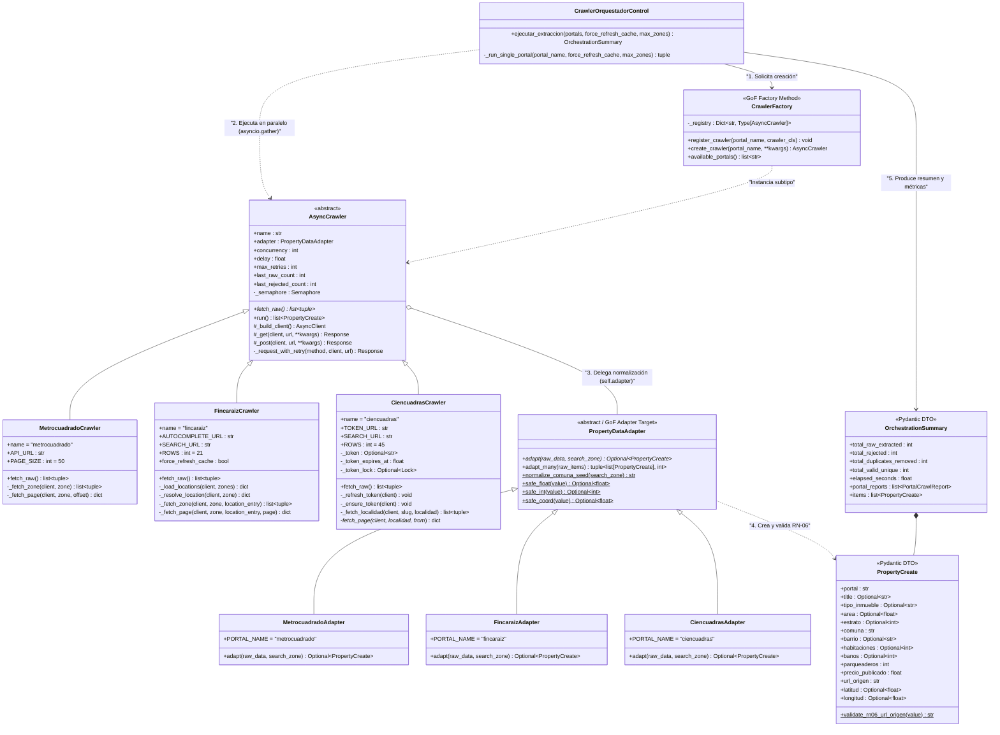
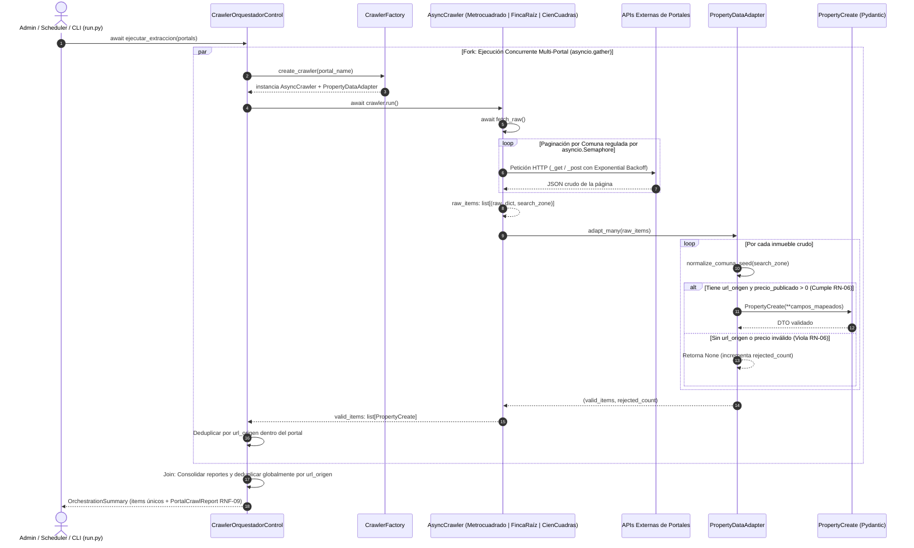
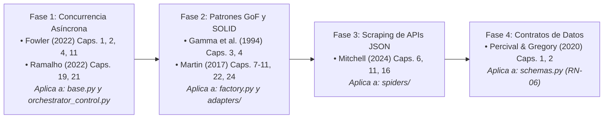

# Arquitectura y Diseño del Módulo de Ingesta Asíncrona (`crawlers/`) — Proyecto Habita

**Proyecto:** Sistema de Búsqueda y Estimación de Precios de Arrendamiento en Medellín (*Habita*)  
**Módulo:** Subsistema de Extracción y Normalización Multi-Portal (`crawlers/`)  
**Patrones GoF implementados:** *Factory Method* (Creacional) y *Adapter* (Estructural)  
**Requisitos asociados:** `RF-01`, `RF-08`, `RF-12`, `RN-06`, `RNF-03`, `RNF-07`, `RNF-09`

---

## Tabla de Contenidos

1. [Justificación del Diseño y de la Estructura Arquitectónica](#1-justificación-del-diseño-y-de-la-estructura-arquitectónica)
2. [Cómo se Conectan los Módulos (Diagrama de Clases y Flujos)](#2-cómo-se-conectan-los-módulos-diagrama-de-clases-y-flujos)
3. [Explicación Detallada de Cada Módulo y Responsabilidades](#3-explicación-detallada-de-cada-módulo-y-responsabilidades)
4. [Ruta de Aprendizaje y Bibliografía con Capítulos Específicos](#4-ruta-de-aprendizaje-y-bibliografía-con-capítulos-específicos)

---

## 1. Justificación del Diseño y de la Estructura Arquitectónica

El diseño del paquete `crawlers/` responde a cuatro decisiones arquitectónicas fundamentales para el Producto Mínimo Viable (MVP):

### 1.1. ¿Por qué un paquete modular integrado en el Backend y no un microservicio aparte?

A diferencia del microservicio de Machine Learning (`ml_service`), que es **intensivo en CPU y memoria RAM (*CPU-bound*)** por el entrenamiento de ensambles de árboles (`XGBoost` y `ExtraTrees`) y el cruce geoespacial con `GeoPandas`, el subsistema de crawlers es **100% intensivo en Entrada/Salida de red (*I/O-bound*)**:

| Dimensión Técnica | Justificación en `crawlers/` |
| :--- | :--- |
| **Naturaleza Asíncrona (`asyncio` + `httpx`)** | Durante el 98% del tiempo de ejecución, los crawlers esperan respuestas HTTP de las APIs de Metrocuadrado, FincaRaíz y CienCuadras. Gracias al *event loop* asíncrono de Python, consumen **< 2% de CPU** y **< 30 MB de RAM**, pudiendo ejecutarse dentro del Backend sin bloquear las peticiones HTTP de los usuarios. |
| **Cercanía a la Persistencia (PostgreSQL)** | El resultado de la extracción alimenta directamente las tablas `properties`, `crawler_jobs` y `audit_logs` (`RNF-09`) del Backend. Mantener el paquete dentro del mismo proceso evita serializar y transmitir miles de JSON por red interna entre dos contenedores. |
| **Desacoplamiento Preparado para Escalar** | Al encapsular toda la extracción detrás de `CrawlerOrquestadorControl` y `CrawlerFactory`, el módulo tiene **cero dependencia hacia FastAPI**. Si en el futuro el sistema escala a decenas de portales, el paquete puede moverse a un *worker* distribuido (Celery / RabbitMQ) sin tocar una línea de los spiders ni de los adaptadores. |

---

### 1.2. Separación Estricta de Responsabilidades (Principio SOLID — SRP)

En la versión preliminar de los scripts de scraping existían tres responsabilidades mezcladas que violaban el **Principio de Responsabilidad Única (SRP)**:
1. Los spiders hacían peticiones HTTP, parseaban diccionarios internos (`_parse`) y escribían archivos CSV en disco (`to_csv`).
2. Scripts sueltos (`reubicar_comunas.py`, `check_coords.py`) ejecutaban geocodificación espacial con OpenStreetMap (`osmnx`), duplicando el trabajo que ya realiza `PreprocesamientoControl` en `ml_service`.
3. Las semillas de búsqueda de la Comuna 11 (`"laureles"` y `"estadio"`) se guardaban como si fueran dos comunas distintas.

La nueva estructura corrige de raíz estas violaciones dividiendo el trabajo en **4 fronteras limpias**:

1. **Spiders (`crawlers/spiders/`):** Su única razón de cambio es si un portal modifica su protocolo de red, paginación o autenticación (OAuth2, headers, autocomplete). Solo devuelven diccionarios JSON crudos.
2. **Adaptadores (`crawlers/adapters/` — Patrón *Adapter*):** Su única razón de cambio es si un portal renombra un atributo dentro de su JSON. Traducen el JSON crudo al esquema canónico `PropertyCreate`, unifican semillas (`"laureles"` / `"estadio"` $\rightarrow$ `"laureles estadio"`) y aplican la regla **`RN-06`** (descarte estricto de inmuebles sin `url_origen`).
3. **Factoría y Orquestador (`factory.py` y `orchestrator_control.py` — Patrón *Factory Method*):** Instancian los portales sin condicionales `if/elif` (`RNF-07`), los ejecutan en paralelo (`Fork/Join` con `asyncio.gather`) y deduplican en memoria por `url_origen`.
4. **Auditoría Geoespacial (`ml_service`):** La validación *Point-in-Polygon* (`GeoPandas` + GeoJSON oficial de Medellín) queda delegada exclusivamente a `PreprocesamientoControl` en el microservicio de ML, eliminando cualquier duplicidad en los crawlers.

---

### 1.3. Cumplimiento de los 5 Principios SOLID en `crawlers/`

* **S — Single Responsibility Principle (SRP):** Cada clase tiene una única responsabilidad: `AsyncCrawler` gestiona transporte HTTP, semáforos y reintentos; cada `*Spider` pagina su portal; cada `*Adapter` transforma el JSON al DTO `PropertyCreate`; `CrawlerOrquestadorControl` coordina el paralelismo y la deduplicación.
* **O — Open/Closed Principle (OCP):** Para agregar un cuarto portal (ej. *Properati*), basta con crear `ProperatiCrawler` y `ProperatiAdapter` y registrarlo con `CrawlerFactory.register_crawler("properati", ProperatiCrawler)`, sin modificar `CrawlerOrquestadorControl` (`RNF-07`).
* **L — Liskov Substitution Principle (LSP):** Todos los subtipos de `AsyncCrawler` devuelven invariablemente `list[PropertyCreate]` validados por Pydantic (nunca diccionarios incompletos ni registros sin `url_origen`).
* **I — Interface Segregation Principle (ISP):** Se eliminó el método `to_csv()` de `AsyncCrawler`, evitando obligar a los crawlers de producción a depender de operaciones de escritura en archivos planos.
* **D — Dependency Inversion Principle (DIP):** `CrawlerOrquestadorControl` depende únicamente de las abstracciones `AsyncCrawler`, `PropertyDataAdapter` y `PropertyCreate`, nunca de los spiders concretos.

---

## 2. Cómo se Conectan los Módulos (Diagrama de Clases y Flujos)

### 2.1. Árbol de Directorios del Paquete

```text
crawlers/
├── __init__.py                         # Fachada de exportación del paquete
├── constants.py                        # SEARCH_ZONES_MEDELLIN, COMUNA_SLUG_TO_CANONICAL, env vars
├── schemas.py                          # Contratos Pydantic: PropertyCreate (RN-06), PortalCrawlReport, OrchestrationSummary
├── base.py                             # [Producto Abstracto] AsyncCrawler: HTTP + Semáforo + Backoff + SSLContext
├── factory.py                          # [GoF Factory Method] CrawlerFactory (registro declarativo RNF-07)
├── orchestrator_control.py             # [Capa Control] CrawlerOrquestadorControl (Fork/Join + deduplicación)
├── run.py                              # CLI de ejecución y diagnóstico
├── adapters/                           # [GoF Adapter] Traducción JSON nativo -> PropertyCreate
│   ├── __init__.py
│   ├── base_adapter.py                 # Interfaz Target: PropertyDataAdapter(ABC)
│   ├── metrocuadrado_adapter.py        # MetrocuadradoAdapter
│   ├── fincaraiz_adapter.py            # FincaraizAdapter
│   └── ciencuadras_adapter.py          # CiencuadrasAdapter
└── spiders/                            # [Productos Concretos] Spiders de paginación HTTP asíncrona
    ├── __init__.py
    ├── metrocuadrado_spider.py         # MetrocuadradoCrawler
    ├── fincaraiz_spider.py             # FincaraizCrawler
    ├── ciencuadras_spider.py           # CiencuadrasCrawler
    └── cache/
        └── fincaraiz_locations.json    # Caché persistente de UUIDs de ubicaciones para FincaRaíz
```

---

### 2.2. Diagrama de Clases UML (`classDiagram`)

El siguiente diagrama de clases muestra cómo se articulan el controlador de orquestación, el patrón **Factory Method** (`CrawlerFactory` $\rightarrow$ `AsyncCrawler`), el patrón **Adapter** (`AsyncCrawler` $\rightarrow$ `PropertyDataAdapter`) y los contratos de datos (`PropertyCreate`):



---

### 2.3. Diagrama de Secuencia de Ejecución Concurrente (`sequenceDiagram`)

Muestra el flujo completo en tiempo de ejecución cuando se dispara `ejecutar_extraccion()` (correspondiente al **Diagrama de Actividades F1**):



---

## 3. Explicación Detallada de Cada Módulo y Responsabilidades

### 3.1. [`constants.py`](file:///C:/Users/heman/Proyecto_Habita/crawlers/constants.py) — Configuración y Semillas de Búsqueda
Centraliza las constantes estáticas y variables de entorno para evitar valores mágicos dispersos en los spiders:
* `SEARCH_ZONES_MEDELLIN`: Lista de 17 *slugs* de búsqueda (`"popular"`, `"el-poblado"`, `"laureles"`, `"estadio"`, etc.) que las APIs de los portales utilizan como filtro de ubicación.
* `COMUNA_SLUG_TO_CANONICAL`: Diccionario de normalización ligera que traduce la semilla de búsqueda al nombre canónico de las 16 comunas de Medellín. Resuelve específicamente la partición de la **Comuna 11**, unificando `"laureles"` y `"estadio"` bajo `"laureles estadio"` sin invocar librerías geoespaciales pesadas.
* `USER_AGENT`, `METROCUADRADO_API_KEY`, `CIENCUADRAS_BASIC_AUTH`: Parámetros de identificación HTTP leídos desde variables de entorno (`os.getenv`) con valores por defecto seguros.

---

### 3.2. [`schemas.py`](file:///C:/Users/heman/Proyecto_Habita/crawlers/schemas.py) — Contratos de Datos y Regla de Negocio `RN-06`
Define los tres esquemas inmutables con **Pydantic v2**:
1. **`PropertyCreate`**: Representa el contrato canónico de un inmueble listo para persistirse en PostgreSQL (`portal`, `title`, `tipo_inmueble`, `area`, `estrato`, `comuna`, `barrio`, `habitaciones`, `banos`, `parqueaderos`, `estado`, `imagen_url`, `precio_publicado`, `url_origen`, `incluye_administracion`, `amoblado`, `latitud`, `longitud`, `antiguedad`, `valor_administracion`).
   * Incluye el validador `@field_validator("url_origen")` que garantiza el cumplimiento estricto de **`RN-06`** (rechaza cualquier registro cuya URL sea nula, vacía o no inicie con `http://` o `https://`) y `Field(..., gt=0)` en `precio_publicado`.
2. **`PortalCrawlReport`**: Estructura las métricas individuales de cada portal (`raw_extracted`, `rejected_rn06_or_invalid`, `duplicates_removed`, `valid_unique_items`, `elapsed_seconds`, `status`, `error_message`) para el registro de auditoría exigido por **`RNF-09`**.
3. **`OrchestrationSummary`**: Agrupa los reportes de todos los portales y la lista consolidada y deduplicada `items: list[PropertyCreate]`.

---

### 3.3. [`base.py`](file:///C:/Users/heman/Proyecto_Habita/crawlers/base.py) — Producto Abstracto (`AsyncCrawler`)
Es la clase base abstracta de la cual heredan todos los spiders:
* **Contexto TLS compartido (`_SSL_CONTEXT`):** Instancia `truststore.SSLContext(ssl.PROTOCOL_TLS_CLIENT)` una única vez al cargar el módulo. Esto inyecta el almacén de certificados nativo de Windows en `httpx` sin recargarlo en cada corrida.
* **Control de concurrencia (`self._semaphore`):** Usa `asyncio.Semaphore(concurrency)` para limitar el número máximo de conexiones simultáneas en vuelo hacia un mismo portal, evitando bloqueos por *rate limiting* (WAF/Cloudflare).
* **Tolerancia a fallos transitorios (`_request_with_retry`):** Implementa reintentos automáticos con *exponential backoff* (`0.5s`, `1.0s`) ante errores `HTTP 429`, `500`, `502`, `503`, `504` o `httpx.TimeoutException`, evitando perder páginas enteras de 45–50 inmuebles por micro-cortes de red.
* **Plantilla de ejecución (`run()`):** Invoca `await self.fetch_raw()` (implementado por cada subclase) y pasa el resultado a `self.adapter.adapt_many(raw_items)`, registrando las métricas `last_raw_count` y `last_rejected_count`.

---

### 3.4. [`spiders/`](file:///C:/Users/heman/Proyecto_Habita/crawlers/spiders) — Productos Concretos de Extracción HTTP
Cada spider conoce únicamente el protocolo de paginación de su portal:
1. **[`metrocuadrado_spider.py`](file:///C:/Users/heman/Proyecto_Habita/crawlers/spiders/metrocuadrado_spider.py) (`MetrocuadradoCrawler`):**
   * Consulta `GET https://www.metrocuadrado.com/rest-search/search` enviando el header `x-api-key`.
   * Aplica paginación paralela en dos fases por zona: pide `offset=0` para conocer `totalHits` y enseguida lanza todos los `offsets` restantes (`50, 100, 150...`) concurrentemente con `asyncio.gather`.
2. **[`fincaraiz_spider.py`](file:///C:/Users/heman/Proyecto_Habita/crawlers/spiders/fincaraiz_spider.py) (`FincaraizCrawler`):**
   * **Fase 1 (Caché de Ubicaciones):** Carga los UUIDs de cada zona desde [`spiders/cache/fincaraiz_locations.json`](file:///C:/Users/heman/Proyecto_Habita/crawlers/spiders/cache/fincaraiz_locations.json). Solo si falta una zona o se solicita `force_refresh_cache=True`, consulta el endpoint `infofinca-autocomplete` (manejando el *fallback* a `NEIGHBOURHOOD` para zonas que FincaRaíz no clasifica como `COMMUNE`).
   * **Fase 2 (Búsqueda Paginada):** Consulta `POST /api/v1/properties/search` para la página 1, calcula `total_pages = ceil(total / 21)` y descarga las páginas `2..N` en paralelo.
3. **[`ciencuadras_spider.py`](file:///C:/Users/heman/Proyecto_Habita/crawlers/spiders/ciencuadras_spider.py) (`CiencuadrasCrawler`):**
   * **Gestión OAuth2 por instancia:** Obtiene un token Bearer mediante `grant_type=client_credentials` en `prod-api-auth.ciencuadras.com`. El estado (`_token`, `_token_expires_at`, `_token_lock = asyncio.Lock()`) vive en la instancia (`self`) con *double-checked locking* para evitar que múltiples corrutinas renueven el token al mismo tiempo.
   * **Búsqueda Paginada:** Consulta `POST /prod/search-results/v1` filtrando por `locality` en bloques de 45 registros.

---

### 3.5. [`adapters/`](file:///C:/Users/heman/Proyecto_Habita/crawlers/adapters) — Patrón GoF *Adapter* (`PropertyDataAdapter`)
Aísla el mapeo de diccionarios JSON heterogéneos:
* **[`base_adapter.py`](file:///C:/Users/heman/Proyecto_Habita/crawlers/adapters/base_adapter.py) (`PropertyDataAdapter`):** Define el método abstracto `adapt(raw_data: dict, search_zone: str) -> Optional[PropertyCreate]`, el procesador por lotes `adapt_many()` y los conversores seguros `safe_float()`, `safe_int()`, `safe_coord()` y `normalize_comuna_seed()`.
* **[`metrocuadrado_adapter.py`](file:///C:/Users/heman/Proyecto_Habita/crawlers/adapters/metrocuadrado_adapter.py) (`MetrocuadradoAdapter`):** Extrae `mvalorarriendo`, `marea`/`mareac`, `mbarrio`, `localizacion.lat`/`lon`, e inspecciona las etiquetas de `featured` para deducir `amoblado`, `incluye_administracion` (`conadmin:s`) y `antiguedad` (`tiempoConstruido:`).
* **[`fincaraiz_adapter.py`](file:///C:/Users/heman/Proyecto_Habita/crawlers/adapters/fincaraiz_adapter.py) (`FincaraizAdapter`):** Extrae `price.amount`, `m2`/`m2Built`, `locations.neighbourhoods[0].name`, `commonExpenses.amount` y `technicalSheet` (`constructionYear`).
* **[`ciencuadras_adapter.py`](file:///C:/Users/heman/Proyecto_Habita/crawlers/adapters/ciencuadras_adapter.py) (`CiencuadrasAdapter`):** Extrae `rentPrice`, `area`, `neighborhoodUser`/`neighborhood`, construye un `title` descriptivo (ya que el JSON nativo de CienCuadras no incluye título) y extrae `coordinates.latitude`/`longitude`.

---

### 3.6. [`factory.py`](file:///C:/Users/heman/Proyecto_Habita/crawlers/factory.py) y [`orchestrator_control.py`](file:///C:/Users/heman/Proyecto_Habita/crawlers/orchestrator_control.py)
* **`CrawlerFactory` (`factory.py`):** Implementa el patrón creacional **Factory Method** mediante un diccionario de registro `_registry`. Provee `create_crawler(portal_name, **kwargs)` y `register_crawler(portal_name, crawler_cls)`.
* **`CrawlerOrquestadorControl` (`orchestrator_control.py`):**
  1. Lanza los 3 portales **en paralelo** con `asyncio.gather` (*Fork*), reduciendo el tiempo total de extracción a la duración del portal más lento (~15–20s en lugar de ~55s secuenciales).
  2. Realiza **deduplicación temprana en memoria** usando un conjunto `seen_urls: set[str]` sobre `url_origen`. Como las búsquedas por zonas vecinas (ej. `"laureles"` y `"estadio"`) devuelven anuncios solapados en los portales, este filtro elimina entre un 20% y un 35% de escrituras redundantes antes de tocar la base de datos.

---

## 4. Ruta de Aprendizaje y Bibliografía con Capítulos Específicos

Para dominar a fondo cada concepto aplicado en `crawlers/` (concurrencia asíncrona con `asyncio`, diseño orientado a objetos con patrones GoF, principios SOLID en Python y validación de contratos de datos), se recomienda seguir esta **ruta de estudio progresiva en 4 fases** indicando exactamente qué capítulos leer de cada obra:

---

### Fase 1: Programación Asíncrona, `asyncio`, Semáforos y Concurrencia I/O
*Objetivo:* Comprender cómo funcionan `async/await`, el *Event Loop*, `asyncio.gather` (Fork/Join), `asyncio.Semaphore` (control de tasa en `base.py`) y `asyncio.Lock` (renovación segura de token OAuth2 en `ciencuadras_spider.py`).

1. **Fowler, Matthew (2022). *Python Concurrency with asyncio*. Manning Publications.**
   * **Capítulo 1 (*Getting to know asyncio*):** Explica la diferencia entre cargas *CPU-bound* (como nuestro `ml_service`) e *I/O-bound* (como nuestros `crawlers`), y por qué `asyncio` en un solo hilo supera al multihilo clásico en web scraping.
   * **Capítulo 2 (*asyncio basics*):** Corrutinas, `async`/`await`, creación de tareas y ejecución concurrente.
   * **Capítulo 4 (*Concurrent web requests*):** **Lectura obligatoria.** Desarrolla paso a paso cómo hacer cientos de peticiones HTTP asíncronas concurrentes con `gather`, manejo de timeouts y captura de excepciones con `return_exceptions=True` (aplicado en `orchestrator_control.py` y en los 3 spiders).
   * **Capítulo 11 (*Synchronization*):** Explica en detalle `asyncio.Lock` (Sección 11.2, usado en `CiencuadrasCrawler._ensure_token`) y `asyncio.Semaphore` (Sección 11.3, usado en `AsyncCrawler._request_with_retry` para limitar las conexiones simultáneas).

2. **Ramalho, Luciano (2022). *Fluent Python: Clear, Concise, and Effective Programming* (2da Edición). O'Reilly Media.**
   * **Capítulo 19 (*Concurrency Models in Python*):** Panorama comparativo de hilos, procesos y corrutinas asíncronas en Python.
   * **Capítulo 21 (*Asynchronous Programming*):** Profundiza en la descarga concurrente de recursos por red usando `httpx.AsyncClient`, semáforos para evitar errores `HTTP 429 Too Many Requests` y el diseño de clientes HTTP asíncronos limpios.

---

### Fase 2: Patrones de Diseño GoF (*Factory Method* y *Adapter*) y Principios SOLID
*Objetivo:* Comprender por qué se separaron los Spiders (`spiders/`) de los Adaptadores (`adapters/`), cómo funciona el registro declarativo de `CrawlerFactory` (`factory.py`) y cómo se aplican los principios SOLID en Python moderno.

3. **Gamma, E., Helm, R., Johnson, R., & Vlissides, J. (1994). *Design Patterns: Elements of Reusable Object-Oriented Software* (GoF). Addison-Wesley.**
   * **Capítulo 3 — Sección *Factory Method* (págs. 107–116):** Estudiar la variante de *Parameterized Factory Method* con registro de clases, aplicada directamente en [`CrawlerFactory`](file:///C:/Users/heman/Proyecto_Habita/crawlers/factory.py) para cumplir `RNF-07`.
   * **Capítulo 4 — Sección *Adapter* (págs. 139–150):** Estudiar el *Object Adapter* (composición sobre herencia), aplicado en [`AsyncCrawler`](file:///C:/Users/heman/Proyecto_Habita/crawlers/base.py) al componer `self.adapter: PropertyDataAdapter` para traducir interfaces incompatibles de terceros al contrato interno `PropertyCreate`.

4. **Shvets, Alexander (2019). *Dive Into Design Patterns*. Refactoring.Guru.**
   * **Sección *Principios de Diseño SOLID*:** Revisar los ejemplos de refactorización de *Single Responsibility* y *Open/Closed*.
   * **Catálogo Creacional — *Factory Method*:** Cómo eliminar condicionales `if/elif` en la creación de conectores externos.
   * **Catálogo Estructural — *Adapter*:** Caso práctico de adaptación de respuestas JSON heterogéneas hacia un modelo de dominio unificado.

5. **Martin, Robert C. (2017). *Clean Architecture: A Craftsman's Guide to Software Structure and Design*. Prentice Hall.**
   * **Capítulos 7 al 11 (*SRP, OCP, LSP, ISP, DIP*):** Fundamentación teórica de los 5 principios SOLID aplicados en nuestra separación entre `base.py` (sin `to_csv` por ISP/SRP), `spiders/`, `adapters/` y `ml_service`.
   * **Capítulo 22 (*The Clean Architecture*) y Capítulo 24 (*Partial Boundaries*):** Explican por qué un subsistema puede vivir como un **paquete con fronteras arquitectónicas limpias dentro del mismo servicio (Backend)** sin necesidad de incurrir prematuramente en el costo operativo de un microservicio separado.

---

### Fase 3: Ingeniería de Web Scraping Moderno (APIs Internas, Paginación y Resiliencia)
*Objetivo:* Comprender la ingeniería inversa de APIs REST/GraphQL de portales modernos (XHR/Fetch), el manejo de sesiones/tokens OAuth2, *Exponential Backoff* y limpieza en pipelines de ingesta.

6. **Mitchell, Ryan (2024). *Web Scraping with Python: Data Extraction from the Modern Web* (3ra Edición). O'Reilly Media.**
   * **Capítulo 6 (*Scraping APIs*):** **Fundamental para este proyecto.** Explica cómo inspeccionar el tráfico de red del navegador (DevTools $\rightarrow$ Network $\rightarrow$ Fetch/XHR) para consumir directamente las APIs JSON subyacentes (como hicimos en Metrocuadrado, FincaRaíz y CienCuadras) en lugar de parsear HTML lento y frágil.
   * **Capítulo 11 (*Scraping Displayed and Hidden Data*):** Manejo de cabeceras HTTP (`Origin`, `Referer`, `User-Agent`, `x-api-key`) y tokens de autenticación.
   * **Capítulo 16 (*Parallel Web Scraping*):** Estrategias de paginación en paralelo por *offset* y número de página, y cómo calcular la concurrencia óptima sin saturar al servidor remoto.

---

### Fase 4: Validación de Esquemas y Calidad de Datos en la Ingesta
*Objetivo:* Comprender cómo garantizar la integridad de los datos desde el borde del sistema (*Data Contracts*) con Pydantic antes de llegar a la base de datos o al modelo de Machine Learning.

7. **Percival, Harry & Gregory, Bob (2020). *Architecture Patterns with Python: Enabling Test-Driven Development, Domain-Driven Design, and Event-Driven Microservices*. O'Reilly Media.**
   * **Capítulo 1 (*Domain Modeling*) y Capítulo 2 (*Repository Pattern*):** Cómo estructurar objetos de transferencia de datos (como `PropertyCreate`) que sirvan de frontera limpia entre los adaptadores de ingesta y el repositorio SQLAlchemy del Backend.
   * **Apéndice C (*Validation at the Edge*):** Por qué las reglas de integridad estructural (como nuestra regla **`RN-06`** en `@field_validator("url_origen")`) deben ejecutarse inmediatamente en la frontera de entrada (dentro del `PropertyDataAdapter`) antes de permitir que datos corruptos ingresen al dominio.

---

### Resumen Visual de la Ruta de Estudio


