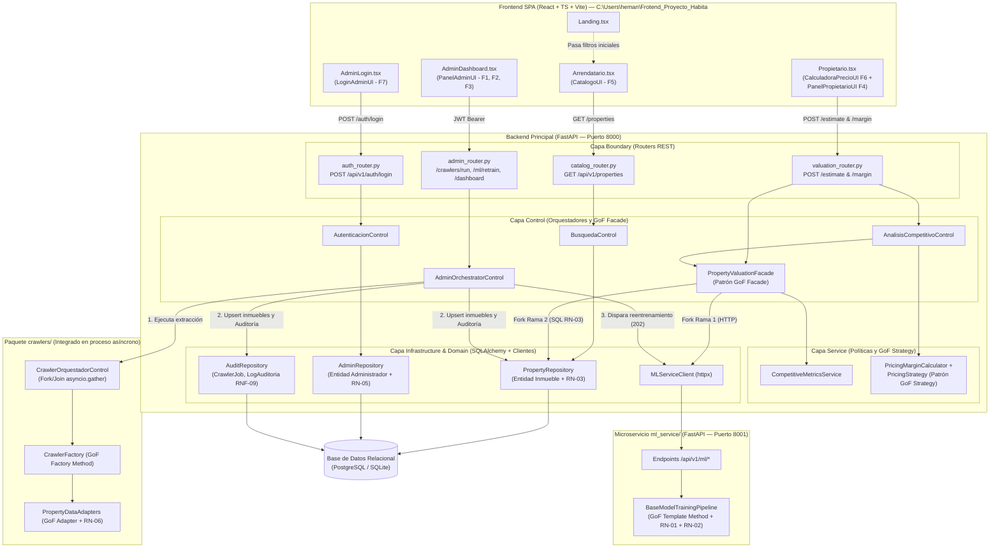
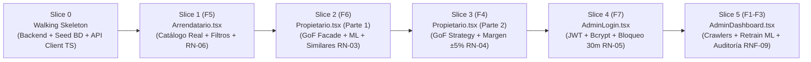

# Guía de Contexto y Arquitectura para el Desarrollo Vertical (End-to-End) — Proyecto Habita

> [!IMPORTANT]
> **Instrucción para el Asistente de IA en el Nuevo Chat:**  
> Este documento contiene el estado actual verificado del ecosistema **Habita**:
> 1. **Microservicio de Machine Learning (`C:\Users\heman\Proyecto_Habita\ml_service\`)** — 100% funcional.
> 2. **Paquete Modular de Crawlers (`C:\Users\heman\Proyecto_Habita\crawlers\`)** — 100% funcional.
> 3. **Prototipo Funcional del Frontend (`C:\Users\heman\Frotend_Proyecto_Habita\`)** — Construido en React 19 + TypeScript + Vite + Tailwind CSS v4, actualmente con datos y estados *hardcodeados* (simulados en memoria).
> 4. **API Backend Principal (`C:\Users\heman\Proyecto_Habita\backend\`)** — Por construir e integrar verticalmente.
>
> **Regla de Oro de Trabajo:** **NO** trabajaremos capa por capa horizontalmente. Trabajaremos **de manera vertical (*Vertical Slicing End-to-End*)**, tomando funcionalidad por funcionalidad desde la vista existente en el Frontend (`.tsx`), conectándola con su Endpoint, Controlador, Servicio/Patrón GoF, Repositorio y Base de Datos en el Backend, y reemplazando las variables *hardcodeadas* del Frontend por llamadas reales a la API.

---

## 1. Entorno de Trabajo y Rutas del Ecosistema

* **Ruta raíz del proyecto Backend / ML / Crawlers:** `C:\Users\heman\Proyecto_Habita`
* **Ruta actual del Frontend (Prototipo React + TS + Vite):** `C:\Users\heman\Frotend_Proyecto_Habita` *(En el Slice 0 se recomienda moverlo o enlazarlo dentro de `C:\Users\heman\Proyecto_Habita\frontend` para unificar el repositorio).*
* **Entorno virtual Python activo:** `C:\Users\heman\Proyecto_Habita\.venv`
  * *Nota técnica crítica sobre Windows:* El entorno `.venv` fue creado con `--system-site-packages` para evitar bloqueos de *Windows Smart App Control* sobre los binarios compilados de `scipy`/`scikit-learn`. **No recrear el `.venv` desde cero**; para instalar nuevas librerías del Backend (como `sqlalchemy`, `python-jose[cryptography]`, `passlib[bcrypt]` o `bcrypt`, `psycopg2-binary`), instalarlas directamente con `.\.venv\Scripts\pip.exe install <paquete>` y registrarlas en `C:\Users\heman\Proyecto_Habita\requirements.txt`.
* **Documentación arquitectónica de referencia en `C:\Users\heman\Proyecto_Habita\Readme\`:**
  1. [`Documentacion_Modelo_C4.md`](file:///C:/Users/heman/Proyecto_Habita/Readme/Documentacion_Modelo_C4.md): Niveles 1 a 4 (Contexto, Contenedores, Componentes y Diagrama de Clases con estereotipos **BCE + Service**: `<<boundary>>`, `<<control>>`, `<<service>>`, `<<entity>>`).
  2. [`analisis_patrones_gof.md`](file:///C:/Users/heman/Proyecto_Habita/Readme/analisis_patrones_gof.md): Fichas técnicas de los **5 patrones GoF** aprobados para el MVP (*Factory Method*, *Adapter*, *Facade*, *Template Method*, *Strategy*).
  3. [`analisis_principios_solid.md`](file:///C:/Users/heman/Proyecto_Habita/Readme/analisis_principios_solid.md): Aplicación de `SRP`, `OCP`, `LSP`, `ISP` y `DIP`.
  4. [`diagramas_actividades_mvp.md`](file:///C:/Users/heman/Proyecto_Habita/Readme/diagramas_actividades_mvp.md): Flujos y piscinas (*swimlanes*) con barras `Fork/Join` para las 7 funcionalidades del MVP (`F1` a `F7`).
  5. [`Arquitectura_Microservicio_ML.md`](file:///C:/Users/heman/Proyecto_Habita/Readme/Arquitectura_Microservicio_ML.md): Especificación interna del microservicio `ml_service/`.
  6. [`Arquitectura_Modulo_Crawlers.md`](file:///C:/Users/heman/Proyecto_Habita/Readme/Arquitectura_Modulo_Crawlers.md): Especificación interna del paquete `crawlers/`.

---

## 2. Estado de los Módulos Existentes (ML Service, Crawlers y Frontend Prototipo)

### 2.1. Microservicio de Machine Learning (`C:\Users\heman\Proyecto_Habita\ml_service\`) — **LISTO**
Microservicio FastAPI independiente (*CPU-bound*) estructurado en 5 capas (`domain/`, `infrastructure/`, `services/`, `controls/`, `boundary/`, `main.py`).
* **Patrón GoF implementado:** **Template Method** en [`BaseModelTrainingPipeline`](file:///C:/Users/heman/Proyecto_Habita/ml_service/controls/training_pipeline_control.py) con dos subclases especializadas por régimen de mercado: `PobladoTrainingPipeline` (*El Poblado*) y `OtrasComunasTrainingPipeline` (*Otras 15 Comunas*).
* **Reglas de negocio garantizadas internamente:**
  * **`RN-01` y `RNF-02`:** Compuerta de calidad estricta **`MAPE <= 16%` (`0.16`)**. Actualmente entrena con **MAPE El Poblado = 13.04%** y **MAPE Otras Comunas = 11.99%**.
  * **`RN-02`:** Prohibición de fuga de datos (*Data Leakage*). El `ColumnTransformer` (`TargetEncoder`, `RobustScaler`, `OneHotEncoder`, `SimpleImputer`) y el `TransformedTargetRegressor` (`log1p`/`expm1`) se ajustan exclusivamente sobre el 80% de entrenamiento.
  * **`RNF-08`:** Reentrenamiento en segundo plano (`BackgroundTasks`) protegido con `threading.Lock`, precarga en RAM mediante `lifespan` y escritura atómica de artefactos (`.tmp` $\rightarrow$ `os.replace` + respaldo `.prev.joblib` de 64.29 MB).
* **Endpoints expuestos por `ml_service` (Puerto sugerido: `8001`):**
  * `GET /api/v1/ml/health`: Estado del modelo en memoria y métricas MAPE vigentes (`mape_poblado`, `mape_comunas`).
  * `POST /api/v1/ml/predict`: Predicción individual en $< 50\text{ ms}$ (recibe `InmuebleInputSchema`, devuelve `PrediccionOutputSchema`).
  * `POST /api/v1/ml/predict/batch`: Predicción vectorizada por lotes (100 inmuebles en $\sim 107\text{ ms}$).
  * `POST /api/v1/ml/retrain`: Dispara reentrenamiento asíncrono (`202 Accepted`).
  * `POST /api/v1/ml/retrain/sync`: Dispara reentrenamiento síncrono esperando métricas finales.

---

### 2.2. Paquete Modular de Ingesta Asíncrona (`C:\Users\heman\Proyecto_Habita\crawlers\`) — **LISTO**
Paquete Python asíncrono (*100% I/O-bound* con `httpx` + `asyncio`) diseñado para ser invocado directamente desde el Backend:
* **Patrones GoF implementados:**
  1. **Factory Method (`RNF-07`):** [`CrawlerFactory`](file:///C:/Users/heman/Proyecto_Habita/crawlers/factory.py) instancia dinámicamente `metrocuadrado`, `fincaraiz` y `ciencuadras` sin condicionales `if/elif`.
  2. **Adapter (`RF-01`, `RN-06`):** [`PropertyDataAdapter`](file:///C:/Users/heman/Proyecto_Habita/crawlers/adapters/base_adapter.py) y sus 3 adaptadores concretos traducen los JSON nativos heterogéneos al esquema canónico Pydantic [`PropertyCreate`](file:///C:/Users/heman/Proyecto_Habita/crawlers/schemas.py), descartando automáticamente cualquier inmueble sin `url_origen` válida (**`RN-06`**) y normalizando las semillas `"laureles"` y `"estadio"` a la Comuna 11 `"laureles estadio"`.
* **Orquestación Concurrente (`Fork/Join`):**
  * [`CrawlerOrquestadorControl.ejecutar_extraccion()`](file:///C:/Users/heman/Proyecto_Habita/crawlers/orchestrator_control.py) lanza los 3 portales en paralelo con `asyncio.gather`, deduplica en memoria por `url_origen` y retorna un [`OrchestrationSummary`](file:///C:/Users/heman/Proyecto_Habita/crawlers/schemas.py) con `items: list[PropertyCreate]` y `portal_reports: list[PortalCrawlReport]`.

---

### 2.3. Diagnóstico Detallado del Frontend Actual (`C:\Users\heman\Frotend_Proyecto_Habita\`) — **PROTOTIPO CON VARIABLES HARDCODEADAS**

El Frontend está desarrollado con **React 19 + TypeScript 5.7 + Vite 8 + Tailwind CSS v4**. La navegación se gestiona en [`src/App.tsx`](file:///C:/Users/heman/Frotend_Proyecto_Habita/src/App.tsx) mediante el estado `page: Page` (`'landing' | 'arrendatario' | 'propietario' | 'admin-login' | 'admin-dashboard'`).

A continuación se detalla qué tiene actualmente cada archivo del Frontend, qué variables están *hardcodeadas* y qué ajustes exactos requiere al conectarse con el Backend en cada *Slice Vertical*:

| Archivo en `Frotend_Proyecto_Habita/src/` | Estereotipo C4 Nivel 4 | Variables / Lógica Hardcodeada Actualmente | Ajustes Requeridos al Conectar con el Backend (End-to-End) |
| :--- | :--- | :--- | :--- |
| **[`types.ts`](file:///C:/Users/heman/Frotend_Proyecto_Habita/src/types.ts)** | Contrato TS | Define `Property` con `imageId` (Unsplash) y `address`, pero **le falta `url_origen`, `imagen_url`, `comuna` y `barrio`**. | Actualizar la interfaz `Property` para incluir `url_origen: string` (**`RN-06`**), `imagen_url: string \| null`, `comuna: string`, `barrio?: string`, y agregar los tipos de respuesta de estimación, estrategias de margen y dashboard. |
| **[`pages/Landing.tsx`](file:///C:/Users/heman/Frotend_Proyecto_Habita/src/pages/Landing.tsx)** | Landing / Inicio | • En `stats` (L8) dice *"Finca Raíz, Metrocuadrado y Vivareal"*.<br/>• Los inputs `sector` y `tipo` del Hero navegan a `'arrendatario'` sin pasar los filtros seleccionados. | • Cambiar *"Vivareal"* por **"CienCuadras"**.<br/>• Permitir que al buscar desde el Hero de `Landing.tsx` se pasen los filtros iniciales (`comuna`, `tipo`) hacia `Arrendatario.tsx`. |
| **[`pages/Arrendatario.tsx`](file:///C:/Users/heman/Frotend_Proyecto_Habita/src/pages/Arrendatario.tsx)** | `CatalogoUI` (`F5`) | • `ALL_PROPERTIES` (L4-61): Array quemado de 8 inmuebles (incluye municipios fuera de Medellín como `Envigado` y `Sabaneta`, y el portal `Vivareal`).<br/>• Imágenes quemadas de Unsplash (`imageId`).<br/>• Botón *"Ir a la oferta original"* (L352) hace `window.open('#', '_blank')`. | • Consumir `GET /api/v1/properties` desde el Backend con filtros reactivos (`comuna`, `tipo_inmueble`, `ordenar_por`) sin recargar la página (**`RNF-06`**).<br/>• Mostrar `prop.imagen_url` real extraída del portal (con imagen *fallback* elegante si viene nula).<br/>• Hacer que *"Ir a la oferta original"* abra `window.open(selected.url_origen, '_blank', 'noopener,noreferrer')` (**`RF-12`**, **`RN-06`**). |
| **[`pages/Propietario.tsx`](file:///C:/Users/heman/Frotend_Proyecto_Habita/src/pages/Propietario.tsx)** | `CalculadoraPrecioUI` (`F6`) + `PanelPropietarioUI` (`F4`) | • Unifica **F6** y **F4** en una sola vista de 2 pasos.<br/>• `NEIGHBORHOODS` (L4-22): Tiene `'Laureles'` y `'Estadio'` separados.<br/>• `BASE_PRICE_M2`, `estimatePrice()` y `COMPETITORS` (L24-127): Diccionarios y fórmula falsa en JS con `setTimeout(..., 2200)`.<br/>• En L344 muestra `(RMSE actual: 9.3%)` en vez de **MAPE**.<br/>• El rango sugerido solo muestra `-5%` y `+5%` fijos sin selector de estrategia (**Patrón Strategy**). | • Enviar el formulario a `POST /api/v1/properties/estimate` (**Patrón Facade** en Backend) y `POST /api/v1/properties/margin` (**Patrón Strategy** en Backend).<br/>• Unificar `'Laureles'` y `'Estadio'` como `'Laureles - Estadio'` (16 comunas oficiales) y permitir ingresar opcionalmente `barrio`.<br/>• Reemplazar la etiqueta `RMSE` por **`MAPE`** (**`RN-01`** $\le 16\%$).<br/>• Agregar en la tarjeta de *"Rango sugerido de publicación"* el selector interactivo de las 3 estrategias del **Patrón Strategy** (*Liquidez Rápida -5%*, *Balanceada de Mercado*, *Máxima Rentabilidad +5%*). |
| **[`pages/AdminLogin.tsx`](file:///C:/Users/heman/Frotend_Proyecto_Habita/src/pages/AdminLogin.tsx)** | `LoginAdminUI` (`F7`) | • Credenciales quemadas en el cliente: `VALID_USER = 'admin'`, `VALID_PASS = 'habita2024'` (L4-5).<br/>• Contador de intentos (`attempts`) y bloqueo (`locked`) en un `useState` local que se pierde al recargar la página. | • Conectar a `POST /api/v1/auth/login` en el Backend.<br/>• Almacenar el token JWT real en `sessionStorage`/`localStorage`.<br/>• Manejar las respuestas `HTTP 401` (intentos restantes) y `HTTP 423 Locked` (bloqueo real de **30 minutos** persistido en BD tras 3 intentos fallidos según **`RN-05`** y **`RNF-01`**). |
| **[`pages/AdminDashboard.tsx`](file:///C:/Users/heman/Frotend_Proyecto_Habita/src/pages/AdminDashboard.tsx)** | `PanelAdminUI` (`F1`, `F2`, `F3`) | • `RMSE_DATA`, `SCRAPE_DATA`, `PORTALS` (con `Vivareal`), `PIPELINE_STEPS`, `AUDIT_LOGS` quemados en constantes (L6-38).<br/>• `runCrawler()` y `runRetraining()` solo usan `setTimeout()` visuales.<br/>• Toda la interfaz nombra la métrica como `RMSE` en lugar de **`MAPE`**. | • Cambiar todas las etiquetas `RMSE` por **`MAPE`** (mostrando `MAPE El Poblado` y `MAPE Otras Comunas` frente al umbral del `16%` — **`RN-01`**).<br/>• Cambiar `Vivareal` por **`CienCuadras` (`ciencuadras.com`)**.<br/>• Conectar *"Ejecutar"* / *"Ejecutar todos"* a `POST /api/v1/admin/crawlers/run` y *"Iniciar reentrenamiento"* a `POST /api/v1/admin/ml/retrain`, poblando las tarjetas y la tabla de auditoría (**`RNF-09`**) desde `GET /api/v1/admin/dashboard`. |

---

## 3. Estructura Global de Carpetas del Proyecto (`Proyecto_Habita/`)

Para mantener total coherencia arquitectónica entre el Modelo C4 (Nivel 4 BCE + Service), los principios SOLID y los módulos ya construidos, el repositorio debe organizarse así:

```text
C:\Users\heman\Proyecto_Habita\
├── .venv/                                      # Entorno virtual compartido (NO borrar)
├── requirements.txt                            # Dependencias de Python
├── Readme/                                     # Documentación C4, SOLID, GoF, Diagramas y Guías
│
├── ml_service/                                 # [CONTENEDOR 1 - LISTO] Microservicio de Machine Learning (Puerto 8001)
│   ├── artifacts/                              # modelos_habita.joblib (64.29 MB)
│   ├── boundary/                               # Endpoints REST de ML (/api/v1/ml/*)
│   ├── controls/                               # PreprocesamientoControl y ReentrenamientoControl (Template Method)
│   ├── domain/                                 # Interfaces ABC, Schemas Pydantic y Config
│   ├── infrastructure/                         # Repositorios CSV, GeoJSON/SITVA y Joblib atómico
│   ├── services/                               # ModeloPredictivoService (Inferencia en RAM)
│   └── main.py                                 # Entrypoint FastAPI del servicio ML
│
├── crawlers/                                   # [MÓDULO DE INGESTA - LISTO] Paquete asíncrono consumido por Backend
│   ├── adapters/                               # [GoF Adapter] MetrocuadradoAdapter, FincaraizAdapter, CiencuadrasAdapter
│   ├── spiders/                                # Spiders HTTP asíncronos + cache/fincaraiz_locations.json
│   ├── base.py                                 # Producto abstracto AsyncCrawler
│   ├── constants.py                            # Semillas y mapeo ligero de comunas
│   ├── factory.py                              # [GoF Factory Method] CrawlerFactory
│   ├── orchestrator_control.py                 # CrawlerOrquestadorControl (Fork/Join + deduplicación)
│   ├── schemas.py                              # DTO PropertyCreate (RN-06) y OrchestrationSummary
│   └── run.py                                  # Runner CLI de diagnóstico
│
├── backend/                                    # [CONTENEDOR 2 - POR CONSTRUIR VERTICALMENTE] API de Negocio (Puerto 8000)
│   ├── app/
│   │   ├── __init__.py
│   │   ├── domain/                             # Capa 1: <<entity>> Modelos de Dominio, Entidades ORM y Contratos
│   │   │   ├── __init__.py
│   │   │   ├── config.py                       # Variables de entorno (DB_URL, ML_SERVICE_URL, JWT_SECRET, etc.)
│   │   │   ├── entities/                       # Entidades SQLAlchemy con métodos de dominio
│   │   │   │   ├── __init__.py
│   │   │   │   ├── property_entity.py          # Entidad Inmueble + método es_comparable_con() (RN-03)
│   │   │   │   ├── admin_entity.py             # Entidad Administrador + esta_bloqueado() / registrar_intento() (RN-05)
│   │   │   │   ├── portal_entity.py            # Entidad Portal (RNF-07)
│   │   │   │   ├── crawler_job_entity.py       # Entidad CrawlerJob
│   │   │   │   ├── model_version_entity.py     # Entidad ModeloPrediccion (historial MAPE y en_produccion)
│   │   │   │   └── audit_log_entity.py         # Entidad LogAuditoria (RNF-09)
│   │   │   ├── interfaces/                     # Contratos abstractos (SOLID DIP / ISP)
│   │   │   │   ├── __init__.py
│   │   │   │   ├── repositories.py             # IPropertyRepository, IAdminRepository, IAuditRepository
│   │   │   │   └── ml_client.py                # IMLServiceClient
│   │   │   └── schemas/                        # DTOs Pydantic de Entrada/Salida por funcionalidad
│   │   │       ├── __init__.py
│   │   │       ├── property_schemas.py         # Filtros de catálogo, RangoPublicacion, MetricasCompetitivas
│   │   │       ├── valuation_schemas.py        # Solicitud/Respuesta de estimación y margen sugerido
│   │   │       ├── auth_schemas.py             # LoginRequest, TokenResponse, BloqueoError
│   │   │       └── admin_schemas.py            # Estado de jobs, métricas de dashboard y auditoría
│   │   │
│   │   ├── infrastructure/                     # Capa 2: Implementación de Base de Datos y Clientes Externos
│   │   │   ├── __init__.py
│   │   │   ├── database.py                     # Engine SQLAlchemy, SessionLocal, Base declarativa y seed inicial
│   │   │   ├── security.py                     # Hashing Bcrypt y codificación/decodificación JWT
│   │   │   ├── ml_service_client.py            # Cliente HTTP asíncrono (httpx) hacia ml_service (puerto 8001)
│   │   │   └── repositories/                   # Implementaciones concretas SQLAlchemy
│   │   │       ├── __init__.py
│   │   │       ├── property_repository.py      # Consultas indexadas (<= 2s RNF-04), filtro RN-03 y Upsert masivo
│   │   │       ├── admin_repository.py         # Persistencia de Administrador y conteo de fallos (RN-05)
│   │   │       └── audit_repository.py         # Persistencia de CrawlerJob, ModeloPrediccion y LogAuditoria (RNF-09)
│   │   │
│   │   ├── services/                           # Capa 3: <<service>> Servicios de Dominio y Estrategias Comerciales
│   │   │   ├── __init__.py
│   │   │   ├── competitive_metrics_service.py  # Cálculo de precio mínimo, promedio y máximo del sector (RF-05)
│   │   │   └── pricing_strategies.py           # [GoF Strategy] PricingStrategy, Liquidity (-5%), Profitability (+5%),
│   │   │                                       #                MarketBalanced y PricingMarginCalculator (RN-04, RF-06)
│   │   │
│   │   ├── controls/                           # Capa 4: <<control>> Orquestadores de Casos de Uso y Fachada
│   │   │   ├── __init__.py
│   │   │   ├── busqueda_control.py             # BusquedaControl: filtros de catálogo e indicador de Mejor Oferta
│   │   │   ├── valuation_facade_control.py     # [GoF Facade] PropertyValuationFacade / EstimacionControl:
│   │   │   │                                   #              Fork/Join entre MLServiceClient y búsqueda SQL RN-03 (<= 3s RNF-05)
│   │   │   ├── analisis_competitivo_control.py # AnalisisCompetitivoControl: coordina Facade + PricingStrategy (F4)
│   │   │   ├── autenticacion_control.py        # AutenticacionControl: login, validación Bcrypt y bloqueo 30 min (RN-05)
│   │   │   └── admin_orchestrator_control.py   # Orquesta CrawlerOrquestadorControl + persistencia BD + reentrenamiento ML
│   │   │
│   │   └── boundary/                           # Capa 5: <<boundary>> Routers FastAPI y Dependencias HTTP
│   │       ├── __init__.py
│   │       ├── dependencies.py                 # Inyección de dependencias (get_db, get_current_admin, etc.)
│   │       └── routers/
│   │           ├── __init__.py
│   │           ├── catalog_router.py           # GET /api/v1/properties (F5)
│   │           ├── valuation_router.py         # POST /api/v1/properties/estimate (F6) y POST /api/v1/properties/margin (F4)
│   │           ├── auth_router.py              # POST /api/v1/auth/login (F7)
│   │           └── admin_router.py             # POST /api/v1/admin/crawlers/run (F1), POST /api/v1/admin/ml/retrain (F2/F3)
│   └── main.py                                 # Entrypoint FastAPI del Backend Principal (CORS, Routers, Lifespan)
│
└── frontend/ (actualmente en C:\Users\heman\Frotend_Proyecto_Habita)
    ├── src/
    │   ├── api/                                # [NUEVO] Clientes HTTP tipados (apiClient.ts) hacia http://localhost:8000/api/v1
    │   ├── types.ts                            # Interfaces TypeScript sincronizadas con los Schemas Pydantic del Backend
    │   ├── App.tsx                             # Router de vistas SPA
    │   └── pages/                              # <<boundary>> Vistas existentes que se conectarán en cada Slice:
    │       ├── Landing.tsx                     # Inicio y buscador rápido
    │       ├── Arrendatario.tsx                # CatalogoUI (F5 - HU-01)
    │       ├── Propietario.tsx                 # CalculadoraPrecioUI (F6 - HU-02) + PanelPropietarioUI (F4 - HU-08)
    │       ├── AdminLogin.tsx                  # LoginAdminUI (F7 - HU-06)
    │       └── AdminDashboard.tsx              # PanelAdminUI (F1, F2, F3 - HU-03, HU-04, HU-05)
    └── package.json
```

---

## 4. Diagrama de Integración End-to-End (Frontend $\leftrightarrow$ Backend $\leftrightarrow$ Crawlers & ML)



---

## 5. Mapa de los 5 Patrones GoF y Reglas de Negocio a Respetar

### 5.1. Estado de los 5 Patrones GoF del MVP (Restricción: Exactamente 5, sin repetir)

| # | Patrón GoF | Categoría | Ubicación en el Proyecto | Estado Actual |
| :-: | :--- | :--- | :--- | :---: |
| **1** | **Factory Method** | Creacional | [`crawlers/factory.py`](file:///C:/Users/heman/Proyecto_Habita/crawlers/factory.py) (`CrawlerFactory`) | **Completado** |
| **2** | **Adapter** | Estructural | [`crawlers/adapters/`](file:///C:/Users/heman/Proyecto_Habita/crawlers/adapters) (`PropertyDataAdapter`) | **Completado** |
| **3** | **Template Method** | Comportamiento | [`ml_service/controls/training_pipeline_control.py`](file:///C:/Users/heman/Proyecto_Habita/ml_service/controls/training_pipeline_control.py) (`BaseModelTrainingPipeline`) | **Completado** |
| **4** | **Facade** | Estructural | `backend/app/controls/valuation_facade_control.py` (`PropertyValuationFacade`) | **Por construir en Slice 2 (F6)** |
| **5** | **Strategy** | Comportamiento | `backend/app/services/pricing_strategies.py` (`PricingStrategy` + 3 estrategias) | **Por construir en Slice 3 (F4)** |

### 5.2. Checklist de Reglas de Negocio (`RN`) y Requisitos No Funcionales (`RNF`)

* **`RN-01` / `RNF-02` (Umbral de Calidad ML):** Un modelo reentrenado solo pasa a producción si **`MAPE <= 16%` (`0.16`)** en ambos regímenes (*El Poblado* y *Otras Comunas*). *(En `Propietario.tsx` y `AdminDashboard.tsx` debe mostrarse como **MAPE** y no como RMSE)*.
* **`RN-02` (Prohibición de Fuga de Datos):** División estricta 80/20 y ajuste de transformadores exclusivamente sobre entrenamiento. *(Ya implementado en `ml_service`)*.
* **`RN-03` (4 Criterios Estrictos de Comparabilidad de Inmuebles):** Dos inmuebles son comparables/competidores sí y solo si comparten:
  1. Misma **`comuna`**
  2. Mismo **`estrato`**
  3. Mismo **`tipo_inmueble`**
  4. Variación de **`area`** dentro de **$\pm 15\%$** ($\text{area\_base} \times 0.85 \le \text{area\_comp} \le \text{area\_base} \times 1.15$).
* **`RN-04` (Banda Comercial de Publicación):** Rango sugerido entre **$-5\%$** (liquidez rápida) y **$+5\%$** (máxima rentabilidad) sobre la estimación base de ML, modulado contra el piso y techo de los competidores del sector.
* **`RN-05` / `RNF-01` (Seguridad y Bloqueo por Fuerza Bruta):** Acceso administrativo exclusivo con JWT. Al acumular **3 intentos fallidos consecutivos de inicio de sesión**, la cuenta del administrador se bloquea temporalmente durante **30 minutos** en el Backend.
* **`RN-06` (Trazabilidad de Fuente Original):** Ningún inmueble sin `url_origen` válida puede ingresar al catálogo consolidado.
* **`RNF-04` y `RNF-05` (Tiempos de Respuesta):** Consultas de catálogo en **$\le 2\text{ segundos}$** (`RNF-04`) y estimación de precio + similares en **$\le 3\text{ segundos}$** (`RNF-05`, usando `asyncio.gather` dentro de `PropertyValuationFacade`).
* **`RNF-06` (Interfaz Dinámica SPA):** El filtrado en `Arrendatario.tsx` y el análisis en `Propietario.tsx` operan mediante llamadas `fetch` asíncronas sin recargar la página completa.
* **`RNF-09` (Auditoría Inmutable):** Toda ejecución de crawlers o reentrenamiento registra un evento en `LogAuditoria` (`audit_logs`) y `CrawlerJob` (`crawler_jobs`) que alimenta en vivo la tabla de `AdminDashboard.tsx`.

---

## 6. Plan de Ejecución por Cortes Verticales (*Vertical Slicing End-to-End*)

Cada *Slice Vertical* entrega una funcionalidad completa conectando la vista existente en React (`.tsx`) con su endpoint en FastAPI, sus clases BCE + GoF y la base de datos:



---

### 🔹 Slice Vertical 0: *Walking Skeleton* + Semilla de Datos Reales + Cliente API en Frontend
* **Objetivo:** Levantar el servidor `backend/` (puerto `8000`), poblar la base de datos inicial con los inmuebles reales ya extraídos en `ml_service/data/raw/medellin_arriendo_*.csv` (calculando su `estimated_price` en lote con `ml_service` para que el ordenamiento por *"Mejor oferta"* funcione con datos reales desde el inicio) y configurar el cliente HTTP en el Frontend.
* **Tareas Verticales:**
  1. **Backend (`domain/config.py`, `infrastructure/database.py`, `main.py`):** Configurar FastAPI con CORS habilitado para el puerto de Vite (`http://localhost:5173`), SQLAlchemy y `GET /api/v1/health`.
  2. **Frontend (`src/api/client.ts` y `Landing.tsx`):** Crear el módulo central de llamadas `fetch` hacia `http://localhost:8000/api/v1`, cambiar `"Vivareal"` por `"CienCuadras"` en `Landing.tsx` y pasar los filtros del buscador inicial hacia `Arrendatario.tsx`.

---

### 🔹 Slice Vertical 1: Catálogo Consolidado para el Arrendatario (`F5` — `Arrendatario.tsx`)
* **Requisitos:** `RF-01`, `RF-12`, `RN-06`, `RNF-04` ($\le 2\text{s}$), `RNF-06`.
* **Tareas Verticales:**
  1. **Backend Domain & Infra:** Crear `property_entity.py` (`Inmueble` con `id`, `portal`, `title`, `tipo_inmueble`, `area`, `estrato`, `comuna`, `barrio`, `habitaciones`, `banos`, `parqueaderos`, `precio_publicado`, `precio_estimado`, `imagen_url`, `url_origen` obligatorio por `RN-06`, `latitud`, `longitud`, `amoblado`, `incluye_administracion`, `valor_administracion`) y `property_repository.py`.
  2. **Backend Control & Boundary:** Crear `busqueda_control.py` (`BusquedaControl`) y `catalog_router.py` (`GET /api/v1/properties` con filtros por `comuna`, `tipo_inmueble`, `ordenar_por` = `mejor-oferta | menor-precio | mayor-area` y paginación rápida $\le 2\text{s}$).
  3. **Frontend (`src/types.ts` y `src/pages/Arrendatario.tsx`):**
     * Eliminar la constante `ALL_PROPERTIES` quemada.
     * Cargar los inmuebles reales desde `GET /api/v1/properties` al montar la vista o cambiar filtros (`useEffect`).
     * Renderizar `prop.imagen_url` real del portal (con imagen por defecto si es `null`).
     * Conectar el botón *"Ir a la oferta original"* del modal de detalle a `window.open(selected.url_origen, '_blank', 'noopener,noreferrer')` (**`RF-12`**, **`RN-06`**).

---

### 🔹 Slice Vertical 2: Estimación de Precio y Competidores Similares (`F6` — `Propietario.tsx` Parte 1)
* **Requisitos:** `RF-03`, `RF-04`, `RF-05`, `RN-03`, `RNF-05` ($\le 3\text{s}$).
* **Patrón GoF a implementar:** **Facade (`PropertyValuationFacade`)**.
* **Tareas Verticales:**
  1. **Backend Domain & Infra:** Implementar `Inmueble.es_comparable_con()` y la consulta `PropertyRepository.buscar_similares_rn03()` aplicando los **4 criterios estrictos de `RN-03`** (misma `comuna`, mismo `estrato`, mismo `tipo_inmueble`, y `area` dentro de $\pm 15\%$). Implementar `MLServiceClient.predecir_precio()` hacia `http://127.0.0.1:8001/api/v1/ml/predict`.
  2. **Backend Service & Control (GoF *Facade*):** Crear `CompetitiveMetricsService` (`precio_minimo`, `precio_promedio`, `precio_maximo` — `RF-05`) y `PropertyValuationFacade` (`valuation_facade_control.py`), ejecutando en paralelo con `asyncio.gather` (**Fork/Join del Diagrama F6**) la inferencia en `ml_service` y la búsqueda SQL `RN-03` en $\le 3\text{s}$ (`RNF-05`).
  3. **Backend Boundary:** Exponer `POST /api/v1/properties/estimate` en `valuation_router.py`.
  4. **Frontend (`src/pages/Propietario.tsx`):**
     * Eliminar `BASE_PRICE_M2`, `estimatePrice()`, `COMPETITORS` y el `setTimeout` simulado.
     * Unificar la lista de las 16 comunas oficiales de Medellín (unificando `'Laureles - Estadio'`).
     * Conectar `handleSubmit` a `POST /api/v1/properties/estimate`, mostrando el precio estimado real del modelo de IA, los competidores reales de la base de datos bajo `RN-03`, el contexto de mercado (`Mínimo`, `Promedio`, `Máximo`) y corrigiendo el texto `RMSE` por **`MAPE`** (`< 16%`).

---

### 🔹 Slice Vertical 3: Margen Sugerido y Estrategias Comerciales (`F4` — `Propietario.tsx` Parte 2)
* **Requisitos:** `RF-06`, `RF-05`, `RN-04` ($-5\% / +5\%$).
* **Patrón GoF a implementar:** **Strategy (`PricingStrategy`)**.
* **Tareas Verticales:**
  1. **Backend Service (GoF *Strategy*):** Crear `pricing_strategies.py` con `PricingStrategy(ABC)`, `LiquidityPricingStrategy` ($-5\%$ acotado por piso de mercado), `ProfitabilityPricingStrategy` ($+5\%$ acotado por techo de mercado), `MarketBalancedPricingStrategy` ($60\%$ IA + $40\%$ promedio de competidores) y `PricingMarginCalculator`.
  2. **Backend Control & Boundary:** Crear `AnalisisCompetitivoControl` (`analisis_competitivo_control.py`) y exponer `POST /api/v1/properties/margin` (o incluir las 3 estrategias pre-calculadas en la respuesta integral para cambio instantáneo en la UI).
  3. **Frontend (`src/pages/Propietario.tsx`):**
     * En la tarjeta inferior *"Recomendación de IA — Rango sugerido de publicación"*, reemplazar el cálculo fijo `result.estimated * 0.95` / `1.05` por los datos devueltos por el Backend y añadir los botones/pestañas para que el propietario alterne entre las 3 estrategias comerciales (*Liquidez Rápida*, *Balanceada de Mercado*, *Máxima Rentabilidad*).

---

### 🔹 Slice Vertical 4: Autenticación de Administrador y Bloqueo por 30 Minutos (`F7` — `AdminLogin.tsx`)
* **Requisitos:** `RF-07`, `RNF-01`, `RN-05`.
* **Tareas Verticales:**
  1. **Backend Domain & Infra:** Crear `admin_entity.py` (`Administrador` con `username`, `password_hash`, `intentos_fallidos`, `bloqueado_hasta` y métodos `esta_bloqueado()`, `registrar_fallo_rn05()`, `resetear_intentos()`), `security.py` (Bcrypt + emisión/validación JWT) y `admin_repository.py` (creando el usuario admin inicial con contraseña hasheada en el seed).
  2. **Backend Control & Boundary:** Crear `AutenticacionControl` (`autenticacion_control.py` aplicando el flujo exacto del Diagrama F7 y registrando el evento de seguridad en `LogAuditoria`), `POST /api/v1/auth/login` en `auth_router.py` y el guardián `get_current_admin` en `dependencies.py`.
  3. **Frontend (`src/pages/AdminLogin.tsx`):**
     * Eliminar `VALID_USER = 'admin'` y `VALID_PASS = 'habita2024'` del código fuente del cliente.
     * Consumir `POST /api/v1/auth/login`, guardar el JWT recibido y redirigir a `'admin-dashboard'`.
     * Mostrar los intentos restantes reales o la pantalla de bloqueo de **30 minutos** devuelta por el Backend (`HTTP 423 Locked`) cuando se incumple **`RN-05`**.

---

### 🔹 Slice Vertical 5: Orquestación de Crawlers, Reentrenamiento ML y Auditoría (`F1, F2, F3` — `AdminDashboard.tsx`)
* **Requisitos:** `RF-08`, `RF-09`, `RF-10`, `RN-01` ($\text{MAPE} \le 16\%$), `RN-02`, `RNF-03`, `RNF-07`, `RNF-08`, `RNF-09`.
* **Tareas Verticales:**
  1. **Backend Domain & Infra:** Crear `portal_entity.py` (`Portal`), `crawler_job_entity.py` (`CrawlerJob`), `model_version_entity.py` (`ModeloPrediccion`) y `audit_log_entity.py` (`LogAuditoria`) + `audit_repository.py`.
  2. **Backend Control & Boundary:** Crear `AdminOrchestratorControl` (`admin_orchestrator_control.py`) y `admin_router.py` (protegido con JWT):
     * `GET /api/v1/admin/dashboard`: Devuelve total de inmuebles por portal (`Finca Raíz`, `Metrocuadrado`, `CienCuadras`), historial de `MAPE` de `ModeloPrediccion`, extracciones por día de `CrawlerJob` y últimos eventos de `LogAuditoria` (`RNF-09`).
     * `POST /api/v1/admin/crawlers/run`: Invoca `CrawlerOrquestadorControl.ejecutar_extraccion()` del paquete `crawlers/`, realiza *Upsert* en la tabla `properties`, actualiza `CrawlerJob` y registra en `LogAuditoria`.
     * `POST /api/v1/admin/ml/retrain`: Exporta/sincroniza el dataset actualizado y llama a `POST http://127.0.0.1:8001/api/v1/ml/retrain` (o `/retrain/sync`), valida el resultado de la compuerta `MAPE <= 16%` (`RN-01`) y registra la nueva versión en `ModeloPrediccion` y `LogAuditoria`.
  3. **Frontend (`src/pages/AdminDashboard.tsx`):**
     * Reemplazar `RMSE_DATA`, `SCRAPE_DATA`, `PORTALS`, `AUDIT_LOGS` y todas las etiquetas `RMSE` por datos reales de **`MAPE`** provenientes de `GET /api/v1/admin/dashboard`.
     * Cambiar `"Vivareal"` por **`"CienCuadras"` (`ciencuadras.com`)**.
     * Conectar los botones *"Ejecutar"* / *"Ejecutar todos"* a `POST /api/v1/admin/crawlers/run` y el botón *"Iniciar reentrenamiento"* a `POST /api/v1/admin/ml/retrain`, refrescando en tiempo real las métricas y los logs de auditoría.

---

## 7. Prompt Sugerido para Iniciar el Nuevo Chat

Copia y pega el siguiente texto en tu nuevo chat para arrancar inmediatamente:

> *"Hola. Vamos a construir el Backend e integrar End-to-End el Frontend del Proyecto Habita. Lee primero el archivo `C:\Users\heman\Proyecto_Habita\Readme\Contexto_Desarrollo_Vertical_Backend.md` donde está todo el contexto de lo que ya tenemos listo (`ml_service/` en `C:\Users\heman\Proyecto_Habita\ml_service`, `crawlers/` en `C:\Users\heman\Proyecto_Habita\crawlers` y el prototipo del Frontend en `C:\Users\heman\Frotend_Proyecto_Habita`). Trabajaremos estrictamente de manera vertical (Slice por Slice, desde la vista en React hasta el Backend y la base de datos). Comencemos con el Slice Vertical 0 y el Slice Vertical 1."*
