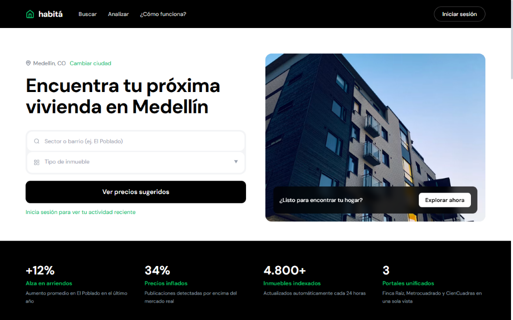
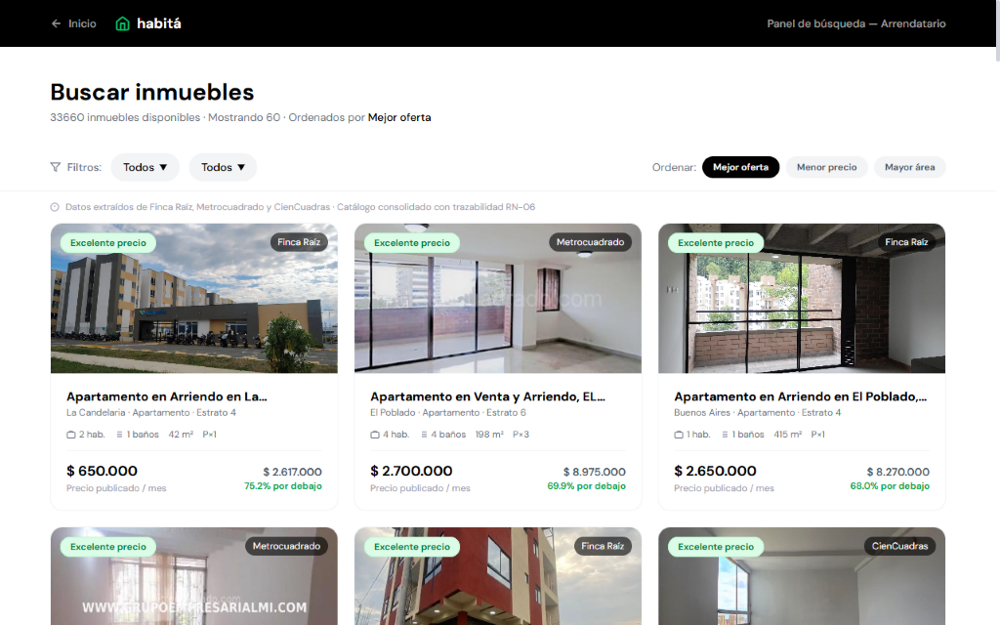
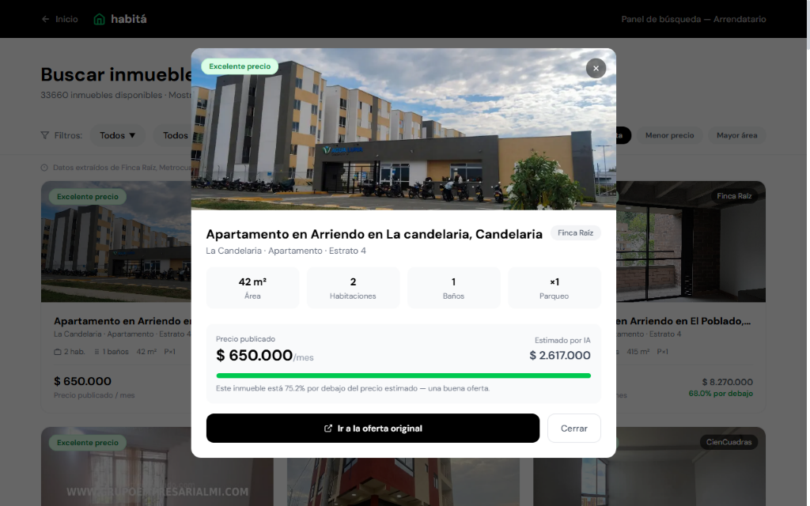
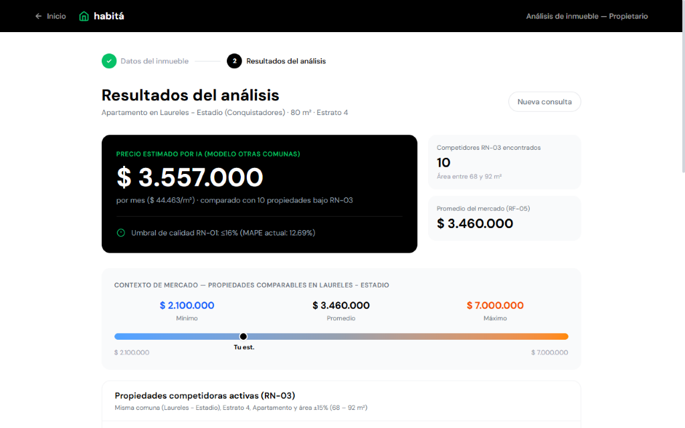
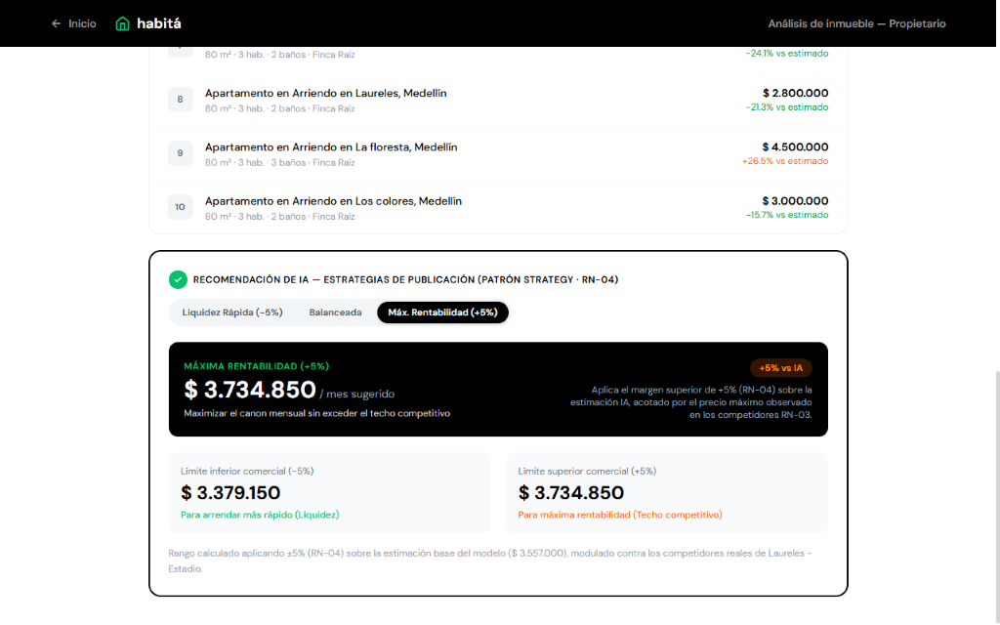
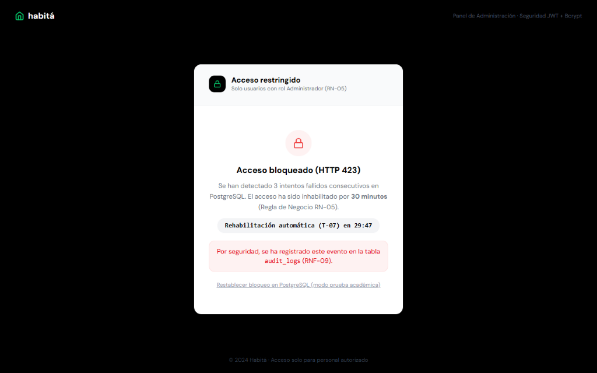
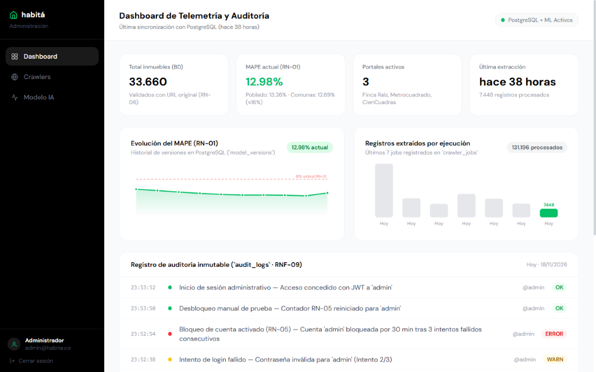
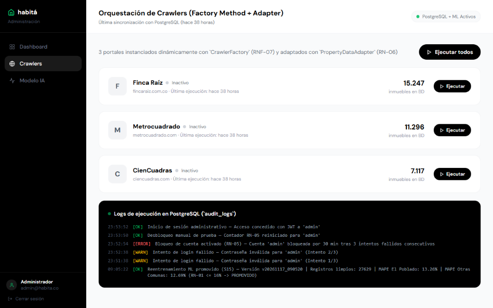
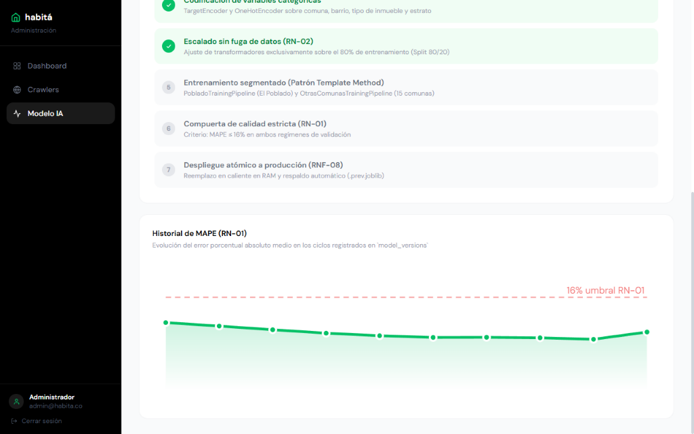

# Documentación Técnica y Evidencias del MVP — Sistema *Habitá* (Medellín)

**Proyecto:** Sistema de Búsqueda y Estimación Inmobiliaria — *Habitá* (Medellín)  
**Estudiante:** Heman Santiago Bermudez Espinosa  
**Docente:** Alexandra Guerrero Bocanegra  
**Asignatura:** Diseño de Sistemas de Información — Instituto Tecnológico Metropolitano (ITM)  

---

## Tabla de Contenido

1. [Descripción de las Funcionalidades Implementadas](#1-descripción-de-las-funcionalidades-implementadas)
2. [Relación con las Historias de Usuario, Épicas y Requisitos](#2-relación-con-las-historias-de-usuario-épicas-y-requisitos)
3. [Capturas de Pantalla de los Principales Procesos](#3-capturas-de-pantalla-de-los-principales-procesos)
4. [Evidencias del Funcionamiento de los Flujos Principales y Alternativos](#4-evidencias-del-funcionamiento-de-los-flujos-principales-y-alternativos)
5. [Descripción de las Validaciones y Excepciones Implementadas](#5-descripción-de-las-validaciones-y-excepciones-implementadas)
6. [Tecnologías Utilizadas](#6-tecnologías-utilizadas)
7. [Instrucciones para Ejecutar el MVP](#7-instrucciones-para-ejecutar-el-mvp)
8. [Referencias a Clases y Componentes con Decisiones de Diseño](#8-referencias-a-clases-y-componentes-con-decisiones-de-diseño)

---

## 1. Descripción de las Funcionalidades Implementadas

El Producto Mínimo Viable (**MVP**) de **Habitá** unifica la oferta de arrendamiento residencial de las **16 comunas oficiales de Medellín** proveniente de tres portales externos (*Finca Raíz*, *Metrocuadrado* y *CienCuadras*) y ofrece tasación objetiva mediante Inteligencia Artificial. A continuación se describen las **7 funcionalidades centrales del MVP (`F1`–`F7`)** y sus capacidades transversales:

* **`F1` — Orquestar extracción de datos:** Motor asíncrono concurrente (*Fork/Join* mediante `asyncio.gather`) que consulta las APIs de *Finca Raíz*, *Metrocuadrado* y *CienCuadras* en las 17 semillas zonales de Medellín (`laureles` y `estadio` unificados como Comuna 11 `Laureles - Estadio`). Normaliza cada anuncio mediante adaptadores dedicados, filtra obligatoriamente por trazabilidad de URL (**`RN-06`**), calcula en lote el canon estimado por IA y renueva transaccionalmente los registros vigentes en PostgreSQL (`habita_db`). Puede ejecutarse manualmente desde el Panel de Administración, desde consola (`python -m crawlers.run`) o automáticamente cada **24 horas** mediante el *scheduler* integrado (**`RNF-03`**).
* **`F2` — Preparar los datos:** Pipeline ETL ejecutado directamente sobre la tabla `properties` de PostgreSQL (`PostgresDatasetRepository`), sin depender de archivos `.csv`. Ejecuta validación **`RN-06`**, geocodificación inversa *Point-in-Polygon* contra el mapa GeoJSON de comunas de Medellín, rescate por *Fuzzy Matching* de pines GPS erróneos, ingeniería de variables espaciales (distancias Haversine al sistema SITVA y polos de valorización), limpieza de atípicos por Rango Intercuartílico (IQR) y aislamiento metodológico 80% entrenamiento / 20% validación antes de ajustar escaladores y codificadores (**`RN-02`**).
* **`F3` — Reentrenar el modelo:** Entrenamiento segmentado de dos ensambles `VotingRegressor` (`XGBRegressor` + `ExtraTreesRegressor` con transformación logarítmica `TransformedTargetRegressor`) especializados en **El Poblado** y **Otras Comunas**. Evalúa el error **`MAPE`** sobre el conjunto de validación (20%) y aplica la compuerta de calidad estricta **`RN-01` ($\text{MAPE} \le 16\%$)** antes de persistir atómicamente el artefacto `.joblib`, recargarlo en memoria RAM y registrar la nueva versión en `model_versions`.
* **`F4` — Obtener margen sugerido:** Evaluador financiero de estrategias comerciales para el propietario sobre la estimación IA y los competidores comparables del sector. Calcula la banda competitiva del **$-5\%$ / $+5\%$ (`RN-04`)** permitiendo alternar dinámicamente entre tres estrategias: **Liquidez Rápida (`-5%`)**, **Balanceada de Mercado (`60% IA + 40% Mercado`)** y **Máxima Rentabilidad (`+5%`)**.
* **`F5` — Consolidar catálogo:** Catálogo web unificado de página única (**SPA**, **`RNF-06`**) para arrendatarios, con filtros reactivos por comuna y tipo de inmueble, ordenamiento en base de datos por **Mejor oferta** (diferencia porcentual frente a la tasación IA), **Menor precio** o **Mayor área**, visualización de fotografías saneadas de los portales y redirección verificada hacia la publicación original (**`RF-12`**, **`RN-06`**).
* **`F6` — Estimar precio de una vivienda:** Calculadora híbrida para propietarios que ejecuta en paralelo (*Fork/Join*) la inferencia del modelo ML activo y la consulta SQL indexada de inmuebles comparables bajo los 4 criterios estrictos de **`RN-03`**, devolviendo el canon estimado, precio por $\text{m}^2$, `MAPE` vigente y métricas descriptivas del sector (mínimo, promedio, máximo — **`RF-05`**).
* **`F7` — Autenticarse y Gobernanza Administrativa (`RF-11`, `RNF-09`):** Inicio de sesión exclusivo para el rol Administrador con contraseñas cifradas con **Bcrypt**, emisión de tokens **JWT (`HS256`)**, bloqueo temporal de **30 minutos tras 3 intentos fallidos consecutivos (`RN-05`)**, desbloqueo automático al expirar la ventana temporal, cierre de sesión auditado y tablero de telemetría en vivo (*Dashboard*, *Crawlers*, *Modelo IA* y tabla inmutable `audit_logs`).

---

## 2. Relación con las Historias de Usuario, Épicas y Requisitos

| Funcionalidad MVP | Épica / Actor | Historia de Usuario | Requisitos Vinculados | Reglas de Negocio | Vista / Endpoint Principal |
| :---: | :--- | :--- | :--- | :---: | :--- |
| **`F5`** | **`RU-01`** *(Arrendatario)* | **`HU-01`:** Consultar catálogo consolidado, ordenar por mejor oferta e ir a la fuente original. | `RF-01`, `RF-02`, `RF-12`, `RNF-04` ($\le 2\text{ s}$), `RNF-06` | **`RN-06`** | `Arrendatario.tsx` $\rightarrow$ `GET /api/v1/properties` |
| **`F6`** | **`RU-02`** *(Propietario)* | **`HU-02`:** Estimar canon mensual por IA y consultar inmuebles competidores similares. | `RF-03`, `RF-04`, `RF-05`, `RNF-05` ($< 3\text{ s}$), `RNF-06` | **`RN-01`**, **`RN-03`**, **`RN-06`** | `Propietario.tsx` $\rightarrow$ `POST /api/v1/properties/estimate` |
| **`F4`** | **`RU-02`** *(Propietario)* | **`HU-08`:** Obtener margen comercial sugerido ($-5\% / +5\%$) y elegir estrategia de publicación. | `RF-05`, `RF-06`, `RNF-06` | **`RN-04`** | `Propietario.tsx` $\rightarrow$ `POST /api/v1/properties/margin` |
| **`F7`** | **`RU-03`** *(Administrador)* | **`HU-06`:** Autenticarse con credenciales exclusivas y protección contra fuerza bruta. | `RF-07`, `RNF-01`, `RNF-09` | **`RN-05`** | `AdminLogin.tsx` $\rightarrow$ `POST /api/v1/auth/login` y `/logout` |
| **`F1`** | **`RU-03`** *(Administrador)* | **`HU-03`:** Accionar crawlers manual o periódicamente con visibilidad de estado y actualización del catálogo. | `RF-08`, `RF-11`, `RNF-03`, `RNF-07`, `RNF-09` | **`RN-06`** | `AdminDashboard.tsx` $\rightarrow$ `POST /api/v1/admin/crawlers/run` |
| **`F2`** | **`RU-03`** *(Administrador)* | **`HU-04`:** Limpiar, codificar y escalar datos sin fuga antes del entrenamiento ML. | `RF-09`, `RNF-09` | **`RN-02`**, **`RN-06`** | `PreprocesamientoControl` (ejecutado desde `/admin/ml/retrain`) |
| **`F3`** | **`RU-03`** *(Administrador)* | **`HU-05`:** Reentrenar el modelo y promoverlo a producción solo si cumple el umbral de error. | `RF-10`, `RF-11`, `RNF-02`, `RNF-08`, `RNF-09` | **`RN-01`**, **`RN-02`** | `AdminDashboard.tsx` $\rightarrow$ `POST /api/v1/admin/ml/retrain` |

---

## 3. Capturas de Pantalla de los Principales Procesos

> [!NOTE]
> Todas las capturas incluidas a continuación fueron tomadas directamente del sistema en ejecución (`http://localhost:5173`) conectado en vivo a la API Backend FastAPI (`:8000`), al servicio predictivo ML en RAM y a la base de datos PostgreSQL (`habita_db`) operando en Docker.

### 3.1. Página de Inicio y Enrutamiento por Roles (`Landing.tsx`)

*Evidencia esperada:* Barra de navegación, buscador inicial de Medellín, estadísticas y tarjetas de acceso para **Arrendatario**, **Propietario** y **Administración**.

### 3.2. Catálogo Consolidado del Arrendatario (`F5` — `Arrendatario.tsx`)

*Evidencia esperada:* Tarjetas reales cargadas desde PostgreSQL mostrando portal (*Finca Raíz*, *Metrocuadrado*, *CienCuadras*), fotografía real del inmueble, etiqueta de oferta calculada por IA y conteo total vigente en BD.

### 3.3. Detalle del Inmueble y Redirección a la Oferta Original (`RF-12` / `RN-06`)

*Evidencia esperada:* Modal comparativo (`Precio publicado` vs `Estimado por IA`) y botón **Ir a la oferta original** apuntando a `url_origen`.

### 3.4. Valoración por IA y Comparables `RN-03` del Propietario (`F6` — `Propietario.tsx`)

*Evidencia esperada:* Tarjeta principal con precio estimado, régimen usado (`Modelo El Poblado` o `Modelo Otras Comunas`), `MAPE` vigente ($\le 16\%$), métricas del sector (`RF-05`) y tabla de competidores comparables bajo los 4 criterios de `RN-03`.

### 3.5. Estrategias Comerciales de Margen (`F4` — Patrón GoF Strategy)

*Evidencia esperada:* Tarjeta inferior con el selector interactivo (*Liquidez Rápida -5%*, *Balanceada*, *Máx. Rentabilidad +5%*), canon sugerido y explicación financiera calculada por el Backend.

### 3.6. Inicio de Sesión Administrativo y Bloqueo `RN-05` (`F7` — `AdminLogin.tsx`)

*Evidencia esperada:* Pantalla de bloqueo `HTTP 423` tras 3 intentos fallidos mostrando la píldora con el contador regresivo (`MM:SS`) de rehabilitación automática (`T-07`).

### 3.7. Panel de Control: Dashboard de Telemetría y Auditoría (`AdminDashboard.tsx`)

*Evidencia esperada:* Total de inmuebles en PostgreSQL, gráfica histórica de `MAPE` con línea límite del `16%`, barras de extracciones recientes y tabla `audit_logs` (**`RNF-09`**).

### 3.8. Orquestación de Crawlers Multi-Portal (`F1` — Pestaña `Crawlers`)

*Evidencia esperada:* Conteos reales por portal en `habita_db`, indicadores de estado (`idle` / `running` / `error`), logs en vivo y ejecución paralela.

### 3.9. Pipeline de Reentrenamiento `Template Method` y Compuerta `RN-01` (`F2` / `F3` — Pestaña `Modelo IA`)

*Evidencia esperada:* Los 7 pasos del pipeline completados en verde tras la promoción (`S15`) y el valor de `MAPE` vigente registrado en `model_versions`.

---

## 4. Evidencias del Funcionamiento de los Flujos Principales y Alternativos

### 4.1. Evidencias Cuantitativas Verificadas en Ejecuciones Reales del Proyecto

* **Orquestación completa de Crawlers y Renovación del Catálogo en PostgreSQL (`habita_db`):**
  * **Corrida inicial completa (17 zonas, `python -m crawlers.run`):** `53.792` registros crudos extraídos en paralelo en `29.92 s` (`Metrocuadrado: 11.715`, `Finca Raíz: 20.650`, `CienCuadras: 21.427`) $\rightarrow$ `48.816` únicos validados por `RN-06`.
  * **Estado vigente renovado en PostgreSQL (`habita_db`, visible en las capturas):** **`33.660` inmuebles activos** consolidados (`Finca Raíz: 15.247`, `Metrocuadrado: 11.296`, `CienCuadras: 7.117`).
* **Reentrenamiento real del Modelo ML leyendo directamente desde PostgreSQL (`PostgresDatasetRepository`):**
  * **Versión vigente en producción (`model_versions`):** `v20261117_090520`
  * **Registros limpios de entrenamiento tras `PreprocesamientoControl` (`RN-06` + GeoJSON + IQR):** `27.629` *(en la corrida previa sobre 46.714 registros obtuvo `37.601` registros limpios con `MAPE Global 12.48%`)*.
  * **`MAPE` El Poblado vigente:** `13.26%` ($\le 16\%$ `RN-01`)
  * **`MAPE` Otras Comunas vigente:** `12.69%` ($\le 16\%$ `RN-01`)
  * **`MAPE` Global vigente:** `12.98%`
* **Tiempos de respuesta verificados en Backend:**
  * Catálogo `GET /api/v1/properties` (`F5`): **`47.59 ms`** (cumple holgadamente **`RNF-04`** $\le 2\text{ s}$).
  * Valoración `POST /api/v1/properties/estimate` (`F6` + `F4`, *GoF Facade*): **`413.4 ms`** con modelo precalentado en RAM (cumple **`RNF-05`** $< 3\text{ s}$).

### 4.2. Resumen de Flujos Principales Implementados

| ID / Épica | Flujo Principal Verificado | Comportamiento Observado |
| :--- | :--- | :--- |
| **`RU-01` (`F5`)** | Arrendatario filtra por comuna/tipo y ordena por *Mejor oferta*. | `Arrendatario.tsx` consulta `GET /api/v1/properties` sin recargar (`RNF-06`), `PropertyRepository` ordena en SQL por ahorro relativo y `Inmueble` etiqueta cada oferta. El modal abre `selected.url_origen` en pestaña nueva (`RF-12`). |
| **`RU-02` (`F6`, `F4`)** | Propietario solicita valoración de vivienda y selecciona estrategia de margen. | `PropertyValuationFacade` lanza `asyncio.gather` entre `MLServiceClient` y `buscar_similares_rn03()`. `CompetitiveMetricsService` calcula piso/promedio/techo (`RF-05`) y `PricingMarginCalculator` evalúa las 3 estrategias (`RN-04`). |
| **`RU-03` (`F7`)** | Administrador inicia sesión con credenciales válidas (`admin` / `habita2024`). | `AutenticacionControl` verifica el hash Bcrypt en `admins`, reinicia intentos, audita `"ok"` en `audit_logs`, emite token JWT (`HS256`, 120 min) y redirige a `AdminDashboard.tsx`. |
| **`RU-03` (`F1`, `F2`, `F3`)** | Administrador ejecuta crawlers y reentrenamiento ML desde el Panel. | `AdminOrchestratorControl` marca portales en `"running"`, orquesta spiders, renueva transaccionalmente `properties` (**Opción 1A**) y, al reentrenar, ejecuta el *Template Method* sobre `habita_db` validando `MAPE <= 16%` (`RN-01`). |

### 4.3. Resumen de Flujos Alternativos y Transiciones Verificables

| Código UML | Escenario Alternativo / Excepción | Evidencia de Implementación y Cómo Verificarlo |
| :---: | :--- | :--- |
| **`A1` (`RU-01`)** | Búsqueda de catálogo sin coincidencias (`total == 0`). | En `Arrendatario.tsx`, al seleccionar una combinación sin registros se despliega el estado vacío con el botón **"Restablecer filtros"** (`handleResetFilters`), restaurando el catálogo sin recargar la página. |
| **`E1` (`RU-01`)** | Indisponibilidad o fallo de PostgreSQL al consultar catálogo. | `catalog_router.py` captura `SQLAlchemyError` y retorna `HTTP 503`. `Arrendatario.tsx` muestra el banner de error con el botón **"Reintentar conexión"**. |
| **`A1` (`RU-02`)** | Microservicio ML (`:8001`) caído o lento durante estimación. | `MLServiceClient` fija `connect=0.25s` y, ante `httpx.HTTPError`, conmuta a `_predecir_en_proceso_local()` usando el `.joblib` precargado en RAM. |
| **`A2` (`RU-02`)** | Sin competidores exactos bajo los 4 criterios de `RN-03`. | `CompetitiveMetricsService` proyecta banda $\pm 8\%$ sobre el estimado IA y `Propietario.tsx` muestra el mensaje informativo sin romper la barra de mercado ni las estrategias. |
| **`E1` (`RU-02`)** | Área ingresada vacía o fuera del rango permitido (`15–500 m²`). | `Propietario.tsx` detiene el envío en `handleSubmit()` y muestra una alerta roja explícita en el formulario. |
| **`T-03a / T-03b`** | Usuario inexistente o contraseña errónea (intentos 1 y 2). | `AutenticacionControl` registra evento `"warn"` en `audit_logs`, incrementa `intentos_fallidos` en `admins` y retorna `HTTP 401` con el número exacto de intentos restantes. |
| **`T-05 / T-06`** | Tercer intento fallido consecutivo e intentos posteriores durante el bloqueo. | Al 3.er fallo fija `bloqueado_hasta = ahora + 30 min` (`RN-05`), audita `"error"` y retorna `HTTP 423 Locked`. Nuevos intentos dentro de los 30 min ejecutan la transición interna `T-06` sin reiniciar el reloj. |
| **`T-07`** | Expiración automática de la ventana de bloqueo de 30 minutos. | En `AdminLogin.tsx`, el reloj regresivo (`MM:SS`) rehabilita automáticamente el formulario al llegar a `00:00`; en Backend, `autenticar_admin()` verifica si `bloqueado_hasta` expiró, resetea y audita `"T-07"`. |
| **`T-20 / S17`** | Cierre de sesión administrativo explícito o expiración de JWT. | El botón **"Cerrar sesión"** invoca `POST /api/v1/auth/logout`, registra `"Cierre de sesión administrativo (S17)"` en `audit_logs`, limpia `sessionStorage` y vuelve a `AdminLogin.tsx`. |
| **`T-09b`** | Extracción automática diaria cada 24 horas (`RNF-03`). | `_scheduler_extraccion_24h()` en `backend/main.py` corre en segundo plano desde el `lifespan` de FastAPI bajo el usuario `"scheduler_24h"`. |
| **`T-13 / S11`** | Fallo de red o `0` registros válidos `RN-06` en un crawler. | `AdminOrchestratorControl` marca `Portal.ultimo_estado = "error"`, registra `CrawlerJob(estado="FAILED")` y `AdminDashboard.tsx` conserva el indicador visual rojo (`Error`) del portal afectado. |
| **`T-18b / S16`** | Modelo reentrenado supera el umbral `MAPE > 16%` (`RN-01`). | `ReentrenamientoControl` aborta el guardado del `.joblib` conservando el modelo previo; `AdminDashboard.tsx` marca el paso 6 en rojo (`✕`) y despliega la alerta de despliegue abortado. |
| **`Guarda T-09a`** | Intento de lanzar dos corridas de crawlers o dos reentrenamientos simultáneos. | Candados `_crawler_lock` y `_retrain_lock` responden `HTTP 409 Conflict` protegiendo recursos e integridad. |

---

## 5. Descripción de las Validaciones y Excepciones Implementadas

### 5.1. Validaciones de Entrada y Reglas de Dominio

* **Frontend React (`Frotend_Proyecto_Habita`):**
  * En `src/pages/Propietario.tsx`, validación previa de área numérica válida dentro del rango `15 m²` a `500 m²` antes de llamar a `/properties/estimate`.
  * En `src/pages/AdminLogin.tsx`, bloqueo de botón de envío cuando usuario o contraseña están vacíos o existe un bloqueo `RN-05` activo.
* **Esquemas Pydantic en Backend y ML (`backend/` y `ml_service/`):**
  * `PropertyEstimateRequestSchema` (`backend/app/domain/schemas/valuation_schemas.py`): `comuna` (`min_length=2`), `area` (`15.0 <= area <= 1000.0`), `estrato` (`1..6`), `habitaciones` (`1..10`), `banos` (`1..10`), `parqueaderos` (`0..10`).
  * `MarginCalculationRequestSchema` (`backend/app/domain/schemas/valuation_schemas.py`): estrategia restringida a `Literal["liquidez", "balanceada", "rentabilidad"]` y `precio_base_estimado > 0`.
  * `CrawlerRunRequestSchema` (`backend/app/domain/schemas/admin_schemas.py`): `max_pages` (`1..5`) y `max_zones` (`1..17` o `None`).
  * `GET /api/v1/properties` (`backend/app/boundary/routers/catalog_router.py`): `ordenar_por` restringido a `Literal["mejor-oferta", "menor-precio", "mayor-area"]`, `limit` (`1..200`), `offset >= 0`.
  * `InmuebleInputSchema` (`ml_service/app/domain/schemas.py`): `area > 0`, `habitaciones >= 0`, `banos >= 1`, `parqueaderos >= 0`, `estrato` (`1..6`).
* **Adaptadores y Saneamiento de Ingesta (`crawlers/`):**
  * `PropertyCreate` (`crawlers/schemas.py`): validador `@field_validator("url_origen")` que rechaza cualquier registro sin esquema `http://` o `https://` (**`RN-06`**) y exige `precio_publicado > 0`.
  * `CiencuadrasAdapter` (`crawlers/adapters/ciencuadras_adapter.py`) y `FincaraizAdapter` (`crawlers/adapters/fincaraiz_adapter.py`): saneamiento de imágenes `www-img-cc.s3.amazonaws.com` (`403`) $\rightarrow$ `www.ciencuadras.com` (`200`) y priorización de CDN activo sobre buckets S3 legados.
  * `AdminOrchestratorControl.construir_y_persistir_inmuebles()` (`backend/app/controls/admin_orchestrator_control.py`): exclusión de precios comodín (`1_111_111`, `2_222_222`, `9_999_999`), filtro físico (`area` `15–500`, `precio` `500.000–15.000.000`, `estrato` `1–6`) y saneamiento de valores atípicos como `parqueaderos < 0`.

### 5.2. Manejo Controlado de Excepciones HTTP y de Infraestructura

| Código / Tipo | Origen | Comportamiento Controlado |
| :--- | :--- | :--- |
| **`HTTP 401 Unauthorized`** | `AutenticacionControl` / `get_current_admin` | Credenciales incorrectas (`AuthFailureDetailSchema` con `intentos_restantes`) o token JWT ausente/expirado; redirige a `AdminLogin.tsx`. |
| **`HTTP 422 Unprocessable Entity`** | FastAPI / Pydantic | Rechaza automáticamente cuerpos JSON o parámetros *query* inválidos con detalle por campo. |
| **`HTTP 423 Locked`** | `AutenticacionControl` | Activado al 3.er fallo consecutivo o durante los 30 minutos de bloqueo **`RN-05`**, retornando `minutos_restantes_bloqueo`. |
| **`HTTP 409 Conflict`** | `AdminOrchestratorControl` / `ml_service` | Impide ejecuciones paralelas duplicadas de crawlers (`_crawler_lock`) o reentrenamiento (`_retrain_lock`). |
| **`HTTP 503 Service Unavailable`** | `catalog_router.py` | Captura `SQLAlchemyError` si PostgreSQL está caído y habilita reconexión controlada en `Arrendatario.tsx`. |
| **Excepciones de Red / Fallback** | `AsyncCrawler`, `MLServiceClient`, `backend/main.py` | Reintentos con *exponential backoff* en crawlers (`429`, `5xx`), *fallback* local `.joblib` si `:8001` no responde, y arranque resiliente de FastAPI si Docker PostgreSQL aún no está encendido. |

---

## 6. Tecnologías Utilizadas

| Capa / Componente | Tecnologías y Versiones Verificadas en el Proyecto |
| :--- | :--- |
| **Frontend (SPA)** | **React** `^19.0.0`, **React DOM** `^19.0.0`, **TypeScript** `^5.7.0`, **Vite** `^8.0.5`, **Tailwind CSS** `^4.0.0` (`@tailwindcss/vite`), **Fetch API** nativa, `oxfmt` `^0.2.0`. |
| **Backend Principal (API REST)** | **Python** `3.14` (`.venv`), **FastAPI** `0.143.3`, **Uvicorn** `0.54.0`, **Pydantic** `2.14.1`, **SQLAlchemy** `2.1.6`, **psycopg2-binary** `2.9.13`. |
| **Seguridad y Criptografía** | **PyJWT** `2.15.1` (`HS256`), **bcrypt** `5.0.0` (cost factor `12` rounds), HTTP Bearer Auth. |
| **Crawlers Asíncronos** | **httpx** `0.28.1` (`AsyncClient`), **truststore** `0.10.4` (certificados TLS del SO), `asyncio` (`Semaphore`, `gather`). |
| **Microservicio Machine Learning** | **scikit-learn** `1.9.1`, **XGBoost** `3.4.1`, **pandas** `3.0.6`, **numpy** `2.5.4`, **scipy** `1.18.1`, **geopandas** `1.2.0`, **shapely** `2.2.0`, **pyogrio** `0.13.0`, **pyproj** `3.8.0`, **rapidfuzz** `3.14.6`, **joblib** `1.6.0`. |
| **Base de Datos y Contenedores** | **PostgreSQL 15** en **Docker** (contenedor `postgres_db`, puerto `5432`, base de datos `habita_db`), **pgAdmin 4** (`pgadmin_ui`, puerto `5050`). |

---

## 7. Instrucciones para Ejecutar el MVP

### Requisitos Previos
* **Docker Desktop** instalado y en ejecución con el contenedor `postgres_db` (PostgreSQL 15 en el puerto `5432`, base de datos `habita_db`, usuario `admin`, contraseña `admin_password`).
* **Python 3.14** con el entorno virtual del proyecto configurado en `.venv` (no recrear el `.venv`; usar sus binarios directamente).
* **Node.js** y **npm** para el Frontend en el repositorio `Frotend_Proyecto_Habita`.

### Paso 1: Iniciar Base de Datos PostgreSQL en Docker
Abre **Docker Desktop** y asegúrate de que el contenedor esté activo:
```powershell
docker start postgres_db pgadmin_ui
docker ps
```

### Paso 2: Iniciar el Backend Principal (Puerto `8000`)
En una terminal **PowerShell** ubicada en la raíz de `Proyecto_Habita`:
```powershell
$env:PYTHONPATH="$PWD;$PWD\ml_service"
.\.venv\Scripts\uvicorn.exe backend.main:app --host 127.0.0.1 --port 8000
```
* **Verificación:** Entra a `http://127.0.0.1:8000/api/v1/health` (debe responder `"status": "ok"`, `"database": "connected"`).
* **Documentación OpenAPI / Swagger:** `http://127.0.0.1:8000/docs`.

### Paso 3 *(Opcional)*: Iniciar el Microservicio ML Independiente (Puerto `8001`)
El Backend cuenta con *fallback* en RAM usando el `.joblib` compartido, pero si deseas observar el microservicio ML desacoplado por HTTP en otra terminal **PowerShell** ubicada en `Proyecto_Habita\ml_service`:
```powershell
..\.venv\Scripts\python.exe main.py --port 8001
```

### Paso 4 *(Opcional / Primera carga si BD está vacía)*: Poblar PostgreSQL con Crawlers en Vivo
Para ejecutar los 3 spiders asíncronos sobre las 17 zonas y renovar el catálogo en `habita_db` desde consola (en `Proyecto_Habita`):
```powershell
$env:PYTHONPATH="$PWD;$PWD\ml_service"
.\.venv\Scripts\python.exe -m crawlers.run
```

### Paso 5: Iniciar el Frontend React + Vite (Puerto `5173`)
En otra terminal **PowerShell** ubicada en la raíz de `Frotend_Proyecto_Habita`:
```powershell
npm run dev -- --host 127.0.0.1 --port 5173
```
* **URL de la aplicación:** `http://localhost:5173`
* **Credenciales iniciales de Administrador en PostgreSQL:** usuario **`admin`** / contraseña **`habita2024`** *(hasheada con Bcrypt al inicializar `habita_db`)*.

---

## 8. Referencias a Clases y Componentes con Decisiones de Diseño

### 8.1. Arquitectura por Capas BCE + Service (Backend y ML)

| Estereotipo / Capa | Archivos y Clases Principales | Responsabilidad y Decisión de Diseño |
| :--- | :--- | :--- |
| **`<<boundary>>` (Frontend SPA)** | `src/pages/Landing.tsx`, `src/pages/Arrendatario.tsx`, `src/pages/Propietario.tsx`, `src/pages/AdminLogin.tsx`, `src/pages/AdminDashboard.tsx`, `src/api/client.ts` *(Frontend)* | Interfaz reactiva sin recarga (`RNF-06`) y cliente HTTP tipado con manejo de JWT en `sessionStorage`. |
| **`<<boundary>>` (API Gateway FastAPI)** | `backend/app/boundary/routers/catalog_router.py`, `valuation_router.py`, `auth_router.py`, `admin_router.py`, `backend/app/boundary/dependencies.py`, `ml_service/app/boundary/api_router.py` | Puntos de entrada REST, validación Pydantic, guardián JWT (`get_current_admin`) y contenedor de inyección de dependencias. |
| **`<<control>>` (Orquestación de Casos de Uso)** | `BusquedaControl` (`backend/app/controls/busqueda_control.py`), `PropertyValuationFacade` (`valuation_facade_control.py`), `AnalisisCompetitivoControl` (`analisis_competitivo_control.py`), `AutenticacionControl` (`autenticacion_control.py`), `AdminOrchestratorControl` (`admin_orchestrator_control.py`), `CrawlerOrquestadorControl` (`crawlers/orchestrator_control.py`), `PreprocesamientoControl` (`ml_service/app/controls/preprocessing_control.py`), `ReentrenamientoControl` (`ml_service/app/controls/training_pipeline_control.py`) | Coordinan el flujo de cada caso de uso (`F1`–`F7`), la concurrencia *Fork/Join* (`asyncio.gather`) y los candados de exclusión mutua. |
| **`<<service>>` (Lógica de Dominio / Cálculo sin Estado)** | `CompetitiveMetricsService` (`backend/app/services/competitive_metrics_service.py`), `PricingMarginCalculator` (`backend/app/services/pricing_strategies.py`), `FeatureEngineeringService` (`ml_service/app/services/feature_engineering.py`), `ModeloPredictivoService` (`ml_service/app/services/inference_service.py`) | Encapsulan cálculos estadísticos, financieros, ingeniería de características simétrica (sin *Training-Serving Skew*) e inferencia vectorizada en RAM. |
| **`<<entity>>` e Infraestructura** | `Inmueble` (`property_entity.py`), `Administrador` (`admin_entity.py`), `Portal` (`portal_entity.py`), `CrawlerJob` (`crawler_job_entity.py`), `ModeloPrediccion` (`model_version_entity.py`), `LogAuditoria` (`audit_log_entity.py`), `PropertyRepository`, `AdminRepository`, `AuditRepository`, `PostgresDatasetRepository` (`ml_service/app/infrastructure/repositories.py`), `MLServiceClient`, `security.py` | Persisten el estado ORM en PostgreSQL, encapsulan invariantes (`es_comparable_con()`, `registrar_intento_fallido_rn05()`), hashing `bcrypt`/JWT y acceso externo HTTP. |

### 8.2. Evidencia de los 5 Patrones GoF (Sin Repetición)

1. **Factory Method (Creacional — `F1`, `RNF-07`):**  
   `CrawlerFactory` (`crawlers/factory.py`) crea dinámicamente `MetrocuadradoCrawler`, `FincaraizCrawler` y `CiencuadrasCrawler` (todos subtipos de `AsyncCrawler` en `crawlers/base.py`) a partir de un registro extensible (`register_crawler`), evitando condicionales `if/elif`.
2. **Adapter (Estructural — `F1` / `F5`, `RN-06`):**  
   `PropertyDataAdapter` (`crawlers/adapters/base_adapter.py`) junto con `MetrocuadradoAdapter`, `FincaraizAdapter` y `CiencuadrasAdapter` unifican los JSON heterogéneos de cada portal hacia el esquema canónico `PropertyCreate` (`crawlers/schemas.py`) validando **`RN-06`**.
3. **Template Method (Comportamiento — `F2` / `F3`, `RN-01`, `RN-02`):**  
   `BaseModelTrainingPipeline.ejecutar_pipeline_completo()` (`ml_service/app/controls/training_pipeline_control.py`) fija el esqueleto invariable del entrenamiento (split 80/20 previo al `.fit()`, evaluación `MAPE` y compuerta $\le 16\%$), delegando las variantes de régimen en `PobladoTrainingPipeline` y `OtrasComunasTrainingPipeline`.
4. **Facade (Estructural — `F6`, `RNF-05`, `RN-03`):**  
   `PropertyValuationFacade.estimar_y_comparar()` (`backend/app/controls/valuation_facade_control.py`) oculta detrás de una única llamada asíncrona la sincronización paralela (`asyncio.gather`) entre `IMLServiceClient`, `IPropertyRepository.buscar_similares_rn03()` y `CompetitiveMetricsService`.
5. **Strategy (Comportamiento — `F4`, `RF-06`, `RN-04`):**  
   `PricingStrategy` (`backend/app/services/pricing_strategies.py`) define el contrato polimórfico implementado por `LiquidityPricingStrategy` ($-5\%$), `MarketBalancedPricingStrategy` ($60\%\text{ IA} + 40\%\text{ Mercado}$) y `ProfitabilityPricingStrategy` ($+5\%$), intercambiadas dinámicamente por el contexto `PricingMarginCalculator`.

### 8.3. Evidencia de los Principios SOLID

* **SRP (*Single Responsibility Principle*):** Cada archivo separa transporte/scraping (`crawlers/spiders/`), adaptación (`crawlers/adapters/`), entidades de dominio (`backend/app/domain/entities/`), repositorios SQL (`backend/app/infrastructure/repositories/`), cálculos de negocio (`services/`), casos de uso (`controls/`) y rutas HTTP (`boundary/`).
* **OCP (*Open/Closed Principle*):** Demostrado al añadir `PostgresDatasetRepository(IDatasetRepository)` (`ml_service/app/infrastructure/repositories.py`) en reemplazo de `CsvDatasetRepository` sin modificar el pipeline de entrenamiento, así como en `CrawlerFactory.register_crawler()` y el catálogo de `PricingStrategy`.
* **LSP (*Liskov Substitution Principle*):** Cualquier spider concreto que hereda de `AsyncCrawler` produce `PropertyCreate` intercambiables y cualquier `PricingStrategy` puede sustituirse sin romper `PricingMarginCalculator`.
* **ISP (*Interface Segregation Principle*):** Contratos pequeños y específicos por dominio en `backend/app/domain/interfaces/repositories.py` (`IPropertyRepository`, `IAdminRepository`, `IAuditRepository`), `IMLServiceClient` (`backend/app/domain/interfaces/ml_client.py`) y `ml_service` (`IDatasetRepository`, `IGeoReferenceRepository`, `IModelArtifactRepository`).
* **DIP (*Dependency Inversion Principle*):** Los controladores principales (`BusquedaControl`, `PropertyValuationFacade`, `AutenticacionControl`, `ReentrenamientoControl`, `ModeloPredictivoService`) reciben abstracciones (`IPropertyRepository`, `IMLServiceClient`, `IAdminRepository`, `IDatasetRepository`) mediante inyección de dependencias en `backend/app/boundary/dependencies.py`. *(Nota de transparencia arquitectónica: únicamente `AdminOrchestratorControl` en `backend/app/controls/admin_orchestrator_control.py` recibe aún las clases concretas `PropertyRepository` y `AuditRepository` directamente, quedando identificado como mejora menor).*
