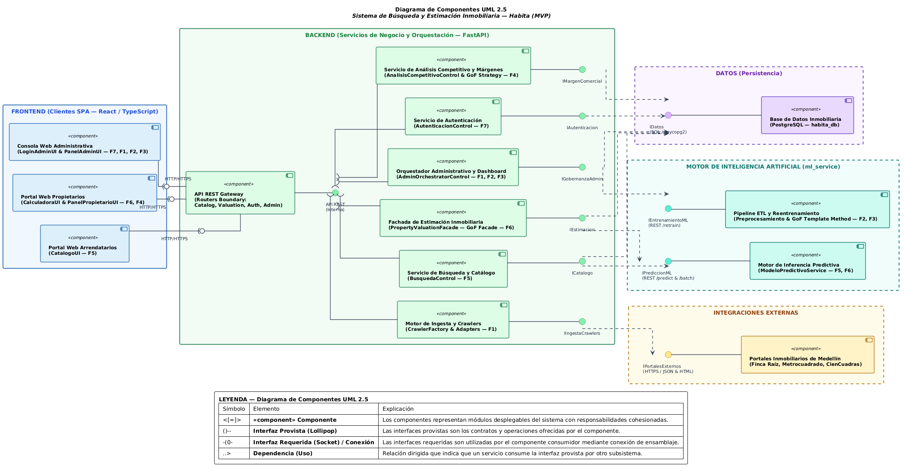

# 3. Diagrama Integrado de Componentes y Despliegue — Parte 1: Diagrama de Componentes UML 2.5

**Proyecto:** Sistema de Búsqueda y Estimación Inmobiliaria — *Habita* (Medellín)  
**Estudiante:** Heman Santiago Bermudez Espinosa  
**Docente:** Alexandra Guerrero Bocanegra  
**Asignatura:** Diseño de Sistemas de Información — Instituto Tecnológico Metropolitano (ITM)  
**Entregable:** Entregable #3 — Sección 3: Diagrama de Componentes UML 2.5  
**Funcionalidades del MVP Cubiertas:** `F1`, `F2`, `F3`, `F4`, `F5`, `F6`, `F7`  
**Requisitos Funcionales Cubiertos:** `RF-01` a `RF-12`  
**Requisitos No Funcionales Cubiertos:** `RNF-01` a `RNF-09`  
**Reglas de Negocio Aplicadas:** `RN-01` a `RN-06`

---

## Introducción y Propósito Arquitectónico

El **Diagrama de Componentes UML 2.5** representa la organización estructural y modular del software que conforma el Producto Mínimo Viable (**MVP**) de **Habita**. Su propósito es ilustrar cómo se descompone la solución en subsistemas cohesivos, cuáles son los componentes desplegables (`<<component>>`), qué contratos exponen mediante **interfaces provistas (*lollipop*)**, qué contratos consumen mediante **interfaces requeridas (*socket*) y relaciones de dependencia (`..>`)**, y cómo colaboran para satisfacer las 7 funcionalidades del MVP.

> [!IMPORTANT]
> **Separación de Vistas Arquitectónicas:**  
> Siguiendo el estándar OMG UML 2.5, este diagrama modela exclusivamente la **vista estructural de componentes de software** (sin mezclar nodos físicos de infraestructura ni flujos temporales de secuencia). No obstante, los límites de sus subsistemas (`FRONTEND`, `BACKEND`, `MOTOR DE INTELIGENCIA ARTIFICIAL`, `DATOS` e `INTEGRACIONES EXTERNAS`) están diseñados con trazabilidad 1 a 1 hacia los contenedores y entornos de ejecución que conforman su vista complementaria en el **Diagrama de Despliegue**.

---

## 3.1. Diagrama de Componentes UML 2.5

Enlaces del diagrama:
* **Enlace editable en línea (PlantText / PlantUML):** [Abrir Diagrama de Componentes en Editor PlantText](https://www.planttext.com/?text=jHhRRY97zjsI_w5aImcMZ6qmC9vPnmeDtHusOBF0p4wKYQoYkmmLDrsTwiOpzcQb_OZzWNp0FELjN_qd-oLxwjPT3Ks2Lx4bQw3EgNE_bkVR9CKyNIx2tPsKfY51vzEBBiKpZXSO1GHrs29c4ObIag1tWpwg7pNFZwSN7wDpUZ6cIKeKclFqd-Jd9GamUa1kaj85zkdJRn7gHGisfI75d6Bqtt_z6xt5KvfYL1cy7nwS7zEBtPsGtAOePOZJsJn50UN4JocBTdSI7uCy2_mPdJPEJj0d6gHpEBsZKOn1F3J5_jsCisKKT5Z8EDhtv8-Dainnm3xHQ8PkSPWG6wGlyeXmrB81lj5ud3u0Vp1DtGO7v1OlmzHZKNg55mJjZScC4VIkjxS1QqmV2QeLQ4Gi80c9GQ-2H3Yw4wUjfdqQuo0G2XHa36b4qeUO8CRJETlTsTsPK_32-VdmRkQv5nS87CC94oWsoDaC6lGtWhhEHf3xOR82AoW4diJH38puZzqTX4fDfewLZHhPLsdvAGi3SU8m7X0-cLF_BY99WkhoiEZyNFDzxyHx9QB0N5o5rvrMnpanh5QXjMx3xPu9FSfvE8f7tNEyHXaF1QzxPyrcUvs7WjQQPoUdtSqyf2-47bslNSP3mK7DLijTvx4ALRUbINDuW9Cv2JQB87s-xxMzPhaf5RpbD5gTshe81bgljS_AH93mFn91nPP8QiTrocJG2CwhLwzhtheG6low3iMZr10AmOZnpsBiPbLWozYjRnUxjQEcE1vd6RE1S151iQYL02GpAAWXzTTKe52q-ItsTVevg-NohELwxSwAPI4wMwtcQMChfOkkXwjk_VMfioP8ctFsIGcX4KzF6xLcSyFjDGws-HgQ-jVecp_nHz2h7I5lT7qrSQ-wgD89gUfvus7xuC_dbbV6lNAUibUE2FPJT8mcuEsnpscS7knPDHudQFZTvOtdAjFc4RitXBQ0G_HtCXMs9r60eSbJbdoCAXtu6B8PUzUJBBmca0H2ddjZOmANZ9n8ecx7TJtdBwBjlCdhPpd78MSn9HR3q5-6q8Ov1fvVeI6EI6ZX645QXyXhPC9O2C-MfSEYX8LOgHyiQ0HZ2iSflSSWJf_DQ2HFSsdCLod7Av2Z1hzr-3tDZIDGjf54Xk-ACQi_GCSCIFIZ776gA_hf6xR6PJUa12yM_FKZvBGxtyau71D-JttmdXZihY3puJECTTSS1ZoO5kLWzx8vyInHbDjmahQ7FPCVZfKVZioFbHW1N3HonnDqYLFo2Jz0P8pO4kfb0iKGIYJc3sy-HZfP3j5x72wnc4eFKNkPpWzLNAdeSDmRJMGzFhoE-qh7HpOHv6KvamAuzyHfX1N9tWr0RlIHATIAZgdEA_eOGmaxWOHmHdrb7g1j7R08iYFbBDJ1dgaWr7gs_Bq2PIEweFHicQEdNqEQq4Gk70HM4NelF3ru-fNF2DH-eKQ49Og5OPJv2bqo3teZf3cPFIZT6fbk0oneF5yxTG_O4UvJ76hzDBNdQcXlI11Ne2vKOT3AMQhZWb-QcUocNZzVUdDJYvqHsaPm3_kmESdDRjCs1wABaaLu-f1b1rp3S4Me8FnXVVLQcKQ68Fi_F9BVrLfPnBRHonGEw4R5rY1YhGkJu9HX7eXO4y1hxi-9H62yu9wL_k3ewYpmdw_J9PkAD8yUiIIY5SjFjr9im416uQvUD1CAYY3Z-5C81KtqOFKH_05O3v0jxG37ijWfTV9eqtUUhuNcQmYOe3FqDkhmDHHpQ7Je7W89waW8g-qYLXc3EQTJZERWNepm5F_4a9Wd4Rc7WPSZdozz8Xj3-FGb8ZYHawokPEfdjOrcjK2ZwbJUW6eoHYDd2LIAd0UYHhSYimGzYnSZT1O_fP9eCxvO-pyzGjtsv7gCAaDW8vvr8c7q4Gcb1ZXysNvVmjjqShagwaxUTTIaQyTT5v9JXFZuRtsObEFamMVnh6xQg8GAq7xtp6buheg_V36rCiZ12H719A-iLJgMf3DE12MHCNFvY7KJJ1MVhdEZ4TOInttTFVEwXgtQbb_8XuqZDEXrHjTZT_I-r-bTewwBUh1Qz7kNxbMdrqRjqQJd0QJTHvL5U9F8vaHUrhE3wydrQ5j9zgodAEtoGN_TvKDE0kgBk1pqnTmcnhZZM1wcKDkEfpZrvoO2R6IqttJTThUXt96_a9JNqLjOj6KMA19wVnYmW8GiEsAgnUicrppC6jsWVsEHM8cAJiTpl5fHZBLM1_s6H7WXTa9cASe9D2GpUq83BA9jeUAGnaH0aJlfGviO4MAJa6sTn9n1RTL7UhgQa4KSmdo51YITiq1fR7L1qBWWpBPA5osrMlrMgRvO-ZIFP8nUZjgGErVk6BaV9kxegZr-qVmePxbdlwxgJ80l9QaWrswIk9_5gY0BuTl9P3Y6KlZNyVKLUExjPD3FSa5ZetslwxREsieN-GFPsZvF2eLGRM430WaWEYxmycZaGvV0JryU3qLOGDGiSS1Xl3f47N1NHtvB57zG89TW9JOyrpljwFd2lETfFw-C1p9OOGw0EIwLtH-EFiFHGemCO5Zn6gvxnLeigOAYu90gfN2GycNYgmCU_g3S_3qKn27ijx8OGj_hFVwyf8J3l8rHLog1Nw0gcpSk3fCiYG9KlK1Y_pIxgmoSOnazm7pj2QDoKhKttJSeHvVOnUUBFy9MpobcIljTRFqwOOiAalTK4ZoYR97FDcW1jjyDGldo2QhixbXCgjNYbhsxKrow3wfLCqnk09b9iXIOpuwbO7jQBEURpuVbzBE9K8zlFLCL4l40TmzZ5AHS3BtC5tkSjOXcva0LZ4AiiqQkUX8roqin6QoCqrMztak0FJnNixrOWknHkMhjdX9e3yRLmWgd-5cJSBMm22dIPgCmf0k6Q6mm1CWfvpgeKjJdB37cW2f0v8qPbnB09LLAnJPXZO-v0QnPJs0KnWk5KUXd0cUrHLVBkffLdNDcTibK2aANwf8Ol2UfouByBc6eSdHqSQ0t9QFexwjckHNkMgEo05gkNGTQpjq2Q1j86YFt_lhjDU3gRMihNh-z1bmnl9Gl3n_DmJ9lI6OYBwOiJTb2DCJpwKNV_HugjNgFt-BlukBMBsZyz6KnPI63Zsv85d8QWe-Vuz2yog5V5ERv3z_yU27-dLuKMs9ENv05Z3uKCzzYAeOqai1d7A75qs_1CfJLBeb12pmDTMzCz9_eVJ0feCFj18js7c10XTCvISH-5-3ao8XK4IL6IfGLMPD8gD9dOKXZ5XyOgI06QPvnSPPn2J0CfSYHV419ODGKhqKc5jajb1qGGnKfa3JNBPD4DeQY92C2ZP_3FLGPCoXZwG6CEXsuzrbOjLmeRkuegPOfwF-8IraBSPFbWehteGM47jPdYhpmEm43BgOX_YaNKmIIbDBAJ5I1j3H6Kckq941Xr13IWqGW8iIs-hYCK5QJb0X4r6Pgr3PsbH8pcBDGifngtqevWA-ANX77tyA_ydzq_0y0)
* **Gráfico vectorial SVG en línea (PlantText):** [Ver diagrama SVG en línea](https://uml.planttext.com/plantuml/svg/jHhRRY97zjsI_w5aImcMZ6qmC9vPnmeDtHusOBF0p4wKYQoYkmmLDrsTwiOpzcQb_OZzWNp0FELjN_qd-oLxwjPT3Ks2Lx4bQw3EgNE_bkVR9CKyNIx2tPsKfY51vzEBBiKpZXSO1GHrs29c4ObIag1tWpwg7pNFZwSN7wDpUZ6cIKeKclFqd-Jd9GamUa1kaj85zkdJRn7gHGisfI75d6Bqtt_z6xt5KvfYL1cy7nwS7zEBtPsGtAOePOZJsJn50UN4JocBTdSI7uCy2_mPdJPEJj0d6gHpEBsZKOn1F3J5_jsCisKKT5Z8EDhtv8-Dainnm3xHQ8PkSPWG6wGlyeXmrB81lj5ud3u0Vp1DtGO7v1OlmzHZKNg55mJjZScC4VIkjxS1QqmV2QeLQ4Gi80c9GQ-2H3Yw4wUjfdqQuo0G2XHa36b4qeUO8CRJETlTsTsPK_32-VdmRkQv5nS87CC94oWsoDaC6lGtWhhEHf3xOR82AoW4diJH38puZzqTX4fDfewLZHhPLsdvAGi3SU8m7X0-cLF_BY99WkhoiEZyNFDzxyHx9QB0N5o5rvrMnpanh5QXjMx3xPu9FSfvE8f7tNEyHXaF1QzxPyrcUvs7WjQQPoUdtSqyf2-47bslNSP3mK7DLijTvx4ALRUbINDuW9Cv2JQB87s-xxMzPhaf5RpbD5gTshe81bgljS_AH93mFn91nPP8QiTrocJG2CwhLwzhtheG6low3iMZr10AmOZnpsBiPbLWozYjRnUxjQEcE1vd6RE1S151iQYL02GpAAWXzTTKe52q-ItsTVevg-NohELwxSwAPI4wMwtcQMChfOkkXwjk_VMfioP8ctFsIGcX4KzF6xLcSyFjDGws-HgQ-jVecp_nHz2h7I5lT7qrSQ-wgD89gUfvus7xuC_dbbV6lNAUibUE2FPJT8mcuEsnpscS7knPDHudQFZTvOtdAjFc4RitXBQ0G_HtCXMs9r60eSbJbdoCAXtu6B8PUzUJBBmca0H2ddjZOmANZ9n8ecx7TJtdBwBjlCdhPpd78MSn9HR3q5-6q8Ov1fvVeI6EI6ZX645QXyXhPC9O2C-MfSEYX8LOgHyiQ0HZ2iSflSSWJf_DQ2HFSsdCLod7Av2Z1hzr-3tDZIDGjf54Xk-ACQi_GCSCIFIZ776gA_hf6xR6PJUa12yM_FKZvBGxtyau71D-JttmdXZihY3puJECTTSS1ZoO5kLWzx8vyInHbDjmahQ7FPCVZfKVZioFbHW1N3HonnDqYLFo2Jz0P8pO4kfb0iKGIYJc3sy-HZfP3j5x72wnc4eFKNkPpWzLNAdeSDmRJMGzFhoE-qh7HpOHv6KvamAuzyHfX1N9tWr0RlIHATIAZgdEA_eOGmaxWOHmHdrb7g1j7R08iYFbBDJ1dgaWr7gs_Bq2PIEweFHicQEdNqEQq4Gk70HM4NelF3ru-fNF2DH-eKQ49Og5OPJv2bqo3teZf3cPFIZT6fbk0oneF5yxTG_O4UvJ76hzDBNdQcXlI11Ne2vKOT3AMQhZWb-QcUocNZzVUdDJYvqHsaPm3_kmESdDRjCs1wABaaLu-f1b1rp3S4Me8FnXVVLQcKQ68Fi_F9BVrLfPnBRHonGEw4R5rY1YhGkJu9HX7eXO4y1hxi-9H62yu9wL_k3ewYpmdw_J9PkAD8yUiIIY5SjFjr9im416uQvUD1CAYY3Z-5C81KtqOFKH_05O3v0jxG37ijWfTV9eqtUUhuNcQmYOe3FqDkhmDHHpQ7Je7W89waW8g-qYLXc3EQTJZERWNepm5F_4a9Wd4Rc7WPSZdozz8Xj3-FGb8ZYHawokPEfdjOrcjK2ZwbJUW6eoHYDd2LIAd0UYHhSYimGzYnSZT1O_fP9eCxvO-pyzGjtsv7gCAaDW8vvr8c7q4Gcb1ZXysNvVmjjqShagwaxUTTIaQyTT5v9JXFZuRtsObEFamMVnh6xQg8GAq7xtp6buheg_V36rCiZ12H719A-iLJgMf3DE12MHCNFvY7KJJ1MVhdEZ4TOInttTFVEwXgtQbb_8XuqZDEXrHjTZT_I-r-bTewwBUh1Qz7kNxbMdrqRjqQJd0QJTHvL5U9F8vaHUrhE3wydrQ5j9zgodAEtoGN_TvKDE0kgBk1pqnTmcnhZZM1wcKDkEfpZrvoO2R6IqttJTThUXt96_a9JNqLjOj6KMA19wVnYmW8GiEsAgnUicrppC6jsWVsEHM8cAJiTpl5fHZBLM1_s6H7WXTa9cASe9D2GpUq83BA9jeUAGnaH0aJlfGviO4MAJa6sTn9n1RTL7UhgQa4KSmdo51YITiq1fR7L1qBWWpBPA5osrMlrMgRvO-ZIFP8nUZjgGErVk6BaV9kxegZr-qVmePxbdlwxgJ80l9QaWrswIk9_5gY0BuTl9P3Y6KlZNyVKLUExjPD3FSa5ZetslwxREsieN-GFPsZvF2eLGRM430WaWEYxmycZaGvV0JryU3qLOGDGiSS1Xl3f47N1NHtvB57zG89TW9JOyrpljwFd2lETfFw-C1p9OOGw0EIwLtH-EFiFHGemCO5Zn6gvxnLeigOAYu90gfN2GycNYgmCU_g3S_3qKn27ijx8OGj_hFVwyf8J3l8rHLog1Nw0gcpSk3fCiYG9KlK1Y_pIxgmoSOnazm7pj2QDoKhKttJSeHvVOnUUBFy9MpobcIljTRFqwOOiAalTK4ZoYR97FDcW1jjyDGldo2QhixbXCgjNYbhsxKrow3wfLCqnk09b9iXIOpuwbO7jQBEURpuVbzBE9K8zlFLCL4l40TmzZ5AHS3BtC5tkSjOXcva0LZ4AiiqQkUX8roqin6QoCqrMztak0FJnNixrOWknHkMhjdX9e3yRLmWgd-5cJSBMm22dIPgCmf0k6Q6mm1CWfvpgeKjJdB37cW2f0v8qPbnB09LLAnJPXZO-v0QnPJs0KnWk5KUXd0cUrHLVBkffLdNDcTibK2aANwf8Ol2UfouByBc6eSdHqSQ0t9QFexwjckHNkMgEo05gkNGTQpjq2Q1j86YFt_lhjDU3gRMihNh-z1bmnl9Gl3n_DmJ9lI6OYBwOiJTb2DCJpwKNV_HugjNgFt-BlukBMBsZyz6KnPI63Zsv85d8QWe-Vuz2yog5V5ERv3z_yU27-dLuKMs9ENv05Z3uKCzzYAeOqai1d7A75qs_1CfJLBeb12pmDTMzCz9_eVJ0feCFj18js7c10XTCvISH-5-3ao8XK4IL6IfGLMPD8gD9dOKXZ5XyOgI06QPvnSPPn2J0CfSYHV419ODGKhqKc5jajb1qGGnKfa3JNBPD4DeQY92C2ZP_3FLGPCoXZwG6CEXsuzrbOjLmeRkuegPOfwF-8IraBSPFbWehteGM47jPdYhpmEm43BgOX_YaNKmIIbDBAJ5I1j3H6Kckq941Xr13IWqGW8iIs-hYCK5QJb0X4r6Pgr3PsbH8pcBDGifngtqevWA-ANX77tyA_ydzq_0y0)

---

## 3.2. Organización Modular: Subsistemas del Ecosistema Habita

La arquitectura modular del sistema se divide en **cinco subsistemas desacoplados**, garantizando el cumplimiento del principio de Responsabilidad Única (**SRP**) y el aislamiento de cargas pesadas de procesamiento (**`RNF-04`**, **`RNF-05`** y **`RNF-08`**):

| Subsistema / Paquete | Naturaleza Arquitectónica | Ruta en el Proyecto | Rol dentro de la Solución |
| :--- | :--- | :--- | :--- |
| **1. `FRONTEND (Clientes SPA — React / TypeScript)`** | Capa de Presentación Cliente (*Single Page Application*) | `C:\Users\heman\Frotend_Proyecto_Habita\src` | Provee las interfaces gráficas reactivas sin recarga de página (`RNF-06`) segmentadas para los tres actores del negocio: **Arrendatario**, **Propietario** y **Administrador**. |
| **2. `BACKEND (Servicios de Negocio y Orquestación — FastAPI)`** | Núcleo Transaccional, Seguridad, Reglas de Negocio e Ingesta | `C:\Users\heman\Proyecto_Habita\backend` y `crawlers` | Expone el `API REST Gateway`, gestiona la seguridad JWT y el bloqueo por fuerza bruta (`RN-05`), consolida el catálogo (`RF-01`), orquesta la valoración comparativa (`RN-03`, `RN-04`) y coordina los *crawlers* asíncronos (`RN-06`). |
| **3. `MOTOR DE INTELIGENCIA ARTIFICIAL (ml_service)`** | Microservicio Independiente de Cómputo Científico (*CPU-bound*) | `C:\Users\heman\Proyecto_Habita\ml_service` | Aísla el preprocesamiento libre de fuga de datos (`RN-02`), el reentrenamiento en segundo plano con compuerta de calidad $\text{MAPE} \le 16\%$ (`RN-01`, `RNF-08`) y la inferencia en memoria RAM ($< 50\text{ ms}$, `RNF-05`). |
| **4. `DATOS (Persistencia)`** | Capa de Almacenamiento Relacional Transaccional | Contenedor PostgreSQL (`habita_db`) + `database.py` | Almacena de forma persistente e indexada el catálogo de inmuebles, las cuentas de administración, el historial de versiones de modelos ML, los trabajos de extracción y la bitácora inmutable de auditoría (`RNF-09`). |
| **5. `INTEGRACIONES EXTERNAS`** | Sistemas de Terceros (Fuentes de Oferta Inmobiliaria) | Portales Web Externos (*Finca Raíz*, *Metrocuadrado*, *CienCuadras*) | Proveen la oferta pública de arriendos en las 16 comunas de Medellín que el motor de ingesta consulta mediante peticiones HTTP asíncronas controladas. |

---

## 3.3. Componentes Principales del Sistema y sus Responsabilidades

A continuación se especifican los **13 componentes (`<<component>>`)** modelados en el diagrama, detallando su responsabilidad modular, los archivos reales que los implementan y los patrones de diseño **GoF** aplicados:

### A. Subsistema `FRONTEND (Clientes SPA)`

1. **`<<component>> Portal Web Arrendatarios (CatalogoUI — F5)`**
   * **Implementación:** `Arrendatario.tsx`, `Landing.tsx` y `client.ts`.
   * **Responsabilidad:** Renderiza el catálogo consolidado de viviendas en Medellín (`RF-01`), aplica filtros dinámicos por comuna y tipo de inmueble de manera asíncrona sin recargar el navegador (`RNF-06`), permite ordenar por el indicador de **"Mejor Oferta"** (`RF-02`) y redirige al usuario a la publicación original en una nueva pestaña (`RF-12`, `RN-06`).
2. **`<<component>> Portal Web Propietarios (CalculadoraUI & PanelPropietarioUI — F6, F4)`**
   * **Implementación:** `Propietario.tsx` y `client.ts`.
   * **Responsabilidad:** Captura las características físicas y de ubicación de la vivienda del propietario para solicitar la estimación de canon mensual (`RF-03`), despliega el listado de inmuebles competidores similares en el sector (`RF-04`, `RN-03`), presenta las métricas competitivas (mínimo, promedio y máximo — `RF-05`) y permite seleccionar interactivamente la estrategia de margen sugerido de publicación (`RF-06`, `RN-04`).
3. **`<<component>> Consola Web Administrativa (LoginAdminUI & PanelAdminUI — F7, F1, F2, F3)`**
   * **Implementación:** `AdminLogin.tsx`, `AdminDashboard.tsx` y `client.ts`.
   * **Responsabilidad:** Gestiona el inicio de sesión seguro del administrador informando intentos restantes o el tiempo de bloqueo temporal (`RF-07`, `RN-05`), permite disparar manualmente los *crawlers* por portal (`RF-08`), accionar el reentrenamiento del modelo predictivo (`RF-10`) y visualizar las gráficas de evolución histórica del MAPE, volumen de ingesta y tabla de auditoría (`RF-11`, `RNF-09`).

---

### B. Subsistema `BACKEND (Servicios de Negocio y Orquestación)`

4. **`<<component>> API REST Gateway (Routers Boundary)`**
   * **Implementación:** `backend/main.py`, `catalog_router.py`, `valuation_router.py`, `auth_router.py`, `admin_router.py` y `dependencies.py`.
   * **Responsabilidad:** Punto único de entrada HTTP/HTTPS del Backend bajo el prefijo `/api/v1`. Configura las políticas CORS, valida los esquemas de entrada/salida con Pydantic, protege las rutas administrativas mediante inyección de dependencias JWT (`get_current_admin`) y enruta cada petición hacia el servicio de control correspondiente a través de la interfaz `API REST (Interna)`.
5. **`<<component>> Servicio de Autenticación (AutenticacionControl — F7)`**
   * **Implementación:** `autenticacion_control.py`, `security.py`, `admin_entity.py` y `admin_repository.py`.
   * **Responsabilidad:** Verifica las credenciales del administrador mediante hashing `bcrypt`, controla el contador de fallos consecutivos, ejecuta el **bloqueo temporal de la cuenta por 30 minutos tras 3 intentos fallidos (`RN-05`, `RNF-01`)** y emite tokens firmados JWT (`HS256`).
6. **`<<component>> Servicio de Análisis Competitivo y Márgenes (AnalisisCompetitivoControl & GoF Strategy — F4)`**
   * **Implementación:** `analisis_competitivo_control.py`, `pricing_strategies.py` y `competitive_metrics_service.py`.
   * **Responsabilidad:** Implementa el patrón **GoF Strategy** (`LiquidityPricingStrategy` $-5\%$, `ProfitabilityPricingStrategy` $+5\%$ y `MarketBalancedPricingStrategy`) junto con el servicio de métricas estadísticas del sector (`RF-05`) para calcular el rango comercial sugerido de publicación (`RF-06`, `RN-04`).
7. **`<<component>> Servicio de Búsqueda y Catálogo (BusquedaControl — F5)`**
   * **Implementación:** `busqueda_control.py` y `property_repository.py`.
   * **Responsabilidad:** Ejecuta consultas filtradas e indexadas sobre el inventario consolidado respondiendo en $\le 2\text{ segundos}$ (`RNF-04`), calcula el diferencial porcentual entre el precio publicado y el precio estimado por IA para clasificar la **"Mejor Oferta"** (`RF-02`) y garantiza la presencia de la URL de origen (`RN-06`).
8. **`<<component>> Fachada de Estimación Inmobiliaria (PropertyValuationFacade — GoF Facade — F6)`**
   * **Implementación:** `valuation_facade_control.py`, `ml_service_client.py` y `property_entity.py`.
   * **Responsabilidad:** Implementa el patrón **GoF Facade** para ocultar la complejidad híbrida de valoración: coordina en paralelo la petición de inferencia hacia `ml_service` (`RF-03`) y la búsqueda SQL de competidores comparables aplicando la regla **`RN-03`** (misma comuna, mismo estrato, mismo tipo de inmueble y área dentro de $\pm 15\%$ — `RF-04`), entregando una respuesta unificada en $< 3\text{ segundos}$ (`RNF-05`).
9. **`<<component>> Orquestador Administrativo y Dashboard (AdminOrchestratorControl — F1, F2, F3)`**
   * **Implementación:** `admin_orchestrator_control.py` y `audit_repository.py`.
   * **Responsabilidad:** Coordina las operaciones de gobernanza del administrador: invoca la ejecución del motor de *crawlers*, valora en lote los nuevos inmuebles extraídos, realiza el *upsert* transaccional en PostgreSQL, solicita el reentrenamiento al microservicio ML, registra cada evento en la bitácora de auditoría (`RNF-09`) y construye el estado consolidado del Dashboard (`RF-11`).
10. **`<<component>> Motor de Ingesta y Crawlers (CrawlerFactory & Adapters — F1)`**
    * **Implementación:** `orchestrator_control.py`, `factory.py`, `adapters/` y `spiders/`.
    * **Responsabilidad:** Implementa el patrón **GoF Factory Method** (`CrawlerFactory`, cumpliendo la escalabilidad de portales `RNF-07`) y el patrón **GoF Adapter** (`PropertyDataAdapter`, normalizando esquemas heterogéneos y descartando estrictamente cualquier anuncio sin `url_origen` válida según **`RN-06`**). Ejecuta la extracción concurrente (*Fork/Join* con `asyncio.gather`) hacia los portales inmobiliarios.

---

### C. Subsistema `MOTOR DE INTELIGENCIA ARTIFICIAL (ml_service)`

11. **`<<component>> Motor de Inferencia Predictiva (ModeloPredictivoService — F5, F6)`**
    * **Implementación:** `inference_service.py`, `feature_engineering.py` y `api_router.py`.
    * **Responsabilidad:** Mantiene precargado en memoria RAM el artefacto `modelos_habita.joblib` y las coordenadas de estaciones SITVA durante el ciclo de vida del servidor (`lifespan`), resolviendo predicciones individuales (`/predict`) y en lote (`/predict/batch`) en milisegundos para cumplir holgadamente **`RNF-05`** ($< 3\text{ s}$) y **`RNF-08`** (disponibilidad continua durante reentrenamientos).
12. **`<<component>> Pipeline ETL y Reentrenamiento (Preprocesamiento & GoF Template Method — F2, F3)`**
    * **Implementación:** `preprocessing_control.py`, `training_pipeline_control.py` y `spatial_transformers.py`.
    * **Responsabilidad:** Ejecuta la limpieza de dominio (`RF-09`, `RN-06`), aplica la partición 80% entrenamiento / 20% validación ajustando los transformadores (`StandardScaler`, `OneHotEncoder`, `TargetEncoder`, `SpatialKNN`) **exclusivamente sobre el 80% de entrenamiento para prohibir la fuga de datos (`RN-02`)**, entrena los ensambles especializados mediante el patrón **GoF Template Method** (`BaseModelTrainingPipeline`) y aplica la **compuerta de calidad estricta $\text{MAPE} \le 16\%$ (`RN-01`, `RNF-02`)** antes de promover cualquier modelo a producción (`RF-10`).

---

### D. Subsistemas `DATOS (Persistencia)` e `INTEGRACIONES EXTERNAS`

13. **`<<component>> Base de Datos Inmobiliaria (PostgreSQL — habita_db)`**
    * **Implementación:** Motor relacional PostgreSQL gestionado mediante SQLAlchemy ORM (`database.py`) con 6 tablas de dominio: `properties`, `admins`, `portals`, `crawler_jobs`, `model_versions` y `audit_logs`.
    * **Responsabilidad:** Garantiza la integridad referencial, la unicidad por `url_origen` (`RN-06`), los índices compuestos de búsqueda rápida (`idx_properties_comuna_tipo`, `idx_properties_comparables` para `RNF-04` y `RN-03`) y la trazabilidad histórica (`RNF-09`).
14. **`<<component>> Portales Inmobiliarios de Medellín (Finca Raíz, Metrocuadrado, CienCuadras)`**
    * **Responsabilidad:** Sistemas externos que publican la oferta de arrendamientos habitacionales en Medellín y constituyen la fuente primaria de ingesta para los *spiders* asíncronos.

---

## 3.4. Catálogo de Interfaces Proporcionadas (Lollipop) y Requeridas (Socket)

El diagrama define explícitamente los contratos de comunicación mediante la notación UML de **Interfaz Provista (`()--` *Lollipop*)** e **Interfaz Requerida (`-(0-` *Socket* / `..>` Dependencia de uso)**:

| Interfaz | Tipo y Subsistema Proveedor | Componente que la Provee | Componentes que la Requieren / Consumen | Operaciones / Endpoints Principales del Contrato |
| :--- | :--- | :--- | :--- | :--- |
| **`HTTP/HTTPS`** | Provista por `BACKEND` | `API REST Gateway` | `Portal Web Arrendatarios`, `Portal Web Propietarios`, `Consola Web Administrativa` | `GET /api/v1/properties`, `POST /estimate`, `POST /margin`, `POST /auth/login`, `GET /admin/dashboard`, `POST /admin/crawlers/run`, `POST /admin/ml/retrain` |
| **`API REST (Interna)`** | Provista dentro de `BACKEND` | `API REST Gateway` | Los 6 servicios internos del `BACKEND` | Despacho interno de peticiones validadas por esquema Pydantic e inyección de sesión SQLAlchemy (`Depends(get_db)`). |
| **`IAutenticacion`** | Provista dentro de `BACKEND` | `Servicio de Autenticación` | `API REST Gateway`, requiere `IDatos` | `autenticar_admin(username, password)`, `verificar_token_jwt(token)`, `registrar_intento_fallido_rn05()`. |
| **`IMargenComercial`** | Provista dentro de `BACKEND` | `Servicio de Análisis Competitivo y Márgenes` | `API REST Gateway`, requiere `IDatos` | `calcular_margen_por_estrategia(estimacion, estrategia)`, `calcular_metricas_competitivas(comparables)`. |
| **`ICatalogo`** | Provista dentro de `BACKEND` | `Servicio de Búsqueda y Catálogo` | `API REST Gateway`, requiere `IDatos` e `IPrediccionML` | `listar_propiedades(comuna, tipo, ordenar_por)`, `calcular_indicador_mejor_oferta()`. |
| **`IEstimacion`** | Provista dentro de `BACKEND` | `Fachada de Estimación Inmobiliaria` | `API REST Gateway`, requiere `IDatos` e `IPrediccionML` | `estimar_propiedad_y_competidores(atributos_inmueble)` (*Fork/Join* entre IA y SQL `RN-03`). |
| **`IGobernanzaAdmin`** | Provista dentro de `BACKEND` | `Orquestador Administrativo y Dashboard` | `API REST Gateway`, requiere `IDatos` e `IEntrenamientoML` | `obtener_estado_dashboard()`, `ejecutar_crawlers()`, `ejecutar_reentrenamiento_ml()`. |
| **`IIngestaCrawlers`** | Provista dentro de `BACKEND` | `Motor de Ingesta y Crawlers` | `Orquestador Administrativo`, requiere `IPortalesExternos` | `ejecutar_extraccion(portales, max_pages)`, `create_crawler(portal_key)`, `adapt_many(raw_payloads)`. |
| **`IDatos (SQL / psycopg2)`** | Provista por `DATOS` | `Base de Datos Inmobiliaria (PostgreSQL)` | `IAutenticacion`, `IMargenComercial`, `ICatalogo`, `IEstimacion`, `IGobernanzaAdmin` | Operaciones transaccionales CRUD/Upsert mediante SQLAlchemy sobre `habita_db` (puerto `5432`). |
| **`IPrediccionML`** | Provista por `MOTOR DE IA` | `Motor de Inferencia Predictiva` | `ICatalogo` (lote), `IEstimacion` (individual) | `POST /api/v1/ml/predict` (individual $< 50\text{ ms}$) y `POST /api/v1/ml/predict/batch` (vectorizado). |
| **`IEntrenamientoML`** | Provista por `MOTOR DE IA` | `Pipeline ETL y Reentrenamiento` | `IGobernanzaAdmin` | `POST /api/v1/ml/retrain` (asíncrono `202 Accepted` — `RNF-08`) y `POST /api/v1/ml/retrain/sync`. |
| **`IPortalesExternos`** | Provista por `INTEGRACIONES EXTERNAS` | `Portales Inmobiliarios de Medellín` | `IIngestaCrawlers` (`Motor de Ingesta y Crawlers`) | Peticiones `HTTPS GET/POST` asíncronas (`httpx`) hacia las APIs/HTML de *Finca Raíz*, *Metrocuadrado* y *CienCuadras*. |

---

## 3.5. Dependencias y Mecanismos de Comunicación

El diseño emplea cuatro mecanismos de comunicación diferenciados según la naturaleza de la interacción entre componentes:

1. **Comunicación Cliente-Servidor (`FRONTEND` $\leftrightarrow$ `BACKEND`):**
   * **Protocolo:** `HTTP/HTTPS` síncrono desde la perspectiva de red, pero consumido de forma **100% asíncrona (`fetch` / `async-await`)** en el navegador mediante `src/api/client.ts` para garantizar que la SPA nunca recargue la página completa (**`RNF-06`**).
   * **Formato y Seguridad:** Payloads serializados en `JSON` y cabeceras `Authorization: Bearer <JWT>` para todas las operaciones protegidas de la `Consola Web Administrativa`.
2. **Comunicación Inter-Servicio (`BACKEND` $\leftrightarrow$ `MOTOR DE IA ml_service`):**
   * **Protocolo:** `HTTP REST` interno mediante cliente `MLServiceClient` (`httpx` con *timeout* controlado y mecanismo de resiliencia *fallback* en memoria).
   * **Patrón de Concurrencia:** En la valoración de inmuebles (`IEstimacion`), el Backend dispara en paralelo la llamada HTTP a `IPrediccionML` y la consulta de comparables a `IDatos` para responder en menos de 3 segundos (**`RNF-05`**). En el reentrenamiento (`IEntrenamientoML`), se emplea despacho no bloqueante en segundo plano (`BackgroundTasks`) para no interrumpir las consultas de usuarios (**`RNF-08`**).
3. **Comunicación de Persistencia (`BACKEND` $\leftrightarrow$ `DATOS PostgreSQL`):**
   * **Protocolo:** Conexión binaria TCP sobre el puerto `5432` utilizando el adaptador nativo `psycopg2-binary` y un *pool* de conexiones con `pool_pre_ping=True` en SQLAlchemy (`database.py`).
4. **Comunicación de Extracción Externa (`BACKEND / Crawlers` $\leftrightarrow$ `INTEGRACIONES EXTERNAS`):**
   * **Protocolo:** Peticiones `HTTPS` concurrentes no bloqueantes gobernadas por `asyncio.gather` y semáforos de límite de tasa (`asyncio.Semaphore`) sobre `httpx.AsyncClient`, respetando la disponibilidad de los portales externos y validando certificados del sistema con `truststore`.

---

## 3.6. Relación entre los Componentes y las Funcionalidades del MVP (`F1` a `F7`)

La siguiente matriz demuestra la trazabilidad completa entre cada una de las **7 funcionalidades del MVP**, los requisitos asociados y los componentes e interfaces del diagrama que las materializan:

| ID | Funcionalidad del MVP | Historia / Requisitos | Componentes de Frontend Involucrados | Componentes de Backend y ML Involucrados | Interfaces y Persistencia Utilizadas |
| :-: | :--- | :--- | :--- | :--- | :--- |
| **`F1`** | **Orquestar extracción de datos** | `HU-03` (`RU-03`) `RF-08`, `RNF-03`, `RNF-07`, `RNF-09`, `RN-06` | `Consola Web Administrativa` (`PanelAdminUI`) | `API REST Gateway` $\rightarrow$ `Orquestador Administrativo y Dashboard` $\rightarrow$ `Motor de Ingesta y Crawlers` (`CrawlerFactory` + `PropertyDataAdapters`) | `IGobernanzaAdmin`, `IIngestaCrawlers` $\rightarrow$ `IPortalesExternos` (Scraping paralelo) y `IDatos` (tablas `properties`, `portals`, `crawler_jobs`, `audit_logs`) |
| **`F2`** | **Preparar los datos** | `HU-04` (`RU-03`) `RF-09`, `RN-02`, `RN-06` | `Consola Web Administrativa` (`PanelAdminUI`) | `Orquestador Administrativo y Dashboard` $\rightarrow$ `Pipeline ETL y Reentrenamiento` (`PreprocesamientoControl`) | `IGobernanzaAdmin` $\rightarrow$ `IEntrenamientoML` (Limpieza `RN-06`, partición 80/20 y ajuste `.fit()` exclusivo en Train `RN-02`) |
| **`F3`** | **Reentrenar el modelo** | `HU-05` (`RU-03`) `RF-10`, `RF-11`, `RN-01`, `RNF-02`, `RNF-08`, `RNF-09` | `Consola Web Administrativa` (`PanelAdminUI`) | `Orquestador Administrativo y Dashboard` $\rightarrow$ `Pipeline ETL y Reentrenamiento` (`BaseModelTrainingPipeline` — *Template Method*) $\rightarrow$ `Motor de Inferencia Predictiva` | `IEntrenamientoML` (Compuerta $\text{MAPE} \le 16\%$ `RN-01`, recarga en caliente en RAM `RNF-08`) y `IDatos` (tablas `model_versions` y `audit_logs`) |
| **`F4`** | **Obtener margen sugerido** | `HU-08` (`RU-02`) `RF-04`, `RF-05`, `RF-06`, `RN-03`, `RN-04` | `Portal Web Propietarios` (`PanelPropietarioUI`) | `API REST Gateway` $\rightarrow$ `Servicio de Análisis Competitivo y Márgenes` (`AnalisisCompetitivoControl` + `PricingStrategies` — *Strategy*) | `IMargenComercial` $\rightarrow$ `IDatos` (consulta de comparables `RN-03`, cálculo de mínimo/promedio/máximo `RF-05` y bandas $\pm 5\%$ `RN-04`) |
| **`F5`** | **Consolidar catálogo** | `HU-01` (`RU-01`) `RF-01`, `RF-02`, `RF-12`, `RNF-04`, `RNF-06`, `RN-06` | `Portal Web Arrendatarios` (`CatalogoUI`) | `API REST Gateway` $\rightarrow$ `Servicio de Búsqueda y Catálogo` (`BusquedaControl`) y `Motor de Inferencia Predictiva` | `ICatalogo` $\rightarrow$ `IDatos` (consulta indexada $\le 2\text{ s}$ `RNF-04`) e `IPrediccionML` (cálculo de "Mejor Oferta" `RF-02`) |
| **`F6`** | **Estimar precio de una vivienda** | `HU-02` (`RU-02`) `RF-03`, `RF-04`, `RN-03`, `RNF-05` | `Portal Web Propietarios` (`CalculadoraUI`) | `API REST Gateway` $\rightarrow$ `Fachada de Estimación Inmobiliaria` (`PropertyValuationFacade` — *Facade*) $\rightarrow$ `Motor de Inferencia Predictiva` | `IEstimacion` $\rightarrow$ `IPrediccionML` (predicción $< 3\text{ s}$ `RNF-05`) e `IDatos` (competidores similares `RN-03`) |
| **`F7`** | **Autenticarse** | `HU-06` (`RU-03`) `RF-07`, `RNF-01`, `RN-05`, `RNF-09` | `Consola Web Administrativa` (`LoginAdminUI`) | `API REST Gateway` $\rightarrow$ `Servicio de Autenticación` (`AutenticacionControl` + `security.py`) | `IAutenticacion` $\rightarrow$ `IDatos` (tabla `admins`: verificación `bcrypt`, conteo de 3 fallos y bloqueo de 30 min `RN-05`, y registro en `audit_logs`) |
