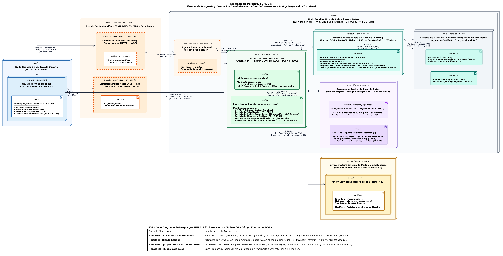

# 3. Diagrama Integrado de Componentes y Despliegue — Parte 2: Diagrama de Despliegue UML 2.5

**Proyecto:** Sistema de Búsqueda y Estimación Inmobiliaria — *Habita* (Medellín)  
**Estudiante:** Heman Santiago Bermudez Espinosa  
**Docente:** Alexandra Guerrero Bocanegra  
**Asignatura:** Diseño de Sistemas de Información — Instituto Tecnológico Metropolitano (ITM)  
**Entregable:** Entregable #3 — Sección 3: Diagrama de Despliegue UML 2.5  
**Coherencia Arquitectónica:** Vista física complementaria del Diagrama de Componentes UML 2.5 y del Modelo C4 (Entregable #2)  
**Funcionalidades del MVP Soportadas:** `F1`, `F2`, `F3`, `F4`, `F5`, `F6`, `F7`

---

## Introducción y Alcance de la Vista de Despliegue

El **Diagrama de Despliegue UML 2.5** representa la topología física y de entornos de ejecución donde se distribuyen los artefactos de software (`<<artifact>>`) que materializan los componentes definidos en el Diagrama de Componentes UML 2.5.

> [!IMPORTANT]
> **Fidelidad al Código Fuente del MVP e Identificación Expresa de Elementos Proyectados:**  
> Cumpliendo estrictamente el lineamiento del Entregable #3 (*"Ambos diagramas deben ser consistentes con el modelo C4 presentado en el Entregable No. 2 y con la estructura real del código fuente. No se deben representar componentes, servicios o tecnologías que no formen parte del MVP sin identificarlos expresamente como elementos proyectados"*), el diagrama diferencia visual y semánticamente:
> 1. **Elementos Implementados en el MVP (Borde Sólido):** Nodos, procesos de ejecución (`Vite/React`, `FastAPI Backend :8000` con el paquete `crawlers/` integrado, `FastAPI ML Service :8001`, contenedor Docker `PostgreSQL :5432` y volumen compartido de artefactos `.joblib`/GeoJSON) que operan hoy en el código fuente.
> 2. **Elementos Proyectados (`<<elemento proyectado>>` — Borde Punteado):**
>    * **Capa de Borde y Exposición Segura con Cloudflare (`Cloudflare Pages CDN`, `Cloudflare Zero Trust Gateway` y demonio `cloudflared`):** Proyectada para publicar el host en Internet con SSL/TLS y protección WAF sin abrir puertos en el servidor.
>    * **Caché en Memoria (`redis_cache :6379`):** Contemplada en el Nivel 2 del Modelo C4 (Entregable #2) para bloqueos temporales y colas; se etiqueta como `<<elemento proyectado>>` dado que en el código fuente real del MVP el bloqueo de 30 minutos (**`RN-05`**) se persiste transaccionalmente en la columna `bloqueado_hasta` de la tabla `admins` en PostgreSQL (`admin_entity.py`) y la concurrencia de *crawlers* se resuelve en memoria mediante `asyncio.gather` (`orchestrator_control.py`).

---

## 3.7. Diagrama de Despliegue UML 2.5

Enlaces del diagrama:
* **Enlace editable en línea (PlantText / PlantUML):** [Abrir Diagrama de Despliegue en Editor PlantText](https://www.planttext.com/?text=nLdTRjj65huFa7SOkDY5Z3ZwbnrxNMCbYdGKIBOgAV7-P26CoB4qDSLXEIF7xhP07w8lqBtRYrxbhhT-apx9VcT8oPGj9TcYcotgs1pEd7Fc_7pdXt_MXYTcCG-VFZ7IX88TJqxQaayJFkSi4AmjT1nACLq8zhhNPTLYuxWqENaR7SkJeTH6fBjQTx_eRnOYuEoMkTh8EVVbtVk8TQAvciXGyaHozkiFFxANV28DPuLET9bmeKsoyCqYuQptfe-Z_KJT2ZyzweHg4Lo6F16xnoLvylH9A2uDCuebSZepB929y8rKqTCdskUGUyvlMArUBhDtCZ0ph5x9AEQu1fjm_sgQg4KKE2fK2Vl2i__bj-WP3zGx6KtP9G-roB_A3YQHIDX-_aKWBlaYD9wAp1cV2xOp55C5BNLsjkmQocy5grJpRoCL22rYLbzRJNXqHQlxZVngp8E095mJ8fIHCBUnO2enC_NqoKFYx9zFdp2sKSPqEHMgjdeqjz3bH8K1hRHK4eXaD9F-LIIqPbLQ71gH24LCjv1Ttv0og6nuOLd16qBfFtto_Rhiy4bvoNtpYV9NFat-Ih7nsMxGJ1BrBXK_SxkAMpsijPQIPejbht9GRMwupGEfBNLhqPqp5IY4XnIH4KUiBNMij3JoMb4aljOB19jw6nNw3YknBe-DYl57x-xzjGntTzZnSI2kfIzEJXZNxEoyxOwTRiSz6o4kojw1v_s9VEgesjftMkLK_emjlnPJX4d2BiI4zR2MHCIdfmpMNWsPEwoMgzLdOEO9uyzOiz-n_CIDy1SKgan4rp9HqHoIf-pTipVZrk3yOkWEs1TjntMzrcFsxDuRTYO8nb2CTSp7imnA1eBUL0xPCpOQufytqeZTjz6lF_xmk_p_DkhnI5vAW1Ldlfh7AYB5woEm-E5Vh8_0uw5L2Imkee0Rqhzc1Q-n-sWB02wMOhLZVuzvzMoNeoAjGfvI2kOo0hec76R55Rq3RApWfugVcbNgKYMf7fk3qNZORowXBQz3qk3tQ_up4875R0gE7CooWjC-ssFji-4U6mwxfL5t24Z-cqWK6oKBRInRdxR3mY8KP4N5OWlP1dwHToZFIdBWjbD9t6RZHTcnVnS3hcSG8ETOEH7wV2eqo9CD4MoulizUActWPcvaaqIeWFP7sGQHN0ELZngLWzfsJmEvXqAIspdUkDyyTOSagTjkDpuiQTu70rXchArmOwwrC1hYoIWGDyMPcOTxY8MICnmoik6bzC5LRpFPg3dgEEjMIoN8hBPHIVScOQVSY7Vybg8zKJUtoBTGY5RivMZKfrYuQ7g_HJ6d5_-zLaPtlqGYP8v4OhVuj9GNmetaNAY5iMAn-TrFDqUiKYwlQsM3DAGYIEEsJzrDEihBazFNcd6V_tqcWq14_x1Lm_Fx2pv6LF8cIV163aS1qaJXuwEGGS1hH4AR6qMMlb39bRM-IZqItWfTTsMqk65jvL-9Z0ALEq33QwV_Ue-TVCdgxBJ51itUPWn-UJua17xXDRtqOaUrMhtIQ92YxxsWEINioGVjQ151xH3BNwqXkhcOgoWDM6GLBgbu-K3GfbffVrhGvesUOpe6fmX4LK86Jvr1ypHBCIqZnYU9J5Yy48bHdsZwziVSy56OkBWUqXBb7jP2tGT01kZAo9Sn9otrRr4cHQnMhDGH7XxNXdQMs6kO0mTPStZQiPRhMpdPqOjokVn9MOnSjEgrl7e6ljwBHgFvM6DfrXfFKjd6F9Qia3sKvZ1KCRw5O3oEIvylXv4A1YxyBuCJv5H4Au04EGBvbYUtMOwo8OA0iD617P6n0KBbEdAKrTlWx7cviMbxTFTJABNKI7JpM9YqOBb5NV9J0gSMb0xhbiAfyW3zI7rYkeblljLmk05LDLMKRJFstlFoCgLwt4TTRnkKhKq9al2AA_RpG6I7pnDmqSOMF6lvM5aiqBE9uac0ywkyV2_0uHQy9oTfEvxZ7kIT9FNV3KxY9_nT23ECuwifAooVFeDZP7wHLdRGNYUQsXtGU2O4tHjoC5R858UTCAP0T0NiZr0OwavWpZCsCoQ-8O_MjmX2LPnoCnF95lquW-P5zqCgofJu4DLNPn-dJS0Vl8kCc64pkH3NmlQs6Q9dRzne2exMYfqv2f68eR0sqmHnKjbV0uL6lLRz551ejm0AJQ-np5lxhVg-KzaA2i645LnoRZJL0n7Qr8F2iPzACVog-nailwwSjLXv6utu9EJwYD0wXYPmU8znYWtuGnhuUz0PLRjwxssKEUpuQpN1lZdi4OwfFC6jwDmYa6QCuBLdFn0q_LFsXNlOVk6ryqfy73J8GLAFWKSpGKq17jZHVktWCBNSAh_0KiofipDvZGHL_LqrYX8LDAacmAz9g6192rcrCjM2InKnw3ScDMY3sYYTO_2vJPCG3Hs08IqlzOhZz_P_a3ItvdDIsy1jTwYuhRalbkvtMAlLtEOdvS-Uz1EbSx3RWrufEhg29v6Cfhynbm8iAumgg0m3FX90lQxjIjjUAlKH6jJzVNTh0Ct3SIepFE3-x_zRNitXvwL0R-WZt_J9JVsihMiWRUpVfuq6EsOrlUmQPIpepimTTG6y0m7AeC7dqfgyaCiv1C4ZCOz3vCmCW_S8cuTmEcynvJOfOpjbNZ85PxrctsN7NxBA_X_iIvYbjPgIZRY-qgb4BxR49Dd5SL3jLF9sUUHDkGbXCu7_N2lRtAbmCQSeX3X4EaWBXCG8Oc8HEMUy9NDTGbx9hLEZNRBYQMWPS0tAUcRBtslBuDwBtfoJ6rM0muUfkFM3HcF_yB4RMOnIEXij505SeGGcxzUBrKFMQy4opzY3FN4YhbSR1qAZp0pK5gszEczrEwrjciiBSYfKYh_8kCCtg9cIHP0gHe0x3gBQdYyYhejJeRxMAjgZ2YVhLSR3pkXDi-ZhQtW1Jn8u30wFLqSNoxQKjcmHzTGz_uY5i_osiSFgTPSxu2WRTy0aQntOmtcmUuFo8U8f_5524MkvoEfYsR3X5GrDi7Ka4X_DiRPHqRFtlVivoZLS19efPJGdj-ISkHRC_Sl8Ta0jDnj2jGuE3YjUVbG1W2ERFE3Sl_i5zlTffBE4kdhz0nE9Uy_idmz6pQuTGhXUpJbup3Vl5Hxw60Gpl_lvMrQuf8U4os-BS0Nym3aH-edo5pom7JXy9VT8kx35WJCuTWd2-dX8t-lizVy268-sMD1cbQMDjgJ-U_NaklzKFVcvLdwCUFpy-Sdw3E28xHmV8qKQvQlmvEHjb4v7IemcN9LY3Qxay0GmEUmtTtUsKpkzM2Vre6rTqhMTrAlX-HdopQkB4QYZoIjcS04xPHnIWZdwxOzGpthghrvtQB1BlAehKcssf8Fg-ED2mX0K1F2HhB_TSkb7nAYswT84RaNfmMrP2_M1e160dSen4B8iIj11wRf2d39UxZqRmCWZ6usSVgdJju6CmgSPeggRKmQFzQsluccLwezSDPxM6GeYek8NDnO7LzVAiG8URNI7z1uhjQHT2rrhDyU8wXVBg1IdMNoFbIRS-3FyJX1iA3DoF8l5arNsUSIpKphVa0VjD9tI2qkoJ98bW2LPYB-wobQwRQbzPR-c2T_wzQ3Pem6gzXDfmHLTy_ivCW3B4bTEw2NnLUHj2PwcHj2YH2HbvJ4FV3PtV5WmDBAaP2relfowGYYcDAAPA6FKd4BwU7BITV_gdhMRLjCV_XJ92ewQBIihd-PngVPGtqDlT-y3ELMeW6nj7QIb-IvzlYH6tx7XtS_pYSBs4YLF-s57nefUoEaoHMObUJFvPY6DI7FJT-bnI9gRuvMsWprnn7uQCbhGGv4Il4EKbFHoudZBH5fts_VYQv39fYhGl2yqrjDYkvJLrdiiMdsDUIScUtJv1trkhciihecSWzb2-WrWUFS-X1oxcQ2hIeo4qUhIaB3mIEHCYIBJzXpSkYPrWUb8HDZMnyzKVhccSbOubYSUN8W6NbaZfiRfbs3wj0j2sB3XnGF1DxSxsHtw2t3azvTuM52ipk1FJizsk4Douqsmo3uw5nv-YzXxF6ibONDpp-m6r7VU_PkbVITTFDTZhb_ZFfXOeOie4fmmoyXemPV2EvmA5DpALdch6Lj0LWZ0R4d2MWYu4sdgkgb_H8kmnPUi48A-db74KUpz6R_jX___0000)
* **Gráfico vectorial SVG en línea (PlantText):** [Ver diagrama SVG en línea](https://uml.planttext.com/plantuml/svg/nLdTRjj65huFa7SOkDY5Z3ZwbnrxNMCbYdGKIBOgAV7-P26CoB4qDSLXEIF7xhP07w8lqBtRYrxbhhT-apx9VcT8oPGj9TcYcotgs1pEd7Fc_7pdXt_MXYTcCG-VFZ7IX88TJqxQaayJFkSi4AmjT1nACLq8zhhNPTLYuxWqENaR7SkJeTH6fBjQTx_eRnOYuEoMkTh8EVVbtVk8TQAvciXGyaHozkiFFxANV28DPuLET9bmeKsoyCqYuQptfe-Z_KJT2ZyzweHg4Lo6F16xnoLvylH9A2uDCuebSZepB929y8rKqTCdskUGUyvlMArUBhDtCZ0ph5x9AEQu1fjm_sgQg4KKE2fK2Vl2i__bj-WP3zGx6KtP9G-roB_A3YQHIDX-_aKWBlaYD9wAp1cV2xOp55C5BNLsjkmQocy5grJpRoCL22rYLbzRJNXqHQlxZVngp8E095mJ8fIHCBUnO2enC_NqoKFYx9zFdp2sKSPqEHMgjdeqjz3bH8K1hRHK4eXaD9F-LIIqPbLQ71gH24LCjv1Ttv0og6nuOLd16qBfFtto_Rhiy4bvoNtpYV9NFat-Ih7nsMxGJ1BrBXK_SxkAMpsijPQIPejbht9GRMwupGEfBNLhqPqp5IY4XnIH4KUiBNMij3JoMb4aljOB19jw6nNw3YknBe-DYl57x-xzjGntTzZnSI2kfIzEJXZNxEoyxOwTRiSz6o4kojw1v_s9VEgesjftMkLK_emjlnPJX4d2BiI4zR2MHCIdfmpMNWsPEwoMgzLdOEO9uyzOiz-n_CIDy1SKgan4rp9HqHoIf-pTipVZrk3yOkWEs1TjntMzrcFsxDuRTYO8nb2CTSp7imnA1eBUL0xPCpOQufytqeZTjz6lF_xmk_p_DkhnI5vAW1Ldlfh7AYB5woEm-E5Vh8_0uw5L2Imkee0Rqhzc1Q-n-sWB02wMOhLZVuzvzMoNeoAjGfvI2kOo0hec76R55Rq3RApWfugVcbNgKYMf7fk3qNZORowXBQz3qk3tQ_up4875R0gE7CooWjC-ssFji-4U6mwxfL5t24Z-cqWK6oKBRInRdxR3mY8KP4N5OWlP1dwHToZFIdBWjbD9t6RZHTcnVnS3hcSG8ETOEH7wV2eqo9CD4MoulizUActWPcvaaqIeWFP7sGQHN0ELZngLWzfsJmEvXqAIspdUkDyyTOSagTjkDpuiQTu70rXchArmOwwrC1hYoIWGDyMPcOTxY8MICnmoik6bzC5LRpFPg3dgEEjMIoN8hBPHIVScOQVSY7Vybg8zKJUtoBTGY5RivMZKfrYuQ7g_HJ6d5_-zLaPtlqGYP8v4OhVuj9GNmetaNAY5iMAn-TrFDqUiKYwlQsM3DAGYIEEsJzrDEihBazFNcd6V_tqcWq14_x1Lm_Fx2pv6LF8cIV163aS1qaJXuwEGGS1hH4AR6qMMlb39bRM-IZqItWfTTsMqk65jvL-9Z0ALEq33QwV_Ue-TVCdgxBJ51itUPWn-UJua17xXDRtqOaUrMhtIQ92YxxsWEINioGVjQ151xH3BNwqXkhcOgoWDM6GLBgbu-K3GfbffVrhGvesUOpe6fmX4LK86Jvr1ypHBCIqZnYU9J5Yy48bHdsZwziVSy56OkBWUqXBb7jP2tGT01kZAo9Sn9otrRr4cHQnMhDGH7XxNXdQMs6kO0mTPStZQiPRhMpdPqOjokVn9MOnSjEgrl7e6ljwBHgFvM6DfrXfFKjd6F9Qia3sKvZ1KCRw5O3oEIvylXv4A1YxyBuCJv5H4Au04EGBvbYUtMOwo8OA0iD617P6n0KBbEdAKrTlWx7cviMbxTFTJABNKI7JpM9YqOBb5NV9J0gSMb0xhbiAfyW3zI7rYkeblljLmk05LDLMKRJFstlFoCgLwt4TTRnkKhKq9al2AA_RpG6I7pnDmqSOMF6lvM5aiqBE9uac0ywkyV2_0uHQy9oTfEvxZ7kIT9FNV3KxY9_nT23ECuwifAooVFeDZP7wHLdRGNYUQsXtGU2O4tHjoC5R858UTCAP0T0NiZr0OwavWpZCsCoQ-8O_MjmX2LPnoCnF95lquW-P5zqCgofJu4DLNPn-dJS0Vl8kCc64pkH3NmlQs6Q9dRzne2exMYfqv2f68eR0sqmHnKjbV0uL6lLRz551ejm0AJQ-np5lxhVg-KzaA2i645LnoRZJL0n7Qr8F2iPzACVog-nailwwSjLXv6utu9EJwYD0wXYPmU8znYWtuGnhuUz0PLRjwxssKEUpuQpN1lZdi4OwfFC6jwDmYa6QCuBLdFn0q_LFsXNlOVk6ryqfy73J8GLAFWKSpGKq17jZHVktWCBNSAh_0KiofipDvZGHL_LqrYX8LDAacmAz9g6192rcrCjM2InKnw3ScDMY3sYYTO_2vJPCG3Hs08IqlzOhZz_P_a3ItvdDIsy1jTwYuhRalbkvtMAlLtEOdvS-Uz1EbSx3RWrufEhg29v6Cfhynbm8iAumgg0m3FX90lQxjIjjUAlKH6jJzVNTh0Ct3SIepFE3-x_zRNitXvwL0R-WZt_J9JVsihMiWRUpVfuq6EsOrlUmQPIpepimTTG6y0m7AeC7dqfgyaCiv1C4ZCOz3vCmCW_S8cuTmEcynvJOfOpjbNZ85PxrctsN7NxBA_X_iIvYbjPgIZRY-qgb4BxR49Dd5SL3jLF9sUUHDkGbXCu7_N2lRtAbmCQSeX3X4EaWBXCG8Oc8HEMUy9NDTGbx9hLEZNRBYQMWPS0tAUcRBtslBuDwBtfoJ6rM0muUfkFM3HcF_yB4RMOnIEXij505SeGGcxzUBrKFMQy4opzY3FN4YhbSR1qAZp0pK5gszEczrEwrjciiBSYfKYh_8kCCtg9cIHP0gHe0x3gBQdYyYhejJeRxMAjgZ2YVhLSR3pkXDi-ZhQtW1Jn8u30wFLqSNoxQKjcmHzTGz_uY5i_osiSFgTPSxu2WRTy0aQntOmtcmUuFo8U8f_5524MkvoEfYsR3X5GrDi7Ka4X_DiRPHqRFtlVivoZLS19efPJGdj-ISkHRC_Sl8Ta0jDnj2jGuE3YjUVbG1W2ERFE3Sl_i5zlTffBE4kdhz0nE9Uy_idmz6pQuTGhXUpJbup3Vl5Hxw60Gpl_lvMrQuf8U4os-BS0Nym3aH-edo5pom7JXy9VT8kx35WJCuTWd2-dX8t-lizVy268-sMD1cbQMDjgJ-U_NaklzKFVcvLdwCUFpy-Sdw3E28xHmV8qKQvQlmvEHjb4v7IemcN9LY3Qxay0GmEUmtTtUsKpkzM2Vre6rTqhMTrAlX-HdopQkB4QYZoIjcS04xPHnIWZdwxOzGpthghrvtQB1BlAehKcssf8Fg-ED2mX0K1F2HhB_TSkb7nAYswT84RaNfmMrP2_M1e160dSen4B8iIj11wRf2d39UxZqRmCWZ6usSVgdJju6CmgSPeggRKmQFzQsluccLwezSDPxM6GeYek8NDnO7LzVAiG8URNI7z1uhjQHT2rrhDyU8wXVBg1IdMNoFbIRS-3FyJX1iA3DoF8l5arNsUSIpKphVa0VjD9tI2qkoJ98bW2LPYB-wobQwRQbzPR-c2T_wzQ3Pem6gzXDfmHLTy_ivCW3B4bTEw2NnLUHj2PwcHj2YH2HbvJ4FV3PtV5WmDBAaP2relfowGYYcDAAPA6FKd4BwU7BITV_gdhMRLjCV_XJ92ewQBIihd-PngVPGtqDlT-y3ELMeW6nj7QIb-IvzlYH6tx7XtS_pYSBs4YLF-s57nefUoEaoHMObUJFvPY6DI7FJT-bnI9gRuvMsWprnn7uQCbhGGv4Il4EKbFHoudZBH5fts_VYQv39fYhGl2yqrjDYkvJLrdiiMdsDUIScUtJv1trkhciihecSWzb2-WrWUFS-X1oxcQ2hIeo4qUhIaB3mIEHCYIBJzXpSkYPrWUb8HDZMnyzKVhccSbOubYSUN8W6NbaZfiRfbs3wj0j2sB3XnGF1DxSxsHtw2t3azvTuM52ipk1FJizsk4Douqsmo3uw5nv-YzXxF6ibONDpp-m6r7VU_PkbVITTFDTZhb_ZFfXOeOie4fmmoyXemPV2EvmA5DpALdch6Lj0LWZ0R4d2MWYu4sdgkgb_H8kmnPUi48A-db74KUpz6R_jX___0000)

---

## 3.8. Nodos de Ejecución, Entornos, Contenedores y Servicios en la Nube

La infraestructura del sistema se organiza en **4 nodos principales (`<<device>>` / `<<cloud>>`)** que albergan **7 entornos de ejecución (`<<execution environment>>` / `<<container>>`)**:

### 1. Nodo Cliente: Dispositivo de Usuario (`<<device>>`)
* **Entorno de Ejecución:** `Navegador Web Moderno (Motor JS ES2022+ / Fetch API)`.
* **Rol:** Ejecuta en el cliente la aplicación de página única (**SPA**) compilada en `Frotend_Proyecto_Habita/dist/`, manteniendo el estado de navegación en memoria y almacenando el token JWT de administración en `sessionStorage` (`client.ts`).

### 2. Red de Borde Cloudflare (`<<cloud / elemento proyectado>>`)
* **Entornos de Ejecución Proyectados:**
  1. `Cloudflare Pages / Vite Static Host`: En el entorno de desarrollo del MVP la SPA es servida por el servidor Vite en el puerto `:5173` (`vite.config.ts`); para el despliegue productivo se proyecta su alojamiento estático en el CDN global de **Cloudflare Pages**.
  2. `Cloudflare Zero Trust Gateway (Proxy Inverso HTTPS + WAF)`: Provee certificados SSL/TLS automáticos, mitigación DDoS y enrutamiento seguro hacia el servidor host mediante un túnel cifrado sin exponer puertos públicos.

### 3. Nodo Servidor Host de Aplicaciones y Datos (`<<device>>`)
Corresponde a la máquina servidora (Workstation Windows en el MVP local o servidor VPS Linux con Docker Compose en producción, dimensionado con mínimo **2 vCPU y 4 GB de RAM** para sostener los modelos de IA en memoria). Dentro de este nodo operan cinco entornos aislados:
1. **`Entorno API Backend Principal (Python 3.14 + FastAPI / Uvicorn ASGI — Puerto :8000)`:**
   Ejecuta el punto de entrada `backend/main.py`. Integra en el mismo espacio de proceso el paquete asíncrono `crawlers/`, el cual es invocado bajo demanda o por programación mediante `asyncio.gather`.
2. **`Entorno Microservicio de Machine Learning (Python 3.14 + FastAPI / Uvicorn ASGI — Puerto :8001, 1 Worker)`:**
   Ejecuta el proceso independiente `ml_service/main.py`. Se configura con un único *worker* para evitar duplicar en RAM los 64.29 MB del artefacto `.joblib` y aislar el uso intensivo de CPU de `xgboost`, `scikit-learn` y `geopandas`.
3. **`Contenedor Docker de Base de Datos (Docker Engine — Imagen postgres:16 — Puerto :5432)`:**
   Contenedor oficial de PostgreSQL (`postgres_db` definido en `backend/app/domain/config.py`) que aloja la base de datos transaccional `habita_db`. Incluye además como `<<elemento proyectado>>` el artefacto `redis_cache (:6379)` previsto en el Nivel 2 del Modelo C4.
4. **`Sistema de Archivos / Volumen Compartido de Artefactos (ml_service/artifacts/ & ml_service/data/)`:**
   Almacenamiento persistente compartido entre el entorno `Backend :8000` y el entorno `ML :8001`. Permite que ambos procesos accedan de forma consistente a los modelos serializados (`modelos_habita.joblib` y su respaldo `.prev.joblib`), a la cartografía oficial de Medellín (`medellin_comunas.geojson`, `Estaciones_SITVA.csv`) y a los CSVs unificados (`config.py`).
5. **`Agente Cloudflare Tunnel (cloudflared daemon — <<container / elemento proyectado>>)`:**
   Conector ligero que establece un túnel saliente (`QUIC / HTTP2`) hacia la red de Cloudflare y redirige el tráfico entrante hacia `http://backend:8000`.

### 4. Infraestructura Externa de Portales Inmobiliarios (`<<device / external system>>`)
* **Entorno de Ejecución:** `APIs y Servidores Web Públicos (Puerto :443)` de **Finca Raíz** (`fincaraiz.com.co`), **Metrocuadrado** (`metrocuadrado.com`) y **CienCuadras** (`ciencuadras.com`).

---

## 3.9. Correspondencia entre los Componentes Definidos y los Artefactos Desplegados

La siguiente tabla documenta la **correspondencia exacta (trazabilidad 1 a 1)** entre el Modelo C4 (Entregable #2), los 13 componentes del Diagrama de Componentes UML 2.5 y los artefactos físicos (`<<artifact>>`) desplegados en cada entorno de ejecución:

| Contenedor Modelo C4 (Entregable #2) | Componente UML (`<<component>>`) | Artefacto Desplegado (`<<artifact>>`) | Entorno de Ejecución Destino | Ruta Física en el Código Fuente |
| :--- | :--- | :--- | :--- | :--- |
| **Web Frontend (SPA)** | • `Portal Web Arrendatarios (F5)` • `Portal Web Propietarios (F6, F4)` • `Consola Web Administrativa (F7, F1, F2, F3)` | `bundle_spa_habita` / `dist_static_assets` (`index.html`, JS y CSS empaquetados por Vite) | `Navegador Web Moderno` (servido desde `Vite :5173` o `Cloudflare Pages` proyectado) | `C:\Users\heman\Frotend_Proyecto_Habita\dist` y `src/` |
| **API Backend** | • `API REST Gateway` • `Servicio de Autenticación (F7)` • `Servicio de Análisis Competitivo y Márgenes (F4)` • `Servicio de Búsqueda y Catálogo (F5)` • `Fachada de Estimación Inmobiliaria (F6)` • `Orquestador Administrativo y Dashboard (F1–F3)` | `habita_backend_api` (`backend/main.py` + paquete `backend/app/`) | `Entorno API Backend Principal` (`Python 3.14 + Uvicorn :8000`) | `C:\Users\heman\Proyecto_Habita\backend` |
| **Crawlers** | • `Motor de Ingesta y Crawlers (F1)` (`CrawlerFactory` & `PropertyDataAdapters`) | `habita_crawlers_pkg` (paquete Python asíncrono importado en proceso por el Backend) | `Entorno API Backend Principal` (`Python 3.14 + asyncio :8000`) | `C:\Users\heman\Proyecto_Habita\crawlers` |
| **Servicio ML** | • `Motor de Inferencia Predictiva (F5, F6)` • `Pipeline ETL y Reentrenamiento (F2, F3)` | `habita_ml_service` (`ml_service/main.py` + `app/`) + artefactos `modelos_habita.joblib` y `GeoDatos` | `Entorno Microservicio de Machine Learning` (`Python 3.14 + Uvicorn :8001`) + `Volumen Compartido` | `C:\Users\heman\Proyecto_Habita\ml_service` |
| **Base de Datos** | • `Base de Datos Inmobiliaria (PostgreSQL)` | `habita_db` (6 tablas relacionales e índices B-Tree) | `Contenedor Docker de Base de Datos` (`postgres:16 — Puerto :5432`) | `backend/app/infrastructure/database.py` |
| **Caché y Colas (C4 Nivel 2)** | *(Consolidado en `Servicio de Autenticación` y `Motor de Ingesta` en el MVP)* | `redis_cache` (**`<<elemento proyectado>>`**) | `Contenedor Docker de Base de Datos` (En el MVP se resuelve en la tabla `admins` de PostgreSQL y `asyncio.gather`) | `backend/app/domain/entities/admin_entity.py` |
| **Portales Externos** | • `Portales Inmobiliarios de Medellín` | `Finca Raíz`, `Metrocuadrado`, `CienCuadras` (APIs REST/GraphQL y HTML público) | `APIs y Servidores Web Públicos (Puerto :443)` | Configurados en `crawlers/constants.py` |

---

## 3.10. Conexiones y Protocolos de Comunicación entre Nodos

| Origen | Destino | Protocolo y Puerto | Seguridad y Transporte | Propósito Operativo |
| :--- | :--- | :--- | :--- | :--- |
| `Navegador Web Moderno` | `Vite Host (:5173)` / `Cloudflare Pages` | `HTTPS / TLS 1.3` (`:443`) o `HTTP` (`:5173` local) | Certificados Edge SSL/TLS | Descarga inicial del artefacto `bundle_spa_habita` (`index.html`, React 19 y hojas de estilo Tailwind CSS v4). |
| `Navegador Web Moderno` | `Entorno API Backend (:8000)` (directo o vía `Cloudflare Tunnel`) | `HTTP/HTTPS REST + JSON` (`:8000` / `:443`) | CORS restringido + `Authorization: Bearer <JWT>` (`HS256`) | Consumo asíncrono (`fetch`) de los endpoints `/api/v1/properties`, `/estimate`, `/margin`, `/auth/login` y `/admin/*` (**`RNF-06`**). |
| `Entorno API Backend (:8000)` | `Entorno Microservicio ML (:8001)` | `HTTP REST Interno (JSON)` (`:8001`) | Red local privada / Red interna Docker (`httpx`) | Peticiones de inferencia individual (`/predict`), en lote (`/predict/batch`) y disparo de reentrenamiento (`/retrain`). |
| `Entorno API Backend (:8000)` | `Contenedor Docker PostgreSQL (:5432)` | `TCP/IP — Wire Protocol PostgreSQL` (`:5432`) | Credenciales por variables de entorno + `pool_pre_ping=True` (`psycopg2-binary`) | Persistencia transaccional de propiedades, control de bloqueo de administrador (**`RN-05`**), jobs de ingesta y logs de auditoría (**`RNF-09`**). |
| `Entorno API Backend` y `Entorno ML` | `Volumen Compartido de Artefactos` | `I/O Sistema de Archivos POSIX / NTFS` | Escritura atómica (`.tmp` $\rightarrow$ `os.replace`) + `threading.Lock` | Precarga de `modelos_habita.joblib` en RAM al iniciar (`lifespan`), lectura de GeoJSON/SITVA y respaldo `.prev.joblib`. |
| `Entorno API Backend (habita_crawlers_pkg)` | `APIs y Servidores de Portales Externos (:443)` | `HTTPS Asíncrono` (`:443`) | Validación de certificados del sistema (`truststore`) + semáforos `asyncio.Semaphore` | Extracción paralela (*Fork/Join*) de ofertas de arriendo en Medellín respetando límites de concurrencia. |

---

## 3.11. Explicación Técnica de las Decisiones Arquitectónicas

1. **Separación en Dos Procesos Python Independientes (`Backend :8000` vs. `Microservicio ML :8001`):**
   * **Decisión:** Aunque ambos servicios están escritos en Python y FastAPI, se despliegan en entornos de ejecución separados (`Puerto :8000` y `Puerto :8001`).
   * **Justificación técnica:** El servicio de Machine Learning realiza operaciones intensivas en CPU y memoria (`GeoPandas` *Point-in-Polygon*, `XGBoost` y `ExtraTrees` con `VotingRegressor`). Si el reentrenamiento se ejecutara dentro del mismo proceso Uvicorn del Backend Principal, el *Global Interpreter Lock (GIL)* de Python degradaría la latencia de las búsquedas de arrendatarios. Al aislar `ml_service` en su propio puerto e invocarlo en segundo plano (`BackgroundTasks`), el sistema garantiza una disponibilidad continua (**`RNF-08`**) y tiempos de respuesta en catálogo $\le 2\text{ s}$ (**`RNF-04`**).
2. **Integración en Proceso (*In-Process*) del Paquete `crawlers/` dentro del Backend Principal:**
   * **Decisión:** El artefacto `habita_crawlers_pkg` se despliega como un módulo asíncrono invocado directamente por el `Entorno API Backend Principal` en lugar de requerir un *broker* externo de mensajería en el MVP.
   * **Justificación técnica:** Dado que el scraping web es una operación **100% limitada por Entrada/Salida de red (*I/O-bound*)** y no por CPU, el bucle de eventos `asyncio` de FastAPI junto con `httpx.AsyncClient` y `asyncio.gather` permite ejecutar los 3 *spiders* (*Finca Raíz*, *Metrocuadrado* y *CienCuadras*) en paralelo sin bloquear el hilo principal ni añadir la complejidad operativa de mantener servidores adicionales de colas en el MVP.
3. **Precarga en Memoria RAM (`lifespan`) y Volumen Compartido con Respaldo (`.joblib`):**
   * **Decisión:** Tanto `ml_service/main.py` como `backend/main.py` precargan en memoria RAM el artefacto `modelos_habita.joblib` desde el volumen compartido durante el arranque del servidor.
   * **Justificación técnica:** Deserializar desde disco un modelo de ensamble de **64.29 MB** en cada petición HTTP añadiría entre 800 ms y 1.5 s de latencia por consulta. Mantenerlo residente en RAM reduce la inferencia individual a $< 50\text{ ms}$ (**`RNF-05`**) y permite además que el Backend cuente con un mecanismo de *fallback* local en caso de reinicio del contenedor ML.
4. **Proyección de Despliegue Zero-Trust con Cloudflare (`Cloudflare Pages` + `cloudflared`):**
   * **Decisión:** Proyectar la publicación del sistema utilizando **Cloudflare Pages** para los activos estáticos del Frontend y **Cloudflare Tunnel (`cloudflared`)** para exponer únicamente el puerto `:8000` del Backend, manteniendo ocultos en la red interna los puertos `:8001` (ML) y `:5432` (PostgreSQL).
   * **Justificación técnica:** Minimiza la superficie de ataque al no abrir puertos entrantes en el firewall del servidor host ni exponer la base de datos ni el motor de IA a Internet pública, delegando la terminación TLS 1.3 y la distribución geográfica del bundle SPA en la red de borde de Cloudflare.

---

## 3.12. Justificación de cómo la Arquitectura Soporta las Funcionalidades Implementadas en el MVP

| ID | Funcionalidad del MVP | Cómo la Topología de Despliegue y los Artefactos Soportan la Funcionalidad |
| :-: | :--- | :--- |
| **`F1`** | **Orquestar extracción de datos** (`RF-08`, `RNF-03`, `RNF-07`, `RNF-09`, `RN-06`) | El artefacto `habita_crawlers_pkg` desplegado en `ENV_BE (:8000)` abre conexiones `HTTPS (:443)` concurrentes (`asyncio.gather`) hacia el nodo externo `ENV_PORTALES`, valida los certificados TLS del sistema operativo mediante `truststore`, filtra en memoria los anuncios sin `url_origen` (`RN-06`) y persiste el lote resultante y su bitácora en `habita_db (:5432)` (`RNF-09`). |
| **`F2`** | **Preparar los datos** (`RF-09`, `RN-02`, `RN-06`) | El artefacto `habita_ml_service` en `ENV_ML (:8001)` lee los datasets desde el volumen `ENV_VOL`, cruza coordenadas con `medellin_comunas.geojson` y `Estaciones_SITVA.csv` en memoria, realiza la partición 80% entrenamiento / 20% validación y ajusta los transformadores exclusivamente sobre el 80% de entrenamiento (`RN-02`). |
| **`F3`** | **Reentrenar el modelo** (`RF-10`, `RF-11`, `RN-01`, `RNF-02`, `RNF-08`, `RNF-09`) | Al ejecutarse en un proceso separado (`ENV_ML :8001`) mediante `BackgroundTasks`, el entrenamiento pesado no bloquea a `ENV_BE :8000` ni las consultas de los usuarios (`RNF-08`). Solo si ambos regímenes cumplen $\text{MAPE} \le 16\%$ (`RN-01`), se escribe atómicamente el nuevo `modelos_habita.joblib` en `ENV_VOL`, se recarga en RAM y se registra la versión en `habita_db (:5432)`. |
| **`F4`** | **Obtener margen sugerido** (`RF-04`, `RF-05`, `RF-06`, `RN-03`, `RN-04`) | Desde `bundle_spa_habita` en el navegador (`ENV_BROWSER`), el propietario invoca `POST /api/v1/properties/margin` hacia `ENV_BE (:8000)`, donde el servicio aplica en memoria el patrón *Strategy* ($\pm 5\%$ `RN-04`) y las estadísticas competitivas calculadas sobre los comparables recuperados de `habita_db (:5432)`. |
| **`F5`** | **Consolidar catálogo** (`RF-01`, `RF-02`, `RF-12`, `RNF-04`, `RNF-06`, `RN-06`) | El navegador (`ENV_BROWSER`) ejecuta peticiones `fetch` asíncronas sin recargar el DOM (`RNF-06`) hacia `ENV_BE (:8000)`. La base de datos `habita_db (:5432)` resuelve los filtros mediante índices compuestos en $\le 2\text{ s}$ (`RNF-04`) y el cliente abre `url_origen` directamente hacia `ENV_PORTALES` (`RF-12`). |
| **`F6`** | **Estimar precio de una vivienda** (`RF-03`, `RF-04`, `RN-03`, `RNF-05`) | `ENV_BE (:8000)` coordina mediante su fachada (`PropertyValuationFacade`) la consulta de competidores similares (`RN-03`) hacia `ENV_DB (:5432)` y la petición HTTP hacia `ENV_ML (:8001)`, el cual responde en milisegundos gracias al artefacto `modelos_habita.joblib` precargado en RAM (`RNF-05` $< 3\text{ s}$). |
| **`F7`** | **Autenticarse** (`RF-07`, `RNF-01`, `RN-05`, `RNF-09`) | `ENV_BE (:8000)` verifica el hash `bcrypt` contra la tabla `admins` en `ENV_DB (:5432)`, persiste transaccionalmente el contador `intentos_fallidos` y la marca `bloqueado_hasta` (30 minutos tras 3 fallos consecutivos — `RN-05`), audita el evento en `audit_logs` (`RNF-09`) y retorna el token JWT al navegador (`ENV_BROWSER`). |
