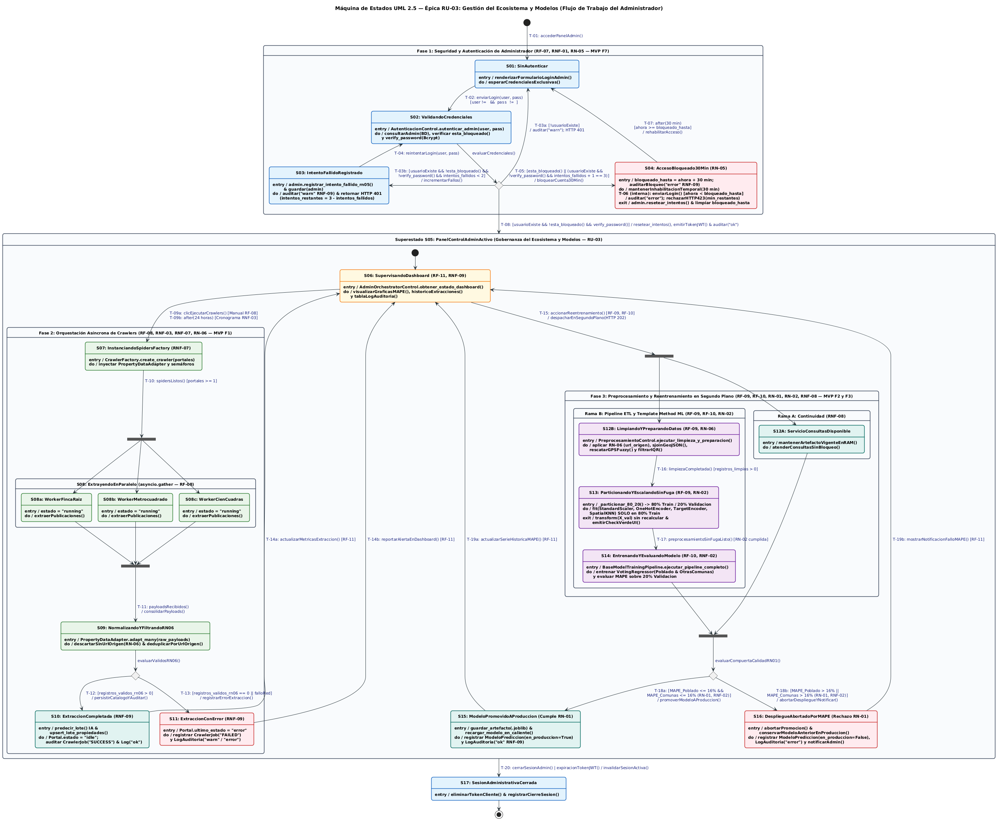

# 2. Máquina de Estados UML 2.5 — Épica 3 (`RU-03`: Gestión del Ecosistema y Modelos)

**Proyecto:** Sistema de Búsqueda y Estimación Inmobiliaria — *Habita* (Medellín)  
**Estudiante:** Heman Santiago Bermudez Espinosa  
**Docente:** Alexandra Guerrero Bocanegra  
**Asignatura:** Diseño de Sistemas de Información — Instituto Tecnológico Metropolitano (ITM)  
**Épica / Requisito de Usuario Modelado:** **`RU-03` — Gestión del Ecosistema y Modelos (Flujo de Trabajo del Administrador)**  
**Requisitos Funcionales Cubiertos:** `RF-07`, `RF-08`, `RF-09`, `RF-10`, `RF-11`  
**Requisitos No Funcionales Cubiertos:** `RNF-01`, `RNF-02`, `RNF-03`, `RNF-07`, `RNF-08`, `RNF-09`  
**Reglas de Negocio Aplicadas:** `RN-01`, `RN-02`, `RN-05`, `RN-06`

---

## 2.1. Nombre y Descripción de la Entidad o Proceso Modelado

### Nombre del Proceso / Entidad Compuesta Modelada
**Ciclo de Vida de Gobernanza del Ecosistema, Ingesta y Modelos Predictivos (`SesionGobernanzaAdmin` / Flujo Administrativo `RU-03`)**

### Descripción General y Alcance dentro del MVP
De acuerdo con el `Modelo Verbal Final.pdf` (págs. 3, 5–8 y 12–15), el requisito de usuario **`RU-03` (Gestión del Ecosistema y Modelos)** establece que:

> *"El administrador debe poder gestionar la plataforma mediante un panel seguro, desde el cual podrá accionar la ingesta de datos externos, reentrenar el modelo predictivo y supervisar las métricas del sistema."*

La máquina de estados modela el ciclo de vida reactivo completo del **flujo de trabajo del Administrador de la plataforma**, evidenciando cómo evoluciona el estado del proceso administrativo y de las entidades persistentes que gobierna: desde la validación de credenciales exclusivas y el control de bloqueo por fuerza bruta, hasta la supervisión del panel de métricas (`Dashboard`), la orquestación asíncrona multi-portal de *crawlers* y el pipeline de preprocesamiento y reentrenamiento en segundo plano del modelo de Machine Learning.

En la arquitectura **Boundary-Control-Entity (BCE)** del proyecto, este ciclo de vida está coordinado por los controladores `AutenticacionControl`, `AdminOrchestratorControl`, `CrawlerOrquestadorControl`, `PreprocesamientoControl` y `ReentrenamientoControl`, materializando sus cambios de estado sobre cinco entidades ORM de dominio en PostgreSQL:

| Entidad de Dominio (`<<entity>>`) | Tabla en BD | Atributos de Estado Persistidos | Rol dentro de la Máquina de Estados (`RU-03`) |
| :--- | :--- | :--- | :--- |
| `Administrador` | `admins` | `intentos_fallidos` (`0..3`), `bloqueado_hasta` (`DateTime \| None`), `ultimo_acceso` | Controla el estado de autenticación (`RF-07`, `RNF-01`) y el bloqueo temporal de **30 minutos** tras **3 intentos fallidos consecutivos** (`RN-05`). |
| `Portal` | `portals` | `activo` (`bool`), `ultimo_estado` (`"idle"` \| `"running"` \| `"error"`), `ultima_ejecucion` | Refleja en tiempo real el estado operativo de cada portal inmobiliario (*Finca Raíz*, *Metrocuadrado*, *CienCuadras*) durante la orquestación (`RF-08`, `RNF-07`). |
| `CrawlerJob` | `crawler_jobs` | `estado` (`"SUCCESS"` \| `"FAILED"`), `registros_extraidos`, `registros_validos_rn06`, `duplicados_omitidos` | Registra el resultado de cada ejecución manual o programada cada 24h (`RNF-03`) y el filtrado estricto de URL original (`RN-06`). |
| `ModeloPrediccion` | `model_versions` | `version`, `mape_poblado`, `mape_otras_comunas`, `mape_promedio`, `en_produccion` (`True` \| `False`) | Persiste el resultado del reentrenamiento (`RF-09`, `RF-10`, `RN-02`) e indica si la versión fue **promovida a producción** o **abortada** según la compuerta `RN-01` ($\text{MAPE} \le 16\%$). |
| `LogAuditoria` | `audit_logs` | `fecha_hora`, `usuario`, `accion`, `detalle`, `estado` (`"ok"` \| `"warn"` \| `"error"`) | Garantiza la trazabilidad e inmutabilidad de auditoría (`RNF-09`) en cada transición crítica del ecosistema y alimenta el Dashboard (`RF-11`). |

---

## 2.2. Estado Inicial, Estados Intermedios y Estado Final

El modelo emplea la notación estricta **OMG UML 2.5 (*StateMachines*)**, distinguiendo pseudoestados iniciales (`[*]`), estados simples, transiciones internas, superestados compuestos jerárquicos, barras de paralelismo (`<<fork>>` / `<<join>>`), pseudoestados de decisión (`<<choice>>`) y el estado final (`[*]`):

### 1. Estado Inicial (`[*]`)
* **Pseudoestado Inicial Global (`[*] -> S01: SinAutenticar`):** Representa el punto de entrada cuando el usuario accede a la ruta administrativa del sistema (`accederPanelAdmin()`). La sesión nace sin privilegios activos y con el formulario de inicio de sesión seguro desplegado (`RF-07`).
* **Pseudoestado Inicial Anidado del Superestado `S05` (`[*] -> S06: SupervisandoDashboard`):** Una vez superada la autenticación y emitido el token JWT con rol `ADMIN`, el administrador ingresa automáticamente a la vista principal del **Panel de Métricas / Dashboard (`RF-11`)**.

### 2. Estados Intermedios (`S01` a `S17`)
Los estados intermedios se agrupan en **tres fases funcionales** y un estado de cierre:

#### A. Fase 1 — Seguridad y Autenticación de Administrador (`RF-07`, `RNF-01`, `RN-05` — Funcionalidad MVP `F7`)
1. **`S01: SinAutenticar`:** Estado de espera inicial donde el sistema aguarda las credenciales exclusivas del perfil Administrador.
   * `entry / renderizarFormularioLoginAdmin()`
   * `do / esperarCredencialesExclusivas()`
2. **`S02: ValidandoCredenciales`:** Estado transitorio de verificación invocando `AutenticacionControl.autenticar_admin()`.
   * `entry / AutenticacionControl.autenticar_admin(user, pass)`
   * `do / consultarAdmin(BD), verificar esta_bloqueado() y verify_password(Bcrypt)`
3. **`S03: IntentoFallidoRegistrado`:** Estado alcanzado cuando la cuenta existe, la contraseña es incorrecta y aún no se alcanza el límite de la regla `RN-05` (menos de 3 fallos consecutivos).
   * `entry / admin.registrar_intento_fallido_rn05() & guardar(admin)`
   * `do / auditar("warn" RNF-09) & retornar HTTP 401 (intentos_restantes = 3 - intentos_fallidos)`
4. **`S04: AccesoBloqueado30Min` (`RN-05`):** Estado de bloqueo de seguridad activado al tercer intento fallido consecutivo. Inhabilita temporalmente el acceso durante **30 minutos** (`HTTP 423 Locked`). Incluye la **transición interna `T-06`** para rechazar intentos durante la ventana de bloqueo sin reiniciar el temporizador ni disparar `exit`/`entry`.
   * `entry / bloqueado_hasta = ahora + 30 min; auditarBloqueo("error" RNF-09)`
   * `do / mantenerInhabilitacionTemporal(30 min)`
   * `T-06 (interna): enviarLogin() [ahora < bloqueado_hasta] / auditar("error"); rechazarHTTP423(min_restantes)`
   * `exit / admin.resetear_intentos() & limpiar bloqueado_hasta`

#### B. Superestado `S05: PanelControlAdminActivo` y Subestado Base de Supervisión (`RF-11`, `RNF-09`)
5. **`S05: PanelControlAdminActivo` (Superestado Compuesto):** Contenedor jerárquico que agrupa todas las operaciones autorizadas mediante token JWT vigente (`get_current_admin`).
6. **`S06: SupervisandoDashboard` (`RF-11`, `RNF-09`):** Estado operativo central del panel donde el administrador monitorea la salud del ecosistema.
   * `entry / AdminOrchestratorControl.obtener_estado_dashboard()`
   * `do / visualizarGraficasMAPE(), historicoExtracciones() y tablaLogAuditoria()`

#### C. Fase 2 — Orquestación Asíncrona de Crawlers (`RF-08`, `RNF-03`, `RNF-07`, `RN-06`, `RNF-09` — Funcionalidad MVP `F1`)
7. **`S07: InstanciandoSpidersFactory` (`RNF-07`):** Resolución polimórfica de los *spiders* configurados mediante el patrón **GoF Factory Method** (`CrawlerFactory.create_crawler()`).
   * `entry / CrawlerFactory.create_crawler(portales)`
   * `do / inyectar PropertyDataAdapter y semáforos`
8. **`S08: ExtrayendoEnParalelo` (`S08a: WorkerFincaRaiz`, `S08b: WorkerMetrocuadrado`, `S08c: WorkerCienCuadras` — `RF-08`):** Estado concurrente abierto por la barra `<<fork>>` y sincronizado por `<<join>>`, donde cada *worker* asíncrono (`asyncio.gather`) extrae publicaciones en paralelo con visibilidad de estado en tiempo real (`Portal.ultimo_estado = "running"`).
9. **`S09: NormalizandoYFiltrandoRN06` (`RN-06`):** Estandarización de esquemas heterogéneos con el patrón **GoF Adapter** (`PropertyDataAdapter`) y descarte estricto de registros sin `url_origen`.
   * `entry / PropertyDataAdapter.adapt_many(raw_payloads)`
   * `do / descartarSinUrlOrigen(RN-06) & deduplicarPorUrlOrigen()`
10. **`S10: ExtraccionCompletada` (`RNF-09`):** Persistencia exitosa en PostgreSQL con inferencia en lote de precios estimados (`RF-02`) y registro de auditoría.
    * `entry / predecir_lote() IA & upsert_lote_propiedades()`
    * `do / Portal.ultimo_estado = "idle"; auditar CrawlerJob("SUCCESS") & LogAuditoria("ok")`
11. **`S11: ExtraccionConError` (`RNF-09`):** Estado de fallo controlado ante caída de red o bloqueo externo que impida obtener registros válidos, registrando trazabilidad en `crawler_jobs` y `audit_logs`.
    * `entry / Portal.ultimo_estado = "error"`
    * `do / registrar CrawlerJob("FAILED") y LogAuditoria("warn" / "error")`

#### D. Fase 3 — Preprocesamiento y Reentrenamiento en Segundo Plano (`RF-09`, `RF-10`, `RN-01`, `RN-02`, `RNF-02`, `RNF-08`, `RNF-09` — Funcionalidades MVP `F2` y `F3`)
Al disparar el reentrenamiento, una barra `<<fork>>` divide la máquina en **dos ramas concurrentes** para garantizar **`RNF-08`**:
12. **`S12A: ServicioConsultasDisponible` (Rama Concurrente A — `RNF-08`):** Mantiene disponible el microservicio de inferencia y el catálogo para arrendatarios y propietarios mientras el nuevo modelo se entrena en segundo plano (`BackgroundTasks`).
    * `entry / mantenerArtefactoVigenteEnRAM()`
    * `do / atenderConsultasSinBloqueo()`
13. **`S12B: LimpiandoYPreparandoDatos` (Rama Concurrente B — `RF-09`, `RN-06`):** Ejecuta la limpieza de dominio en `PreprocesamientoControl`.
    * `entry / PreprocesamientoControl.ejecutar_limpieza_y_preparacion()`
    * `do / aplicar RN-06 (url_origen), sjoinGeoJSON(), rescatarGPSFuzzy() y filtrarIQR()`
14. **`S13: ParticionandoYEscalandoSinFuga` (`RF-09`, `RN-02`):** Aplica la regla crítica **`RN-02`**: divide el dataset (80% entrenamiento / 20% validación) y calcula los parámetros de `StandardScaler`, `OneHotEncoder`, `TargetEncoder`, `OrdinalEncoder` y `SpatialKNNFeatures` **exclusivamente sobre el 80% de entrenamiento (`X_train`)**, aplicándolos luego a `X_val` sin fuga de datos. Al salir, emite el *check* verde a la UI.
    * `entry / _particionar_80_20() -> 80% Train / 20% Validacion`
    * `do / fit(StandardScaler, OneHotEncoder, TargetEncoder, SpatialKNN) SOLO en 80% Train`
    * `exit / transform(X_val) sin recalcular & emitirCheckVerdeUI()`
15. **`S14: EntrenandoYEvaluandoModelo` (`RF-10`, `RNF-02`):** Ejecuta el patrón **GoF Template Method** (`BaseModelTrainingPipeline`) para entrenar los ensambles `VotingRegressor` (*El Poblado* y *Otras Comunas*) y evaluar el MAPE sobre el conjunto de validación (20%).
    * `entry / BaseModelTrainingPipeline.ejecutar_pipeline_completo()`
    * `do / entrenar VotingRegressor(Poblado & OtrasComunas) y evaluar MAPE sobre 20% Validacion`
16. **`S15: ModeloPromovidoAProduccion` (Cumple `RN-01`):** Estado alcanzado cuando ambos submodelos obtienen MAPE $\le 16\%$. Reemplaza el artefacto `.joblib`, recarga el modelo en caliente en RAM y audita el despliegue.
    * `entry / guardar_artefacto(.joblib) & recargar_modelo_en_caliente()`
    * `do / registrar ModeloPrediccion(en_produccion=True) y LogAuditoria("ok" RNF-09)`
17. **`S16: DespliegueAbortadoPorMAPE` (Rechazo `RN-01`):** Estado alcanzado cuando el MAPE supera el $16\%$. Aborta la promoción, conserva intacto el modelo anterior en producción, registra el rechazo en auditoría y notifica al administrador.
    * `entry / abortarPromocion() & conservarModeloAnteriorEnProduccion()`
    * `do / registrar ModeloPrediccion(en_produccion=False), LogAuditoria("error") y notificarAdmin()`

### 3. Estado de Cierre y Estado Final (`[*]`)
18. **`S17: SesionAdministrativaCerrada` $\rightarrow$ Estado Final (`[*]`):** Cuando el administrador cierra sesión explícitamente (`cerrarSesionAdmin()`) o expira el token JWT (`expiracionTokenJWT()`), el sistema abandona el superestado `S05: PanelControlAdminActivo`, elimina el token en el cliente, registra el cierre y alcanza el **Estado Final (`[*]`)**, concluyendo el ciclo de vida de la sesión administrativa.

---

## 2.3. Matriz de Análisis de Estados, Eventos, Transiciones, Condiciones de Guarda y Acciones Asociadas

La siguiente matriz identifica formalmente cada transición (`T-01` a `T-20`) modelada en el diagrama UML, detallando su estado origen, evento disparador, condición de guarda (`[Guard]`), acción/efecto (`/ Action`), estado destino y su trazabilidad normativa:

| ID | Fase / MVP | Estado Origen | Evento Disparador (*Trigger*) | Condición de Guarda (`[Guard]`) | Acción Asociada (`/ Effect`) | Estado Destino | Requisitos / Reglas |
| :-: | :---: | :--- | :--- | :--- | :--- | :--- | :---: |
| **`T-01`** | Inicio (`F7`) | `[*]` *(Estado Inicial)* | `accederPanelAdmin()` | `[ N/A ]` | `/ cargarVistaLoginAdmin()` | `S01: SinAutenticar` | `RF-07` |
| **`T-02`** | Autenticación (`F7`) | `S01: SinAutenticar` | `enviarLogin(user, pass)` | `[ user != "" && pass != "" ]` | `/ invocar AutenticacionControl.autenticar_admin()` | `S02: ValidandoCredenciales` | `RF-07`, `RNF-01` |
| **`T-03a`** | Autenticación (`F7`) | `S02: ValidandoCredenciales` (`<<choice>>`) | `evaluarCredenciales()` | `[ !usuarioExiste ]` | `/ auditar("warn" RNF-09); emitir HTTP 401` | `S01: SinAutenticar` | `RF-07`, `RNF-01`, `RNF-09` |
| **`T-03b`** | Autenticación (`F7`) | `S02: ValidandoCredenciales` (`<<choice>>`) | `evaluarCredenciales()` | `[ usuarioExiste && !esta_bloqueado() && !verify_password() && intentos_fallidos < 2 ]` | `/ admin.registrar_intento_fallido_rn05(); auditar("warn"); emitir HTTP 401` | `S03: IntentoFallidoRegistrado` | `RF-07`, `RNF-01`, `RN-05`, `RNF-09` |
| **`T-04`** | Autenticación (`F7`) | `S03: IntentoFallidoRegistrado` | `reintentarLogin(user, pass)` | `[ intentos_fallidos < 3 ]` | `/ reevaluarCredencialesEnBD()` | `S02: ValidandoCredenciales` | `RF-07`, `RNF-01` |
| **`T-05`** | Bloqueo (`F7`) | `S02: ValidandoCredenciales` (`<<choice>>`) | `evaluarCredenciales()` | `[ esta_bloqueado() \|\| (usuarioExiste && !verify_password() && intentos_fallidos + 1 == 3) ]` | `/ bloqueado_hasta = ahora + 30 min; auditar("error"); emitir HTTP 423 Locked` | `S04: AccesoBloqueado30Min` | `RN-05`, `RNF-01`, `RNF-09` |
| **`T-06`** | Bloqueo (`F7`) | `S04: AccesoBloqueado30Min` *(Transición Interna)* | `enviarLogin(user, pass)` | `[ ahora < bloqueado_hasta ]` | `/ auditar("error"); rechazarHTTP423(minutos_restantes_bloqueo())` | `S04: AccesoBloqueado30Min` *(Permanece sin reiniciar `entry`/`exit`)* | `RN-05`, `RNF-01`, `RNF-09` |
| **`T-07`** | Desbloqueo (`F7`) | `S04: AccesoBloqueado30Min` | `after(30 min)` *(Evento de Tiempo)* | `[ ahora >= bloqueado_hasta ]` | `/ admin.resetear_intentos(); rehabilitarFormularioLogin()` | `S01: SinAutenticar` | `RN-05`, `RNF-01` |
| **`T-08`** | Ingreso Exitoso (`F7`) | `S02: ValidandoCredenciales` (`<<choice>>`) | `evaluarCredenciales()` | `[ usuarioExiste && !esta_bloqueado() && verify_password() ]` | `/ admin.resetear_intentos(); create_access_token(JWT); auditar("ok")` | `S05: PanelControlAdminActivo` $\rightarrow$ `S06: SupervisandoDashboard` | `RF-07`, `RF-11`, `RNF-01`, `RNF-09` |
| **`T-09a`** | Ingesta (`F1`) | `S06: SupervisandoDashboard` | `clicEjecutarCrawlers(portal)` *(Evento Manual)* | `[ tokenJWTValido && portalesNoEnRunning ]` | `/ iniciar CrawlerOrquestadorControl.ejecutar_extraccion()` | `S07: InstanciandoSpidersFactory` | `RF-08`, `RNF-07` |
| **`T-09b`** | Ingesta (`F1`) | `S06: SupervisandoDashboard` | `after(24 horas)` *(Evento Temporal Scheduler)* | `[ cronograma24hCumplido ]` | `/ dispararExtraccionProgramadaAutomatica()` | `S07: InstanciandoSpidersFactory` | `RF-08`, `RNF-03`, `RNF-07` |
| **`T-10`** | Ingesta (`F1`) | `S07: InstanciandoSpidersFactory` | `spidersListos()` | `[ portales_configurados.count >= 1 ]` | `/ abrir barra <<fork>> asyncio.gather(); Portal.ultimo_estado = "running"` | `S08: ExtrayendoEnParalelo` (`S08a` $\parallel$ `S08b` $\parallel$ `S08c`) | `RF-08`, `RNF-07` |
| **`T-11`** | Ingesta (`F1`) | `S08: ExtrayendoEnParalelo` (`<<join>>`) | `payloadsRecibidos()` | `[ todasLasTareasAsyncFinalizadas ]` | `/ sincronizar en barra <<join>>; consolidarPayloadsCrudos()` | `S09: NormalizandoYFiltrandoRN06` | `RF-08`, `RN-06` |
| **`T-12`** | Ingesta (`F1`) | `S09: NormalizandoYFiltrandoRN06` (`<<choice>>`) | `evaluarValidosRN06()` | `[ url_origen != null && registros_validos_rn06 > 0 ]` | `/ predecir_lote() IA; upsert_lote_propiedades(); registrar CrawlerJob("SUCCESS") y LogAuditoria("ok")` | `S10: ExtraccionCompletada` | `RF-08`, `RN-06`, `RNF-09` |
| **`T-13`** | Ingesta (`F1`) | `S09: NormalizandoYFiltrandoRN06` (`<<choice>>`) | `evaluarValidosRN06()` | `[ registros_validos_rn06 == 0 \|\| falloRed ]` | `/ Portal.ultimo_estado = "error"; registrar CrawlerJob("FAILED") y LogAuditoria("warn" / "error")` | `S11: ExtraccionConError` | `RF-08`, `RNF-09` |
| **`T-14a`** | Monitoreo (`RF-11`) | `S10: ExtraccionCompletada` | `actualizarMetricasExtraccion()` | `[ persistenciaCompletada ]` | `/ refrescarGraficoExtraccionesDiarias() y tabla de portales` | `S06: SupervisandoDashboard` | `RF-11`, `RNF-09` |
| **`T-14b`** | Monitoreo (`RF-11`) | `S11: ExtraccionConError` | `reportarAlertaEnDashboard()` | `[ errorRegistradoEnAuditoria ]` | `/ mostrarIndicadorErrorPortalEnUI()` | `S06: SupervisandoDashboard` | `RF-11`, `RNF-09` |
| **`T-15`** | Preprocesamiento y ML (`F2`, `F3`) | `S06: SupervisandoDashboard` | `accionarReentrenamiento()` | `[ tokenJWTValido && datasetDisponibleEnBD ]` | `/ abrir barra <<fork>> asíncrona (HTTP 202 Accepted en ml_service); mantener consultas activas` | `S12A: ServicioConsultasDisponible` $\parallel$ `S12B: LimpiandoYPreparandoDatos` | `RF-09`, `RF-10`, `RNF-08` |
| **`T-16`** | Preprocesamiento (`F2`) | `S12B: LimpiandoYPreparandoDatos` | `limpiezaCompletada()` | `[ url_origen valida (RN-06) && total_registros_limpios > 0 ]` | `/ segmentar El Poblado vs Otras Comunas; iniciar partición 80/20` | `S13: ParticionandoYEscalandoSinFuga` | `RF-09`, `RN-02`, `RN-06` |
| **`T-17`** | Preprocesamiento $\rightarrow$ ML (`F2` $\rightarrow$ `F3`) | `S13: ParticionandoYEscalandoSinFuga` | `preprocesamientoSinFugaListo()` | `[ escaladores/codificadores ajustados SOLO en 80% Train (RN-02) ]` | `/ transformar 20% Val sin recalcular estadísticas; emitir check verde a la UI` | `S14: EntrenandoYEvaluandoModelo` | `RF-09`, `RF-10`, `RN-02` |
| **`T-18a`** | Compuerta `RN-01` (`F3`) | `S14: EntrenandoYEvaluandoModelo` (`<<join>>` $\rightarrow$ `<<choice>>`) | `evaluarCompuertaCalidadRN01()` | `[ MAPE_Poblado <= 16% && MAPE_Comunas <= 16% ]` | `/ guardar_artefacto(.joblib); recargar_modelo_en_caliente(); registrar ModeloPrediccion(en_produccion=True) y LogAuditoria("ok")` | `S15: ModeloPromovidoAProduccion` | `RF-10`, `RN-01`, `RNF-02`, `RNF-09` |
| **`T-18b`** | Compuerta `RN-01` (`F3`) | `S14: EntrenandoYEvaluandoModelo` (`<<join>>` $\rightarrow$ `<<choice>>`) | `evaluarCompuertaCalidadRN01()` | `[ MAPE_Poblado > 16% \|\| MAPE_Comunas > 16% ]` | `/ abortarPromocion(); conservar modelo vigente; registrar ModeloPrediccion(en_produccion=False), LogAuditoria("error") y notificarAdmin()` | `S16: DespliegueAbortadoPorMAPE` | `RF-10`, `RN-01`, `RNF-02`, `RNF-09` |
| **`T-19a`** | Monitoreo (`RF-11`) | `S15: ModeloPromovidoAProduccion` | `actualizarSerieHistoricaMAPE()` | `[ modeloRecargadoEnRAM ]` | `/ actualizarGraficaMAPEHistorico() y tarjeta de versión activa` | `S06: SupervisandoDashboard` | `RF-11`, `RNF-09` |
| **`T-19b`** | Monitoreo (`RF-11`) | `S16: DespliegueAbortadoPorMAPE` | `mostrarNotificacionFalloMAPE()` | `[ rechazoAuditadoEnBD ]` | `/ desplegarAlertaRechazoRN01EnPanel()` | `S06: SupervisandoDashboard` | `RF-11`, `RN-01`, `RNF-09` |
| **`T-20`** | Cierre de Sesión | `S05: PanelControlAdminActivo` | `cerrarSesionAdmin()` \| `expiracionTokenJWT()` | `[ sesionFinalizadaPorUsuario \|\| tokenExpirado ]` | `/ removerTokenJWT(); finalizarSesionAdmin()` | `S17: SesionAdministrativaCerrada` $\rightarrow$ `[*]` | `RF-07`, `RNF-01` |

---

## 2.4. Imagen Legible del Diagrama de Máquina de Estados UML 2.5 (`RU-03`)

### 2.4.1. Diagrama UML 2.5 Renderizado en Alta Resolución (PNG / SVG)

Enlaces del diagrama:
* **Enlace editable en línea (PlantText / PlantUML):** [Abrir Diagrama de Máquina de Estados en Editor PlantText](https://www.planttext.com/?text=bLhRSXit4drtbVy1PYekCh4KNaIAKcnNA8fqbDLjHTdPbEAQ0cSW4jPmm61cPDEng_Prt_S7yW7xj9_WFzalsMvS1dEZu-Y5v01eT1_qvJH6FyG9bKcw2Xy-I7WICdBswO_VKXvH4Z0oWS50nEJbsIdfxlR9__xvR_BfNslkKtBrSgVTEoGlM9pmJ_-DO7P89hw8UPom5IKRSYRW4QnjJiFqZK1frvBEgVeQab6muX7CbI1Vjc1liIQ987EH96950YwPdt0HFNmG-nIKMj5tf3jijybR7YHBU7h7epMLT4NcrBzRI956mLY4GfAlfkelFoLUmYPlURGWjpICMNx8B9GHawJJpez4e7xCrgJRBSodqPrwEim_NTCWGF7z_CE0tT8qJAOYIixfYf76Z2q48ozF6bjcpVXxHZg5xKPIYhV6hkwWr-qDAwEuqipeZBgz_Kdj32sxy_110PU49epy_l018KSL58VJqNIiXeGCc3IFUxszJh_l7bylkNyNiJWcdLtrkDPS_JYpp_nCDd2mSn46-6IK99BFquGv0MCHnIAaSQCodbbJKVpfqr6QB9y_9rzDUjFkzBXaW1lkz0VzSRjMmgdmxt3AT3evcamg4kpmUD0TeXlKI3YcyN8kg0oqcEbmqgc8ASxfxqyx-xMonfA-3PbK9Wsd_Sb1HL9kHdUoVzphrievErKRzIRzQRyYGWyEHfsZWr7jwbdg-t3AIeis05kr9pUZtHuSzC5tFgAxtNppckn0-4KxpycitV5cF88pO542IKIIGtAzq-uS4WgBGTObZLYeKaEpfNnLUMXZIcCuxqC2BfLA7j00qaicn3VffvXIIFDgkjFUVqAkpk6pWvyxRPt0pbvTakb-gq5eJ50okeIE0hFT33KgwAdcLhMtxeHhwso3Rt93lYEIHM0SVq_bLCXL6bB9nQbOm6nhQltwGC1Y5g-Pf78i0Q38vv0DuyaxFqnZVazZ3LDEy-uXUKL3m2WAH7w9iQ3hrOwMBDasorcKGrz44AY95E4kpNJtg38iZPby0janZbj_9bYPwaF4GpAaKkDoTDnwGku1k5k51rGQwir3yLlAu8IRhLyZWdyRFMNZuJvlmIMRHxxSh9C2Chv7yPIVFlMNWliC3It01fNi94BjnPI6eA6uOWlZIWQvdbUSK8AiCkomKbZiIYDGUbnFz6xrJ4z6xNvc3Vmz9eiKyWALJRMojNK3XHbD0mw8DHjlgOmQsjqFMY14iWJg6k3su_Nr9TbhTymEJRD_x4b457x4v1dfaHsI3HZDuh9pxHsI4KQvEBAdq6kVyGXY3OEhPP3Qyx9XOjEbjY4_ul39ZjHRKjWAbA5B8IdvblJQ103uta5ZZDLIHBF1eBx9pEYwJHH6AxGIIln9jAHp7e88TDjhjbh3Fc5JRrEx7BBJG2C6KBPGvtjEfOhTPelSQ4MVbaruRJJEdOxMjFKz78k_f909y5JskhqcxEmEebO7zeudEJUAMSAS5q46WBCE-MeDUfNrqCTNpImk7syFIB2yMxGt5ys_HZVuYpnwHXeDylYnUgf_lVvyfDkjJK323lSqJ8lfpIOrCsSdNM-l7JrwI6uUfN6AENNo3jade5yE2y3THa5USCXk4oMw9hXGzXna5qIZgO_AUGWU_XezAYSXV5oDAF2LhjAFHxvaAnY4cW1Z8cvkYtDh_cUF2Y9JChrRpN4LuPHyiTHcLtoz3mPNpFlmWJJBA7ovmT-I3da6-QMbp3PovJX5JLNsQDOu_MUFV1_emYq4f8rRS4OTXy-VrGGYLbyRzL9dBznHSHEBI1OEVKyn45FGHj22t1jaXb_g2fLgr7gj640bR9yGjk89bzVYZaK__Noj0ZbpMt7No3EWMGeaWAbk3DKy90KzCJCOPPiln1npLVIURc_9a0Mf_iscx5gxVzTkKoHm0q-fSizZTCICn9OAnG3uKzqqnSewdISsOvljjmWb1PQilMJRr1mrGJGkfBzaM6wX1bfw8kQg27WQHY-mQwq3RXUjYWWyJo408NM_a1GPINmskfpWEIu1O26v3vu1E_fOMp29PVmaeVEGGb2Ey71X8YsnDaLl8TbUIF2ZE36CTXH_-Wya2Q4xSKFoOyrhXmR1dldSr_nsuFXjn_7RRAdYkBbJsaVIWvK7CWbOF5jpOAdnbFgWv0QBEagsPxJlsO5Snw45vWVTEPX9Pc0NqXriw_dwQHCgRuBfgrKdGk7Demtp8HR8fHHmBCdcc2Pq5D0rX3w06hFLfpzkXHInnjBQ1O_kz2wWAFwmMkhXDmBghHt67vOAvd21M5SdkG7QBYRH9JJB8SGDQT9u0rY9tGLDbg242YCy3OlHq7FhBDfvkL2hVWQD01H8__IAylTs8QsYIlHp1wW9VoYoCeqY7YqQfOcwNK0De9DAvw6XvwwW5hMPMstE6CI7dz8WHtU7yoqQpRzKe_bVryYt6eqvYyPA8Tku3Fqj-lXVge__P_hWl8yLPpWu9EVGjAd8XsFzPSf3M0xVhixR0wFSWLTuMXSXvIbEwHhttgNuwG5jtJH14DIIJIXeu8AbAarP5h0OgYJ435JDbpAyW4hF8aNE1rXS0XQaQxHPNWhfnbj5c_qiF8gzaiEaqpO1uklkRxKE6G1FJSgmQRtJzXGCK2yJx0Io6m9ZHN7S0R96TkDpwOKYOL0LJqRaiMi1qZNmcaIDUMk0ZhE01ku0Ar8LC9Sgs-mw_-11o1gsiJ15rsQidyIysPYz78ydira3SOFKxGfo0OXE4OXeWYo_34F7AAJ6yWqHAG_cd48h3CqmNmdFwQtRY2sBbQbPdramPpewEPqSDrnDAfGZqpj-P-LdXkRJikK0kGIBp0YT8TQLunJh83OaDpQx8oNhlDQoSkiSdHZIpmtEFpVeMnKXzzd7BhjdW_FF3VfR1tDrmkrP3Jkm7tp0nkSLkEqSMIyMVtsT8P2ooqipeRarWbrVPA4rZP4Y_IB6IIvI_R9gPQy7lO1Gt1Xd03v-hyNWPSE0F2TjnOmXxo0vv78CkISK2_7BoF3FrhPzIYu7-_IsxmEylutj0pO3uee5XeuR1rKoNFZeFJ_QddKR6tEdaMSCmD0FeBhwaDqcRvYV9jXHQjg3_dX68-1kkbY34ZXxRhk8xXx1xY66QMDWMs8XAP1bJQzqCri4r_Ocs-aYWB97yKupCOGH2omInhonv4PHORD30TOlss6EBPyAD3a2EnCwYOuTfNNY7T5KSRGgyg8_1zgkKhlsrLKj643b5SDanIAwujZHc2tR1qyGvevsC4ZCQ-eluQmZlBi5-PSXZKHJDUFTThU61uCxNO9TG4XOR4H3kYfj1dcI6854ITIqsEwjsR2vzEqQZZnqvBWB4gSznv3FJalS-0fTO7H8i7NWKQgkd7LMDrmFhmT5TCpZjOWuDfSueyBuEjqHNbe3jW3Ps5nkndOLL21T8BeZpquohLUbM9BQQQvUs1kkaKpOBKR5Aopj2Pj4LwCp6ytRXEXxn4HTKcTQ0eMmrsnRk942wGYEYwzPo2D69jUd02nUguKu0Rn-AG82uDOSJZUFuwHmjZKmmYwdweeB6HYw1vNQMHCHE-cAvrXCZxni1T4lE78Wv0VpJApeTxPnP2QZUEgQZRsd7hJtMWcNk6ebQsGrvp8TMZELeISKyuBMCSOwyuA9dsONvz1Acl8iaSV1XYykPzFq_ViDnDQ6tAfw8K_-VbL7dZ4DGwEIS1MS2DC4tvoglev7qtH12pXrBKuzpmwNGN8Z3Y5WedOBwGtRNhSDga6E6BQ_nhUxF88vNVYkRwfyzGAtJfx2vPOdpHbqdr0VWnc-vPLFo4N4VXJ99F95W3-lgLomxAT1PxQc2QVXtyxFMsHsSNg1oI1JO8l--WeLwsqC-MpL_0SMgXQ9GMF9O6yVNyhaQAQ-cXalcN_tYic0lJof1NqF-9_sNOMugjZmJT-pwCkEjaa_6U9xdbjI0Rqmw70_mYI5GfMDqDZOc7E-kJPFF5_pSP5tov9OtGRf9vAy4f3Z5X29u7QnaCrBCG-HRZuc5m1O3Fm-ZMZigACX9WIlFqWivf9LpdnBG3WQaJySA2k3Gs9ZoxKJM54SiL3Z4Et8NUeEsSak6GlYzm-ngIZ4jbccAAigNHWKn4zXSx3YTPRnihHdow3Rfv9AjqpB8P0lTufXhlBN4FNvkS1GLw6ULh2nCYF_tWk8MAVGov5iPySvrIHt5mz7a2AZ6AiZ3O1xTiel6f49Q3U7_dKbxe7qZU1Ra2fsG9fZH9BfEcmzl-zbSyiLhZZe7D-y2VEehMlDtJVWddpUolU46C9o0TDMIYEF0NK7rR40cikzalXIfsGDOG7Nx0m4h3DZdbtBb6thdA0jTA-V2W21Jny3_G4r5YaRpP6e0VqHKeLDyqgz1X95W0QUdLTySPOVoBrNL8-aiijmoXmcs7o08m7vLCQDy1KM1xuTkLEos1Ia_pLeflWFDLdTAa9ZUac0B88CezxXvbxj4-jsBbAAPmHnYnTcDuYNPtFIK-Wd1r-h5n3gkKbEzdaputqgu-ecHyba5eUo-HKj2cYW4lEo4i_LNXy-b7HulbK5SrBE7NuvjuXOC8hMVr47S53eCI1hSFQZkOcc-cgws6Fa3Fio-M3uIYWtiEeYREfrLLd-n_ox2iotCnR3NFSl6P3Aw1Wy0lAwSVPzJyynJtFlqwjZkIi-g0CSgfPwQpAsCQvUTnkN7NDOnFHwZUwMznlkoAlRNUzqsz1Euc-PCmNVXW6PM7FD_7AlRl2-MlM-sNpSHDtqL-NRdM--0UX-0Dwj_ltk_m00)
* **Gráfico vectorial SVG en línea (PlantText):** [Ver diagrama SVG en línea](https://uml.planttext.com/plantuml/svg/bLhRSXit4drtbVy1PYekCh4KNaIAKcnNA8fqbDLjHTdPbEAQ0cSW4jPmm61cPDEng_Prt_S7yW7xj9_WFzalsMvS1dEZu-Y5v01eT1_qvJH6FyG9bKcw2Xy-I7WICdBswO_VKXvH4Z0oWS50nEJbsIdfxlR9__xvR_BfNslkKtBrSgVTEoGlM9pmJ_-DO7P89hw8UPom5IKRSYRW4QnjJiFqZK1frvBEgVeQab6muX7CbI1Vjc1liIQ987EH96950YwPdt0HFNmG-nIKMj5tf3jijybR7YHBU7h7epMLT4NcrBzRI956mLY4GfAlfkelFoLUmYPlURGWjpICMNx8B9GHawJJpez4e7xCrgJRBSodqPrwEim_NTCWGF7z_CE0tT8qJAOYIixfYf76Z2q48ozF6bjcpVXxHZg5xKPIYhV6hkwWr-qDAwEuqipeZBgz_Kdj32sxy_110PU49epy_l018KSL58VJqNIiXeGCc3IFUxszJh_l7bylkNyNiJWcdLtrkDPS_JYpp_nCDd2mSn46-6IK99BFquGv0MCHnIAaSQCodbbJKVpfqr6QB9y_9rzDUjFkzBXaW1lkz0VzSRjMmgdmxt3AT3evcamg4kpmUD0TeXlKI3YcyN8kg0oqcEbmqgc8ASxfxqyx-xMonfA-3PbK9Wsd_Sb1HL9kHdUoVzphrievErKRzIRzQRyYGWyEHfsZWr7jwbdg-t3AIeis05kr9pUZtHuSzC5tFgAxtNppckn0-4KxpycitV5cF88pO542IKIIGtAzq-uS4WgBGTObZLYeKaEpfNnLUMXZIcCuxqC2BfLA7j00qaicn3VffvXIIFDgkjFUVqAkpk6pWvyxRPt0pbvTakb-gq5eJ50okeIE0hFT33KgwAdcLhMtxeHhwso3Rt93lYEIHM0SVq_bLCXL6bB9nQbOm6nhQltwGC1Y5g-Pf78i0Q38vv0DuyaxFqnZVazZ3LDEy-uXUKL3m2WAH7w9iQ3hrOwMBDasorcKGrz44AY95E4kpNJtg38iZPby0janZbj_9bYPwaF4GpAaKkDoTDnwGku1k5k51rGQwir3yLlAu8IRhLyZWdyRFMNZuJvlmIMRHxxSh9C2Chv7yPIVFlMNWliC3It01fNi94BjnPI6eA6uOWlZIWQvdbUSK8AiCkomKbZiIYDGUbnFz6xrJ4z6xNvc3Vmz9eiKyWALJRMojNK3XHbD0mw8DHjlgOmQsjqFMY14iWJg6k3su_Nr9TbhTymEJRD_x4b457x4v1dfaHsI3HZDuh9pxHsI4KQvEBAdq6kVyGXY3OEhPP3Qyx9XOjEbjY4_ul39ZjHRKjWAbA5B8IdvblJQ103uta5ZZDLIHBF1eBx9pEYwJHH6AxGIIln9jAHp7e88TDjhjbh3Fc5JRrEx7BBJG2C6KBPGvtjEfOhTPelSQ4MVbaruRJJEdOxMjFKz78k_f909y5JskhqcxEmEebO7zeudEJUAMSAS5q46WBCE-MeDUfNrqCTNpImk7syFIB2yMxGt5ys_HZVuYpnwHXeDylYnUgf_lVvyfDkjJK323lSqJ8lfpIOrCsSdNM-l7JrwI6uUfN6AENNo3jade5yE2y3THa5USCXk4oMw9hXGzXna5qIZgO_AUGWU_XezAYSXV5oDAF2LhjAFHxvaAnY4cW1Z8cvkYtDh_cUF2Y9JChrRpN4LuPHyiTHcLtoz3mPNpFlmWJJBA7ovmT-I3da6-QMbp3PovJX5JLNsQDOu_MUFV1_emYq4f8rRS4OTXy-VrGGYLbyRzL9dBznHSHEBI1OEVKyn45FGHj22t1jaXb_g2fLgr7gj640bR9yGjk89bzVYZaK__Noj0ZbpMt7No3EWMGeaWAbk3DKy90KzCJCOPPiln1npLVIURc_9a0Mf_iscx5gxVzTkKoHm0q-fSizZTCICn9OAnG3uKzqqnSewdISsOvljjmWb1PQilMJRr1mrGJGkfBzaM6wX1bfw8kQg27WQHY-mQwq3RXUjYWWyJo408NM_a1GPINmskfpWEIu1O26v3vu1E_fOMp29PVmaeVEGGb2Ey71X8YsnDaLl8TbUIF2ZE36CTXH_-Wya2Q4xSKFoOyrhXmR1dldSr_nsuFXjn_7RRAdYkBbJsaVIWvK7CWbOF5jpOAdnbFgWv0QBEagsPxJlsO5Snw45vWVTEPX9Pc0NqXriw_dwQHCgRuBfgrKdGk7Demtp8HR8fHHmBCdcc2Pq5D0rX3w06hFLfpzkXHInnjBQ1O_kz2wWAFwmMkhXDmBghHt67vOAvd21M5SdkG7QBYRH9JJB8SGDQT9u0rY9tGLDbg242YCy3OlHq7FhBDfvkL2hVWQD01H8__IAylTs8QsYIlHp1wW9VoYoCeqY7YqQfOcwNK0De9DAvw6XvwwW5hMPMstE6CI7dz8WHtU7yoqQpRzKe_bVryYt6eqvYyPA8Tku3Fqj-lXVge__P_hWl8yLPpWu9EVGjAd8XsFzPSf3M0xVhixR0wFSWLTuMXSXvIbEwHhttgNuwG5jtJH14DIIJIXeu8AbAarP5h0OgYJ435JDbpAyW4hF8aNE1rXS0XQaQxHPNWhfnbj5c_qiF8gzaiEaqpO1uklkRxKE6G1FJSgmQRtJzXGCK2yJx0Io6m9ZHN7S0R96TkDpwOKYOL0LJqRaiMi1qZNmcaIDUMk0ZhE01ku0Ar8LC9Sgs-mw_-11o1gsiJ15rsQidyIysPYz78ydira3SOFKxGfo0OXE4OXeWYo_34F7AAJ6yWqHAG_cd48h3CqmNmdFwQtRY2sBbQbPdramPpewEPqSDrnDAfGZqpj-P-LdXkRJikK0kGIBp0YT8TQLunJh83OaDpQx8oNhlDQoSkiSdHZIpmtEFpVeMnKXzzd7BhjdW_FF3VfR1tDrmkrP3Jkm7tp0nkSLkEqSMIyMVtsT8P2ooqipeRarWbrVPA4rZP4Y_IB6IIvI_R9gPQy7lO1Gt1Xd03v-hyNWPSE0F2TjnOmXxo0vv78CkISK2_7BoF3FrhPzIYu7-_IsxmEylutj0pO3uee5XeuR1rKoNFZeFJ_QddKR6tEdaMSCmD0FeBhwaDqcRvYV9jXHQjg3_dX68-1kkbY34ZXxRhk8xXx1xY66QMDWMs8XAP1bJQzqCri4r_Ocs-aYWB97yKupCOGH2omInhonv4PHORD30TOlss6EBPyAD3a2EnCwYOuTfNNY7T5KSRGgyg8_1zgkKhlsrLKj643b5SDanIAwujZHc2tR1qyGvevsC4ZCQ-eluQmZlBi5-PSXZKHJDUFTThU61uCxNO9TG4XOR4H3kYfj1dcI6854ITIqsEwjsR2vzEqQZZnqvBWB4gSznv3FJalS-0fTO7H8i7NWKQgkd7LMDrmFhmT5TCpZjOWuDfSueyBuEjqHNbe3jW3Ps5nkndOLL21T8BeZpquohLUbM9BQQQvUs1kkaKpOBKR5Aopj2Pj4LwCp6ytRXEXxn4HTKcTQ0eMmrsnRk942wGYEYwzPo2D69jUd02nUguKu0Rn-AG82uDOSJZUFuwHmjZKmmYwdweeB6HYw1vNQMHCHE-cAvrXCZxni1T4lE78Wv0VpJApeTxPnP2QZUEgQZRsd7hJtMWcNk6ebQsGrvp8TMZELeISKyuBMCSOwyuA9dsONvz1Acl8iaSV1XYykPzFq_ViDnDQ6tAfw8K_-VbL7dZ4DGwEIS1MS2DC4tvoglev7qtH12pXrBKuzpmwNGN8Z3Y5WedOBwGtRNhSDga6E6BQ_nhUxF88vNVYkRwfyzGAtJfx2vPOdpHbqdr0VWnc-vPLFo4N4VXJ99F95W3-lgLomxAT1PxQc2QVXtyxFMsHsSNg1oI1JO8l--WeLwsqC-MpL_0SMgXQ9GMF9O6yVNyhaQAQ-cXalcN_tYic0lJof1NqF-9_sNOMugjZmJT-pwCkEjaa_6U9xdbjI0Rqmw70_mYI5GfMDqDZOc7E-kJPFF5_pSP5tov9OtGRf9vAy4f3Z5X29u7QnaCrBCG-HRZuc5m1O3Fm-ZMZigACX9WIlFqWivf9LpdnBG3WQaJySA2k3Gs9ZoxKJM54SiL3Z4Et8NUeEsSak6GlYzm-ngIZ4jbccAAigNHWKn4zXSx3YTPRnihHdow3Rfv9AjqpB8P0lTufXhlBN4FNvkS1GLw6ULh2nCYF_tWk8MAVGov5iPySvrIHt5mz7a2AZ6AiZ3O1xTiel6f49Q3U7_dKbxe7qZU1Ra2fsG9fZH9BfEcmzl-zbSyiLhZZe7D-y2VEehMlDtJVWddpUolU46C9o0TDMIYEF0NK7rR40cikzalXIfsGDOG7Nx0m4h3DZdbtBb6thdA0jTA-V2W21Jny3_G4r5YaRpP6e0VqHKeLDyqgz1X95W0QUdLTySPOVoBrNL8-aiijmoXmcs7o08m7vLCQDy1KM1xuTkLEos1Ia_pLeflWFDLdTAa9ZUac0B88CezxXvbxj4-jsBbAAPmHnYnTcDuYNPtFIK-Wd1r-h5n3gkKbEzdaputqgu-ecHyba5eUo-HKj2cYW4lEo4i_LNXy-b7HulbK5SrBE7NuvjuXOC8hMVr47S53eCI1hSFQZkOcc-cgws6Fa3Fio-M3uIYWtiEeYREfrLLd-n_ox2iotCnR3NFSl6P3Aw1Wy0lAwSVPzJyynJtFlqwjZkIi-g0CSgfPwQpAsCQvUTnkN7NDOnFHwZUwMznlkoAlRNUzqsz1Euc-PCmNVXW6PM7FD_7AlRl2-MlM-sNpSHDtqL-NRdM--0UX-0Dwj_ltk_m00)



---

### 2.4.2. Diagrama Interactivo en Mermaid (`stateDiagram-v2`)

```mermaid
stateDiagram-v2
    direction TB

    [*] --> S01_SinAutenticar : T-01: accederPanelAdmin()

    state "Fase 1: Seguridad y Autenticación de Administrador (RF-07, RNF-01, RN-05 — MVP F7)" as FaseAuth {
        state "S01: SinAutenticar" as S01_SinAutenticar
        S01_SinAutenticar : entry / renderizarFormularioLoginAdmin()
        S01_SinAutenticar : do / esperarCredencialesExclusivas()

        state "S02: ValidandoCredenciales" as S02_ValidandoCredenciales
        S02_ValidandoCredenciales : entry / AutenticacionControl.autenticar_admin(user, pass)
        S02_ValidandoCredenciales : do / consultarAdmin(BD), verificar esta_bloqueado() y verify_password(Bcrypt)

        state c_auth <<choice>>

        state "S03: IntentoFallidoRegistrado" as S03_IntentoFallido
        S03_IntentoFallido : entry / admin.registrar_intento_fallido_rn05() & guardar(admin)
        S03_IntentoFallido : do / auditar("warn" RNF-09) & retornar HTTP 401 (3 - intentos_fallidos)

        state "S04: AccesoBloqueado30Min (RN-05)" as S04_Bloqueado
        S04_Bloqueado : entry / bloqueado_hasta = ahora + 30 min; auditarBloqueo("error" RNF-09)
        S04_Bloqueado : do / mantenerInhabilitacionTemporal(30 min)
        S04_Bloqueado : T-06 (interna) enviarLogin() [ahora < bloqueado_hasta] / auditar("error"); HTTP 423
        S04_Bloqueado : exit / admin.resetear_intentos() & limpiar bloqueado_hasta

        S01_SinAutenticar --> S02_ValidandoCredenciales : T-02: enviarLogin(user, pass)
        S02_ValidandoCredenciales --> c_auth : evaluarCredenciales()

        c_auth --> S01_SinAutenticar : T-03a: [!usuarioExiste] / auditar("warn"); HTTP 401
        c_auth --> S03_IntentoFallido : T-03b: [usuarioExiste && !esta_bloqueado() && !verify_password() && intentos < 2] / incrementarFallos()
        S03_IntentoFallido --> S02_ValidandoCredenciales : T-04: reintentarLogin(user, pass)

        c_auth --> S04_Bloqueado : T-05: [esta_bloqueado() || (usuarioExiste && !verify_password() && intentos + 1 == 3)] / bloquearCuenta30Min()
        S04_Bloqueado --> S01_SinAutenticar : T-07: after(30 min) [ahora >= bloqueado_hasta] / rehabilitarAcceso()
    }

    c_auth --> S05_PanelControlActivo : T-08: [usuarioExiste && !esta_bloqueado() && verify_password()] / resetear_intentos(), emitirTokenJWT() & auditar("ok")

    state "Superestado S05: PanelControlAdminActivo (Gobernanza del Ecosistema y Modelos — RU-03)" as S05_PanelControlActivo {
        [*] --> S06_SupervisandoDashboard

        state "S06: SupervisandoDashboard (RF-11, RNF-09)" as S06_SupervisandoDashboard
        S06_SupervisandoDashboard : entry / AdminOrchestratorControl.obtener_estado_dashboard()
        S06_SupervisandoDashboard : do / visualizarGraficasMAPE(), historicoExtracciones() y tablaLogAuditoria()

        state "Fase 2: Orquestación Asíncrona de Crawlers (RF-08, RNF-03, RNF-07, RN-06 — MVP F1)" as FaseCrawlers {
            state "S07: InstanciandoSpidersFactory (RNF-07)" as S07_Factory
            S07_Factory : entry / CrawlerFactory.create_crawler(portales)
            S07_Factory : do / inyectar PropertyDataAdapter y semáforos

            state fork_crawl <<fork>>
            state join_crawl <<join>>

            state "S08: ExtrayendoEnParalelo (asyncio.gather — RF-08)" as S08_Extrayendo {
                state "S08a: WorkerFincaRaiz" as S08a
                --
                state "S08b: WorkerMetrocuadrado" as S08b
                --
                state "S08c: WorkerCienCuadras" as S08c
            }

            state "S09: NormalizandoYFiltrandoRN06" as S09_FiltrandoRN06
            S09_FiltrandoRN06 : entry / PropertyDataAdapter.adapt_many(raw_payloads)
            S09_FiltrandoRN06 : do / descartarSinUrlOrigen(RN-06) & deduplicarPorUrlOrigen()

            state c_crawl <<choice>>

            state "S10: ExtraccionCompletada (RNF-09)" as S10_CrawlExito
            S10_CrawlExito : entry / predecir_lote() IA & upsert_lote_propiedades()
            S10_CrawlExito : do / Portal.ultimo_estado = "idle"; auditar CrawlerJob("SUCCESS")

            state "S11: ExtraccionConError (RNF-09)" as S11_CrawlError
            S11_CrawlError : entry / Portal.ultimo_estado = "error"
            S11_CrawlError : do / registrar CrawlerJob("FAILED") y LogAuditoria("warn" / "error")

            S07_Factory --> fork_crawl : T-10: spidersListos()
            fork_crawl --> S08a
            fork_crawl --> S08b
            fork_crawl --> S08c
            S08a --> join_crawl
            S08b --> join_crawl
            S08c --> join_crawl
            join_crawl --> S09_FiltrandoRN06 : T-11: payloadsRecibidos() / consolidarPayloads()
            S09_FiltrandoRN06 --> c_crawl : evaluarValidosRN06()

            c_crawl --> S10_CrawlExito : T-12: [registros_validos_rn06 > 0] / persistirCatalogoYAuditar()
            c_crawl --> S11_CrawlError : T-13: [registros_validos_rn06 == 0 || falloRed] / registrarErrorExtraccion()
        }

        S06_SupervisandoDashboard --> S07_Factory : T-09a: clicEjecutarCrawlers() [Manual RF-08]
        S06_SupervisandoDashboard --> S07_Factory : T-09b: after(24 horas) [Cronograma RNF-03]
        S10_CrawlExito --> S06_SupervisandoDashboard : T-14a: actualizarMetricasExtraccion() [RF-11]
        S11_CrawlError --> S06_SupervisandoDashboard : T-14b: reportarAlertaEnDashboard() [RF-11]

        state fork_ml <<fork>>
        S06_SupervisandoDashboard --> fork_ml : T-15: accionarReentrenamiento() [RF-09, RF-10] / despacharEnSegundoPlano(HTTP 202)

        state "Fase 3: Preprocesamiento y Reentrenamiento en Segundo Plano (RF-09, RF-10, RN-01, RN-02, RNF-08 — MVP F2 y F3)" as FaseML {
            state "Rama A: Continuidad del Servicio (RNF-08)" as RegionDisponibilidad {
                state "S12A: ServicioConsultasDisponible (RNF-08)" as S12A_ServicioActivo
                S12A_ServicioActivo : entry / mantenerArtefactoVigenteEnRAM()
                S12A_ServicioActivo : do / atenderConsultasSinBloqueo()
            }

            state "Rama B: Pipeline ETL y Template Method ML (RF-09, RF-10, RN-02)" as RegionEntrenamiento {
                state "S12B: LimpiandoYPreparandoDatos (RF-09, RN-06)" as S12B_Limpiando
                S12B_Limpiando : entry / PreprocesamientoControl.ejecutar_limpieza_y_preparacion()
                S12B_Limpiando : do / aplicar RN-06 (url_origen), sjoinGeoJSON(), rescatarGPSFuzzy() y filtrarIQR()

                state "S13: ParticionandoYEscalandoSinFuga (RF-09, RN-02)" as S13_SinFuga
                S13_SinFuga : entry / _particionar_80_20() -> 80% Train / 20% Validacion
                S13_SinFuga : do / fit(StandardScaler, OneHotEncoder, TargetEncoder, SpatialKNN) SOLO en 80% Train
                S13_SinFuga : exit / transform(X_val) sin recalcular & emitirCheckVerdeUI()

                state "S14: EntrenandoYEvaluandoModelo (RF-10, RNF-02)" as S14_Entrenando
                S14_Entrenando : entry / BaseModelTrainingPipeline.ejecutar_pipeline_completo()
                S14_Entrenando : do / entrenar VotingRegressor(Poblado & OtrasComunas) y evaluar MAPE en 20% Val

                S12B_Limpiando --> S13_SinFuga : T-16: limpiezaCompletada() [registros_limpios > 0]
                S13_SinFuga --> S14_Entrenando : T-17: preprocesamientoSinFugaListo() [RN-02 cumplida]
            }
        }

        fork_ml --> S12A_ServicioActivo
        fork_ml --> S12B_Limpiando

        state join_ml <<join>>
        S12A_ServicioActivo --> join_ml
        S14_Entrenando --> join_ml

        state c_rn01 <<choice>>
        join_ml --> c_rn01 : evaluarCompuertaCalidadRN01()

        state "S15: ModeloPromovidoAProduccion (Cumple RN-01)" as S15_Promovido
        S15_Promovido : entry / guardar_artefacto(.joblib) & recargar_modelo_en_caliente()
        S15_Promovido : do / registrar ModeloPrediccion(en_produccion=True) y LogAuditoria("ok" RNF-09)

        state "S16: DespliegueAbortadoPorMAPE (Rechazo RN-01)" as S16_Abortado
        S16_Abortado : entry / abortarPromocion() & conservarModeloAnteriorEnProduccion()
        S16_Abortado : do / registrar ModeloPrediccion(en_produccion=False), LogAuditoria("error") y notificarAdmin()

        c_rn01 --> S15_Promovido : T-18a: [MAPE_Poblado <= 16% && MAPE_Comunas <= 16% (RN-01, RNF-02)] / promoverModeloAProduccion()
        c_rn01 --> S16_Abortado : T-18b: [MAPE_Poblado > 16% || MAPE_Comunas > 16% (RN-01, RNF-02)] / abortarDespliegueYNotificar()

        S15_Promovido --> S06_SupervisandoDashboard : T-19a: actualizarSerieHistoricaMAPE() [RF-11]
        S16_Abortado --> S06_SupervisandoDashboard : T-19b: mostrarNotificacionFalloMAPE() [RF-11]
    }

    state "S17: SesionAdministrativaCerrada" as S17_SesionCerrada
    S17_SesionCerrada : entry / eliminarTokenCliente() & registrarCierreSesion()

    S05_PanelControlActivo --> S17_SesionCerrada : T-20: cerrarSesionAdmin() | expiracionTokenJWT() / invalidarSesionActiva()
    S17_SesionCerrada --> [*]
```

---

## 2.5. Explicación Técnica de las Transiciones y su Relación con las Funcionalidades del MVP

El flujo del administrador (`RU-03`) articula directamente cuatro funcionalidades nucleares del MVP (**`F7`**, **`F1`**, **`F2`** y **`F3`**) junto con el panel transversal de observabilidad (**`RF-11`**). A continuación se detalla técnicamente cómo se ejecuta cada grupo de transiciones en el código fuente del proyecto:

### 1. Transiciones `T-01` a `T-08` y `T-20` $\leftrightarrow$ Funcionalidad del MVP `F7: Autenticarse` (`RF-07`, `RNF-01`, `RN-05`, `RNF-09`)
* **Componentes técnicos involucrados:** `auth_router.py`, `AutenticacionControl`, `Administrador` y `security.py`.
* **Mecánica de las transiciones:**
  1. Al dispararse **`T-02`** (`POST /api/v1/auth/login`), el sistema entra en `S02: ValidandoCredenciales`. El controlador recupera la entidad `Administrador` desde PostgreSQL y verifica si el usuario existe (`T-03a` ante usuario inexistente, auditando `"warn"` y retornando `HTTP 401`) y si tiene un bloqueo temporal activo mediante `admin.esta_bloqueado()`.
  2. **Acumulación de fallos (`T-03b` y `T-04`):** Si la contraseña no coincide con el hash `bcrypt` (`verify_password() == False`) y el contador aún es menor a 3 (`MAX_FAILED_LOGIN_ATTEMPTS = 3`), el método `registrar_intento_fallido_rn05()` incrementa `intentos_fallidos` en la tabla `admins`, registra un evento `"warn"` en `audit_logs` (`RNF-09`) y devuelve `HTTP 401 Unauthorized` informando cuántos intentos restan (`3 - intentos_fallidos`).
  3. **Activación y retención del bloqueo por fuerza bruta (`T-05` y `T-06` — Regla `RN-05`):** En el tercer fallo consecutivo (`intentos_fallidos == 3`), `registrar_intento_fallido_rn05()` fija `bloqueado_hasta = ref + timedelta(minutes=30)`, transitando a `S04: AccesoBloqueado30Min` con código `HTTP 423 Locked`. Mientras `[ahora < bloqueado_hasta]`, cualquier intento de inicio de sesión ejecuta la **transición interna `T-06`**, rechazando el acceso sin evaluar el hash `bcrypt` ni reiniciar `bloqueado_hasta`, y calculando los minutos restantes con `minutos_restantes_bloqueo()`.
  4. **Expiración del temporizador (`T-07`), éxito (`T-08`) y cierre (`T-20`):** Al cumplirse el evento de tiempo UML `after(30 min)` (`[ahora >= bloqueado_hasta]`), la cuenta queda habilitada para volver a autenticarse (`exit / resetear_intentos()`). Cuando las credenciales son válidas (`T-08`), se invoca `admin.resetear_intentos()`, se firma el token JWT con rol `ADMIN` y se ingresa al superestado `S05: PanelControlAdminActivo`. Finalmente, `T-20` cierra el ciclo al cerrar sesión o expirar el JWT.

### 2. Transiciones `T-09a/b` a `T-14a/b` $\leftrightarrow$ Funcionalidad del MVP `F1: Orquestar extracción de datos` (`RF-08`, `RNF-03`, `RNF-07`, `RN-06`, `RNF-09`)
* **Componentes técnicos involucrados:** `admin_router.py`, `AdminOrchestratorControl.ejecutar_crawlers()`, `CrawlerOrquestadorControl.ejecutar_extraccion()`, `CrawlerFactory` y `PropertyDataAdapter`.
* **Mecánica de las transiciones:**
  1. **Disparo dual (`T-09a` manual y `T-09b` automático cada 24h):** Desde `S06: SupervisandoDashboard`, la ingesta se inicia ya sea por acción manual del administrador en el botón *"Ejecutar Crawlers"* (`POST /api/v1/admin/crawlers/run`, `RF-08`) o por el evento temporal programado `after(24 horas)` (`RNF-03`).
  2. **Escalabilidad mediante Factory Method (`T-10` — `RNF-07`):** En `S07: InstanciandoSpidersFactory`, `CrawlerFactory.create_crawler()` instancia desacopladamente los *spiders* de *Finca Raíz*, *Metrocuadrado* y *CienCuadras* permitiendo agregar nuevos portales por configuración sin modificar el orquestador.
  3. **Paralelismo de red Fork/Join (`T-10` $\rightarrow$ `S08a`/`S08b`/`S08c` $\rightarrow$ `T-11`):** Una barra `<<fork>>` lanza las tres corrutinas concurrentes mediante `asyncio.gather(*tasks)`. Durante `S08: ExtrayendoEnParalelo`, cada portal opera en su rama concurrente con visibilidad de estado en la UI (`RF-08`).
  4. **Adaptación y filtro de integridad `RN-06` (`T-11` $\rightarrow$ `S09` $\rightarrow$ `T-12`/`T-13`):** Al converger en la barra `<<join>>`, `PropertyDataAdapter.adapt_many()` normaliza cada anuncio y verifica la regla de negocio **`RN-06`**: todo registro cuyo campo `url_origen` sea nulo, vacío o inválido es descartado inmediatamente e incrementa `rejected_rn06_or_invalid`.
  5. **Persistencia con inferencia en lote y auditoría (`T-12`, `T-13`, `T-14a/b` — `RNF-09`):** Si existen registros válidos (`[registros_validos_rn06 > 0]`), `construir_y_persistir_inmuebles()` calcula en lote el `precio_estimado` con el modelo activo (`RF-02`), ejecuta `upsert_lote_propiedades()` en PostgreSQL y registra por cada portal su `Portal`, `CrawlerJob` y `LogAuditoria` antes de retornar a `S06: SupervisandoDashboard` (`T-14a`). Si ocurre un fallo crítico que deje 0 registros válidos, transita a `S11: ExtraccionConError` (`T-13`) y reporta la alerta en el panel (`T-14b`).

### 3. Transiciones `T-15` a `T-17` $\leftrightarrow$ Funcionalidad del MVP `F2: Preparar los datos` (`RF-09`, `RN-02`, `RN-06`, `RNF-08`)
* **Componentes técnicos involucrados:** `ml_service/app/boundary/api_router.py`, `PreprocesamientoControl` y `BaseModelTrainingPipeline`.
* **Mecánica de las transiciones:**
  1. **Desacoplamiento en segundo plano (`T-15` — `RNF-08`):** Al accionar el reentrenamiento (`POST /api/v1/admin/ml/retrain` en el backend y `POST /api/v1/retrain` con `BackgroundTasks` retornando `HTTP 202 Accepted` en `ml_service`), la barra `<<fork>>` activa simultáneamente `S12A: ServicioConsultasDisponible` (que conserva el artefacto `.joblib` vigente en memoria RAM para atender `/predict` y `/predict/batch` sin bloqueo) y `S12B: LimpiandoYPreparandoDatos` en el hilo de entrenamiento protegido por `_retrain_lock`.
  2. **Limpieza de dominio y enriquecimiento geoespacial (`T-16` — `RF-09`, `RN-06`):** En `S12B`, `ejecutar_limpieza_y_preparacion()` filtra cualquier registro sin `url_origen` (`RN-06`), ejecuta geocodificación inversa (*Point-in-Polygon*) contra el GeoJSON oficial de comunas de Medellín, rescata coordenadas falsas por *Fuzzy Matching*, deduplica inter-portal y elimina valores atípicos mediante rango intercuartílico (`IQR` sobre precio/$m^2$).
  3. **Aislamiento estadístico contra fuga de datos (`T-17` — Regla `RN-02`):** En `S13: ParticionandoYEscalandoSinFuga`, el método `_particionar_80_20()` divide primero el dataset en **80% entrenamiento (`X_train`, `y_train`)** y **20% validación (`X_val`, `y_val`)**. Acto seguido, `_ajustar_sin_fuga_de_datos()` ajusta (`.fit()`) los transformadores `SpatialKNNFeatures`, `StandardScaler`, `OneHotEncoder`, `TargetEncoder` y `OrdinalEncoder` **exclusivamente sobre `X_train`**, prohibiendo cualquier cruce de información desde validación (`RN-02`). Al concluir esta etapa, la acción `exit /` emite la confirmación visual (*check* verde de preprocesamiento en la UI) y pasa a `S14`.

### 4. Transiciones `T-18a/b` y `T-19a/b` $\leftrightarrow$ Funcionalidad del MVP `F3: Reentrenar el modelo` y Panel `RF-11` (`RF-10`, `RF-11`, `RN-01`, `RNF-02`, `RNF-09`)
* **Componentes técnicos involucrados:** `PobladoTrainingPipeline`, `OtrasComunasTrainingPipeline`, `ReentrenamientoControl.ejecutar_reentrenamiento()` y `AdminOrchestratorControl.ejecutar_reentrenamiento_ml()`.
* **Mecánica de las transiciones:**
  1. **Entrenamiento con Patrón GoF Template Method (`S14`):** Las subclases concretas entrenan el ensamble `VotingRegressor` (`2 XGBRegressor + ExtraTreesRegressor` sobre `TransformedTargetRegressor(log1p/expm1)`) para los dos regímenes del mercado inmobiliario de Medellín (*El Poblado* y *Otras Comunas*) y evalúan `mean_absolute_percentage_error` sobre el 20% de validación (`X_val`, `y_val`).
  2. **Compuerta de Aceptación Estricta `RN-01` / `RNF-02` (`<<choice>> c_rn01`):**
     * **Camino de Promoción (`T-18a` $\rightarrow$ `S15: ModeloPromovidoAProduccion`):** Si se cumple la guarda `[MAPE_Poblado <= 16% && MAPE_Comunas <= 16%]`, el repositorio respalda el modelo previo (`.prev.joblib`), serializa el nuevo artefacto `modelos_habita.joblib`, invoca `servicio_ml.recargar_modelo_en_caliente()` para actualizar la instancia en RAM sin reiniciar el servidor, e inserta en PostgreSQL un registro `ModeloPrediccion(en_produccion=True)` junto con un `LogAuditoria(estado="ok")` (`RNF-09`).
     * **Camino de Rechazo Seguro (`T-18b` $\rightarrow$ `S16: DespliegueAbortadoPorMAPE`):** Si cualquiera de los submodelos arroja un error superior al umbral (`[MAPE_Poblado > 16% || MAPE_Comunas > 16%]`), se aborta inmediatamente el despliegue sin sobrescribir el archivo `.joblib` de producción, se registra el intento fallido en `model_versions` con `en_produccion=False`, se audita el incidente con `estado="error"` (`RNF-09`) y se genera la notificación de alerta para el administrador.
  3. **Retorno al Dashboard de Gobernanza (`T-19a` y `T-19b` $\rightarrow$ `S06: SupervisandoDashboard` — `RF-11`):** Ambas ramas regresan al estado `S06`, donde `obtener_estado_dashboard()` (`GET /api/v1/admin/dashboard`) refresca las gráficas de evolución histórica del MAPE, el volumen de registros extraídos por día y la tabla de auditoría en tiempo real.
