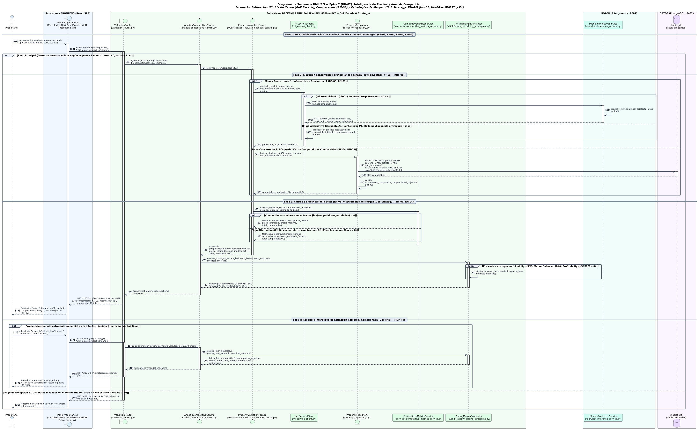

# 4. Diagramas de Secuencia UML 2.5 — Interacciones Dinámicas por Épica del MVP

**Proyecto:** Sistema de Búsqueda y Estimación Inmobiliaria — *Habita* (Medellín)  
**Estudiante:** Heman Santiago Bermudez Espinosa  
**Docente:** Alexandra Guerrero Bocanegra  
**Asignatura:** Diseño de Sistemas de Información — Instituto Tecnológico Metropolitano (ITM)  
**Entregable:** Entregable #3 — Sección 4: Diagramas de Secuencia UML 2.5  
**Épicas Cubiertas:** `RU-01` (Arrendatario), `RU-02` (Propietario) y `RU-03` (Administrador)  
**Funcionalidades del MVP Cubiertas:** `F1`, `F2`, `F3`, `F4`, `F5`, `F6`, `F7`  
**Coherencia Estructural:** Basado en el [Diagrama de Clases BCE (C4 Nivel 4)](file:///C:/Users/heman/Proyecto_Habita/Readme/Documentacion_Modelo_C4.md#L168-L218), el [Diagrama de Componentes UML 2.5](file:///C:/Users/heman/Proyecto_Habita/Readme/diagrama_componentes_uml.md) y el código fuente real del MVP.

---

## Matriz Resumen de Escenarios Modelados por Épica

Para cubrir la totalidad de las épicas y las 7 funcionalidades del MVP respetando los estereotipos arquitectónicos **Boundary-Control-Entity (BCE) + Service**, se presentan **4 diagramas de secuencia UML 2.5**:

| # | Épica | Historias de Usuario / Funcionalidades MVP | Nombre del Escenario Representativo | Actor Principal | Fragmentos Combinados UML | Reglas y Requisitos Clave |
| :-: | :--- | :--- | :--- | :--- | :--- | :--- |
| **4.1** | **`RU-01`** *(Arrendatario)* | **`HU-01`** Funcionalidad **`F5`** (*Consolidar catálogo*) | Consulta Asíncrona del Catálogo Consolidado, Clasificación por *"Mejor Oferta"* y Redirección al Portal Original | `Arrendatario` | `opt`, `alt`, `loop` | `RF-01`, `RF-02`, `RF-12`, `RNF-04` ($\le 2\text{ s}$), `RNF-06` (SPA sin recarga), `RN-06` (`url_origen`) |
| **4.2** | **`RU-02`** *(Propietario)* | **`HU-02`** y **`HU-08`** Funcionalidades **`F6`** (*Estimar precio*) y **`F4`** (*Obtener margen sugerido*) | Estimación Híbrida de Canon (*GoF Facade*), Búsqueda de Comparables (`RN-03`) y Cálculo de Estrategias Comerciales (*GoF Strategy*) | `Propietario` | `alt`, `par` (*Fork/Join*), `loop`, `opt` | `RF-03`, `RF-04`, `RF-05`, `RF-06`, `RN-01`, `RN-03` (4 criterios), `RN-04` ($\pm 5\%$), `RNF-05` ($< 3\text{ s}$) |
| **4.3** | **`RU-03`** *(Administrador — Seguridad)* | **`HU-06`** Funcionalidad **`F7`** (*Autenticarse*) | Autenticación Exclusiva de Administrador con `Bcrypt`/`JWT` y Bloqueo Temporal de 30 Minutos por Fuerza Bruta | `Administrador` | `alt` (anidado en 4 ramas: éxito, fallo 1–2, bloqueo 3.er fallo, cuenta bloqueada) | `RF-07`, `RNF-01`, `RNF-09` (auditoría), `RN-05` (3 fallos $\rightarrow$ 30 min `HTTP 423`) |
| **4.4** | **`RU-03`** *(Administrador — Gobernanza e IA)* | **`HU-03`**, **`HU-04`**, **`HU-05`** Funcionalidades **`F1`**, **`F2`**, **`F3`** | Orquestación Asíncrona de Crawlers (*Factory + Adapter*), Preprocesamiento Sin Fuga (`RN-02`) y Reentrenamiento con Compuerta $\text{MAPE} \le 16\%$ (`RN-01`) | `Administrador` | `par`, `loop`, `alt` (promoción vs. rechazo por compuerta `RN-01`) | `RF-08`, `RF-09`, `RF-10`, `RF-11`, `RN-01` ($\le 16\%$), `RN-02`, `RN-06`, `RNF-02`, `RNF-07`, `RNF-08`, `RNF-09` |

---

## 4.1. Épica 1 (`RU-01`): Exploración y Comparación de Oferta para Arrendatarios

### 4.1.1. Identificación del Escenario
* **Nombre del Escenario:** Consulta Asíncrona del Catálogo Consolidado, Clasificación por Indicador *"Mejor Oferta"* y Redirección al Portal Inmobiliario de Origen.
* **Épica Asociada:** **`RU-01` — Exploración y Comparación de Oferta para Arrendatarios**.
* **Historia de Usuario y Funcionalidad MVP:** **`HU-01`** (*"Como arrendatario, quiero buscar inmuebles consolidados de múltiples portales filtrando por comuna y tipo, y ordenarlos por mejor oferta para identificar arriendos con precio justo"*) — **Funcionalidad `F5: Consolidar catálogo`**.
* **Requisitos y Reglas Aplicadas:** `RF-01`, `RF-02`, `RF-12`, `RNF-04`, `RNF-06`, `RN-06`.

### 4.1.2. Actor Principal y Líneas de Vida Participantes

| Línea de Vida / Participante | Estereotipo UML / Rol | Subsistema | Archivo Real en el Código Fuente | Responsabilidad en la Interacción |
| :--- | :--- | :--- | :--- | :--- |
| **`Arrendatario`** | `actor` | Usuario Externo | — | Selecciona filtros de búsqueda, explora las tarjetas valoradas con IA y abre la oferta original. |
| **`:CatalogoUI`** | `<<boundary>>` | `FRONTEND` | [`Arrendatario.tsx`](file:///C:/Users/heman/Frotend_Proyecto_Habita/src/pages/Arrendatario.tsx) y [`client.ts`](file:///C:/Users/heman/Frotend_Proyecto_Habita/src/api/client.ts#L89-L112) | Dispara `fetchCatalogProperties()` de forma asíncrona actualizando el DOM sin recargar la página (`RNF-06`). |
| **`:CatalogRouter`** | `<<boundary>>` | `BACKEND` | [`catalog_router.py`](file:///C:/Users/heman/Proyecto_Habita/backend/app/boundary/routers/catalog_router.py) | Expone el endpoint `GET /api/v1/properties`, valida parámetros *query* e inyecta `BusquedaControl`. |
| **`:BusquedaControl`** | `<<control>>` | `BACKEND` | [`busqueda_control.py`](file:///C:/Users/heman/Proyecto_Habita/backend/app/controls/busqueda_control.py) | Orquesta la consulta al repositorio y construye los DTOs invocando los métodos de negocio de `Inmueble`. |
| **`:PropertyRepository`** | `<<entity / repository>>` | `BACKEND` | [`property_repository.py`](file:///C:/Users/heman/Proyecto_Habita/backend/app/infrastructure/repositories/property_repository.py) | Ejecuta las consultas SQL indexadas sobre PostgreSQL garantizando tiempos $\le 2\text{ s}$ (`RNF-04`). |
| **`:Inmueble`** | `<<entity>>` | `BACKEND` | [`property_entity.py`](file:///C:/Users/heman/Proyecto_Habita/backend/app/domain/entities/property_entity.py) | Calcula `diferencia_porcentual_oferta()` y `etiqueta_calidad_oferta()` (`RF-02`). |
| **`:habita_db`** | `database` | `DATOS` | Tabla `properties` en PostgreSQL | Retorna las filas indexadas que cumplen `url_origen != ''` (`RN-06`). |
| **`:PortalesExternos`** | `<<external>>` | `INTEGRACIONES EXTERNAS` | *Finca Raíz*, *Metrocuadrado*, *CienCuadras* | Recibe al arrendatario en una nueva pestaña cuando pulsa *"Ir a la oferta original"* (`RF-12`). |

### 4.1.3. Diagrama de Secuencia Renderizado y Enlaces Editables
* **Imagen PNG de alta resolución:** [`secuencia_epica1_ru01_catalogo_f5.png`](file:///C:/Users/heman/Proyecto_Habita/Readme/diagramas/secuencia_epica1_ru01_catalogo_f5.png)
* **Gráfico vectorial SVG:** [`secuencia_epica1_ru01_catalogo_f5.svg`](file:///C:/Users/heman/Proyecto_Habita/Readme/diagramas/secuencia_epica1_ru01_catalogo_f5.svg)
* **Código fuente PlantUML:** [`secuencia_epica1_ru01_catalogo_f5.puml`](file:///C:/Users/heman/Proyecto_Habita/Readme/diagramas/secuencia_epica1_ru01_catalogo_f5.puml)
* **Enlace editable en línea (PlantText / PlantUML):** [Abrir Diagrama de Secuencia Épica 1 en Editor PlantText](https://www.planttext.com/?text=dLZBSYB95Ttp5TVb20-CQGJeqMgYaOT7LJSUFJ2WiHrg1P4KAPJTHIMJbQL6xNQ4jzxx1-O3Pk7mRhRw4t-9JsOzA2GKxXuMGENZt9ltdll8-YxIJEbu6PIqq06drxEJlc0BnPQCvfp6t8zvw0j6bsUdrAmTqd__yIzw-ETA-8mQL1vTlgWtAYrorwj0AkQBX_-4Pj_53LUQqOefHXsbU3Xda2Daz7flTl8kV2rEtCZdeHbgKK-6KHnWUITw-3dqbGoDx81wJ3_y5CY5j2ja8EPiBglK2rWaRg108iqvu--bIYKwT4yZFXUA-ydiXH8B4RA0oc-DgbRzin-6v1rMNk-9anABjGpZvOmhSd3sgthzsYb5FeCfbcnD-yrwdJwAkRujHHz4QCwpf1dpFooKZCDvJ-BKz5lFVWehebje-b642xfXGSGBC-as5KBWKN47_z4Ocf_nA68BtWd48gI0t-ZYNXwjO8XiJPS7yYECAp-ILd5H23HFrup59qxDWtfXSivl6ApjoL2VioKdPymNajFbmDczo48qcgKTojBVIaHMWzGG3RVvQh-R3PhTwKJTQxniTeeJ2MmZ6vhS2lz32AMfKJl0uAcuuQSYv5sfvbobA0Sl3m-FNXLddtZYsEjuFGFgQt77j93X5aAZV-3sZxVd7sFqksx7Sx7c3KPNMzltzmyQXuVvr1Ff3U_GUvLDl-KCEtSPmKuNRKlK5tS2gvz0kattsAiN5XJLEJfuUN3SBVszw1jyQ-6B5GkrTSykFoUZ6-7sIT-3ypCPp36GI2dwvD18ORw6MASOq0wno1YpOBZIJAuXBPv58j8SUSGRNPnFtFC-qWK718s7dOe3QzMzbuWQWb2SbwbxSbe8UMOY_dBmBYmNvTHqjAOzyWF1Gus7YXLyEO3KdkjwtH9M0cZzL7gtq_lU21-E1kUzmR1pIcMFHRep753hk8xmDYcXetwCXUQ-Zf6mkZtNwjVqkjx1Jlr6CjPSGKK_UPugEr1RtITw9VD6Dw_dlWI43mih6G2X6qS8dZdh9IF0cAKZqtHHZjBJAYXWuE126oM6IgwGxEv7V2KZ0TFV0sML3avLFhfH1qExW0RXCkQpW1Ut9vFvLZTPcstUjdA_CxaOKtae8xrGVFodKseT7kmthV4w20NZNEE_6Ol0lzOjcmdDflCPv4tOB41zIAGAdlgptmNZN_MFlVuZIGCGwCseqnjSdBjZSlyoSKVddR5ZKs_NDHcdo7kOIA8O13nor_13A2D8z4I8cZLY3pz_0f7EE4pjnsokaAdnt0ElUlOnLGKxWUvw-xt2gTjjyinP6YqQenxvGiVpxQfLA5htv8b0M_o-21z-MWfVqbY4S8VFr88X73oKf2gDpl5xLA5skrHAGkd5YQ5s2uasC8KCqCfYoQZiosKSiYffiP9JaJgmIYPWiMgwaghjB4r5V26JYbWnOMjodOdzKWcuG4y9sg8RhltRbDN3t1lbohlmZJkXFROIUtUDlOsV_f38RzTgjTzjgM17YbeKbTYea0WkbL85e8fbUSj4Y6q2r3IDAVa5HwrI89P2ju_g6BwvYRXkrmldDT2baXLWpcoYe8KTqQ-Jaeae232GfP9SQKhTGtOAlrS9BFscJUSovFJvyxQ0RE8QrBMARHHaAp0hTpYYgfp5QIq51GqphVEfRNIis1ge60uZWGVGD8ZVInegX0EY9G1DEu494cOKjmpEsh4h_EDhsqRXHyk86IzH8TpBhzlKZ1827rIkIuN389GH9EwfsvlGjwO4d1MYdVxyrXsv5AjWAj6WyT2Ouvjlw6BKTqVK_IiX7t7mVhgAPyOO2A4Nb0xnI8ibHYfxZmQeC-xHwU1iCA4ZKp5pB_LDVe0-BpOsHiSHKTbImHnPyGN-6l-9SCxN08igz7lI4Xn1Mev3RJ8PBoBcHzrGk6no9tfK7YKikygSSrrDe5g01tsse18A4JrYgPnfZXvnUfEmO3eNflSJ04Dm5Wzdz-ysUtymdg3cJMWdnH_xvFzOBC7OKYG1t1fwOgOTLleof6VCj8l1kPqZb3PRH8q3gMnjJYTKJvX954Yv0dqLWL6CKc_19qlyfznvu3qok1y7DXe6uTmIK3s-QDZitQnSM-ID_zA2sQ8vUbHbxqucX-2oesEGASc7reNcavylsPQEfXW5enN1q46rgVmb4OAwzcJeMshKwwcSWdrJ-SyTXck17WN56pSZOwLVUuuS9zbFPSTT-oXo8RQczOe-azF5zI9LtJuFxL_ZZYLNvh1sT2ndQ7QILPLdZsH6RVBR7AnO0BEEBhrRZVrRD8q9TQfVIFegeNLSHeaAMM7BIlZRoMH8vXPvyJsL_pY-E7yiqVQV2C0bmcGhdLeuKwu1bRG5BMDdi4XyOch2r7iOCkfVdA6dI5kAibMacfiveY9doJ8sxpSIYsGjJRC5gaUhxDuCK_S1421FFBfH8wIIxihK7ZaJWJ3zUU6Y3IaDAoLlQemSKoIB3JqnE0zY4XdSP4QE5mZwuPUaol0mOBXXoWpsolP2cizhXQfnXq057I7J2ijYSRk9mft1xqfSyylEG14Zz9qf-p9mfqexq3DA9HsJwGTRU1KGuc9VGyuCopksLCcPegyDFm3H2QLPnbKrb8f3eEBAUHelQvq52mGKNNqM8sXn6qa3F35-RWuSFepv7QQnYZtyEtbZ4h8xlh39Al72hgX81QOXmV5w8asenJQWqw2hxiCloSM48ZIjlZJfTcvpK9vRGPuykNvLQBNhNnbSxQlhBuqlmvxjFO-2Q2cDOPKBmytb3x2iB3ld4XJ8ouSo47bHiNICqFzGMeqTqnpC3ALEnN8bDisvZIbhsO9TvyReFbyb7dHXMHTlF9GPz_C6Iz94B3dEPZpRDG5f8f0PePj-woiQB7JZkmlwEYle5rXgNu2m8D5dBrF1FZvVoTTPCk-dLpjxEeEqlSTstyyux10EsyFtFjumgZk1GBy4Tva8cEbCoYOjYA3j98g1QFdj08H5zKwlMCxZ9Y6vN3pdy2uB4OuMqphy9kPaxif6f4sVs-Wr93WqOSWJDjAMfaZL7eiqLohhyE_mRLwZ_Wy0) | [Ver SVG en línea](https://uml.planttext.com/plantuml/svg/dLZBSYB95Ttp5TVb20-CQGJeqMgYaOT7LJSUFJ2WiHrg1P4KAPJTHIMJbQL6xNQ4jzxx1-O3Pk7mRhRw4t-9JsOzA2GKxXuMGENZt9ltdll8-YxIJEbu6PIqq06drxEJlc0BnPQCvfp6t8zvw0j6bsUdrAmTqd__yIzw-ETA-8mQL1vTlgWtAYrorwj0AkQBX_-4Pj_53LUQqOefHXsbU3Xda2Daz7flTl8kV2rEtCZdeHbgKK-6KHnWUITw-3dqbGoDx81wJ3_y5CY5j2ja8EPiBglK2rWaRg108iqvu--bIYKwT4yZFXUA-ydiXH8B4RA0oc-DgbRzin-6v1rMNk-9anABjGpZvOmhSd3sgthzsYb5FeCfbcnD-yrwdJwAkRujHHz4QCwpf1dpFooKZCDvJ-BKz5lFVWehebje-b642xfXGSGBC-as5KBWKN47_z4Ocf_nA68BtWd48gI0t-ZYNXwjO8XiJPS7yYECAp-ILd5H23HFrup59qxDWtfXSivl6ApjoL2VioKdPymNajFbmDczo48qcgKTojBVIaHMWzGG3RVvQh-R3PhTwKJTQxniTeeJ2MmZ6vhS2lz32AMfKJl0uAcuuQSYv5sfvbobA0Sl3m-FNXLddtZYsEjuFGFgQt77j93X5aAZV-3sZxVd7sFqksx7Sx7c3KPNMzltzmyQXuVvr1Ff3U_GUvLDl-KCEtSPmKuNRKlK5tS2gvz0kattsAiN5XJLEJfuUN3SBVszw1jyQ-6B5GkrTSykFoUZ6-7sIT-3ypCPp36GI2dwvD18ORw6MASOq0wno1YpOBZIJAuXBPv58j8SUSGRNPnFtFC-qWK718s7dOe3QzMzbuWQWb2SbwbxSbe8UMOY_dBmBYmNvTHqjAOzyWF1Gus7YXLyEO3KdkjwtH9M0cZzL7gtq_lU21-E1kUzmR1pIcMFHRep753hk8xmDYcXetwCXUQ-Zf6mkZtNwjVqkjx1Jlr6CjPSGKK_UPugEr1RtITw9VD6Dw_dlWI43mih6G2X6qS8dZdh9IF0cAKZqtHHZjBJAYXWuE126oM6IgwGxEv7V2KZ0TFV0sML3avLFhfH1qExW0RXCkQpW1Ut9vFvLZTPcstUjdA_CxaOKtae8xrGVFodKseT7kmthV4w20NZNEE_6Ol0lzOjcmdDflCPv4tOB41zIAGAdlgptmNZN_MFlVuZIGCGwCseqnjSdBjZSlyoSKVddR5ZKs_NDHcdo7kOIA8O13nor_13A2D8z4I8cZLY3pz_0f7EE4pjnsokaAdnt0ElUlOnLGKxWUvw-xt2gTjjyinP6YqQenxvGiVpxQfLA5htv8b0M_o-21z-MWfVqbY4S8VFr88X73oKf2gDpl5xLA5skrHAGkd5YQ5s2uasC8KCqCfYoQZiosKSiYffiP9JaJgmIYPWiMgwaghjB4r5V26JYbWnOMjodOdzKWcuG4y9sg8RhltRbDN3t1lbohlmZJkXFROIUtUDlOsV_f38RzTgjTzjgM17YbeKbTYea0WkbL85e8fbUSj4Y6q2r3IDAVa5HwrI89P2ju_g6BwvYRXkrmldDT2baXLWpcoYe8KTqQ-Jaeae232GfP9SQKhTGtOAlrS9BFscJUSovFJvyxQ0RE8QrBMARHHaAp0hTpYYgfp5QIq51GqphVEfRNIis1ge60uZWGVGD8ZVInegX0EY9G1DEu494cOKjmpEsh4h_EDhsqRXHyk86IzH8TpBhzlKZ1827rIkIuN389GH9EwfsvlGjwO4d1MYdVxyrXsv5AjWAj6WyT2Ouvjlw6BKTqVK_IiX7t7mVhgAPyOO2A4Nb0xnI8ibHYfxZmQeC-xHwU1iCA4ZKp5pB_LDVe0-BpOsHiSHKTbImHnPyGN-6l-9SCxN08igz7lI4Xn1Mev3RJ8PBoBcHzrGk6no9tfK7YKikygSSrrDe5g01tsse18A4JrYgPnfZXvnUfEmO3eNflSJ04Dm5Wzdz-ysUtymdg3cJMWdnH_xvFzOBC7OKYG1t1fwOgOTLleof6VCj8l1kPqZb3PRH8q3gMnjJYTKJvX954Yv0dqLWL6CKc_19qlyfznvu3qok1y7DXe6uTmIK3s-QDZitQnSM-ID_zA2sQ8vUbHbxqucX-2oesEGASc7reNcavylsPQEfXW5enN1q46rgVmb4OAwzcJeMshKwwcSWdrJ-SyTXck17WN56pSZOwLVUuuS9zbFPSTT-oXo8RQczOe-azF5zI9LtJuFxL_ZZYLNvh1sT2ndQ7QILPLdZsH6RVBR7AnO0BEEBhrRZVrRD8q9TQfVIFegeNLSHeaAMM7BIlZRoMH8vXPvyJsL_pY-E7yiqVQV2C0bmcGhdLeuKwu1bRG5BMDdi4XyOch2r7iOCkfVdA6dI5kAibMacfiveY9doJ8sxpSIYsGjJRC5gaUhxDuCK_S1421FFBfH8wIIxihK7ZaJWJ3zUU6Y3IaDAoLlQemSKoIB3JqnE0zY4XdSP4QE5mZwuPUaol0mOBXXoWpsolP2cizhXQfnXq057I7J2ijYSRk9mft1xqfSyylEG14Zz9qf-p9mfqexq3DA9HsJwGTRU1KGuc9VGyuCopksLCcPegyDFm3H2QLPnbKrb8f3eEBAUHelQvq52mGKNNqM8sXn6qa3F35-RWuSFepv7QQnYZtyEtbZ4h8xlh39Al72hgX81QOXmV5w8asenJQWqw2hxiCloSM48ZIjlZJfTcvpK9vRGPuykNvLQBNhNnbSxQlhBuqlmvxjFO-2Q2cDOPKBmytb3x2iB3ld4XJ8ouSo47bHiNICqFzGMeqTqnpC3ALEnN8bDisvZIbhsO9TvyReFbyb7dHXMHTlF9GPz_C6Iz94B3dEPZpRDG5f8f0PePj-woiQB7JZkmlwEYle5rXgNu2m8D5dBrF1FZvVoTTPCk-dLpjxEeEqlSTstyyux10EsyFtFjumgZk1GBy4Tva8cEbCoYOjYA3j98g1QFdj08H5zKwlMCxZ9Y6vN3pdy2uB4OuMqphy9kPaxif6f4sVs-Wr93WqOSWJDjAMfaZL7eiqLohhyE_mRLwZ_Wy0)

### 4.1.4. Explicación Técnica del Comportamiento, Flujos y Fragmentos Combinados
1. **Orden Temporal y Filtrado Opcional (`[01]` a `[12]` — Fragmento `opt`):**
   * Cuando el arrendatario selecciona una comuna, un tipo de inmueble o el criterio de ordenamiento `"mejor-oferta"` (`[01]`), `:CatalogoUI` invoca asíncronamente `GET /api/v1/properties` (`[02]`).
   * `:CatalogRouter` delega en `:BusquedaControl.consultar_catalogo()` (`[03]`), que invoca a `:PropertyRepository.listar_catalogo()` (`[04]`). Dentro del fragmento `opt [Filtros activos]`, el repositorio añade dinámicamente predicados SQL indexados (`idx_properties_comuna_tipo`) y ordena directamente en motor de base de datos por la expresión `(precio_publicado - precio_estimado) / precio_estimado ASC` (`[05]–[08]`), asegurando tiempos de respuesta menores a 2 segundos (**`RNF-04`**).
2. **Flujo Principal (`[13]` a `[22]` — Fragmentos `alt`, `loop` y `opt`):**
   * Si `total > 0`, el fragmento `loop [Por cada entidad inm en entidades]` (`[13]–[16]`) invoca sobre cada entidad `:Inmueble` sus métodos de dominio `diferencia_porcentual_oferta()` y `etiqueta_calidad_oferta()` (**`RF-02`**), clasificando cada anuncio como *"Excelente oferta"* ($\le -8\%$), *"Buen precio"*, *"Precio de mercado"* o *"Sobreprecio"*.
   * `:CatalogoUI` recibe el payload JSON (`[18]`) y actualiza las tarjetas del DOM de forma reactiva sin recargar el navegador (**`RNF-06`**).
   * En la Fase 2, el fragmento `opt` (`[20]–[22]`) modela la redirección externa (**`RF-12`**): dado que todo inmueble almacenado cumplió la regla **`RN-06`** (`url_origen` obligatoria), al pulsar *"Ir a la oferta original"* se ejecuta `window.open(selected.url_origen, "_blank")`.
3. **Flujo Alternativo `A1` (`[23]` a `[25]` — Sin coincidencias `total == 0`):**
   * Cuando la combinación de filtros no arroja resultados, el Backend retorna `HTTP 200 OK` con `items=[]` y `:CatalogoUI` muestra un estado vacío amigable con un botón para restablecer los filtros sin recargar la vista.
4. **Flujo de Excepción `E1` (`[26]` a `[30]` — Fallo de Base de Datos):**
   * Si ocurre un `OperationalError` o *timeout* en PostgreSQL, la excepción se propaga hasta `:CatalogRouter`, que responde con `HTTP 500/503` y `:CatalogoUI` despliega un banner de reconexión controlada.

---

## 4.2. Épica 2 (`RU-02`): Inteligencia de Precios y Análisis Competitivo para Propietarios

### 4.2.1. Identificación del Escenario
* **Nombre del Escenario:** Estimación Híbrida de Canon (*GoF Facade*), Comparación con Competidores Similares (`RN-03`) y Cálculo de Estrategias Comerciales de Margen (*GoF Strategy*, `RN-04`).
* **Épica Asociada:** **`RU-02` — Inteligencia de Precios y Análisis Competitivo para Propietarios**.
* **Historias de Usuario y Funcionalidades MVP:** **`HU-02`** (*Funcionalidad `F6: Estimar precio de una vivienda`*) y **`HU-08`** (*Funcionalidad `F4: Obtener margen sugerido`*).
* **Requisitos y Reglas Aplicadas:** `RF-03`, `RF-04`, `RF-05`, `RF-06`, `RN-01`, `RN-03`, `RN-04`, `RNF-05`, `RNF-06`.

### 4.2.2. Actor Principal y Líneas de Vida Participantes

| Línea de Vida / Participante | Estereotipo UML / Rol | Subsistema | Archivo Real en el Código Fuente | Responsabilidad en la Interacción |
| :--- | :--- | :--- | :--- | :--- |
| **`Propietario`** | `actor` | Usuario Externo | — | Ingresa las características de su inmueble y selecciona la estrategia comercial deseada. |
| **`:PanelPropietarioUI`** | `<<boundary>>` | `FRONTEND` | [`Propietario.tsx`](file:///C:/Users/heman/Frotend_Proyecto_Habita/src/pages/Propietario.tsx) (`CalculadoraUI` + `PanelPropietarioUI`) | Captura el formulario, consume `/estimate` y `/margin` y presenta el dashboard competitivo. |
| **`:ValuationRouter`** | `<<boundary>>` | `BACKEND` | [`valuation_router.py`](file:///C:/Users/heman/Proyecto_Habita/backend/app/boundary/routers/valuation_router.py) | Expone `POST /api/v1/properties/estimate` y `POST /api/v1/properties/margin`. |
| **`:AnalisisCompetitivoControl`** | `<<control>>` | `BACKEND` | [`analisis_competitivo_control.py`](file:///C:/Users/heman/Proyecto_Habita/backend/app/controls/analisis_competitivo_control.py) | Coordina la fachada de valoración (`F6`) con el calculador de estrategias de margen (`F4`). |
| **`:PropertyValuationFacade`** | `<<control / GoF Facade>>` | `BACKEND` | [`valuation_facade_control.py`](file:///C:/Users/heman/Proyecto_Habita/backend/app/controls/valuation_facade_control.py) | Ejecuta en paralelo (`asyncio.gather`) la inferencia ML y la consulta SQL de comparables `RN-03`. |
| **`:MLServiceClient`** | `<<infrastructure>>` | `BACKEND` | [`ml_service_client.py`](file:///C:/Users/heman/Proyecto_Habita/backend/app/infrastructure/ml_service_client.py) | Consume `ml_service :8001` vía `httpx` o conmuta al modelo `.joblib` local de respaldo si hay *timeout*. |
| **`:ModeloPredictivoService`** | `<<service>>` | `MOTOR IA` | [`inference_service.py`](file:///C:/Users/heman/Proyecto_Habita/ml_service/app/services/inference_service.py) | Realiza la inferencia matemática en $< 50\text{ ms}$ con el artefacto precargado en RAM (`RNF-05`). |
| **`:PropertyRepository`** | `<<entity / repository>>` | `BACKEND` | [`property_repository.py`](file:///C:/Users/heman/Proyecto_Habita/backend/app/infrastructure/repositories/property_repository.py) | Busca competidores que cumplen estrictamente los 4 criterios de **`RN-03`** (`es_comparable_con()`). |
| **`:CompetitiveMetricsService`** | `<<service>>` | `BACKEND` | [`competitive_metrics_service.py`](file:///C:/Users/heman/Proyecto_Habita/backend/app/services/competitive_metrics_service.py) | Calcula el precio mínimo, promedio y máximo del sector (`RF-05`). |
| **`:PricingMarginCalculator`** | `<<service / GoF Strategy>>` | `BACKEND` | [`pricing_strategies.py`](file:///C:/Users/heman/Proyecto_Habita/backend/app/services/pricing_strategies.py) | Evalúa las estrategias de Liquidez ($-5\%$), Mercado ($0\%$) y Rentabilidad ($+5\%$) según **`RN-04`**. |

### 4.2.3. Diagrama de Secuencia Renderizado y Enlaces Editables
* **Imagen PNG de alta resolución:** [`secuencia_epica2_ru02_estimacion_margen_f6_f4.png`](file:///C:/Users/heman/Proyecto_Habita/Readme/diagramas/secuencia_epica2_ru02_estimacion_margen_f6_f4.png)
* **Gráfico vectorial SVG:** [`secuencia_epica2_ru02_estimacion_margen_f6_f4.svg`](file:///C:/Users/heman/Proyecto_Habita/Readme/diagramas/secuencia_epica2_ru02_estimacion_margen_f6_f4.svg)
* **Código fuente PlantUML:** [`secuencia_epica2_ru02_estimacion_margen_f6_f4.puml`](file:///C:/Users/heman/Proyecto_Habita/Readme/diagramas/secuencia_epica2_ru02_estimacion_margen_f6_f4.puml)
* **Enlace editable en línea (PlantText / PlantUML):** [Abrir Diagrama de Secuencia Épica 2 en Editor PlantText](https://www.planttext.com/?text=dLbBSo974hxpApBay0RO6WaGQ3I491iGU6JhmGh9FiWJHD6Kf9ffkdgg6yqmjYFsklVz0pxkmQUz-Qf_ihzalwpg9o3RiNCGK8zyvvUPDLz7iJ3nOkvNOXNxaWwdnoTAt1in5pIJD9RUGWQU4dHpVaRDdJRzzn__egT_XieJrAJgrSsBUhFMeTCWbhwwTqTnRsIaftH4I-e6Jx_wAb8HzVKybE2Y7lNXxlJun-1G7GyYJmR2ADsXGHIhkV3Kqty2UltqszIecINL5u4EgFgD7j9GU68cQzkMb31Ywii8CboygE_Lm0eKZ8ZblH8HNpmN1WAvcsEtizmcFjsgKVKrIxvD_75WbJh_VaJ3VP0Pjcg7k-gu8XQn3XRpgJIq1RFSrkjljYgH9s2bkVX8UwrwdJweMVnGYTwfWEMPqrHux-wDNWIpllQreS-6zb_XHFGWPlg32kxfJlYHBEmarqm0Xll56_8z-q2UooWIzx8BEmVaoxkuU5T6eGwYz4nF-lf3rnZzWMApA3A1vCcPiVeagTcg5pPdyaui_7YeW_X2p2LjZUMzbdHpkhNva2NHQ5Os24i_LOYi18aX6eFcgxrUkiYtautwiF6osIrkEBADTEdwGNdl0WXDZPqM5i_KdJnJWUnfCvCceT9wsMxllohkhddYODWTzfceXn0KiT91YKAZVL3VEodlhz8uwG_xWvSuymrMmzBrlRrMeztEjjQuDuRjuQjq-xL479jDHh3RHTiIdQX7XTDh90VDmS6mNZXG56U_zR9rqAlyKga8ByR2riZeKCcOSssBa21Tk_pPIM_G7GugbQd-27SlfaZKM2BtXrUN5zU3YnEabmG56e-wjIseKH--H3WJJLaGOPQqrHc9GFe5yZUdFmRLll2zXOzGD-BcbFv6cmuLVkx4qSUQbGkdOUR1ODYho606FX_NXUjr-z-nRAEhqul-wQXxHjMXYEBkw9Gw1tMa9UTphp-WBoc73GYHee3Lf3di3LjbJRuN_i8w_aelOccWncEwCZ5sQITSEZ7TYK94UF2PqJweT0DX0Q-0Ttst2O8YsPnu-UuakPiHxyV6tqYQBIPDlCm4TQg1xk5XhkdnCULotzcbDHQ9JN8cIDzOUIeKGGn6vsTZQHwL9_k-aa4C1dD_4hcbYMVNCbBdP-vGWHX-gNXP4FXAXZfIYBWbI8N9uiHagxbTiVIiLBb50NInKLwKI6aDa8W7xNFRoidS7Ko5pwLswy_o6c4NACr5H0L9D4FIpDHfB85Tw8vEql8ZeunBUYfZKuxfyylhooiwxLB1l3Q46qcodGoxwxxHCy0xAknCCLBfpJPGmPqqZCJhcgU-fS_wVIH1OqMea-xrvPYg8nt5zqQE_tv6dNPhhsabwWB5EFrd8XPJ4Q54T1x4LCLYCfj2W6kKP469Vs47n_2a1x1wTN8mFCav7HqX176_qQ6nzg5Sl9XnqIvs0LaVyLmROTiEz2e-K6g89W3L7Hyjzz5s7_irEZggL1pSlJXcVEd0ED0i4gQB69YYp4VV0q8XcwWYT1Q1s4OXDu2bROfLYB_2IAn1quXt0eqF-EJzDadhSrrZbEMYmSMoKW4FS4eWeiE7e5CiqsJWq9BLK2nzBMOruE3b-9fsHQXs7nkxkV5sqtivSKSIcEx7DFGNRpKCf0AE39zkJo28RNoGVKQWUNfaaysm5idxfzy3o87Q3FWSBMU89ELHbVMYOwfdYg34xkpNtbJWuaHyA6BX26gyHJC8j9va6AOIyrUZr8KTIfKS9C9VSKCGnMFl0Qnhe9ifmsIPaIKFDWaafVOoawK5IRGL9cTGek1kC8qqd9he8rbC5q20NMzXa0LyLfjtkzzg1JEWUn9yzu6DL1NH4XRKE_SYVe2-XqUq5za2SdN1KUJ2n-OWNN5NN2JQuCxNvLcnxsN4jbcTHYLwpWPBJgcIK3U3pGuIHivmpqn2UtrZ4CBOyuL4n_jNef4vPLPA6LNSCaBdN7b6ErY0i6Zigmvph6cUVWiG5BTNw2ZPSO8N3wbTftdqnbAWN7IhHeecy7qnaEV-RkWmYggdYUodGRWeXCAAc0cXZ4bAU8LBPYqLpBZpMI00QzRaW4aqfyXqsdchfxwQiknNtVDrYcNxlxw-7b4JVSFbTrHrFfYu89nnSGwtALcSOsAOM_Z5fmZb17KMOmgsWbIVcNn68ubkFqdQhe_C2eI5CDXPMJaaTHjqovs232Jw9lQBTGi5ccQA-ti54vAcQpMNI4uaBWQoPvoIwJR9p2K3VDUUZFJ4rnXZ2WXq4ub4hyno258UAeG_qrPxr45OesXGuAKBgPnpCOkTyzaqapa0-lmihLXehsI42S9Ph6IlF52jjTRo3UdTU_gTOGoPovM9vqDN3s0n6QqCXaaniFFXIlRPFgD3qmK6EZE9r5pvIAjeOeBwNfP_IJuzau0-BiL7ZVfAkZ5bks9PW1NA7uhSu6pGlwOlkB4-BrH8-k7ru6f0ZkFHLzH5MvkmJNwLU1zzzMF0YnQuUuFh7mQ32_lZY_hEGPlIhIyQEuqsLVj68T1u3cUIi3s-5QoHYNpIixyXw8lSD7UmI9GYC1jqrLt9hLJDv9hB24Dfok_88X7kGst_f-31sKHFtqhEWbewnHSe5cF9A_XumiqbBhE7KORYsvJJcxM0IboH16fQ8_Owr4TbH4EdxJF1qx_PDlRDmES73suKREoq_-AZWgiMt6japmkkPXJ0FkaseOfh9KtIc0hkJ9bbTREEBjWct6jbA9H14ruGV7vnA1N5X1NpPwmlfKSMvx29dGW4jmUtlWoUOL_Zxi0XJAf2oJ7dYH9vKoOYX-yfZivLeEOwans-dmC6yWKyIDZzMCV2BuPRhV8iPdQRT3j69I_AJFAZi04-5JXjeocfz2wt42puYHYer_u_VL1fPuY1n7_yDT9J8vzroWQLZYnMS3YMSI_tM1enUTTbiZfSNM-jtAEF4z1Mm1LXaYhbe7qIeXIZlMdiVuwuBjgkLfOdRwlIrYoBT3HdThGqarZ311E629bdIEfq3jUZTLdIY9zB0mww5BOf2sRhQntI26deSOUMqsU7tfwfzmiru_6o-gBzEHu3aPBlPDmJli2qCwDgdHTXgpkC9LFKLZxv9Kw-SI3JSZ2HgLHMB-6rtCdo55eWP0DNvOiARbOe0PkSVA61pWt5KO4xId2X-cdBjph9JriTWaxRj9KGnEyw_-JgPtL1Kc8DslnITbdHUivfnG7aJmDd7leorcMIQNkUpW7fx5HgbhuTNrxOm9Fvt0QFT4U3xN9sseI4nJAmjG2BE2mOXJBty005Vcvewm370xnigKyYUGmUP27bECLsx4JUb5WkoOZWNjEjDIbiXW0uvEO-QUoBDQ75JBoqAl1OQQmXT3AJfW7OJzs6Gk5BsztO8U8oj5_z_2KvAm8wZAdmqiNMcY_YKbXdmP0W5izLvavy0Z8dWK4_Kn8I-5QC1eTbvUasoaGpkUZLdDzH7c-WbiKQVoy5cakKbM4soOjOkfUHtZ8DlUeVJB9pUtQbJtAph2tugwDcNYHjkIr0JBNy86ERoPK1StN4v9KDG9Rn2BN1avPub5NxDwjCdED_WbwRyAiCBhbEoOFI5SE9nHCMlbmheyKzmfoPsTvIJkmZZe9yDeIJnMWHkiKlUV7j0XBUGR1y2Dc42xaHoi3mh4ohb39J_Y4UR2H8Z1BhpLdk_vLqnoTcEavtP0mQnE9aFKvCXEmkQCx3Vfv44Lg3P68n53xzYdWHZFtsDIY5w49hmId-qPEXepF059Qz2o4LirSKv2OQn3jjvXmsaAKgt-xGqw_SYgEirZ6PfQyeTmlW1zDTVqufcQtLRD9DuAQoY5i46hYNq-e0__DXc48wOR9ewSFDIhtEBBbYn_E5bGTj8D9Gh19ZgD7Spyn3xNhVNBKoVNxIiZRx6d_vlmh_1m00) | [Ver SVG en línea](https://uml.planttext.com/plantuml/svg/dLbBSo974hxpApBay0RO6WaGQ3I491iGU6JhmGh9FiWJHD6Kf9ffkdgg6yqmjYFsklVz0pxkmQUz-Qf_ihzalwpg9o3RiNCGK8zyvvUPDLz7iJ3nOkvNOXNxaWwdnoTAt1in5pIJD9RUGWQU4dHpVaRDdJRzzn__egT_XieJrAJgrSsBUhFMeTCWbhwwTqTnRsIaftH4I-e6Jx_wAb8HzVKybE2Y7lNXxlJun-1G7GyYJmR2ADsXGHIhkV3Kqty2UltqszIecINL5u4EgFgD7j9GU68cQzkMb31Ywii8CboygE_Lm0eKZ8ZblH8HNpmN1WAvcsEtizmcFjsgKVKrIxvD_75WbJh_VaJ3VP0Pjcg7k-gu8XQn3XRpgJIq1RFSrkjljYgH9s2bkVX8UwrwdJweMVnGYTwfWEMPqrHux-wDNWIpllQreS-6zb_XHFGWPlg32kxfJlYHBEmarqm0Xll56_8z-q2UooWIzx8BEmVaoxkuU5T6eGwYz4nF-lf3rnZzWMApA3A1vCcPiVeagTcg5pPdyaui_7YeW_X2p2LjZUMzbdHpkhNva2NHQ5Os24i_LOYi18aX6eFcgxrUkiYtautwiF6osIrkEBADTEdwGNdl0WXDZPqM5i_KdJnJWUnfCvCceT9wsMxllohkhddYODWTzfceXn0KiT91YKAZVL3VEodlhz8uwG_xWvSuymrMmzBrlRrMeztEjjQuDuRjuQjq-xL479jDHh3RHTiIdQX7XTDh90VDmS6mNZXG56U_zR9rqAlyKga8ByR2riZeKCcOSssBa21Tk_pPIM_G7GugbQd-27SlfaZKM2BtXrUN5zU3YnEabmG56e-wjIseKH--H3WJJLaGOPQqrHc9GFe5yZUdFmRLll2zXOzGD-BcbFv6cmuLVkx4qSUQbGkdOUR1ODYho606FX_NXUjr-z-nRAEhqul-wQXxHjMXYEBkw9Gw1tMa9UTphp-WBoc73GYHee3Lf3di3LjbJRuN_i8w_aelOccWncEwCZ5sQITSEZ7TYK94UF2PqJweT0DX0Q-0Ttst2O8YsPnu-UuakPiHxyV6tqYQBIPDlCm4TQg1xk5XhkdnCULotzcbDHQ9JN8cIDzOUIeKGGn6vsTZQHwL9_k-aa4C1dD_4hcbYMVNCbBdP-vGWHX-gNXP4FXAXZfIYBWbI8N9uiHagxbTiVIiLBb50NInKLwKI6aDa8W7xNFRoidS7Ko5pwLswy_o6c4NACr5H0L9D4FIpDHfB85Tw8vEql8ZeunBUYfZKuxfyylhooiwxLB1l3Q46qcodGoxwxxHCy0xAknCCLBfpJPGmPqqZCJhcgU-fS_wVIH1OqMea-xrvPYg8nt5zqQE_tv6dNPhhsabwWB5EFrd8XPJ4Q54T1x4LCLYCfj2W6kKP469Vs47n_2a1x1wTN8mFCav7HqX176_qQ6nzg5Sl9XnqIvs0LaVyLmROTiEz2e-K6g89W3L7Hyjzz5s7_irEZggL1pSlJXcVEd0ED0i4gQB69YYp4VV0q8XcwWYT1Q1s4OXDu2bROfLYB_2IAn1quXt0eqF-EJzDadhSrrZbEMYmSMoKW4FS4eWeiE7e5CiqsJWq9BLK2nzBMOruE3b-9fsHQXs7nkxkV5sqtivSKSIcEx7DFGNRpKCf0AE39zkJo28RNoGVKQWUNfaaysm5idxfzy3o87Q3FWSBMU89ELHbVMYOwfdYg34xkpNtbJWuaHyA6BX26gyHJC8j9va6AOIyrUZr8KTIfKS9C9VSKCGnMFl0Qnhe9ifmsIPaIKFDWaafVOoawK5IRGL9cTGek1kC8qqd9he8rbC5q20NMzXa0LyLfjtkzzg1JEWUn9yzu6DL1NH4XRKE_SYVe2-XqUq5za2SdN1KUJ2n-OWNN5NN2JQuCxNvLcnxsN4jbcTHYLwpWPBJgcIK3U3pGuIHivmpqn2UtrZ4CBOyuL4n_jNef4vPLPA6LNSCaBdN7b6ErY0i6Zigmvph6cUVWiG5BTNw2ZPSO8N3wbTftdqnbAWN7IhHeecy7qnaEV-RkWmYggdYUodGRWeXCAAc0cXZ4bAU8LBPYqLpBZpMI00QzRaW4aqfyXqsdchfxwQiknNtVDrYcNxlxw-7b4JVSFbTrHrFfYu89nnSGwtALcSOsAOM_Z5fmZb17KMOmgsWbIVcNn68ubkFqdQhe_C2eI5CDXPMJaaTHjqovs232Jw9lQBTGi5ccQA-ti54vAcQpMNI4uaBWQoPvoIwJR9p2K3VDUUZFJ4rnXZ2WXq4ub4hyno258UAeG_qrPxr45OesXGuAKBgPnpCOkTyzaqapa0-lmihLXehsI42S9Ph6IlF52jjTRo3UdTU_gTOGoPovM9vqDN3s0n6QqCXaaniFFXIlRPFgD3qmK6EZE9r5pvIAjeOeBwNfP_IJuzau0-BiL7ZVfAkZ5bks9PW1NA7uhSu6pGlwOlkB4-BrH8-k7ru6f0ZkFHLzH5MvkmJNwLU1zzzMF0YnQuUuFh7mQ32_lZY_hEGPlIhIyQEuqsLVj68T1u3cUIi3s-5QoHYNpIixyXw8lSD7UmI9GYC1jqrLt9hLJDv9hB24Dfok_88X7kGst_f-31sKHFtqhEWbewnHSe5cF9A_XumiqbBhE7KORYsvJJcxM0IboH16fQ8_Owr4TbH4EdxJF1qx_PDlRDmES73suKREoq_-AZWgiMt6japmkkPXJ0FkaseOfh9KtIc0hkJ9bbTREEBjWct6jbA9H14ruGV7vnA1N5X1NpPwmlfKSMvx29dGW4jmUtlWoUOL_Zxi0XJAf2oJ7dYH9vKoOYX-yfZivLeEOwans-dmC6yWKyIDZzMCV2BuPRhV8iPdQRT3j69I_AJFAZi04-5JXjeocfz2wt42puYHYer_u_VL1fPuY1n7_yDT9J8vzroWQLZYnMS3YMSI_tM1enUTTbiZfSNM-jtAEF4z1Mm1LXaYhbe7qIeXIZlMdiVuwuBjgkLfOdRwlIrYoBT3HdThGqarZ311E629bdIEfq3jUZTLdIY9zB0mww5BOf2sRhQntI26deSOUMqsU7tfwfzmiru_6o-gBzEHu3aPBlPDmJli2qCwDgdHTXgpkC9LFKLZxv9Kw-SI3JSZ2HgLHMB-6rtCdo55eWP0DNvOiARbOe0PkSVA61pWt5KO4xId2X-cdBjph9JriTWaxRj9KGnEyw_-JgPtL1Kc8DslnITbdHUivfnG7aJmDd7leorcMIQNkUpW7fx5HgbhuTNrxOm9Fvt0QFT4U3xN9sseI4nJAmjG2BE2mOXJBty005Vcvewm370xnigKyYUGmUP27bECLsx4JUb5WkoOZWNjEjDIbiXW0uvEO-QUoBDQ75JBoqAl1OQQmXT3AJfW7OJzs6Gk5BsztO8U8oj5_z_2KvAm8wZAdmqiNMcY_YKbXdmP0W5izLvavy0Z8dWK4_Kn8I-5QC1eTbvUasoaGpkUZLdDzH7c-WbiKQVoy5cakKbM4soOjOkfUHtZ8DlUeVJB9pUtQbJtAph2tugwDcNYHjkIr0JBNy86ERoPK1StN4v9KDG9Rn2BN1avPub5NxDwjCdED_WbwRyAiCBhbEoOFI5SE9nHCMlbmheyKzmfoPsTvIJkmZZe9yDeIJnMWHkiKlUV7j0XBUGR1y2Dc42xaHoi3mh4ohb39J_Y4UR2H8Z1BhpLdk_vLqnoTcEavtP0mQnE9aFKvCXEmkQCx3Vfv44Lg3P68n53xzYdWHZFtsDIY5w49hmId-qPEXepF059Qz2o4LirSKv2OQn3jjvXmsaAKgt-xGqw_SYgEirZ6PfQyeTmlW1zDTVqufcQtLRD9DuAQoY5i46hYNq-e0__DXc48wOR9ewSFDIhtEBBbYn_E5bGTj8D9Gh19ZgD7Spyn3xNhVNBKoVNxIiZRx6d_vlmh_1m00)

### 4.2.4. Explicación Técnica del Comportamiento, Flujos y Fragmentos Combinados
1. **Orquestación mediante Patrón GoF Facade y Concurrencia `par` (`[01]` a `[15]` — `RNF-05` $< 3\text{ s}$):**
   * Al enviar el formulario (`POST /api/v1/properties/estimate`), `:AnalisisCompetitivoControl` invoca a `:PropertyValuationFacade.estimar_y_comparar()` (`[04]`).
   * El fragmento combinado **`par`** modela el `asyncio.gather` real implementado en [`valuation_facade_control.py`](file:///C:/Users/heman/Proyecto_Habita/backend/app/controls/valuation_facade_control.py#L48-L74):
     * **Rama 1 (Inferencia IA — `[05]–[10]`):** `:MLServiceClient` invoca `POST /api/v1/ml/predict` en `:ModeloPredictivoService` (`:8001`). Incluye el **Flujo Alternativo Resiliente `A1`** (`[09]`): si el microservicio externo no responde dentro del *timeout* de 2.5 s, conmuta automáticamente a `_predecir_en_proceso_local()` usando el modelo `.joblib` precargado en RAM.
     * **Rama 2 (Búsqueda SQL `RN-03` — `[11]–[15]`):** En paralelo, `:PropertyRepository.buscar_similares_rn03()` consulta los inmuebles de la misma comuna, mismo estrato, mismo tipo y área dentro de $\pm 15\%$ (**`RN-03`**), verificando el método de dominio `Inmueble.es_comparable_con()`.
2. **Métricas Competitivas (`RF-05`) y Patrón GoF Strategy (`[16]` a `[25]` — Fragmentos `alt` y `loop`):**
   * `:CompetitiveMetricsService` calcula el mínimo, promedio y máximo del sector (`[16]–[18]`). Si no existen competidores exactos bajo `RN-03` (**Flujo Alternativo `A2`**), proyecta las métricas de referencia sobre `precio_estimado_fallback` sin interrumpir la experiencia del propietario.
   * Acto seguido, el fragmento **`loop`** (`[20]–[22]`) ejecuta las 3 estrategias del patrón **GoF Strategy** (`LiquidityPricingStrategy` $-5\%$, `MarketBalancedPricingStrategy` $0\%$ y `ProfitabilityPricingStrategy` $+5\%$, cumpliendo **`RN-04`** y **`RF-06`**).
3. **Conmutación Interactiva de Estrategia (`[26]` a `[33]` — Fragmento `opt`) y Excepción `E1` (`[34]–[35]`):**
   * El fragmento `opt` modela el cambio interactivo de estrategia en la UI (`POST /api/v1/properties/margin`), mientras que la rama `else` exterior captura errores de validación Pydantic (`HTTP 422 Unprocessable Entity`).

---

## 4.3. Épica 3A (`RU-03` — Seguridad): Autenticación de Administrador y Bloqueo Temporal (`RN-05`)

### 4.3.1. Identificación del Escenario
* **Nombre del Escenario:** Autenticación Exclusiva de Administrador con `Bcrypt`/`JWT` y Bloqueo Temporal de 30 Minutos tras 3 Intentos Fallidos Consecutivos (`RN-05`).
* **Épica Asociada:** **`RU-03` — Gestión del Ecosistema y Modelos (Flujo del Administrador)**.
* **Historia de Usuario y Funcionalidad MVP:** **`HU-06`** (*"Como administrador, quiero autenticarme de forma segura con control de intentos fallidos y bloqueo temporal de 30 minutos para proteger la gobernanza del sistema"*) — **Funcionalidad `F7: Autenticarse`**.
* **Requisitos y Reglas Aplicadas:** `RF-07`, `RNF-01`, `RNF-09`, `RN-05`.

### 4.3.2. Actor Principal y Líneas de Vida Participantes

| Línea de Vida / Participante | Estereotipo UML / Rol | Subsistema | Archivo Real en el Código Fuente | Responsabilidad en la Interacción |
| :--- | :--- | :--- | :--- | :--- |
| **`Administrador`** | `actor` | Usuario Externo | — | Ingresa sus credenciales exclusivas en la consola administrativa. |
| **`:LoginAdminUI`** | `<<boundary>>` | `FRONTEND` | [`AdminLogin.tsx`](file:///C:/Users/heman/Frotend_Proyecto_Habita/src/pages/AdminLogin.tsx) y [`client.ts`](file:///C:/Users/heman/Frotend_Proyecto_Habita/src/api/client.ts#L132-L137) | Envía `POST /api/v1/auth/login`, almacena el JWT en `sessionStorage` o presenta el estado de bloqueo `HTTP 423`. |
| **`:AuthRouter`** | `<<boundary>>` | `BACKEND` | [`auth_router.py`](file:///C:/Users/heman/Proyecto_Habita/backend/app/boundary/routers/auth_router.py) | Recibe la solicitud HTTP y delega en `AutenticacionControl`. |
| **`:AutenticacionControl`** | `<<control>>` | `BACKEND` | [`autenticacion_control.py`](file:///C:/Users/heman/Proyecto_Habita/backend/app/controls/autenticacion_control.py) | Evalúa existencia, estado de bloqueo `RN-05`, hash `bcrypt`, reinicio o incremento de fallos y auditoría `RNF-09`. |
| **`:AdminRepository`** | `<<entity / repository>>` | `BACKEND` | [`admin_repository.py`](file:///C:/Users/heman/Proyecto_Habita/backend/app/infrastructure/repositories/admin_repository.py) | Persiste el estado de la entidad `Administrador` y los eventos en `audit_logs`. |
| **`:Administrador`** | `<<entity>>` | `BACKEND` | [`admin_entity.py`](file:///C:/Users/heman/Proyecto_Habita/backend/app/domain/entities/admin_entity.py) | Ejecuta la lógica de dominio `esta_bloqueado()`, `minutos_restantes_bloqueo()`, `registrar_intento_fallido_rn05()` y `resetear_intentos()`. |
| **`:SecurityModule`** | `<<service / infra>>` | `BACKEND` | [`security.py`](file:///C:/Users/heman/Proyecto_Habita/backend/app/infrastructure/security.py) | Verifica contraseñas con `bcrypt.checkpw()` y firma tokens JWT (`HS256`). |

### 4.3.3. Diagrama de Secuencia Renderizado y Enlaces Editables
* **Imagen PNG de alta resolución:** [`secuencia_epica3a_ru03_autenticacion_f7.png`](file:///C:/Users/heman/Proyecto_Habita/Readme/diagramas/secuencia_epica3a_ru03_autenticacion_f7.png)
* **Gráfico vectorial SVG:** [`secuencia_epica3a_ru03_autenticacion_f7.svg`](file:///C:/Users/heman/Proyecto_Habita/Readme/diagramas/secuencia_epica3a_ru03_autenticacion_f7.svg)
* **Código fuente PlantUML:** [`secuencia_epica3a_ru03_autenticacion_f7.puml`](file:///C:/Users/heman/Proyecto_Habita/Readme/diagramas/secuencia_epica3a_ru03_autenticacion_f7.puml)
* **Enlace editable en línea (PlantText / PlantUML):** [Abrir Diagrama de Secuencia Épica 3A en Editor PlantText](https://www.planttext.com/?text=jLdRSkEu4NtdLtIKgYqgiMLTROzYULSNCjQkBIkMF9igpvGA8c4PCKLeGSgNILALrxpd1_O3yf3A9_XFyYNf1aYAkdXgTcPsgcnB0FgWqNtw0intKSnKl9m7LYpYWCF9zBGds4onEGEVmuXxInvwWi7rnJbKImtutp_-1I__N0YFGQqDzjNrVhbMREB2sL89d_dm3ErbpCCOLtZYvRyXmRJzkGX552lcItLoC3rz5vw8KoVoUCYKaCrD4UV92vQHU63WoH0wddfUn0VV_pX6y4uWVrfo2MC-NqZ50eAlbU52XCjOHe1Zu2wv-i2WevOnGmq7--L64UmprFHGgt_nTWZkKV7aG9nQ3AN2vNpA5HJmx3Vbylk25NaCJJ5dJr2hbilmAFpupehkHRXWQ1YOCkz-fkGozBiomFr-w-f_kHNH7HxqKOGpk6L1n7CpYPWASSF3l0J_YGpDBtWKiHbl1s8MGi1luxmiZnOoZD8r7Hx8nxPIyX5YjSnlWfedQqRY0uTglPoRzFajMmQnAyDumEOS2kWwoU6wNzYzI4DKgjOEPU6l5e3M8354nQc-gNNIGP9E9ifkvQZQpayOs4ewDBuJtds8IaEbLCV1St7BpqN8ErBvN2KezQD6u_1DVdRB4yTks-qIg1SZVM8XmpM4Ig_kz8xNvpSnUXsdxJguveyukbWJhzNgbKOZczhQlU8st3Vfz1bdABdB27ewRrk0ddWGk7eBqgawnsuvjo2lpc7zg7xSiVvkMSoBSQ2m5cS5O16TCtScQogVqE7BQOIBE8QuUtKv63k37eO9HmmO3Tl50Xwax1uXeG6cf0fJpr1edikP2FK6r_rteQq_wR5I73t10NY1m136BqMzyNKVT-qwZjknUEWZqDFsxfrszmVQV7ZL7tJxm_Ovs2wBulQm3ytZCaOUHUigi-X8rld55tYgbtyp77Btos-qobMtuzRNLSQiSdSbCRKeL1WZ_MwYzBVIujaeQIP9KRVh7A4mffjOoS38fXb9XbqpR51MmvDaUORNZLMGGwELiLQ4Z7N55p8YnPy9XqOcAXjQgOH3hqAahiq0p7Gcx9ZLAt6CLrHMB5WO8mPbSuKBBgI_33Y2HCa00cXRcqmBty3m6REjmKIX373Taxts-784zb16yKpnqP_EeTcerwhQ6ssC12AGps8sPH6ccUOTcugOJVmfRZncqm2nzI4Yt8-HIoU1d2NiwNMG-czwnsvljMUhXSRn-2AhAbt5VLsS0XxbIWm5ThGg8H5o6qboj6V8KYb2gsLP9YxsJucdJS1CZScLgJoYlOou2Z53xg4Le-WH0wz8SKPfWzAbPQ4e0YGSQaAG1OYzOC-1P7xnNJYy78tXW2t4mKFbW2Xue9UjW8ouPIKm2AX9r8ICQMgYpMJhOBkYr1l58-yE0oYd3mbPbXObdOX4JP1JXE1gWaLnafucErPEc9PRMWPbqVHOpfrpfpk6tr62k4ZTzEEPS-L0AWyj-7O5qUjOABY_sbln6Nb36kNXRp2G8RTydfSmM-QEJ4kRwzt23acjhiM2c9oSyi6fDE4wMb8xWUxaJvHYGbnyO_P7yX3CUmivkM6bH5EqCtz04TJOv1V1REPHcBSA_P30995Eku_AUY1yMTW3T0QgsIeyCXKMYeY-hYR0cbtxWv5pDSO_uyiSvy4kbKf5QbLqDgEmuPimHkdzfnNVpiRZeJO0LJ6xNgx0TKWCGyq_S7yFhQ2LZZ3Be8xu9MfL2JjbMaf-me5DSR0fURfC14l5Upp63oddWCH8siHG4ow8aOe1nqAko4PUFZ15-F3oCngBHPR5iHbQSrgr2Lri9MBJw4sJtYvEUpkJyH_4BEVA4frcOfQYvMsAPnXZ0mGsG-KPd40sERd3SiAAQrvFScGJjd2-WRdf8bSMI-PnDkzP0u4Z2LQEmgJ87fZSdc20NIcLi4N5mGtN9ZXVH4aUWcSic1ubwtbpxDIk-VNe-IdyhDRWN7htnCpCwAtCNBlDtbepvElapR0_XxPK736SzNrdYu54oyI-w1HKXIubzePQXjS9aOrbuEOtkzdwdepzbYjnczrskaeiOZbJBp_JM5g4xQHSvUb1jRW93oJzF4chafr-c2m25iezaqPBsIZ6mDsQvn45ln9MZhXez0T6OTh4QYk3TIUJ125WodM3vLya39K8gQq8ckjL-6qIwd2JuQNXgODmHnYY7NdCaUffljAnjYlQTiLRbkIIZ1nXMIhlRMO0CDb_3_1E8-OOJfx78ucZEcDew9rXkHMOComms5oQxeionYT5AdPWkdP4I1zoECltAlaY8kyB6uTFedGZJg-7s7ivQLqUEUDjExIshT0QN9-V_-6ZGRvfYZIwDoc86HwdZHsZIIplUPWr5Yt3lrNxX1rogz3kNVG7cwSpJDpYOXuMRBhtdusgZKEqqzEYLQbcgNGNHxDCbElCnWHqbToUJJwmytliWVupYPyNl5MO8XcvGgzyv0Gxqn2z5Lp-0FRQTl3zw79WX4o_gDSZ4o8anmYPWhVq4aP07rEENKXwPDFSQwLGZxogAwHS9hlYlb1O9350OSX27go_kPWiOsviFKm6KuaaHWZg-B4rhfWSetEOYUvs4DF9YPnuiSlLQtfTqNSXxEXV_iEW7tfIAUvXXAq7l4lF7gz7V1ep2MjJqavKM6vyGlZdiBRZ__SjgBoIB51JlAEkih59TUWmwXuYiGFij0MrucVdXwyKojHfxqfftxuUhPlDSQq9jH8IDkqQN0DDpgGxeFQq8HGYPHUizAsDt9vxOxlPjEEg0pEDH-BupsbhqYsfYypNKzpaOrtDRaD_OdVZSwh_6FdTpKOgEJXT88ZpKDEDlumAQztGgrxujRgYMZdTzalQeHs9n5YVmQrKysMWxr8h4sZVSwGdpJAOIyqQNTRI5vh4HURqhoIKDbxKDcbO0GdLtRpIcGJixQ0umSZy0gBzaYlTrs5NkkEV3sfVZpzRjxuLYxJbTbq3CNNKO7yxp-pGHJyhV8ngl-JQk7bEy_AnauXfRuvDfOfrP-xboevObHsU7GDMvpE_VQo3ISHiRqxlDvgaeM-Pt_HZVOU_wJz3_Wy0) | [Ver SVG en línea](https://uml.planttext.com/plantuml/svg/jLdRSkEu4NtdLtIKgYqgiMLTROzYULSNCjQkBIkMF9igpvGA8c4PCKLeGSgNILALrxpd1_O3yf3A9_XFyYNf1aYAkdXgTcPsgcnB0FgWqNtw0intKSnKl9m7LYpYWCF9zBGds4onEGEVmuXxInvwWi7rnJbKImtutp_-1I__N0YFGQqDzjNrVhbMREB2sL89d_dm3ErbpCCOLtZYvRyXmRJzkGX552lcItLoC3rz5vw8KoVoUCYKaCrD4UV92vQHU63WoH0wddfUn0VV_pX6y4uWVrfo2MC-NqZ50eAlbU52XCjOHe1Zu2wv-i2WevOnGmq7--L64UmprFHGgt_nTWZkKV7aG9nQ3AN2vNpA5HJmx3Vbylk25NaCJJ5dJr2hbilmAFpupehkHRXWQ1YOCkz-fkGozBiomFr-w-f_kHNH7HxqKOGpk6L1n7CpYPWASSF3l0J_YGpDBtWKiHbl1s8MGi1luxmiZnOoZD8r7Hx8nxPIyX5YjSnlWfedQqRY0uTglPoRzFajMmQnAyDumEOS2kWwoU6wNzYzI4DKgjOEPU6l5e3M8354nQc-gNNIGP9E9ifkvQZQpayOs4ewDBuJtds8IaEbLCV1St7BpqN8ErBvN2KezQD6u_1DVdRB4yTks-qIg1SZVM8XmpM4Ig_kz8xNvpSnUXsdxJguveyukbWJhzNgbKOZczhQlU8st3Vfz1bdABdB27ewRrk0ddWGk7eBqgawnsuvjo2lpc7zg7xSiVvkMSoBSQ2m5cS5O16TCtScQogVqE7BQOIBE8QuUtKv63k37eO9HmmO3Tl50Xwax1uXeG6cf0fJpr1edikP2FK6r_rteQq_wR5I73t10NY1m136BqMzyNKVT-qwZjknUEWZqDFsxfrszmVQV7ZL7tJxm_Ovs2wBulQm3ytZCaOUHUigi-X8rld55tYgbtyp77Btos-qobMtuzRNLSQiSdSbCRKeL1WZ_MwYzBVIujaeQIP9KRVh7A4mffjOoS38fXb9XbqpR51MmvDaUORNZLMGGwELiLQ4Z7N55p8YnPy9XqOcAXjQgOH3hqAahiq0p7Gcx9ZLAt6CLrHMB5WO8mPbSuKBBgI_33Y2HCa00cXRcqmBty3m6REjmKIX373Taxts-784zb16yKpnqP_EeTcerwhQ6ssC12AGps8sPH6ccUOTcugOJVmfRZncqm2nzI4Yt8-HIoU1d2NiwNMG-czwnsvljMUhXSRn-2AhAbt5VLsS0XxbIWm5ThGg8H5o6qboj6V8KYb2gsLP9YxsJucdJS1CZScLgJoYlOou2Z53xg4Le-WH0wz8SKPfWzAbPQ4e0YGSQaAG1OYzOC-1P7xnNJYy78tXW2t4mKFbW2Xue9UjW8ouPIKm2AX9r8ICQMgYpMJhOBkYr1l58-yE0oYd3mbPbXObdOX4JP1JXE1gWaLnafucErPEc9PRMWPbqVHOpfrpfpk6tr62k4ZTzEEPS-L0AWyj-7O5qUjOABY_sbln6Nb36kNXRp2G8RTydfSmM-QEJ4kRwzt23acjhiM2c9oSyi6fDE4wMb8xWUxaJvHYGbnyO_P7yX3CUmivkM6bH5EqCtz04TJOv1V1REPHcBSA_P30995Eku_AUY1yMTW3T0QgsIeyCXKMYeY-hYR0cbtxWv5pDSO_uyiSvy4kbKf5QbLqDgEmuPimHkdzfnNVpiRZeJO0LJ6xNgx0TKWCGyq_S7yFhQ2LZZ3Be8xu9MfL2JjbMaf-me5DSR0fURfC14l5Upp63oddWCH8siHG4ow8aOe1nqAko4PUFZ15-F3oCngBHPR5iHbQSrgr2Lri9MBJw4sJtYvEUpkJyH_4BEVA4frcOfQYvMsAPnXZ0mGsG-KPd40sERd3SiAAQrvFScGJjd2-WRdf8bSMI-PnDkzP0u4Z2LQEmgJ87fZSdc20NIcLi4N5mGtN9ZXVH4aUWcSic1ubwtbpxDIk-VNe-IdyhDRWN7htnCpCwAtCNBlDtbepvElapR0_XxPK736SzNrdYu54oyI-w1HKXIubzePQXjS9aOrbuEOtkzdwdepzbYjnczrskaeiOZbJBp_JM5g4xQHSvUb1jRW93oJzF4chafr-c2m25iezaqPBsIZ6mDsQvn45ln9MZhXez0T6OTh4QYk3TIUJ125WodM3vLya39K8gQq8ckjL-6qIwd2JuQNXgODmHnYY7NdCaUffljAnjYlQTiLRbkIIZ1nXMIhlRMO0CDb_3_1E8-OOJfx78ucZEcDew9rXkHMOComms5oQxeionYT5AdPWkdP4I1zoECltAlaY8kyB6uTFedGZJg-7s7ivQLqUEUDjExIshT0QN9-V_-6ZGRvfYZIwDoc86HwdZHsZIIplUPWr5Yt3lrNxX1rogz3kNVG7cwSpJDpYOXuMRBhtdusgZKEqqzEYLQbcgNGNHxDCbElCnWHqbToUJJwmytliWVupYPyNl5MO8XcvGgzyv0Gxqn2z5Lp-0FRQTl3zw79WX4o_gDSZ4o8anmYPWhVq4aP07rEENKXwPDFSQwLGZxogAwHS9hlYlb1O9350OSX27go_kPWiOsviFKm6KuaaHWZg-B4rhfWSetEOYUvs4DF9YPnuiSlLQtfTqNSXxEXV_iEW7tfIAUvXXAq7l4lF7gz7V1ep2MjJqavKM6vyGlZdiBRZ__SjgBoIB51JlAEkih59TUWmwXuYiGFij0MrucVdXwyKojHfxqfftxuUhPlDSQq9jH8IDkqQN0DDpgGxeFQq8HGYPHUizAsDt9vxOxlPjEEg0pEDH-BupsbhqYsfYypNKzpaOrtDRaD_OdVZSwh_6FdTpKOgEJXT88ZpKDEDlumAQztGgrxujRgYMZdTzalQeHs9n5YVmQrKysMWxr8h4sZVSwGdpJAOIyqQNTRI5vh4HURqhoIKDbxKDcbO0GdLtRpIcGJixQ0umSZy0gBzaYlTrs5NkkEV3sfVZpzRjxuLYxJbTbq3CNNKO7yxp-pGHJyhV8ngl-JQk7bEy_AnauXfRuvDfOfrP-xboevObHsU7GDMvpE_VQo3ISHiRqxlDvgaeM-Pt_HZVOU_wJz3_Wy0)

### 4.3.4. Explicación Técnica del Comportamiento, Flujos y Fragmentos Combinados
El diagrama modela con exactitud las **4 ramas de decisión (`alt`)** implementadas en [`AutenticacionControl.autenticar_admin()`](file:///C:/Users/heman/Proyecto_Habita/backend/app/controls/autenticacion_control.py#L35-L158):
1. **Excepción `E1` — Usuario inexistente (`[08]` a `[12]`):** Si `admin == None`, registra un evento `"warn"` en `audit_logs` (**`RNF-09`**) y lanza `HTTP 401 Unauthorized`.
2. **Excepción `E2` — Cuenta con bloqueo temporal `RN-05` activo (`[13]` a `[19]`):** Si `admin.esta_bloqueado() == True` (`ahora < bloqueado_hasta`), rechaza inmediatamente el acceso sin evaluar el hash `bcrypt`, audita el intento con estado `"error"` y devuelve `HTTP 423 Locked` informando los `minutos_restantes_bloqueo`.
3. **Flujo Principal — Credenciales válidas (`[20]` a `[31]`):** Si la cuenta no está bloqueada y `verify_password()` es `True`, invoca `admin.resetear_intentos()`, actualiza PostgreSQL, registra el evento `"ok"` en `audit_logs`, emite el token JWT con rol `ADMIN` (`exp=120 min`) y redirige a `AdminDashboardUI`.
4. **Flujo Alternativo `A1` y Excepción `E3` — Contraseña incorrecta y activación de bloqueo `RN-05` (`[32]` a `[46]`):**
   * Invoca `admin.registrar_intento_fallido_rn05()` (`[32]–[34]`) y persiste el nuevo contador en PostgreSQL (`[35]–[36]`).
   * **Excepción `E3` (`recien_bloqueado == True` al 3.er fallo consecutivo — `[37]–[41]`):** Fija `bloqueado_hasta = ahora + 30 min` (**`RN-05`**), audita el bloqueo con estado `"error"` y retorna `HTTP 423 Locked`.
   * **Flujo Alternativo `A1` (`intentos_fallidos < 3` — `[42]–[46]`):** Audita la advertencia (`"warn"`) y retorna `HTTP 401 Unauthorized` indicando cuántos intentos restan (`3 - intentos_fallidos`).

---

## 4.4. Épica 3B (`RU-03` — Gobernanza): Orquestación de Crawlers (`RN-06`), Preprocesamiento (`RN-02`) y Reentrenamiento IA (`RN-01`)

### 4.4.1. Identificación del Escenario
* **Nombre del Escenario:** Extracción Asíncrona Multi-Portal (*Factory Method & Adapter*), Preprocesamiento Sin Fuga de Datos (`RN-02`) y Reentrenamiento con Compuerta de Calidad $\text{MAPE} \le 16\%$ (`RN-01`).
* **Épica Asociada:** **`RU-03` — Gestión del Ecosistema y Modelos (Flujo del Administrador)**.
* **Historias de Usuario y Funcionalidades MVP:** **`HU-03`** (*`F1: Orquestar extracción de datos`*), **`HU-04`** (*`F2: Preparar los datos`*) y **`HU-05`** (*`F3: Reentrenar el modelo`* + Dashboard `RF-11`).
* **Requisitos y Reglas Aplicadas:** `RF-08`, `RF-09`, `RF-10`, `RF-11`, `RN-01`, `RN-02`, `RN-06`, `RNF-02`, `RNF-07`, `RNF-08`, `RNF-09`.

### 4.4.2. Actor Principal y Líneas de Vida Participantes

| Línea de Vida / Participante | Estereotipo UML / Rol | Subsistema | Archivo Real en el Código Fuente | Responsabilidad en la Interacción |
| :--- | :--- | :--- | :--- | :--- |
| **`Administrador`** | `actor` | Usuario Externo | — | Dispara la extracción de portales y el reentrenamiento supervisando las métricas en el Dashboard. |
| **`:PanelAdminUI`** | `<<boundary>>` | `FRONTEND` | [`AdminDashboard.tsx`](file:///C:/Users/heman/Frotend_Proyecto_Habita/src/pages/AdminDashboard.tsx) | Consume `/admin/crawlers/run` y `/admin/ml/retrain` con cabecera `Bearer JWT` y renderiza gráficas MAPE y bitácora. |
| **`:AdminRouter`** | `<<boundary>>` | `BACKEND` | [`admin_router.py`](file:///C:/Users/heman/Proyecto_Habita/backend/app/boundary/routers/admin_router.py) | Verifica el token JWT (`get_current_admin`) y delega en `AdminOrchestratorControl`. |
| **`:AdminOrchestratorControl`** | `<<control>>` | `BACKEND` | [`admin_orchestrator_control.py`](file:///C:/Users/heman/Proyecto_Habita/backend/app/controls/admin_orchestrator_control.py) | Coordina la ingesta, la valoración en lote, el reentrenamiento ML y la persistencia de auditoría (`RNF-09`). |
| **`:CrawlerOrquestadorControl`** | `<<control>>` | `BACKEND (crawlers)` | [`orchestrator_control.py`](file:///C:/Users/heman/Proyecto_Habita/crawlers/orchestrator_control.py) | Ejecuta en paralelo (`asyncio.gather`) los *spiders* y deduplica anuncios por `url_origen`. |
| **`:CrawlerFactory & Adapters`** | `<<GoF Factory & Adapter>>` | `BACKEND (crawlers)` | [`factory.py`](file:///C:/Users/heman/Proyecto_Habita/crawlers/factory.py) y [`adapters/base_adapter.py`](file:///C:/Users/heman/Proyecto_Habita/crawlers/adapters/base_adapter.py) | Instancia *spiders* desacoplados (`RNF-07`), adapta JSON/HTML nativo y descarta registros sin `url_origen` (`RN-06`). |
| **`:ReentrenamientoControl`** | `<<control>>` | `MOTOR IA` | [`training_pipeline_control.py`](file:///C:/Users/heman/Proyecto_Habita/ml_service/app/controls/training_pipeline_control.py#L280-L362) | Coordina el ETL, invoca las subclases del *Template Method* y aplica la compuerta $\text{MAPE} \le 16\%$ (`RN-01`). |
| **`:PreprocesamientoControl`** | `<<control>>` | `MOTOR IA` | [`preprocessing_control.py`](file:///C:/Users/heman/Proyecto_Habita/ml_service/app/controls/preprocessing_control.py) | Limpia registros (`RN-06`), ejecuta geocodificación *Point-in-Polygon* (GeoJSON) y filtra *outliers* por IQR (`RF-09`). |
| **`:BaseModelTrainingPipeline`** | `<<control / GoF Template Method>>` | `MOTOR IA` | [`training_pipeline_control.py`](file:///C:/Users/heman/Proyecto_Habita/ml_service/app/controls/training_pipeline_control.py#L35-L275) | Define el esqueleto invariante: partición 80/20, ajuste `.fit()` exclusivo en Train (`RN-02`), entrenamiento y evaluación MAPE. |

### 4.4.3. Diagrama de Secuencia Renderizado y Enlaces Editables
* **Imagen PNG de alta resolución:** [`secuencia_epica3b_ru03_crawlers_reentrenamiento_f1_f2_f3.png`](file:///C:/Users/heman/Proyecto_Habita/Readme/diagramas/secuencia_epica3b_ru03_crawlers_reentrenamiento_f1_f2_f3.png)
* **Gráfico vectorial SVG:** [`secuencia_epica3b_ru03_crawlers_reentrenamiento_f1_f2_f3.svg`](file:///C:/Users/heman/Proyecto_Habita/Readme/diagramas/secuencia_epica3b_ru03_crawlers_reentrenamiento_f1_f2_f3.svg)
* **Código fuente PlantUML:** [`secuencia_epica3b_ru03_crawlers_reentrenamiento_f1_f2_f3.puml`](file:///C:/Users/heman/Proyecto_Habita/Readme/diagramas/secuencia_epica3b_ru03_crawlers_reentrenamiento_f1_f2_f3.puml)
* **Enlace editable en línea (PlantText / PlantUML):** [Abrir Diagrama de Secuencia Épica 3B en Editor PlantText](https://www.planttext.com/?text=lLhDSjj8ahxpAJAuCJraZ2oHb6pBMain50NOwjOFXwIy7U5s88f0YO8DeBW5GBOqCn5xtVk-m1pxC2S_WjvadsI_h090W9IyxfZPxOXkYlMJcPML-UMNnVvZcWcTvN7Koi8ialHwVdGIYeKMiQ10qbJwkKpyKD3L-HaDjf_JV__7Vz73Vov3Nz3kCNKcLyzwkzq3UgFcKYSYkJVRJfE5X63gZBJu74cTTkcE9b8ccPQ9Y4FyeUXq-7fdVlHByZeySb8VupfK1-HyoRJm_V3XQqB3zE7lYQzL8kWyZxBmsLZfJ4JGUl6izwAxHMCjbrhvCYrbJiE4t7mXx9B1OsfzbT18nSjSGXQT3ySElJwa_elVsJtzBdNUyg6sY3_sx8Szz_cxCRdzBN87-7Ut-tedF6g9F5D97kFqr8RptlTw7zgjr1VmPIo-qEvUhqUVmo2xQQMVmcGfu5cQ2__JGgiy2KOgKfh-nJN_r5QaDo9GdyDaGTSYIcLjfjYc4oXyKTyX_vrlIfxBD1KBEOp2HKAHlCxgUsMwL4bQhZcMaVeyr5fzfapdTIMml5Wp3Uyb3VPwjSb0NWlSXgkIx4B4ajfJkL2IhaxRZoyo8lg3rYF6qfzRHCQ2mX5zP_1gzxWSvDt5HC_jlnmCwnDMRByScjs4_gS4HbD_Um-3P-6rF0iJUQnq87KXPU_by-SlNjLdDsvYtnsw8nRgP-6jo4ALD2Jqt9SlNZZD-NKPev5xxB9XRp2wR6pVtTthFtzUJMrexxlFtLVbz5ifiFCn9vZfkc-9JiBR4AitH3e3Pz_jrHRKpNcnzt9l_xZrrrPB-1a6siCW3fCmHGe6IhT9f7nENdbox0nTfzMQgo_KTYUN5pFduWGP8x6HfkDXjmthuHn4CT6SzGjzH-s3iKXaPAHUdVwITCnV9oAzcIkXW-qi_T8rMgvEeMBaEEvnIoO117mfL1qFHp-nfl7az69qEXwUKSSLQJOSdzB1VW-vnNbvgH5Em1kB6dTq_l0ro2D55VgmSGDSobxJE6FDHEMPrB1Dy3TFcw_Ropjhc9rbuzoHynBR0H-PLb6v-rBxDvBz1I-Dx5GbIjNcl69V9TZi7cKwUbHsONbviA0kt2zEjVDD-KO2MrUJZ-JBGZzSYYHRwN3DrT_H3p19B77O53fUltwZNDgOEZgomek9OhIc0GWRPkRUjLe2OCtUF0YpYLmg5hminZqWjw8T4ZnflXJ-vdMLm6Oid5_EBYSe6zI98o-L-ZO4Wd0Kz4qKEBCpQ6ExPp9UHYAJT2wp6nKKiNdY3Xi-NYiCAmV3eqY2PE4jmwMCW18Rpfr8iyPUNvNkAz7hTMabUrdEfAnWNIxlUrBeiG1ogq16iyA-SM5UTLzhvovlgrnNazgC12DLGNaGCggfgVKjv8R9jTICrAM_ArFFpufLbTJcPPqCPvTJtCVuSZ8RdZbJSdwUEPEBoobVnX0mnq0HY4pCSIpOS2FcOIQyO0wjOvLc2osdVpgZW-TxkmEhyUGOQFRgPDyzsJY0vGKo1Na02p61veQ9BoRYuU_tY3Bu0qxFHS2uXkyZtCh8V4sjR6o4MOwxEwe5tU4XZQ4607km1Z4rOWAsKy8CaCSD8uETbWHbSg73G0Ha-4h1AsfCeak7XwsMHTXdHmo21-H7eUzy1Eq2Boi5TvRcV8VjcGfKskuoMdFnuQBRQc4RDXT0TK0wJoosb9kxloJZo-cCTiGotBdjxnXmsgbG1EkfSoo5nkuV_srM4sv5jWh9qB72h0EIXOrUAQYJAfWUPdcmHHR_yfGfOImFs-PxtUvA4evV2OM65MhLDCY24ggaS4Hw-BvzpVUBHBXlRr4xhjyl3_YuOFizRN-ewQtajrg8e0RPH8xwkKQmS_uqsAQhzAUT7nMefKZlG8RLza9aDt09t-J4VTRRty8Du_Db5v4PARKaR2LV18AimS15-aqcGmxLd07Fh44k0aLBdAXqV-4PaDSwS5iSi7PM1X9LxcWADNDhUg2PSmC4tvdjc30IPUmhwjnasV8B_G5jGYoMDqhBDVdOQWPOnBF73W7ZlQMuYvG8KkhyEBsyG7Q-dQ7NI0GZ4V8eAdneHGToG_YcnHjg1F_bnIAvwzGr5jugrY5FJYIOExS5MYwO1Q4K0QSfrn6AURZ0BTu-_2r2IfSjoAC6hCLncCauzMu5zgdKqmcGu0zaOyiiuvAdi_NJRLmDO8cXgTLgX4LTKI23V8aS51hIhpI6sUJEflvkNSPQNgy83V9jciSng98LiLLSXAdMEakxhPgvjSGIKKPkb7zKA6U8U61qLEy9tsUAXHXxl3m9WQjqH3qE-GOKh0hC0Q5g1j8FjHUfJ5fhS7Vl14XiWSXW1TnQK9YWXZ5VGkn_n7ylhqsRnrawuDkg3Ax4Ot2bQjqRK8nyJprO7iQ2_SSMj1etjPAqVWHBPWueNm89CxFLOm8KIXG5cNQINDuA20TfCWDTrCiYybR0wdrKyqvxUZKQETDfkxaaKejEMtrgDqvcj6B0QeSPA9m7T7enTIQp7IJOwFB2FJiTpUXgZ2BjK479Gfd-Qx4A7xDBgkd7tLkY1eKfnpxS-QhRT8DLAz6j5hS_ZBWOspJUGRRwScdlAk350JbzUk-A23mTULNYf2tWfAXNoq6RT2hzy9I3OKIEUBhdOc7eicVbTTeIlQ5kVyEnxl3qp3bvpA-VXKw-nxEb6srfegap8ouViIfiEVozCUBt_mplSlxNF52l-qMzd-J9f6ZpfyZaM7GgFzf2Qb1Whl5i0RshkJe-R1579izNZiLK8zzN1Roa1oM1UJkRZMc0pkpof-hzfsOKCSWtH1KqWsaCPvzXGmVyQJLJ_F1hff7KAGUEh5NiEm9bVFYR3n3W44Abg3fBUD5zrkztQoHkSF1_-Loq-KuqO3gu-nJ5Eqt0bOHUqzRfFiNc34Klseud65qSxMYxu1_YSxffaXT7dTz2vnA07AbRAAW6jnfWYqSoReV293VKc0kydGnL4VlxtGD-6QHpDW1q2Cz5fNbyoMLNnk6mPYnZ6KWt0fdJaSwK_scBLOP7JxGu_8I7rowO8o4GGJGPdhCEZfXhhi2yDpPxKy-sADl8s2YScvstN61nNbDwu8W4JoiSCIa0G5Zk469Uwzn2txPfBjX5Qxottb0-VHUT-cMkThHQzUsGLhMHDL5H6AFkt0llpkCUL73X1A7kcanXkAaabxjRbPWIwGnTbgPhIsLc3ggO3Tb-9qpYNCxHXPcS-GPdgikjcVf6Aby5uJLItURt69GxUnOc8EBHtG8oErXYu8E12qoDQL9-Vtz7RyPJPDirDr_654Hu5797TlgdIKtTXgE3Q-iNLSUZwloj9fNN3xykmbYQ-XLBpIo3teyH3FXZlIM7DPSSka2EF17fndJdiMUA3wQqD6-ot52xoTgh1FPBX0MEmK0EsnhbgjoCiKfEKsP_cxoYaqOlgxtzdZVe8IRumirp8UttVaSpYoa_UyOq1ia1HjznmIXk2dEtbg4_eMW0HU9ZpZysUCWAxngWwmNIGoYfr2gy3hFEbD_DzHPT9lAjohPe9lH2Paw2kE3XwH9iGaG_NLm00PsVHsTNqzDtmtC7Zv6KghcsvXPsmany9kcrqd5Xdqb8C3eH-Nc4zW_Fbuj8aCN-futVXV557e9V9AWUY79hj6E7wPq2e2qW3d6P8c0wFxyvLdZ50DCtIJD39gVVKB77Ac1Y3WrefGhf8skehJhsWC0cTZvkvdR3_rjqjtaD6p7VgUAdE5EWjeXrUgL4bQoHZogG3FzuWj_ZnIzMrfptguB9poD6h7q4wOC96emVq11OFKTU7PZZUKKYbSNrXn_iS950nV27rcQAD4_7D4D4oDPjeDnjWTK8XGKy6p16FtoD0J2nWMt3SkXHU5_NirOjYpbpvqpy-5qpLiWOvGcc-45ktYiEP_XTfV3kqXwm-AOO7JY3-NGRNAy6xT_eYZYIzO8Znfm0z-aXjBbI87v-Uwyph6fUZVLnJOnb32GNfZPo1lbuLGk4gTpfUkN-hQtHYdE3CgHmMN6O3WwpviTDYbxmw-_iW0gURkINsYnTR-foXsTJfoBhfaSZiznasffTaokdYoJ_JlxUz4ATvzNvtHf__-xGyfP-zbXuyJYRyqscRWaILSf8KAaCv-RjQmJzF3VF1CncQZKR-VxmwvSmGvp3UlyJUuxxFOPOf64LMOItDlZr1hVvy9NPFUyqE5Snz-zi9KjuSGRqVYBz6t5loTyAWmpmhC7CaK6Pl_obYJ97tmSompdtUjPNPIl2P4ZoaS1PJ18XEsmeas0A6C8axdDNFlqdGOpBFn3ZshamVGGvjpuG1GLES_JsA7NuXLe3fus7-UJ69yYQVp0lZVAd4xFelh_tTS9snci9sdaaExlDNhgUVSsUk_l_bexhru2dHBp5oGLUjuG9b-92IiStp5drJ_zBbdvBkMazXr5PTdMH2xPBNJk-xGIVp6bHIKbn0liR1duA0fCI2Sx1JtRGLuJymzV7OftFQgBDv5HJFVzgOQZ47_5V_dzF_WS0) | [Ver SVG en línea](https://uml.planttext.com/plantuml/svg/lLhDSjj8ahxpAJAuCJraZ2oHb6pBMain50NOwjOFXwIy7U5s88f0YO8DeBW5GBOqCn5xtVk-m1pxC2S_WjvadsI_h090W9IyxfZPxOXkYlMJcPML-UMNnVvZcWcTvN7Koi8ialHwVdGIYeKMiQ10qbJwkKpyKD3L-HaDjf_JV__7Vz73Vov3Nz3kCNKcLyzwkzq3UgFcKYSYkJVRJfE5X63gZBJu74cTTkcE9b8ccPQ9Y4FyeUXq-7fdVlHByZeySb8VupfK1-HyoRJm_V3XQqB3zE7lYQzL8kWyZxBmsLZfJ4JGUl6izwAxHMCjbrhvCYrbJiE4t7mXx9B1OsfzbT18nSjSGXQT3ySElJwa_elVsJtzBdNUyg6sY3_sx8Szz_cxCRdzBN87-7Ut-tedF6g9F5D97kFqr8RptlTw7zgjr1VmPIo-qEvUhqUVmo2xQQMVmcGfu5cQ2__JGgiy2KOgKfh-nJN_r5QaDo9GdyDaGTSYIcLjfjYc4oXyKTyX_vrlIfxBD1KBEOp2HKAHlCxgUsMwL4bQhZcMaVeyr5fzfapdTIMml5Wp3Uyb3VPwjSb0NWlSXgkIx4B4ajfJkL2IhaxRZoyo8lg3rYF6qfzRHCQ2mX5zP_1gzxWSvDt5HC_jlnmCwnDMRByScjs4_gS4HbD_Um-3P-6rF0iJUQnq87KXPU_by-SlNjLdDsvYtnsw8nRgP-6jo4ALD2Jqt9SlNZZD-NKPev5xxB9XRp2wR6pVtTthFtzUJMrexxlFtLVbz5ifiFCn9vZfkc-9JiBR4AitH3e3Pz_jrHRKpNcnzt9l_xZrrrPB-1a6siCW3fCmHGe6IhT9f7nENdbox0nTfzMQgo_KTYUN5pFduWGP8x6HfkDXjmthuHn4CT6SzGjzH-s3iKXaPAHUdVwITCnV9oAzcIkXW-qi_T8rMgvEeMBaEEvnIoO117mfL1qFHp-nfl7az69qEXwUKSSLQJOSdzB1VW-vnNbvgH5Em1kB6dTq_l0ro2D55VgmSGDSobxJE6FDHEMPrB1Dy3TFcw_Ropjhc9rbuzoHynBR0H-PLb6v-rBxDvBz1I-Dx5GbIjNcl69V9TZi7cKwUbHsONbviA0kt2zEjVDD-KO2MrUJZ-JBGZzSYYHRwN3DrT_H3p19B77O53fUltwZNDgOEZgomek9OhIc0GWRPkRUjLe2OCtUF0YpYLmg5hminZqWjw8T4ZnflXJ-vdMLm6Oid5_EBYSe6zI98o-L-ZO4Wd0Kz4qKEBCpQ6ExPp9UHYAJT2wp6nKKiNdY3Xi-NYiCAmV3eqY2PE4jmwMCW18Rpfr8iyPUNvNkAz7hTMabUrdEfAnWNIxlUrBeiG1ogq16iyA-SM5UTLzhvovlgrnNazgC12DLGNaGCggfgVKjv8R9jTICrAM_ArFFpufLbTJcPPqCPvTJtCVuSZ8RdZbJSdwUEPEBoobVnX0mnq0HY4pCSIpOS2FcOIQyO0wjOvLc2osdVpgZW-TxkmEhyUGOQFRgPDyzsJY0vGKo1Na02p61veQ9BoRYuU_tY3Bu0qxFHS2uXkyZtCh8V4sjR6o4MOwxEwe5tU4XZQ4607km1Z4rOWAsKy8CaCSD8uETbWHbSg73G0Ha-4h1AsfCeak7XwsMHTXdHmo21-H7eUzy1Eq2Boi5TvRcV8VjcGfKskuoMdFnuQBRQc4RDXT0TK0wJoosb9kxloJZo-cCTiGotBdjxnXmsgbG1EkfSoo5nkuV_srM4sv5jWh9qB72h0EIXOrUAQYJAfWUPdcmHHR_yfGfOImFs-PxtUvA4evV2OM65MhLDCY24ggaS4Hw-BvzpVUBHBXlRr4xhjyl3_YuOFizRN-ewQtajrg8e0RPH8xwkKQmS_uqsAQhzAUT7nMefKZlG8RLza9aDt09t-J4VTRRty8Du_Db5v4PARKaR2LV18AimS15-aqcGmxLd07Fh44k0aLBdAXqV-4PaDSwS5iSi7PM1X9LxcWADNDhUg2PSmC4tvdjc30IPUmhwjnasV8B_G5jGYoMDqhBDVdOQWPOnBF73W7ZlQMuYvG8KkhyEBsyG7Q-dQ7NI0GZ4V8eAdneHGToG_YcnHjg1F_bnIAvwzGr5jugrY5FJYIOExS5MYwO1Q4K0QSfrn6AURZ0BTu-_2r2IfSjoAC6hCLncCauzMu5zgdKqmcGu0zaOyiiuvAdi_NJRLmDO8cXgTLgX4LTKI23V8aS51hIhpI6sUJEflvkNSPQNgy83V9jciSng98LiLLSXAdMEakxhPgvjSGIKKPkb7zKA6U8U61qLEy9tsUAXHXxl3m9WQjqH3qE-GOKh0hC0Q5g1j8FjHUfJ5fhS7Vl14XiWSXW1TnQK9YWXZ5VGkn_n7ylhqsRnrawuDkg3Ax4Ot2bQjqRK8nyJprO7iQ2_SSMj1etjPAqVWHBPWueNm89CxFLOm8KIXG5cNQINDuA20TfCWDTrCiYybR0wdrKyqvxUZKQETDfkxaaKejEMtrgDqvcj6B0QeSPA9m7T7enTIQp7IJOwFB2FJiTpUXgZ2BjK479Gfd-Qx4A7xDBgkd7tLkY1eKfnpxS-QhRT8DLAz6j5hS_ZBWOspJUGRRwScdlAk350JbzUk-A23mTULNYf2tWfAXNoq6RT2hzy9I3OKIEUBhdOc7eicVbTTeIlQ5kVyEnxl3qp3bvpA-VXKw-nxEb6srfegap8ouViIfiEVozCUBt_mplSlxNF52l-qMzd-J9f6ZpfyZaM7GgFzf2Qb1Whl5i0RshkJe-R1579izNZiLK8zzN1Roa1oM1UJkRZMc0pkpof-hzfsOKCSWtH1KqWsaCPvzXGmVyQJLJ_F1hff7KAGUEh5NiEm9bVFYR3n3W44Abg3fBUD5zrkztQoHkSF1_-Loq-KuqO3gu-nJ5Eqt0bOHUqzRfFiNc34Klseud65qSxMYxu1_YSxffaXT7dTz2vnA07AbRAAW6jnfWYqSoReV293VKc0kydGnL4VlxtGD-6QHpDW1q2Cz5fNbyoMLNnk6mPYnZ6KWt0fdJaSwK_scBLOP7JxGu_8I7rowO8o4GGJGPdhCEZfXhhi2yDpPxKy-sADl8s2YScvstN61nNbDwu8W4JoiSCIa0G5Zk469Uwzn2txPfBjX5Qxottb0-VHUT-cMkThHQzUsGLhMHDL5H6AFkt0llpkCUL73X1A7kcanXkAaabxjRbPWIwGnTbgPhIsLc3ggO3Tb-9qpYNCxHXPcS-GPdgikjcVf6Aby5uJLItURt69GxUnOc8EBHtG8oErXYu8E12qoDQL9-Vtz7RyPJPDirDr_654Hu5797TlgdIKtTXgE3Q-iNLSUZwloj9fNN3xykmbYQ-XLBpIo3teyH3FXZlIM7DPSSka2EF17fndJdiMUA3wQqD6-ot52xoTgh1FPBX0MEmK0EsnhbgjoCiKfEKsP_cxoYaqOlgxtzdZVe8IRumirp8UttVaSpYoa_UyOq1ia1HjznmIXk2dEtbg4_eMW0HU9ZpZysUCWAxngWwmNIGoYfr2gy3hFEbD_DzHPT9lAjohPe9lH2Paw2kE3XwH9iGaG_NLm00PsVHsTNqzDtmtC7Zv6KghcsvXPsmany9kcrqd5Xdqb8C3eH-Nc4zW_Fbuj8aCN-futVXV557e9V9AWUY79hj6E7wPq2e2qW3d6P8c0wFxyvLdZ50DCtIJD39gVVKB77Ac1Y3WrefGhf8skehJhsWC0cTZvkvdR3_rjqjtaD6p7VgUAdE5EWjeXrUgL4bQoHZogG3FzuWj_ZnIzMrfptguB9poD6h7q4wOC96emVq11OFKTU7PZZUKKYbSNrXn_iS950nV27rcQAD4_7D4D4oDPjeDnjWTK8XGKy6p16FtoD0J2nWMt3SkXHU5_NirOjYpbpvqpy-5qpLiWOvGcc-45ktYiEP_XTfV3kqXwm-AOO7JY3-NGRNAy6xT_eYZYIzO8Znfm0z-aXjBbI87v-Uwyph6fUZVLnJOnb32GNfZPo1lbuLGk4gTpfUkN-hQtHYdE3CgHmMN6O3WwpviTDYbxmw-_iW0gURkINsYnTR-foXsTJfoBhfaSZiznasffTaokdYoJ_JlxUz4ATvzNvtHf__-xGyfP-zbXuyJYRyqscRWaILSf8KAaCv-RjQmJzF3VF1CncQZKR-VxmwvSmGvp3UlyJUuxxFOPOf64LMOItDlZr1hVvy9NPFUyqE5Snz-zi9KjuSGRqVYBz6t5loTyAWmpmhC7CaK6Pl_obYJ97tmSompdtUjPNPIl2P4ZoaS1PJ18XEsmeas0A6C8axdDNFlqdGOpBFn3ZshamVGGvjpuG1GLES_JsA7NuXLe3fus7-UJ69yYQVp0lZVAd4xFelh_tTS9snci9sdaaExlDNhgUVSsUk_l_bexhru2dHBp5oGLUjuG9b-92IiStp5drJ_zBbdvBkMazXr5PTdMH2xPBNJk-xGIVp6bHIKbn0liR1duA0fCI2Sx1JtRGLuJymzV7OftFQgBDv5HJFVzgOQZ47_5V_dzF_WS0)

### 4.4.4. Explicación Técnica del Comportamiento, Flujos y Fragmentos Combinados
1. **Parte 1 — Orquestación Asíncrona de Crawlers (`[01]` a `[20]` — Funcionalidad `F1`, Fragmentos `par`, `loop` y `alt`):**
   * Al accionar `POST /api/v1/admin/crawlers/run`, `:AdminOrchestratorControl` invoca a `:CrawlerOrquestadorControl.ejecutar_extraccion()` (`[04]`).
   * Dentro del bloque `par` + `loop` (`[05]–[09]`), `CrawlerFactory.create_crawler()` (**GoF Factory Method**, **`RNF-07`**) instancia cada *spider* (*Finca Raíz*, *Metrocuadrado*, *CienCuadras*), extrae las publicaciones vía `httpx` asíncrono y ejecuta `PropertyDataAdapter.adapt_many()` (**GoF Adapter**), descartando inmediatamente cualquier anuncio que carezca de `url_origen` válida (**`RN-06`**).
   * En el fragmento `alt`: si hay registros válidos (`total_valid_unique > 0`), valora los inmuebles en lote con `:ModeloPredictivoService`, realiza `upsert_lote_propiedades()` en PostgreSQL y registra `CrawlerJob("SUCCESS")` y `LogAuditoria("ok")` (**`RNF-09`**). Si un portal falla (**Excepción `E1`**), actualiza su estado a `"error"` y audita `"warn"` sin detener la plataforma.
2. **Parte 2 — Preprocesamiento Sin Fuga (`RN-02`) y Reentrenamiento con Compuerta `RN-01` (`[21]` a `[50]` — Funcionalidades `F2` y `F3`, Fragmentos `loop` y `alt`):**
   * Mientras corre el entrenamiento, `:ModeloPredictivoService` conserva en RAM el artefacto `modelos_habita.joblib` vigente para no interrumpir las consultas de usuarios (**`RNF-08`**).
   * `:PreprocesamientoControl.ejecutar_limpieza_y_preparacion()` (`[25]–[28]`) depura el dataset (`RN-06`), aplica geocodificación *Point-in-Polygon* contra el GeoJSON de Medellín y filtra valores atípicos por IQR (**`RF-09`**).
   * El fragmento `loop` (`[29]–[34]`) ejecuta el patrón **GoF Template Method** (`BaseModelTrainingPipeline.ejecutar_pipeline_completo()`) para *El Poblado* y *Otras Comunas*: divide 80% entrenamiento / 20% validación y ajusta (`.fit()`) los transformadores **exclusivamente sobre el 80% de entrenamiento (`X_train`)**, transformando luego `X_val` sin recalcular estadísticas para prohibir la fuga de datos (**`RN-02`**).
   * Finalmente, el fragmento **`alt [Compuerta de Calidad RN-01 / RNF-02]`** (`[35]–[50]`) evalúa si ambos regímenes cumplen $\text{MAPE} \le 16\%$:
     * **Flujo Principal de Promoción (`[35]–[43]`):** Si `MAPE_Poblado <= 16% && MAPE_Comunas <= 16%`, respalda `.prev.joblib`, guarda atómicamente el nuevo `modelos_habita.joblib`, ejecuta `recargar_modelo_en_caliente()` en RAM, registra `ModeloPrediccion(en_produccion=True)` y actualiza la serie histórica en el Dashboard (**`RF-11`**).
     * **Flujo de Excepción de Calidad `E2` (`[44]–[50]`):** Si el MAPE supera el $16\%$, aborta el despliegue conservando intacto el modelo anterior en producción, registra el intento fallido (`en_produccion=False`) y el log de auditoría (`estado="error"`), e informa al administrador en `:PanelAdminUI`.
