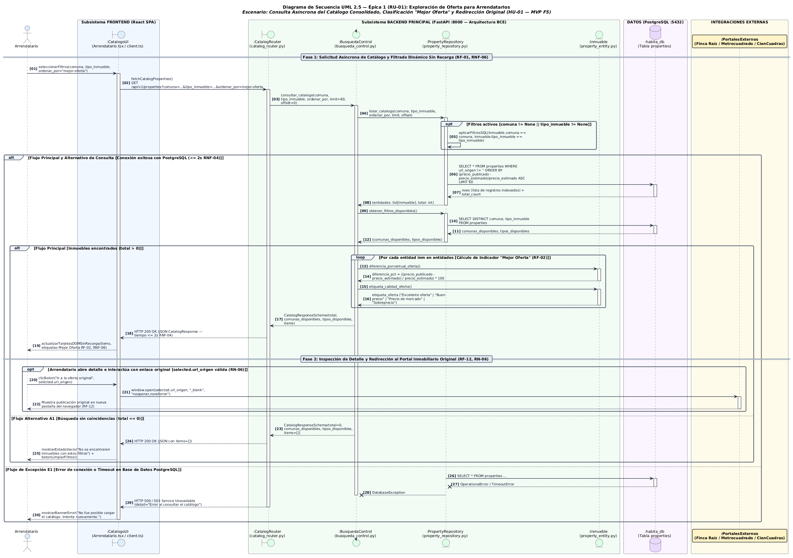
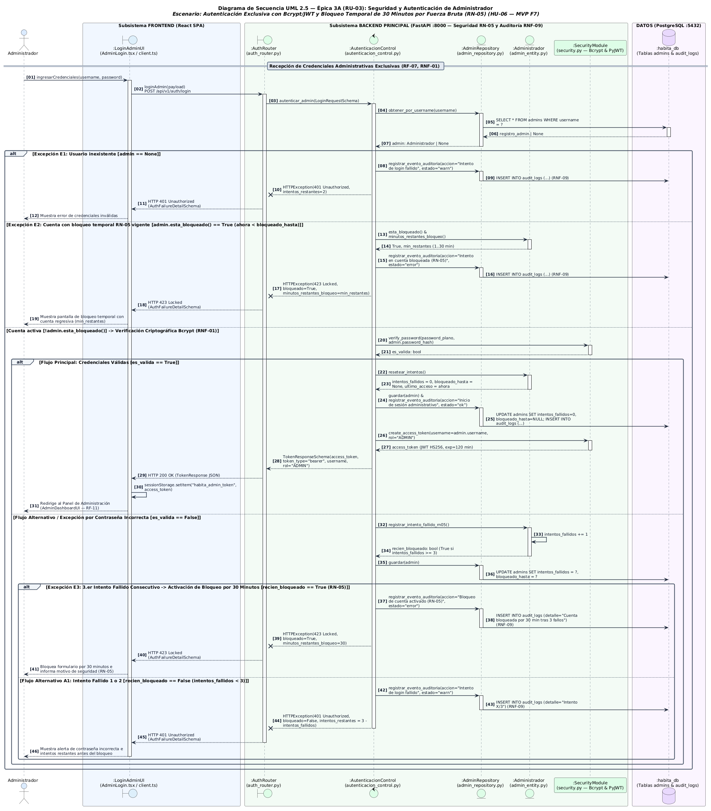
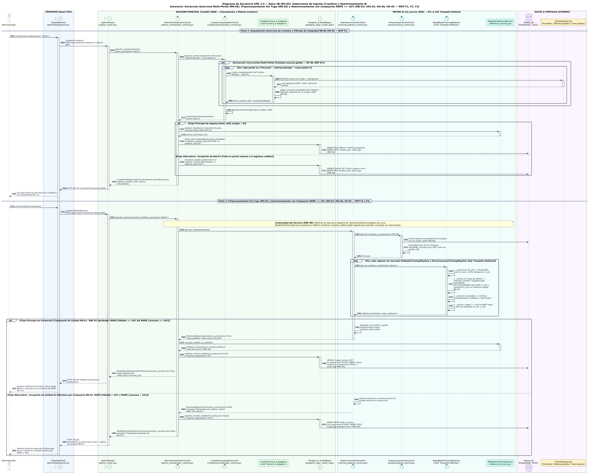

# 4. Diagramas de Secuencia UML 2.5 — Interacciones Dinámicas por Épica del MVP

**Proyecto:** Sistema de Búsqueda y Estimación Inmobiliaria — *Habita* (Medellín)  
**Estudiante:** Heman Santiago Bermudez Espinosa  
**Docente:** Alexandra Guerrero Bocanegra  
**Asignatura:** Diseño de Sistemas de Información — Instituto Tecnológico Metropolitano (ITM)  
**Entregable:** Entregable #3 — Sección 4: Diagramas de Secuencia UML 2.5  
**Épicas Cubiertas:** `RU-01` (Arrendatario), `RU-02` (Propietario) y `RU-03` (Administrador)  
**Funcionalidades del MVP Cubiertas:** `F1`, `F2`, `F3`, `F4`, `F5`, `F6`, `F7`  
**Coherencia Estructural:** Basado en el Diagrama de Clases BCE (C4 Nivel 4), el Diagrama de Componentes UML 2.5 y el código fuente real del MVP.

---

## Matriz Resumen de Escenarios Modelados por Épica

Para cubrir la totalidad de las épicas y las 7 funcionalidades del MVP respetando los estereotipos arquitectónicos **Boundary-Control-Entity (BCE) + Service**, se presentan **4 diagramas de secuencia UML 2.5**:

| # | Épica | Historias de Usuario / Funcionalidades MVP | Nombre del Escenario Representativo | Actor Principal | Fragmentos Combinados UML | Reglas y Requisitos Clave |
| :-: | :--- | :--- | :--- | :--- | :--- | :--- |
| **4.1** | **`RU-01`** *(Arrendatario)* | **`HU-01`** Funcionalidad **`F5`** (*Consolidar catálogo*) | Consulta Asíncrona del Catálogo Consolidado, Clasificación por *"Mejor Oferta"* y Redirección al Portal Original | `Arrendatario` | `opt`, `alt`, `loop` | `RF-01`, `RF-02`, `RF-12`, `RNF-04` ($\le 2\text{ s}$), `RNF-06` (SPA sin recarga), `RN-06` (`url_origen`) |
| **4.2** | **`RU-02`** *(Propietario)* | **`HU-02`** y **`HU-08`** Funcionalidades **`F6`** (*Estimar precio*) y **`F4`** (*Obtener margen sugerido*) | Estimación Híbrida de Canon (*GoF Facade*), Búsqueda de Comparables (`RN-03`) y Cálculo de Estrategias Comerciales (*GoF Strategy*) | `Propietario` | `alt`, `par` (*Fork/Join*), `loop`, `opt` | `RF-03`, `RF-04`, `RF-05`, `RF-06`, `RN-01`, `RN-03` (4 criterios), `RN-04` ($\pm 5\%$), `RNF-05` ($< 3\text{ s}$) |
| **4.3** | **`RU-03`** *(Administrador — Seguridad)* | **`HU-06`** Funcionalidad **`F7`** (*Autenticarse*) | Autenticación Exclusiva de Administrador con `Bcrypt`/`JWT` y Bloqueo Temporal de 30 Minutos por Fuerza Bruta | `Administrador` | `alt` (anidado en 4 ramas: éxito, fallo 1–2, bloqueo 3.er fallo, cuenta bloqueada) | `RF-07`, `RNF-01`, `RNF-09` (auditoría), `RN-05` (3 fallos $\rightarrow$ 30 min `HTTP 423`) |
| **4.4** | **`RU-03`** *(Administrador — Gobernanza e IA)* | **`HU-03`**, **`HU-04`**, **`HU-05`** Funcionalidades **`F1`**, **`F2`**, **`F3`** | Orquestación Asíncrona de Crawlers (*Factory + Adapter*), Preprocesamiento Sin Fuga (`RN-02`) y Reentrenamiento con Compuerta $\text{MAPE} \le 16\%$ (`RN-01`) | `Administrador` | `par`, `loop`, `alt` (promoción vs. rechazo por compuerta `RN-01`) | `RF-08`, `RF-09`, `RF-10`, `RF-11`, `RN-01` ($\le 16\%$), `RN-02`, `RN-06`, `RNF-02`, `RNF-07`, `RNF-08`, `RNF-09` |

---

## 4.1. Épica 1 (`RU-01`): Exploración y Comparación de Oferta para Arrendatarios

### 4.1.1. Identificación del Escenario
* **Nombre del Escenario:** Consulta Asíncrona del Catálogo Consolidado, Clasificación por Indicador *"Mejor Oferta"* y Redirección al Portal Inmobiliario de Origen.
* **Épica Asociada:** **`RU-01` — Exploración y Comparación de Oferta para Arrendatarios**.
* **Historia de Usuario y Funcionalidad MVP:** **`HU-01`** (*"Como arrendatario, quiero buscar inmuebles consolidados de múltiples portales filtrando por comuna y tipo, y ordenarlos por mejor oferta para identificar arriendos con precio justo"*) — **Funcionalidad `F5: Consolidar catálogo`**.
* **Requisitos y Reglas Aplicadas:** `RF-01`, `RF-02`, `RF-12`, `RNF-04`, `RNF-06`, `RN-06`.

### 4.1.2. Actor Principal y Líneas de Vida Participantes

| Línea de Vida / Participante | Estereotipo UML / Rol | Subsistema | Archivo Real en el Código Fuente | Responsabilidad en la Interacción |
| :--- | :--- | :--- | :--- | :--- |
| **`Arrendatario`** | `actor` | Usuario Externo | — | Selecciona filtros de búsqueda, explora las tarjetas valoradas con IA y abre la oferta original. |
| **`:CatalogoUI`** | `<<boundary>>` | `FRONTEND` | `Arrendatario.tsx` y `client.ts` | Dispara `fetchCatalogProperties()` de forma asíncrona actualizando el DOM sin recargar la página (`RNF-06`). |
| **`:CatalogRouter`** | `<<boundary>>` | `BACKEND` | `catalog_router.py` | Expone el endpoint `GET /api/v1/properties`, valida parámetros *query* e inyecta `BusquedaControl`. |
| **`:BusquedaControl`** | `<<control>>` | `BACKEND` | `busqueda_control.py` | Orquesta la consulta al repositorio y construye los DTOs invocando los métodos de negocio de `Inmueble`. |
| **`:PropertyRepository`** | `<<entity / repository>>` | `BACKEND` | `property_repository.py` | Ejecuta las consultas SQL indexadas sobre PostgreSQL garantizando tiempos $\le 2\text{ s}$ (`RNF-04`). |
| **`:Inmueble`** | `<<entity>>` | `BACKEND` | `property_entity.py` | Calcula `diferencia_porcentual_oferta()` y `etiqueta_calidad_oferta()` (`RF-02`). |
| **`:habita_db`** | `database` | `DATOS` | Tabla `properties` en PostgreSQL | Retorna las filas indexadas que cumplen `url_origen != ''` (`RN-06`). |
| **`:PortalesExternos`** | `<<external>>` | `INTEGRACIONES EXTERNAS` | *Finca Raíz*, *Metrocuadrado*, *CienCuadras* | Recibe al arrendatario en una nueva pestaña cuando pulsa *"Ir a la oferta original"* (`RF-12`). |

### 4.1.3. Diagrama de Secuencia Renderizado y Enlaces Editables
* **Enlace editable en línea (PlantText / PlantUML):** [Abrir Diagrama de Secuencia Épica 1 en Editor PlantText](https://www.planttext.com/?text=dLZDSYB94RuhGk-GRaTuOSqWG3-Z8ORnyjFCuDMV0Qtjq2Y8eYcXcccwsEfk2Ot74RxwxXVO1zY3mxUzwaty9FwgghlfHcWzkpf8a5NrPLPcVfbP-YQCc8hYXR-x4ud8v_Hw-gOds5on1QCPfn7tOXvuWj7bwGargeVqtt_yYnx_kHGUepgLXfSlQlLoazpLqfUAUUBnFu4-Ttx3LSHeoHIZjb8yc34e4Z9ylJTzypvuBTwueSS3BMfILmPXx6DxEtpyCV2K3BHkdxeiUlp1btDfTaXVpDXCLgZhir3Sm02hpJdb7wHAD3hqG4C-4ufxTlLSYRa8c4-bTzfKO_xfTnVKFoo_tXDlTdTO7CaWNaov8WUNlwhLhftTdT1ZSCQ2hMY_KQlHlPX5jv1-586-qeAcpFiuLp8EPbs9YzDl--OdloMyXRNt8fZJ3VD3dbzA3ge0IeyAP_Ztsjtyb8SXc_EsB-O1-VmcAfpcuHB-I3Trk2_luMDvJv6A2tfWVx9f93vnQXpKygipViFWzhuCeZEsuEIC-5nokXmup-mo8FN6xiusa-blkpj4nex49NMtyMg_aqarGh9IwzTVDjg55OjTpsJZM-5z360yrQi7MdeYRlY927X7gXbN2T31oyF3erU5vIU1EUwt-rs3wqNYZaL21WMCUk_0xHrlRDX4wNNSTj_Lczv2l2m0xEyVr0yFrsjFBAZt3_klilLtdE7iLc-OzOAdYNhYJc3_4rItuHxtQ_aTUPkE3buU7CFtVoy62xyZuOab2o8Rhwt1j-AS3UPhz016JAK_qnAhB1-amqGPyo8OuEH9xn0BjNFpZjpTcSeLjCRJK8GHHxNf3y_FnkvP3qM50uH65-so0-_L-YyriGYwSNkc7iXfeZ8mNHWk1--3KbvLDGfNj4UUBtWGuKlPwBuSG77NTVlm2BO2QRNDWawx-wqsu68uEEiEBjedLEgpC6fV3AXvN4CPqCMZhRwFHSIzA4PfwtHTOsEZt-aVRBTnAEE8AvZfsUyJPGJLvOErpQvh-_fTzwN6yE1j9Nr0TE8Gv9gnhfK0P9f89icc3AORAJyFWkkBI9jneUGIbV5Xo9So58Z10s2MYN2YCkdQ88Ys8Ws2HSodFi-VjulPMTVkpKvlEhlN7f-Fg7GXmsYk-EXF9zGyFDXl61-smH8JPntAAGkHayrRDXKHcyocq3bcKnyTnMeMF0bjhmCglEeTztjFjGsGJs-7xUxW_CmTaVkNiJiyQuySKwmxhgbCUKB0Ln8jnEUXkq980Xb2Qry4w7H3zlZZ9-JLAOVJlPZD56exldUHPbtpDJ479m7lzlUxnTktMjJNLwetQOH6veaedXNRNQxRFL1V-95HqHF1umyBuKaQYG2XyPYQCp2aZrvMeU4P_XwLgTNIEYp3NhpHwTv4NVPr3mIuCcWoB7bo4GUiGf5Ooeb8ebaXJMNicYobQZaBtKnVIDjCouREkYRgog1r01eAafnjqWsFlDiaqI-oo9JAxuEtxfZss5BitTNtrZ7xWpMXLQrMVrUmmaZoXkJjo5bXDMjB4XjWZKdzfgQDcIBK966Q_88BLyWN2n6rZceGtzo4F6hLyhVMs5gRqQ5lhidHnA7mrobAjUHrQ4ojGouZIa95PX5_homo_QP5PpBWzFbpKKUwSAsJsHYtDf8jaMXPz46sKihWQeAAh4mjpvQAyDXH49HDLfiwxyDQF_uWwKA18w2GZyHj-vevJ1jlSZgTxAxmYQ_CH8O_aGoPZXVb2a7fTOiQeKtfW_ArLh6-4LWEuhWdRdTCN-jESPeh1FJdT-xGfLZv4ubfZmVQALzzHUV3dZkapby9vOg32PDbFDKU0QrUK2BYOIGMa9JtDWJK7dNfP70w6DEHwR9Pk7gcSC2Y5sjNOs09gMIoGbzRyJa-wZYAOCPNW0lBz7kA9D85bJiE8bFdU05pVTzrJfTqVSNKoqERSrTfcAuh5gq93JgP2cXfGX5jfAsSHXmpv-J6fiHa9lGaAO07pXOkQI6s1w0t68tH8CUqDUite_D_VMTH2iPOo89eYyEskElBi9xtrxQapdmUeXMQjglZIINZVtf3jJHPYNmfbyXfHKWoHadi4A45FbCMIf01XTwBVKEHGJ0pEQas7pAco3VArnPw7SkanpPfXf5NcSUPBZ1uJKKnqikMJ1jE_PFTqfvBnGbApdbvE8nVBIfz2M_G19-8lgPwhPOgolavjU3P6_58OBf1myVhI_lgrrycGx88L7BSbOUE6E1iqjpeCpaTF5qI-ytt2_DHXsN1bRwnaOxa57EItLN-cNjfSL8TrzVBjyjq94mUS2Fl5cEdJQJA5_AWGXW-5s5YHje4qwR_RZo-8FrWFV-MIdySdPzjgZGZB6Yv074A1TVYwVOEB3j9DBMxaLBY4rDZfZx0dM7l_1I3I3A7b8mfbSpP8UKpc4p-PaDAwfLq4ceqaVhXCdsdm-KzGFWe81ilU93CpcMwHycfy8KUz7CFU-Yf6psvMKXhqlqq_pOWXZ12aTN2TUNa2bTy_Cas8nxu3EzOcG9VcH4guhDghhNSWRf8JMWrwZ9s5eSll3-yZenaK786YXXXS4qICKLtAhG5FiikEsVfQR99zsWYyhwAWXgKjfofa3F1P1ny1AGJIBsDgqeW5OT6nPMpXJshAACELEH3VXg3ntZP99ot8SXS0WS4CR_3CdQnnt_R_zC4x8xFJGcpiTZAaLHbHX3k8mjiiSrF3UqwNNKUVxBF70enzNfIb-APAKrPtKKQvGhlBw9Qg_OBoTQwklvYlkb4sZYqGQg5r0vMBXmuaz_1mxBad4baGzPUbCR8cev9pH0Z4oLjsz6pn5HdrubOBCLwlayubdWuvz-Pzh_7bpQQBZpiAWLZ8FUokKpIM2muBgYZtD4KrPnaMl5wJFj5Snbc-kUw_ohj_kVORFxbmdnhqrvgXldwSsr_bHRxNl9WD7VKM1kdx13_JFGE4Rqz_Dwd4LTt0WNW4ldCXC_qC5FIvKBuBSSQXyJBdXb8OFJvvCtcF9afaeVAS-7li00qDQWc_3Sn9_qKrqfDSItYLr7yCBkXW1Z-BNGZgpvHQjzeIVo_mL_pZzt_0G00)
* **Gráfico vectorial SVG en línea (PlantText):** [Ver diagrama SVG en línea](https://uml.planttext.com/plantuml/svg/dLZDSYB94RuhGk-GRaTuOSqWG3-Z8ORnyjFCuDMV0Qtjq2Y8eYcXcccwsEfk2Ot74RxwxXVO1zY3mxUzwaty9FwgghlfHcWzkpf8a5NrPLPcVfbP-YQCc8hYXR-x4ud8v_Hw-gOds5on1QCPfn7tOXvuWj7bwGargeVqtt_yYnx_kHGUepgLXfSlQlLoazpLqfUAUUBnFu4-Ttx3LSHeoHIZjb8yc34e4Z9ylJTzypvuBTwueSS3BMfILmPXx6DxEtpyCV2K3BHkdxeiUlp1btDfTaXVpDXCLgZhir3Sm02hpJdb7wHAD3hqG4C-4ufxTlLSYRa8c4-bTzfKO_xfTnVKFoo_tXDlTdTO7CaWNaov8WUNlwhLhftTdT1ZSCQ2hMY_KQlHlPX5jv1-586-qeAcpFiuLp8EPbs9YzDl--OdloMyXRNt8fZJ3VD3dbzA3ge0IeyAP_Ztsjtyb8SXc_EsB-O1-VmcAfpcuHB-I3Trk2_luMDvJv6A2tfWVx9f93vnQXpKygipViFWzhuCeZEsuEIC-5nokXmup-mo8FN6xiusa-blkpj4nex49NMtyMg_aqarGh9IwzTVDjg55OjTpsJZM-5z360yrQi7MdeYRlY927X7gXbN2T31oyF3erU5vIU1EUwt-rs3wqNYZaL21WMCUk_0xHrlRDX4wNNSTj_Lczv2l2m0xEyVr0yFrsjFBAZt3_klilLtdE7iLc-OzOAdYNhYJc3_4rItuHxtQ_aTUPkE3buU7CFtVoy62xyZuOab2o8Rhwt1j-AS3UPhz016JAK_qnAhB1-amqGPyo8OuEH9xn0BjNFpZjpTcSeLjCRJK8GHHxNf3y_FnkvP3qM50uH65-so0-_L-YyriGYwSNkc7iXfeZ8mNHWk1--3KbvLDGfNj4UUBtWGuKlPwBuSG77NTVlm2BO2QRNDWawx-wqsu68uEEiEBjedLEgpC6fV3AXvN4CPqCMZhRwFHSIzA4PfwtHTOsEZt-aVRBTnAEE8AvZfsUyJPGJLvOErpQvh-_fTzwN6yE1j9Nr0TE8Gv9gnhfK0P9f89icc3AORAJyFWkkBI9jneUGIbV5Xo9So58Z10s2MYN2YCkdQ88Ys8Ws2HSodFi-VjulPMTVkpKvlEhlN7f-Fg7GXmsYk-EXF9zGyFDXl61-smH8JPntAAGkHayrRDXKHcyocq3bcKnyTnMeMF0bjhmCglEeTztjFjGsGJs-7xUxW_CmTaVkNiJiyQuySKwmxhgbCUKB0Ln8jnEUXkq980Xb2Qry4w7H3zlZZ9-JLAOVJlPZD56exldUHPbtpDJ479m7lzlUxnTktMjJNLwetQOH6veaedXNRNQxRFL1V-95HqHF1umyBuKaQYG2XyPYQCp2aZrvMeU4P_XwLgTNIEYp3NhpHwTv4NVPr3mIuCcWoB7bo4GUiGf5Ooeb8ebaXJMNicYobQZaBtKnVIDjCouREkYRgog1r01eAafnjqWsFlDiaqI-oo9JAxuEtxfZss5BitTNtrZ7xWpMXLQrMVrUmmaZoXkJjo5bXDMjB4XjWZKdzfgQDcIBK966Q_88BLyWN2n6rZceGtzo4F6hLyhVMs5gRqQ5lhidHnA7mrobAjUHrQ4ojGouZIa95PX5_homo_QP5PpBWzFbpKKUwSAsJsHYtDf8jaMXPz46sKihWQeAAh4mjpvQAyDXH49HDLfiwxyDQF_uWwKA18w2GZyHj-vevJ1jlSZgTxAxmYQ_CH8O_aGoPZXVb2a7fTOiQeKtfW_ArLh6-4LWEuhWdRdTCN-jESPeh1FJdT-xGfLZv4ubfZmVQALzzHUV3dZkapby9vOg32PDbFDKU0QrUK2BYOIGMa9JtDWJK7dNfP70w6DEHwR9Pk7gcSC2Y5sjNOs09gMIoGbzRyJa-wZYAOCPNW0lBz7kA9D85bJiE8bFdU05pVTzrJfTqVSNKoqERSrTfcAuh5gq93JgP2cXfGX5jfAsSHXmpv-J6fiHa9lGaAO07pXOkQI6s1w0t68tH8CUqDUite_D_VMTH2iPOo89eYyEskElBi9xtrxQapdmUeXMQjglZIINZVtf3jJHPYNmfbyXfHKWoHadi4A45FbCMIf01XTwBVKEHGJ0pEQas7pAco3VArnPw7SkanpPfXf5NcSUPBZ1uJKKnqikMJ1jE_PFTqfvBnGbApdbvE8nVBIfz2M_G19-8lgPwhPOgolavjU3P6_58OBf1myVhI_lgrrycGx88L7BSbOUE6E1iqjpeCpaTF5qI-ytt2_DHXsN1bRwnaOxa57EItLN-cNjfSL8TrzVBjyjq94mUS2Fl5cEdJQJA5_AWGXW-5s5YHje4qwR_RZo-8FrWFV-MIdySdPzjgZGZB6Yv074A1TVYwVOEB3j9DBMxaLBY4rDZfZx0dM7l_1I3I3A7b8mfbSpP8UKpc4p-PaDAwfLq4ceqaVhXCdsdm-KzGFWe81ilU93CpcMwHycfy8KUz7CFU-Yf6psvMKXhqlqq_pOWXZ12aTN2TUNa2bTy_Cas8nxu3EzOcG9VcH4guhDghhNSWRf8JMWrwZ9s5eSll3-yZenaK786YXXXS4qICKLtAhG5FiikEsVfQR99zsWYyhwAWXgKjfofa3F1P1ny1AGJIBsDgqeW5OT6nPMpXJshAACELEH3VXg3ntZP99ot8SXS0WS4CR_3CdQnnt_R_zC4x8xFJGcpiTZAaLHbHX3k8mjiiSrF3UqwNNKUVxBF70enzNfIb-APAKrPtKKQvGhlBw9Qg_OBoTQwklvYlkb4sZYqGQg5r0vMBXmuaz_1mxBad4baGzPUbCR8cev9pH0Z4oLjsz6pn5HdrubOBCLwlayubdWuvz-Pzh_7bpQQBZpiAWLZ8FUokKpIM2muBgYZtD4KrPnaMl5wJFj5Snbc-kUw_ohj_kVORFxbmdnhqrvgXldwSsr_bHRxNl9WD7VKM1kdx13_JFGE4Rqz_Dwd4LTt0WNW4ldCXC_qC5FIvKBuBSSQXyJBdXb8OFJvvCtcF9afaeVAS-7li00qDQWc_3Sn9_qKrqfDSItYLr7yCBkXW1Z-BNGZgpvHQjzeIVo_mL_pZzt_0G00)

### 4.1.4. Explicación Técnica del Comportamiento, Flujos y Fragmentos Combinados
1. **Orden Temporal y Filtrado Opcional (`[01]` a `[12]` — Fragmento `opt`):**
   * Cuando el arrendatario selecciona una comuna, un tipo de inmueble o el criterio de ordenamiento `"mejor-oferta"` (`[01]`), `:CatalogoUI` invoca asíncronamente `GET /api/v1/properties` (`[02]`).
   * `:CatalogRouter` delega en `:BusquedaControl.consultar_catalogo()` (`[03]`), que invoca a `:PropertyRepository.listar_catalogo()` (`[04]`). Dentro del fragmento `opt [Filtros activos]`, el repositorio añade dinámicamente predicados SQL indexados (`idx_properties_comuna_tipo`) y ordena directamente en motor de base de datos por la expresión `(precio_publicado - precio_estimado) / precio_estimado ASC` (`[05]–[08]`), asegurando tiempos de respuesta menores a 2 segundos (**`RNF-04`**).
2. **Flujo Principal (`[13]` a `[22]` — Fragmentos `alt`, `loop` y `opt`):**
   * Si `total > 0`, el fragmento `loop [Por cada entidad inm en entidades]` (`[13]–[16]`) invoca sobre cada entidad `:Inmueble` sus métodos de dominio `diferencia_porcentual_oferta()` y `etiqueta_calidad_oferta()` (**`RF-02`**), clasificando cada anuncio como *"Excelente oferta"* ($\le -8\%$), *"Buen precio"*, *"Precio de mercado"* o *"Sobreprecio"*.
   * `:CatalogoUI` recibe el payload JSON (`[18]`) y actualiza las tarjetas del DOM de forma reactiva sin recargar el navegador (**`RNF-06`**).
   * En la Fase 2, el fragmento `opt` (`[20]–[22]`) modela la redirección externa (**`RF-12`**): dado que todo inmueble almacenado cumplió la regla **`RN-06`** (`url_origen` obligatoria), al pulsar *"Ir a la oferta original"* se ejecuta `window.open(selected.url_origen, "_blank")`.
3. **Flujo Alternativo `A1` (`[23]` a `[25]` — Sin coincidencias `total == 0`):**
   * Cuando la combinación de filtros no arroja resultados, el Backend retorna `HTTP 200 OK` con `items=[]` y `:CatalogoUI` muestra un estado vacío amigable con un botón para restablecer los filtros sin recargar la vista.
4. **Flujo de Excepción `E1` (`[26]` a `[30]` — Fallo de Base de Datos):**
   * Si ocurre un `OperationalError` o *timeout* en PostgreSQL, la excepción se propaga hasta `:CatalogRouter`, que responde con `HTTP 500/503` y `:CatalogoUI` despliega un banner de reconexión controlada.

---

## 4.2. Épica 2 (`RU-02`): Inteligencia de Precios y Análisis Competitivo para Propietarios

### 4.2.1. Identificación del Escenario
* **Nombre del Escenario:** Estimación Híbrida de Canon (*GoF Facade*), Comparación con Competidores Similares (`RN-03`) y Cálculo de Estrategias Comerciales de Margen (*GoF Strategy*, `RN-04`).
* **Épica Asociada:** **`RU-02` — Inteligencia de Precios y Análisis Competitivo para Propietarios**.
* **Historias de Usuario y Funcionalidades MVP:** **`HU-02`** (*Funcionalidad `F6: Estimar precio de una vivienda`*) y **`HU-08`** (*Funcionalidad `F4: Obtener margen sugerido`*).
* **Requisitos y Reglas Aplicadas:** `RF-03`, `RF-04`, `RF-05`, `RF-06`, `RN-01`, `RN-03`, `RN-04`, `RNF-05`, `RNF-06`.

### 4.2.2. Actor Principal y Líneas de Vida Participantes

| Línea de Vida / Participante | Estereotipo UML / Rol | Subsistema | Archivo Real en el Código Fuente | Responsabilidad en la Interacción |
| :--- | :--- | :--- | :--- | :--- |
| **`Propietario`** | `actor` | Usuario Externo | — | Ingresa las características de su inmueble y selecciona la estrategia comercial deseada. |
| **`:PanelPropietarioUI`** | `<<boundary>>` | `FRONTEND` | `Propietario.tsx` (`CalculadoraUI` + `PanelPropietarioUI`) | Captura el formulario, consume `/estimate` y `/margin` y presenta el dashboard competitivo. |
| **`:ValuationRouter`** | `<<boundary>>` | `BACKEND` | `valuation_router.py` | Expone `POST /api/v1/properties/estimate` y `POST /api/v1/properties/margin`. |
| **`:AnalisisCompetitivoControl`** | `<<control>>` | `BACKEND` | `analisis_competitivo_control.py` | Coordina la fachada de valoración (`F6`) con el calculador de estrategias de margen (`F4`). |
| **`:PropertyValuationFacade`** | `<<control / GoF Facade>>` | `BACKEND` | `valuation_facade_control.py` | Ejecuta en paralelo (`asyncio.gather`) la inferencia ML y la consulta SQL de comparables `RN-03`. |
| **`:MLServiceClient`** | `<<infrastructure>>` | `BACKEND` | `ml_service_client.py` | Consume `ml_service :8001` vía `httpx` o conmuta al modelo `.joblib` local de respaldo si hay *timeout*. |
| **`:ModeloPredictivoService`** | `<<service>>` | `MOTOR IA` | `inference_service.py` | Realiza la inferencia matemática en $< 50\text{ ms}$ con el artefacto precargado en RAM (`RNF-05`). |
| **`:PropertyRepository`** | `<<entity / repository>>` | `BACKEND` | `property_repository.py` | Busca competidores que cumplen estrictamente los 4 criterios de **`RN-03`** (`es_comparable_con()`). |
| **`:CompetitiveMetricsService`** | `<<service>>` | `BACKEND` | `competitive_metrics_service.py` | Calcula el precio mínimo, promedio y máximo del sector (`RF-05`). |
| **`:PricingMarginCalculator`** | `<<service / GoF Strategy>>` | `BACKEND` | `pricing_strategies.py` | Evalúa las estrategias de Liquidez ($-5\%$), Mercado ($0\%$) y Rentabilidad ($+5\%$) según **`RN-04`**. |

### 4.2.3. Diagrama de Secuencia Renderizado y Enlaces Editables
* **Enlace editable en línea (PlantText / PlantUML):** [Abrir Diagrama de Secuencia Épica 2 en Editor PlantText](https://www.planttext.com/?text=dLdDKYD74hvFnBn31WvlI3O3af0OHW5uXP0ysFne4TW7FA4ejGgecUwkTdMBGUDrn5xtlY_WunvysfkllCa-oNvPrR-Ii1qx1oHLL-TVVVbbPirVuqIOP1xuBryaAl4bxKyFZvMuCo8GD9CqbjvSXfuIT7rsIgsj3ltt7_-Yftz6oXFKejhbzQj6gzwbap2HlhfpM_7Uo4XFwPWMr0kVVl5Lh6Bgwo2IqA8UzFxszF27S5yT3c9FXi8etQL1dAX0UEhfFo6zVVfrQjJCYkgBK8TK-reFQIWyCPFrJIjA637rPGmRpbyrTkfG1Gb69F9EYPXVF1C61hatn-x9OfDuTxjEjRTi-IRnnvvrwkox4Grt8MROhkzlgyENByGyqU4yc4f36uZBJQFnRkFbYzWJY5CW7ccdtMZGHpLBxh7wGOLiKa1JuNsuCteUplhQruO-6zf_vItnlPZfZogyerlXnxByA7tHX52wMtb7_iWd8Sza78ixsKEqG_BbRL9vMyQH3kDiqv7qzSUUCVeZ9MPUqGFxqqrZzKbIgzqeFvt9Mp7taw4EatCHIDeOopijwVfauvbTLaYpzVB5EfFffvSlYAmTQKYQWzQRdQDybIMaJnh3vkjMh_B4oMxcQrVtoliGmdXgRhLvzLJTobCLoYDjPjAaWjglEvtTDvN7AmUpD-mD-rQk1rIAHEcm8gFPsMli72zjM9Pot1_s1wzvqzTOZYe2TdRQpKwdUBPYGNFO6Rx9dx-LWBTP6mtxl19fecFreB1_HUgWDTWRDiexoZRjjb-tzn3xd_cmX9TWRMDaTAHamecuGSYUdbt-xFXeq1iEUDzKFm84yodoE96WXk7bnVdLuFmOsISXWyQZNdq3_ZI6hndgH5EsHvW5RNH78fH-ISFroGzXhIzyR-uZ3OouFg6_qBfDfPzRIVnOjwPXDq8-60pXWWndKFIupi2ZNlzRjczqUNBUFndrJgas577I6vrGTw-1lEMKF-eFw4igc0LsP4HXlMaDZuRj9M--4_xS0k5IpnDfuCf3jZ8nTcahMZXJtOuoGZmSeD4-nFH2OLcnH8fzzn0IHVfmuXLF9-cxkVH-OlpriZbkqYIBt5Jd7GJlxnVE7XvIOVcjNLhHaOQbf0MPdIXFHI9CeEdiT2pDW_9atrSoJA0Xy2UnMvfuTYsNTNRgDfMbuQTA5YMJBsMaOmNmBI0hIXSd9byjOekbv-qgeWegJ8poujHE6uFKG0IWYA-S16vZPdvXjrj_Nja8Zy7bN6vKcE8QjkRXpY05VP7REiaAbOnpDTckGiyokiykhYukwQH7fI1RC3VJr3iUzjOSaPwX2g0UpnHpc5uV21NUIiDSlUf-TiJqMR-FV6Yk6dRSkxeOKssau-JEoF7VJgdRQU-qh5Kz49mbX9b8n5J4g2NTUp5LYPZCfZ3Y2aLSK7hIY8TJUdm45djpl3SyhcWxE00Y8QBPfR7suMCodt6bBxSEUVFnNEzXUnKqE3wuQuZE0Iq1Fjhke-C-TkjqSC0Q7H6-EcJQwI9Ay2yMfWT4JD4SnD-1Ns6Vg058yr1ielWRiDKc9Ih2Ns4ark1kp4z2ZGySpe-R92q0TDqIC1SMhgsi3sgWB2MEBk-3OudCqeEX9ckHMFXQpEfWo8ln5MsBI6q_DBUB86vdxvNaEvcMy_s4XlxylKQWLCX0yUdc6EROhWafQGGwhmSEtGnhiRnx-Ys4AIZc8DRHOWPWAOzgx1qTKYDt1_LuQxV-ZdLGvWEyiKG5NzwZbmIPJt9sK-b1rEBiCBkKUJf8FRZa7Y9EnjuzbDTPSEuHotMwh0PeIkagYvkPB2o3eXanXOwg4FUA4vF1guLcb8rrW08jUtE3vE3TsdpO_aOhX0FDb-2txpbODH4l44czTIUIUtYzVq0xiIqnb-UCgWnEDZdfaflhijWcDz0k0SljCrEwpVSCfsXTczPyobo5qpclTf56SeONpIIoxwz59Q8Up2Kwvpy5JrQLnohJv3p10m3fJ7b6Eyw0mPWHQewHR82UVWq1aPjBTALyY88NzwdJe21-vqHGORvr9UCQ0A4CxS3VZXo3KUqajVyaZEPbN2oPcaegr6IYb_JaCLFXZBkbEV1Ojv47ZQB11G7GrdizzTMKpR_idQqHMJs6jrTN8sgXnxZubchkA2OEaJCkuz4cfOi11f30yZC-HIGdACYOUl0ep5sQoUUSaXWTqaJk-SYrK5XwGxILjKHIhqatt5N8KABHujEnXqEXffdYIK4XZgJfIWKIwOfaneJttD7axatoaCaGtxKdOptnDSQY4ZDTno9rBOyUuChpYV1dsWO0zH81gGGLN9g1gr1UJco70WxG9021dvrcXGtzc8mnZAHngqIjZ5eRj9K4HCOVFVt638TavWB6SwSh6GYSZ9S6phHUsBbpEHrjOzAbwHnpefd4Ab0-yYoUcB2naoTacc3FPAIFbvA3PcCv_rYqMx9Ae0nr4gLmS3heNz4Nt9IVbKefVVzsS3aWf_FWA-gX7KuLfxygsW---Y7aHKlhHuEhxmU3S_lZYyRMNeUoHryqjveTglMD0kHun6UHE05yAmSaD_huo2t0r5T5U6uHbJWZPuxgoh5bxsMkfY-w336KiS2MB8lX1jQsZGe7EPlewNl9EL7FBWdA8ikmyafdFU6c56_pIQDE9JUPgdUhsCfE9CTjLa9skjH70KKhgErLnDE_EKZsNiBdInNkAYoEEd_oui8L4svDyYkChAIKIa7Qgi8XruQQjAiLtDQoqjfwJnto9joVvUIKCzQjy7s-rAWMpbINCu4hGILVSjmZD7Qe4DnAtFWoVCQ2EdSIAVDaRbIEw2nrfEZaHEpOFwFOG8KgqBdzW440RYWM0l5edoSw4NuPU_MS65RPjDUYcp7gVTbgae_20dugiDiYA-q7NAu1D_W9A3Jg_wT7gCOpO24zHVuQwwcHpnxD6gSE77rOP5Rvi7nm6NQADitanRgssekvsoLdfAsHImQbPSmH_oH2kKOdrDpz71Wl1x2-P5Av2SjwkHpuwERid6ecYKOa9amSiaYOxFGPkmUhvcJm3wI13bt5SAR3QVQrZcY4nFIufIjKyDdUdAeVvsh6mshjLUVp-YOdwGUP70bVO6gQKQt1YuZOBKQRAGemx_mIEzyvxccdv96xLNKnLRROoXCNdW2_eUi6oau-urHEGOM6KkzTn8inWjUKu5BsquPl_PAVDhe4lpPf8vM9tmt-oVNH-eCinHey-ddfyAf1TCTNdc7-44L1vCj4BqajcljiaCY6i4ftzStuujm2KHOZ8CwcDnfiLbFMPYb2bnEn9L_WiXGQAWwAvp0eTEDV5pmVpb3jFedqDdgG0yofIkmKYqIgw5oG4U6TfXiRMOGEMDZdmI0T2gebeyrglAney91gR3HqEk5cQEndvuSwualR2zaHv2AoN_tYChjK8tIKKEawZKCMp9CAodDSf5p6qvcv5P_0sYb6wE-KeWFVoi18MQuwBCUvTQQmlbOeF2Ym1t4vxlXx1NHfuYnDnccU9D9TknmjCXZMVcSi3kpUvQug7OnjPx0yj1PrrDRa4l7KglSzjW5T7bLNXbLUMaDmkPP8cuddYmTPit_pqiLv_qUijfRNgfHJ-9NUMLqooLYMOGUgvJIUtm7ohCxset9YxuWKBBHmJXVZUUGMl-J5ztFOU0lJIYFCMgee0b6bYcUjMf5L1FHt2MAjI6BQMDFDbP2mH03un638183yGLDPdjB7QQ2GxoN_-UgWIAaOBKGwyXYAddu1SWGN1dlNLABlKXV2MV_eoSY96c2Kow-Ta9lvzGoI5ItbhJO18mZcrEJxBNhwXRju5Dy6nhliUkPs3afXkUlkQIhHQxTQT1swsIxcTe86xgQsDZ060O6CR5Hbux8xeUMwNWHqAPndSsiJ-aPafbWMn_oZkVi98kqwviAz9GtkrYmDtb_nQVyhyty0)
* **Gráfico vectorial SVG en línea (PlantText):** [Ver diagrama SVG en línea](https://uml.planttext.com/plantuml/svg/dLdDKYD74hvFnBn31WvlI3O3af0OHW5uXP0ysFne4TW7FA4ejGgecUwkTdMBGUDrn5xtlY_WunvysfkllCa-oNvPrR-Ii1qx1oHLL-TVVVbbPirVuqIOP1xuBryaAl4bxKyFZvMuCo8GD9CqbjvSXfuIT7rsIgsj3ltt7_-Yftz6oXFKejhbzQj6gzwbap2HlhfpM_7Uo4XFwPWMr0kVVl5Lh6Bgwo2IqA8UzFxszF27S5yT3c9FXi8etQL1dAX0UEhfFo6zVVfrQjJCYkgBK8TK-reFQIWyCPFrJIjA637rPGmRpbyrTkfG1Gb69F9EYPXVF1C61hatn-x9OfDuTxjEjRTi-IRnnvvrwkox4Grt8MROhkzlgyENByGyqU4yc4f36uZBJQFnRkFbYzWJY5CW7ccdtMZGHpLBxh7wGOLiKa1JuNsuCteUplhQruO-6zf_vItnlPZfZogyerlXnxByA7tHX52wMtb7_iWd8Sza78ixsKEqG_BbRL9vMyQH3kDiqv7qzSUUCVeZ9MPUqGFxqqrZzKbIgzqeFvt9Mp7taw4EatCHIDeOopijwVfauvbTLaYpzVB5EfFffvSlYAmTQKYQWzQRdQDybIMaJnh3vkjMh_B4oMxcQrVtoliGmdXgRhLvzLJTobCLoYDjPjAaWjglEvtTDvN7AmUpD-mD-rQk1rIAHEcm8gFPsMli72zjM9Pot1_s1wzvqzTOZYe2TdRQpKwdUBPYGNFO6Rx9dx-LWBTP6mtxl19fecFreB1_HUgWDTWRDiexoZRjjb-tzn3xd_cmX9TWRMDaTAHamecuGSYUdbt-xFXeq1iEUDzKFm84yodoE96WXk7bnVdLuFmOsISXWyQZNdq3_ZI6hndgH5EsHvW5RNH78fH-ISFroGzXhIzyR-uZ3OouFg6_qBfDfPzRIVnOjwPXDq8-60pXWWndKFIupi2ZNlzRjczqUNBUFndrJgas577I6vrGTw-1lEMKF-eFw4igc0LsP4HXlMaDZuRj9M--4_xS0k5IpnDfuCf3jZ8nTcahMZXJtOuoGZmSeD4-nFH2OLcnH8fzzn0IHVfmuXLF9-cxkVH-OlpriZbkqYIBt5Jd7GJlxnVE7XvIOVcjNLhHaOQbf0MPdIXFHI9CeEdiT2pDW_9atrSoJA0Xy2UnMvfuTYsNTNRgDfMbuQTA5YMJBsMaOmNmBI0hIXSd9byjOekbv-qgeWegJ8poujHE6uFKG0IWYA-S16vZPdvXjrj_Nja8Zy7bN6vKcE8QjkRXpY05VP7REiaAbOnpDTckGiyokiykhYukwQH7fI1RC3VJr3iUzjOSaPwX2g0UpnHpc5uV21NUIiDSlUf-TiJqMR-FV6Yk6dRSkxeOKssau-JEoF7VJgdRQU-qh5Kz49mbX9b8n5J4g2NTUp5LYPZCfZ3Y2aLSK7hIY8TJUdm45djpl3SyhcWxE00Y8QBPfR7suMCodt6bBxSEUVFnNEzXUnKqE3wuQuZE0Iq1Fjhke-C-TkjqSC0Q7H6-EcJQwI9Ay2yMfWT4JD4SnD-1Ns6Vg058yr1ielWRiDKc9Ih2Ns4ark1kp4z2ZGySpe-R92q0TDqIC1SMhgsi3sgWB2MEBk-3OudCqeEX9ckHMFXQpEfWo8ln5MsBI6q_DBUB86vdxvNaEvcMy_s4XlxylKQWLCX0yUdc6EROhWafQGGwhmSEtGnhiRnx-Ys4AIZc8DRHOWPWAOzgx1qTKYDt1_LuQxV-ZdLGvWEyiKG5NzwZbmIPJt9sK-b1rEBiCBkKUJf8FRZa7Y9EnjuzbDTPSEuHotMwh0PeIkagYvkPB2o3eXanXOwg4FUA4vF1guLcb8rrW08jUtE3vE3TsdpO_aOhX0FDb-2txpbODH4l44czTIUIUtYzVq0xiIqnb-UCgWnEDZdfaflhijWcDz0k0SljCrEwpVSCfsXTczPyobo5qpclTf56SeONpIIoxwz59Q8Up2Kwvpy5JrQLnohJv3p10m3fJ7b6Eyw0mPWHQewHR82UVWq1aPjBTALyY88NzwdJe21-vqHGORvr9UCQ0A4CxS3VZXo3KUqajVyaZEPbN2oPcaegr6IYb_JaCLFXZBkbEV1Ojv47ZQB11G7GrdizzTMKpR_idQqHMJs6jrTN8sgXnxZubchkA2OEaJCkuz4cfOi11f30yZC-HIGdACYOUl0ep5sQoUUSaXWTqaJk-SYrK5XwGxILjKHIhqatt5N8KABHujEnXqEXffdYIK4XZgJfIWKIwOfaneJttD7axatoaCaGtxKdOptnDSQY4ZDTno9rBOyUuChpYV1dsWO0zH81gGGLN9g1gr1UJco70WxG9021dvrcXGtzc8mnZAHngqIjZ5eRj9K4HCOVFVt638TavWB6SwSh6GYSZ9S6phHUsBbpEHrjOzAbwHnpefd4Ab0-yYoUcB2naoTacc3FPAIFbvA3PcCv_rYqMx9Ae0nr4gLmS3heNz4Nt9IVbKefVVzsS3aWf_FWA-gX7KuLfxygsW---Y7aHKlhHuEhxmU3S_lZYyRMNeUoHryqjveTglMD0kHun6UHE05yAmSaD_huo2t0r5T5U6uHbJWZPuxgoh5bxsMkfY-w336KiS2MB8lX1jQsZGe7EPlewNl9EL7FBWdA8ikmyafdFU6c56_pIQDE9JUPgdUhsCfE9CTjLa9skjH70KKhgErLnDE_EKZsNiBdInNkAYoEEd_oui8L4svDyYkChAIKIa7Qgi8XruQQjAiLtDQoqjfwJnto9joVvUIKCzQjy7s-rAWMpbINCu4hGILVSjmZD7Qe4DnAtFWoVCQ2EdSIAVDaRbIEw2nrfEZaHEpOFwFOG8KgqBdzW440RYWM0l5edoSw4NuPU_MS65RPjDUYcp7gVTbgae_20dugiDiYA-q7NAu1D_W9A3Jg_wT7gCOpO24zHVuQwwcHpnxD6gSE77rOP5Rvi7nm6NQADitanRgssekvsoLdfAsHImQbPSmH_oH2kKOdrDpz71Wl1x2-P5Av2SjwkHpuwERid6ecYKOa9amSiaYOxFGPkmUhvcJm3wI13bt5SAR3QVQrZcY4nFIufIjKyDdUdAeVvsh6mshjLUVp-YOdwGUP70bVO6gQKQt1YuZOBKQRAGemx_mIEzyvxccdv96xLNKnLRROoXCNdW2_eUi6oau-urHEGOM6KkzTn8inWjUKu5BsquPl_PAVDhe4lpPf8vM9tmt-oVNH-eCinHey-ddfyAf1TCTNdc7-44L1vCj4BqajcljiaCY6i4ftzStuujm2KHOZ8CwcDnfiLbFMPYb2bnEn9L_WiXGQAWwAvp0eTEDV5pmVpb3jFedqDdgG0yofIkmKYqIgw5oG4U6TfXiRMOGEMDZdmI0T2gebeyrglAney91gR3HqEk5cQEndvuSwualR2zaHv2AoN_tYChjK8tIKKEawZKCMp9CAodDSf5p6qvcv5P_0sYb6wE-KeWFVoi18MQuwBCUvTQQmlbOeF2Ym1t4vxlXx1NHfuYnDnccU9D9TknmjCXZMVcSi3kpUvQug7OnjPx0yj1PrrDRa4l7KglSzjW5T7bLNXbLUMaDmkPP8cuddYmTPit_pqiLv_qUijfRNgfHJ-9NUMLqooLYMOGUgvJIUtm7ohCxset9YxuWKBBHmJXVZUUGMl-J5ztFOU0lJIYFCMgee0b6bYcUjMf5L1FHt2MAjI6BQMDFDbP2mH03un638183yGLDPdjB7QQ2GxoN_-UgWIAaOBKGwyXYAddu1SWGN1dlNLABlKXV2MV_eoSY96c2Kow-Ta9lvzGoI5ItbhJO18mZcrEJxBNhwXRju5Dy6nhliUkPs3afXkUlkQIhHQxTQT1swsIxcTe86xgQsDZ060O6CR5Hbux8xeUMwNWHqAPndSsiJ-aPafbWMn_oZkVi98kqwviAz9GtkrYmDtb_nQVyhyty0)

### 4.2.4. Explicación Técnica del Comportamiento, Flujos y Fragmentos Combinados
1. **Orquestación mediante Patrón GoF Facade y Concurrencia `par` (`[01]` a `[15]` — `RNF-05` $< 3\text{ s}$):**
   * Al enviar el formulario (`POST /api/v1/properties/estimate`), `:AnalisisCompetitivoControl` invoca a `:PropertyValuationFacade.estimar_y_comparar()` (`[04]`).
   * El fragmento combinado **`par`** modela el `asyncio.gather` real implementado en `valuation_facade_control.py`:
     * **Rama 1 (Inferencia IA — `[05]–[10]`):** `:MLServiceClient` invoca `POST /api/v1/ml/predict` en `:ModeloPredictivoService` (`:8001`). Incluye el **Flujo Alternativo Resiliente `A1`** (`[09]`): si el microservicio externo no responde dentro del *timeout* de 2.5 s, conmuta automáticamente a `_predecir_en_proceso_local()` usando el modelo `.joblib` precargado en RAM.
     * **Rama 2 (Búsqueda SQL `RN-03` — `[11]–[15]`):** En paralelo, `:PropertyRepository.buscar_similares_rn03()` consulta los inmuebles de la misma comuna, mismo estrato, mismo tipo y área dentro de $\pm 15\%$ (**`RN-03`**), verificando el método de dominio `Inmueble.es_comparable_con()`.
2. **Métricas Competitivas (`RF-05`) y Patrón GoF Strategy (`[16]` a `[25]` — Fragmentos `alt` y `loop`):**
   * `:CompetitiveMetricsService` calcula el mínimo, promedio y máximo del sector (`[16]–[18]`). Si no existen competidores exactos bajo `RN-03` (**Flujo Alternativo `A2`**), proyecta las métricas de referencia sobre `precio_estimado_fallback` sin interrumpir la experiencia del propietario.
   * Acto seguido, el fragmento **`loop`** (`[20]–[22]`) ejecuta las 3 estrategias del patrón **GoF Strategy** (`LiquidityPricingStrategy` $-5\%$, `MarketBalancedPricingStrategy` $0\%$ y `ProfitabilityPricingStrategy` $+5\%$, cumpliendo **`RN-04`** y **`RF-06`**).
3. **Conmutación Interactiva de Estrategia (`[26]` a `[33]` — Fragmento `opt`) y Excepción `E1` (`[34]–[35]`):**
   * El fragmento `opt` modela el cambio interactivo de estrategia en la UI (`POST /api/v1/properties/margin`), mientras que la rama `else` exterior captura errores de validación Pydantic (`HTTP 422 Unprocessable Entity`).

---

## 4.3. Épica 3A (`RU-03` — Seguridad): Autenticación de Administrador y Bloqueo Temporal (`RN-05`)

### 4.3.1. Identificación del Escenario
* **Nombre del Escenario:** Autenticación Exclusiva de Administrador con `Bcrypt`/`JWT` y Bloqueo Temporal de 30 Minutos tras 3 Intentos Fallidos Consecutivos (`RN-05`).
* **Épica Asociada:** **`RU-03` — Gestión del Ecosistema y Modelos (Flujo del Administrador)**.
* **Historia de Usuario y Funcionalidad MVP:** **`HU-06`** (*"Como administrador, quiero autenticarme de forma segura con control de intentos fallidos y bloqueo temporal de 30 minutos para proteger la gobernanza del sistema"*) — **Funcionalidad `F7: Autenticarse`**.
* **Requisitos y Reglas Aplicadas:** `RF-07`, `RNF-01`, `RNF-09`, `RN-05`.

### 4.3.2. Actor Principal y Líneas de Vida Participantes

| Línea de Vida / Participante | Estereotipo UML / Rol | Subsistema | Archivo Real en el Código Fuente | Responsabilidad en la Interacción |
| :--- | :--- | :--- | :--- | :--- |
| **`Administrador`** | `actor` | Usuario Externo | — | Ingresa sus credenciales exclusivas en la consola administrativa. |
| **`:LoginAdminUI`** | `<<boundary>>` | `FRONTEND` | `AdminLogin.tsx` y `client.ts` | Envía `POST /api/v1/auth/login`, almacena el JWT en `sessionStorage` o presenta el estado de bloqueo `HTTP 423`. |
| **`:AuthRouter`** | `<<boundary>>` | `BACKEND` | `auth_router.py` | Recibe la solicitud HTTP y delega en `AutenticacionControl`. |
| **`:AutenticacionControl`** | `<<control>>` | `BACKEND` | `autenticacion_control.py` | Evalúa existencia, estado de bloqueo `RN-05`, hash `bcrypt`, reinicio o incremento de fallos y auditoría `RNF-09`. |
| **`:AdminRepository`** | `<<entity / repository>>` | `BACKEND` | `admin_repository.py` | Persiste el estado de la entidad `Administrador` y los eventos en `audit_logs`. |
| **`:Administrador`** | `<<entity>>` | `BACKEND` | `admin_entity.py` | Ejecuta la lógica de dominio `esta_bloqueado()`, `minutos_restantes_bloqueo()`, `registrar_intento_fallido_rn05()` y `resetear_intentos()`. |
| **`:SecurityModule`** | `<<service / infra>>` | `BACKEND` | `security.py` | Verifica contraseñas con `bcrypt.checkpw()` y firma tokens JWT (`HS256`). |

### 4.3.3. Diagrama de Secuencia Renderizado y Enlaces Editables
* **Enlace editable en línea (PlantText / PlantUML):** [Abrir Diagrama de Secuencia Épica 3A en Editor PlantText](https://www.planttext.com/?text=jLdRRkF84Nqtu7-eAC22IcnP5ryLoxkwaB5sVL4iUJQ0Po2qoBRSCSNMDYbV9WcGrxpd1_O3yX3a4_md-P9KTPCKISd6pCxiFgpjlfokhZfrgfhpNHWn5Irc_kP692AVm_7af2VOLB4P0u_3aBiB7hY2mVNv6TGhU_2_V_mBNluv5ow3HXkig-ljQgFSn8NJXH8Uy-0Psek81n6kSCNBVmE2QNip4OWmKioJwdXdSl8-E1OdTkZoW2aXcyKjzfFhBqBnmC2L0NHSzJoFThx_SOJW7L_-jE0IHdmsbuhv1D-emha85f4C0SV0MN3raK57BIA65bviL_VAO9sYfVlQ_FDt0t0EoiSxucHpW-6sO36RS0KblFnDjVgXjBaHkWoTCMDFqAXNg_0elEWEH-z5C6Ve6vWmztwgv2BmkjB78t_hwF-oIy8xlEoZ2APmo_oGPwVYZIh0G_TpU_XFv6v-piEGJNdR5zC0V7uRvNRpS2w3C5dKuRvyR2ib7o5IYzmvQ7-yQ2W-SgZlLhEp7hzb2pzoP11Ti1c74iPGShZkbrvPfK5gzSsDTIR3NpSt0BGTiKjgTlseqKb72I6UgJgrWtexDsEmQ-dOw4wuzm4Q3xNABesUYLj-9WBUaShZAWRQFTZRsp_AJQy4vj1fErsDwqR8g4Z888THw-tQlSF2WY9AhsEt7PiM_H67vpc0HcEtjhUtd5kneERiEKVf_2bdk7UjD_HypjC0FV4WSFqAgbst3vrgTaNMfltTWzr3zFtVALZCZN2ib4l24h2GBfoztER6H3uX3HQJ49TnL03dwl9YP5_qC8iuei1mq2wNy4PLvu383Z0XYvXwXbBpJ4v5eC-uxhyFBFsR7gj4uHFiWEiBJ77yewpFlkxZmLtRTj1A7dY8zBJEWawx-mCPCBZgNtJxW_OPM0uBe_QW3yt3AgOc9VHIV7IoQmdo1DxjvTyCXvpjwf4sk-vqdDs2sQWyTrSIvKUXqIW6TsEb_whCdusXPfACTRhs0Ur6JOgKzCtcHBPaq3N31cOvF8wNfu3TIFbPE5eQQLF8PLTyBaEo_Pc0Q6Iiqg6bKJZqEaOIv1J1JAUxRRCwinzp6UqLSnP424Aght35kVGMFaUKC1v01ErmeyZm3GoUKPKDA6vQ8XOZsckFBeTW3MGOJHKV_kaCcdkxZRgEIXlJGvF9On6Ri12Lg7d79Y9YOs-2Xu_On4TyVPCGpsGKsx4lfp6JUXtCXgFUeTFBdTjgePTSFa-BK5TnJzSoduUPYaGv7ouhJeXSHy8SR1dYrChGQX6SoPNj4o9k4r3MKOQPoc9QYv2h09Lq2zqPXe-OZsMTV2GgfAi4WxiH8-PK4_mqQQmvU_ObyyhlWy7bS0GxR2vs7cexHCaTlIo3PVOJNeo4c9fMJKYvfyRQOvREmIjIwJ0QkdUOL5chQ1VXwDra6H6h2NA2A5oDiPoEaskbzylkf_Le1Ut2tHWAR0NiCxixWj-HUfmdOVlnrBwo8K605doR0UcX1k3MxUNvYayfEDBS0Vu65pB0qkRnt1vpRERkjBYPxpRMxJL6em5-H85FE6BNcd0TBgWZmG3p9vAW09VV62EGK8JqWNO251mM6unUvm-u2Gqt2YIOnLoIWLQf7n2S92hgU59Vu0jFbhO0GuEsjagFJ0MbCi4NR0N8kRX_CRIlHlXZT9b91x0gbKgPEXwjU3gbYfTE3Dz-MfBmT3GQQ3TGwRDsgpMu3eXsQFr7xcsXBxJX8GeHseb_XAswHa_8bsG50K5nFrWaiGuJ_aBn7e_mbvI6GFjekyck9fmJInK3ZZs08a-vsQGLmSFBp-Wo5b8CE7PLkV3Lcz35NYGoNUCaRXIZf54qjU51J3D1hT2DncOfHi2YR8SHjb5WCRIVmJ6aa-CxB3oiN8X_hALDM47w1cQcALtwBPx7sLoC3GODnMWPJfCnMs3AG8m2LgrImPuN1uj1Jf2-ZA4y0DSuChbFsaTdoAfZzEkozPFuMc_0cNJlYQcf-rkfszO7e9Lpw1jaJi5_4OsfdcAIwwVK2X-9fB6RCJPe3BrthA9XCSzZOXl_mCrlrhFt0_dy7LVYDdrATPMOHtAgNdwciQHoMt5nopE5IdWJ7cZ_ypYfOLRootZkiq1k6PMjfAEO5NTv4Y0C_Kre6IAZynyO9MyJAxJq2_7MUpGAQhBZB_uYOQ14G2s9tyoNxdUn1i1D2fbaRPoRQx8JNSeZZkHFnCoauDeaN9U6gGR6eXrY2Qjk5SK1J8dO0dmnYHcccEloKEAe5XE3_KgshkJh50iHzgYcWoCr-QG4nYPELvWGwKJXPza-9rjgv7sfw84aUGlfUpt0xirE2ldG7gqwexNgYjR5zTdP7zxC_HL_B9E-o4ai0xZ0-3CSH_AU1saxqZA4N7PVs6otIktUUVzYvOenDLV8cGK6Yxuqd0xhU_lehgTvgrPVQkrwqgOgbMdjHeHr5R_LZLHOsMEsGFyOHyzptYfDa9jSONpUkiPQYQBl4vS_W9Kx3xuVNbx4kqpBgJSWAq8aoX1PmwQyWYdHHpcoId6xRHuBsYoq96ji1YeZSrVS4mhhAIOj35Z0_Vot7YD0vYNOGvMOI6GqGj0B0dliMY8_Mk1CphVzYAvFNCKdOwQuqtST_S32zy7BVnZq0rSgnLtCkRmCEFInvIqTI98e9d72uR4AgdkV90ePj5LL-7qBQgzf29gBJ-2bNXiXnCXHln6ADMWdBMYiqkupPEEhPJXrxElaxjitaxZOO3UQqAWWWvD6mp7e55bwOkgm6tuXLlfmIpxv4GSod_fkYlvSzcwcLqbPy4jweUHGwa6pjHUFURCLUiNVdzWIUPpw1TI3Rh7_YYzF3n5A0cZevuCCI_aMwerW_5gjLAEQdln5FTGQWJ51O70hrMpXwuVPqW-Q11ofIhCCPbBJHzU-v7DG7Ad40wy8JHlVVKL6ra12VJt5jCA0jPeYnvYiNyIvpteXVYMY9MV-UQVnLQcqyefS4aexSDsp4lMa0TkhuhFE7FFXuYtQVTOxj7ZP-0FBMbOctJrseohIlRsRgKnYMPbuUXLOtj7ytyDY6IVGckFDjo9DsS0pt_Sy_N6BXh_3d_fVRFuF)
* **Gráfico vectorial SVG en línea (PlantText):** [Ver diagrama SVG en línea](https://uml.planttext.com/plantuml/svg/jLdRRkF84Nqtu7-eAC22IcnP5ryLoxkwaB5sVL4iUJQ0Po2qoBRSCSNMDYbV9WcGrxpd1_O3yX3a4_md-P9KTPCKISd6pCxiFgpjlfokhZfrgfhpNHWn5Irc_kP692AVm_7af2VOLB4P0u_3aBiB7hY2mVNv6TGhU_2_V_mBNluv5ow3HXkig-ljQgFSn8NJXH8Uy-0Psek81n6kSCNBVmE2QNip4OWmKioJwdXdSl8-E1OdTkZoW2aXcyKjzfFhBqBnmC2L0NHSzJoFThx_SOJW7L_-jE0IHdmsbuhv1D-emha85f4C0SV0MN3raK57BIA65bviL_VAO9sYfVlQ_FDt0t0EoiSxucHpW-6sO36RS0KblFnDjVgXjBaHkWoTCMDFqAXNg_0elEWEH-z5C6Ve6vWmztwgv2BmkjB78t_hwF-oIy8xlEoZ2APmo_oGPwVYZIh0G_TpU_XFv6v-piEGJNdR5zC0V7uRvNRpS2w3C5dKuRvyR2ib7o5IYzmvQ7-yQ2W-SgZlLhEp7hzb2pzoP11Ti1c74iPGShZkbrvPfK5gzSsDTIR3NpSt0BGTiKjgTlseqKb72I6UgJgrWtexDsEmQ-dOw4wuzm4Q3xNABesUYLj-9WBUaShZAWRQFTZRsp_AJQy4vj1fErsDwqR8g4Z888THw-tQlSF2WY9AhsEt7PiM_H67vpc0HcEtjhUtd5kneERiEKVf_2bdk7UjD_HypjC0FV4WSFqAgbst3vrgTaNMfltTWzr3zFtVALZCZN2ib4l24h2GBfoztER6H3uX3HQJ49TnL03dwl9YP5_qC8iuei1mq2wNy4PLvu383Z0XYvXwXbBpJ4v5eC-uxhyFBFsR7gj4uHFiWEiBJ77yewpFlkxZmLtRTj1A7dY8zBJEWawx-mCPCBZgNtJxW_OPM0uBe_QW3yt3AgOc9VHIV7IoQmdo1DxjvTyCXvpjwf4sk-vqdDs2sQWyTrSIvKUXqIW6TsEb_whCdusXPfACTRhs0Ur6JOgKzCtcHBPaq3N31cOvF8wNfu3TIFbPE5eQQLF8PLTyBaEo_Pc0Q6Iiqg6bKJZqEaOIv1J1JAUxRRCwinzp6UqLSnP424Aght35kVGMFaUKC1v01ErmeyZm3GoUKPKDA6vQ8XOZsckFBeTW3MGOJHKV_kaCcdkxZRgEIXlJGvF9On6Ri12Lg7d79Y9YOs-2Xu_On4TyVPCGpsGKsx4lfp6JUXtCXgFUeTFBdTjgePTSFa-BK5TnJzSoduUPYaGv7ouhJeXSHy8SR1dYrChGQX6SoPNj4o9k4r3MKOQPoc9QYv2h09Lq2zqPXe-OZsMTV2GgfAi4WxiH8-PK4_mqQQmvU_ObyyhlWy7bS0GxR2vs7cexHCaTlIo3PVOJNeo4c9fMJKYvfyRQOvREmIjIwJ0QkdUOL5chQ1VXwDra6H6h2NA2A5oDiPoEaskbzylkf_Le1Ut2tHWAR0NiCxixWj-HUfmdOVlnrBwo8K605doR0UcX1k3MxUNvYayfEDBS0Vu65pB0qkRnt1vpRERkjBYPxpRMxJL6em5-H85FE6BNcd0TBgWZmG3p9vAW09VV62EGK8JqWNO251mM6unUvm-u2Gqt2YIOnLoIWLQf7n2S92hgU59Vu0jFbhO0GuEsjagFJ0MbCi4NR0N8kRX_CRIlHlXZT9b91x0gbKgPEXwjU3gbYfTE3Dz-MfBmT3GQQ3TGwRDsgpMu3eXsQFr7xcsXBxJX8GeHseb_XAswHa_8bsG50K5nFrWaiGuJ_aBn7e_mbvI6GFjekyck9fmJInK3ZZs08a-vsQGLmSFBp-Wo5b8CE7PLkV3Lcz35NYGoNUCaRXIZf54qjU51J3D1hT2DncOfHi2YR8SHjb5WCRIVmJ6aa-CxB3oiN8X_hALDM47w1cQcALtwBPx7sLoC3GODnMWPJfCnMs3AG8m2LgrImPuN1uj1Jf2-ZA4y0DSuChbFsaTdoAfZzEkozPFuMc_0cNJlYQcf-rkfszO7e9Lpw1jaJi5_4OsfdcAIwwVK2X-9fB6RCJPe3BrthA9XCSzZOXl_mCrlrhFt0_dy7LVYDdrATPMOHtAgNdwciQHoMt5nopE5IdWJ7cZ_ypYfOLRootZkiq1k6PMjfAEO5NTv4Y0C_Kre6IAZynyO9MyJAxJq2_7MUpGAQhBZB_uYOQ14G2s9tyoNxdUn1i1D2fbaRPoRQx8JNSeZZkHFnCoauDeaN9U6gGR6eXrY2Qjk5SK1J8dO0dmnYHcccEloKEAe5XE3_KgshkJh50iHzgYcWoCr-QG4nYPELvWGwKJXPza-9rjgv7sfw84aUGlfUpt0xirE2ldG7gqwexNgYjR5zTdP7zxC_HL_B9E-o4ai0xZ0-3CSH_AU1saxqZA4N7PVs6otIktUUVzYvOenDLV8cGK6Yxuqd0xhU_lehgTvgrPVQkrwqgOgbMdjHeHr5R_LZLHOsMEsGFyOHyzptYfDa9jSONpUkiPQYQBl4vS_W9Kx3xuVNbx4kqpBgJSWAq8aoX1PmwQyWYdHHpcoId6xRHuBsYoq96ji1YeZSrVS4mhhAIOj35Z0_Vot7YD0vYNOGvMOI6GqGj0B0dliMY8_Mk1CphVzYAvFNCKdOwQuqtST_S32zy7BVnZq0rSgnLtCkRmCEFInvIqTI98e9d72uR4AgdkV90ePj5LL-7qBQgzf29gBJ-2bNXiXnCXHln6ADMWdBMYiqkupPEEhPJXrxElaxjitaxZOO3UQqAWWWvD6mp7e55bwOkgm6tuXLlfmIpxv4GSod_fkYlvSzcwcLqbPy4jweUHGwa6pjHUFURCLUiNVdzWIUPpw1TI3Rh7_YYzF3n5A0cZevuCCI_aMwerW_5gjLAEQdln5FTGQWJ51O70hrMpXwuVPqW-Q11ofIhCCPbBJHzU-v7DG7Ad40wy8JHlVVKL6ra12VJt5jCA0jPeYnvYiNyIvpteXVYMY9MV-UQVnLQcqyefS4aexSDsp4lMa0TkhuhFE7FFXuYtQVTOxj7ZP-0FBMbOctJrseohIlRsRgKnYMPbuUXLOtj7ytyDY6IVGckFDjo9DsS0pt_Sy_N6BXh_3d_fVRFuF)

### 4.3.4. Explicación Técnica del Comportamiento, Flujos y Fragmentos Combinados
El diagrama modela con exactitud las **4 ramas de decisión (`alt`)** implementadas en `AutenticacionControl.autenticar_admin()`:
1. **Excepción `E1` — Usuario inexistente (`[08]` a `[12]`):** Si `admin == None`, registra un evento `"warn"` en `audit_logs` (**`RNF-09`**) y lanza `HTTP 401 Unauthorized`.
2. **Excepción `E2` — Cuenta con bloqueo temporal `RN-05` activo (`[13]` a `[19]`):** Si `admin.esta_bloqueado() == True` (`ahora < bloqueado_hasta`), rechaza inmediatamente el acceso sin evaluar el hash `bcrypt`, audita el intento con estado `"error"` y devuelve `HTTP 423 Locked` informando los `minutos_restantes_bloqueo`.
3. **Flujo Principal — Credenciales válidas (`[20]` a `[31]`):** Si la cuenta no está bloqueada y `verify_password()` es `True`, invoca `admin.resetear_intentos()`, actualiza PostgreSQL, registra el evento `"ok"` en `audit_logs`, emite el token JWT con rol `ADMIN` (`exp=120 min`) y redirige a `AdminDashboardUI`.
4. **Flujo Alternativo `A1` y Excepción `E3` — Contraseña incorrecta y activación de bloqueo `RN-05` (`[32]` a `[46]`):**
   * Invoca `admin.registrar_intento_fallido_rn05()` (`[32]–[34]`) y persiste el nuevo contador en PostgreSQL (`[35]–[36]`).
   * **Excepción `E3` (`recien_bloqueado == True` al 3.er fallo consecutivo — `[37]–[41]`):** Fija `bloqueado_hasta = ahora + 30 min` (**`RN-05`**), audita el bloqueo con estado `"error"` y retorna `HTTP 423 Locked`.
   * **Flujo Alternativo `A1` (`intentos_fallidos < 3` — `[42]–[46]`):** Audita la advertencia (`"warn"`) y retorna `HTTP 401 Unauthorized` indicando cuántos intentos restan (`3 - intentos_fallidos`).

---

## 4.4. Épica 3B (`RU-03` — Gobernanza): Orquestación de Crawlers (`RN-06`), Preprocesamiento (`RN-02`) y Reentrenamiento IA (`RN-01`)

### 4.4.1. Identificación del Escenario
* **Nombre del Escenario:** Extracción Asíncrona Multi-Portal (*Factory Method & Adapter*), Preprocesamiento Sin Fuga de Datos (`RN-02`) y Reentrenamiento con Compuerta de Calidad $\text{MAPE} \le 16\%$ (`RN-01`).
* **Épica Asociada:** **`RU-03` — Gestión del Ecosistema y Modelos (Flujo del Administrador)**.
* **Historias de Usuario y Funcionalidades MVP:** **`HU-03`** (*`F1: Orquestar extracción de datos`*), **`HU-04`** (*`F2: Preparar los datos`*) y **`HU-05`** (*`F3: Reentrenar el modelo`* + Dashboard `RF-11`).
* **Requisitos y Reglas Aplicadas:** `RF-08`, `RF-09`, `RF-10`, `RF-11`, `RN-01`, `RN-02`, `RN-06`, `RNF-02`, `RNF-07`, `RNF-08`, `RNF-09`.

### 4.4.2. Actor Principal y Líneas de Vida Participantes

| Línea de Vida / Participante | Estereotipo UML / Rol | Subsistema | Archivo Real en el Código Fuente | Responsabilidad en la Interacción |
| :--- | :--- | :--- | :--- | :--- |
| **`Administrador`** | `actor` | Usuario Externo | — | Dispara la extracción de portales y el reentrenamiento supervisando las métricas en el Dashboard. |
| **`:PanelAdminUI`** | `<<boundary>>` | `FRONTEND` | `AdminDashboard.tsx` | Consume `/admin/crawlers/run` y `/admin/ml/retrain` con cabecera `Bearer JWT` y renderiza gráficas MAPE y bitácora. |
| **`:AdminRouter`** | `<<boundary>>` | `BACKEND` | `admin_router.py` | Verifica el token JWT (`get_current_admin`) y delega en `AdminOrchestratorControl`. |
| **`:AdminOrchestratorControl`** | `<<control>>` | `BACKEND` | `admin_orchestrator_control.py` | Coordina la ingesta, la valoración en lote, el reentrenamiento ML y la persistencia de auditoría (`RNF-09`). |
| **`:CrawlerOrquestadorControl`** | `<<control>>` | `BACKEND (crawlers)` | `orchestrator_control.py` | Ejecuta en paralelo (`asyncio.gather`) los *spiders* y deduplica anuncios por `url_origen`. |
| **`:CrawlerFactory & Adapters`** | `<<GoF Factory & Adapter>>` | `BACKEND (crawlers)` | `factory.py` y `adapters/base_adapter.py` | Instancia *spiders* desacoplados (`RNF-07`), adapta JSON/HTML nativo y descarta registros sin `url_origen` (`RN-06`). |
| **`:ReentrenamientoControl`** | `<<control>>` | `MOTOR IA` | `training_pipeline_control.py` | Coordina el ETL, invoca las subclases del *Template Method* y aplica la compuerta $\text{MAPE} \le 16\%$ (`RN-01`). |
| **`:PreprocesamientoControl`** | `<<control>>` | `MOTOR IA` | `preprocessing_control.py` | Limpia registros (`RN-06`), ejecuta geocodificación *Point-in-Polygon* (GeoJSON) y filtra *outliers* por IQR (`RF-09`). |
| **`:BaseModelTrainingPipeline`** | `<<control / GoF Template Method>>` | `MOTOR IA` | `training_pipeline_control.py` | Define el esqueleto invariante: partición 80/20, ajuste `.fit()` exclusivo en Train (`RN-02`), entrenamiento y evaluación MAPE. |

### 4.4.3. Diagrama de Secuencia Renderizado y Enlaces Editables
* **Enlace editable en línea (PlantText / PlantUML):** [Abrir Diagrama de Secuencia Épica 3B en Editor PlantText](https://www.planttext.com/?text=lLhDSjj8ahxpAJAuCJraZ2oHb6pBMain50NOwjOFXwIy7U5s88f0YO8DeBW5GBOqCn5xtVk-m1pxC2S_WjvadsI_h090W9IyxfZPxOXkYlMJcPML-UMNnVvZcWcTvN7Koi8ialHwVdGIYeKMiQ10qbJwkKpyKD3L-HaDjf_JV__7Vz73Vov3Nz3kCNKcLyzwkzq3UgFcKYSYkJVRJfE5X63gZBJu74cTTkcE9b8ccPQ9Y4FyeUXq-7fdVlHByZeySb8VupfK1-HyoRJm_V3XQqB3zE7lYQzL8kWyZxBmsLZfJ4JGUl6izwAxHMCjbrhvCYrbJiE4t7mXx9B1OsfzbT18nSjSGXQT3ySElJwa_elVsJtzBdNUyg6sY3_sx8Szz_cxCRdzBN87-7Ut-tedF6g9F5D97kFqr8RptlTw7zgjr1VmPIo-qEvUhqUVmo2xQQMVmcGfu5cQ2__JGgiy2KOgKfh-nJN_r5QaDo9GdyDaGTSYIcLjfjYc4oXyKTyX_vrlIfxBD1KBEOp2HKAHlCxgUsMwL4bQhZcMaVeyr5fzfapdTIMml5Wp3Uyb3VPwjSb0NWlSXgkIx4B4ajfJkL2IhaxRZoyo8lg3rYF6qfzRHCQ2mX5zP_1gzxWSvDt5HC_jlnmCwnDMRByScjs4_gS4HbD_Um-3P-6rF0iJUQnq87KXPU_by-SlNjLdDsvYtnsw8nRgP-6jo4ALD2Jqt9SlNZZD-NKPev5xxB9XRp2wR6pVtTthFtzUJMrexxlFtLVbz5ifiFCn9vZfkc-9JiBR4AitH3e3Pz_jrHRKpNcnzt9l_xZrrrPB-1a6siCW3fCmHGe6IhT9f7nENdbox0nTfzMQgo_KTYUN5pFduWGP8x6HfkDXjmthuHn4CT6SzGjzH-s3iKXaPAHUdVwITCnV9oAzcIkXW-qi_T8rMgvEeMBaEEvnIoO117mfL1qFHp-nfl7az69qEXwUKSSLQJOSdzB1VW-vnNbvgH5Em1kB6dTq_l0ro2D55VgmSGDSobxJE6FDHEMPrB1Dy3TFcw_Ropjhc9rbuzoHynBR0H-PLb6v-rBxDvBz1I-Dx5GbIjNcl69V9TZi7cKwUbHsONbviA0kt2zEjVDD-KO2MrUJZ-JBGZzSYYHRwN3DrT_H3p19B77O53fUltwZNDgOEZgomek9OhIc0GWRPkRUjLe2OCtUF0YpYLmg5hminZqWjw8T4ZnflXJ-vdMLm6Oid5_EBYSe6zI98o-L-ZO4Wd0Kz4qKEBCpQ6ExPp9UHYAJT2wp6nKKiNdY3Xi-NYiCAmV3eqY2PE4jmwMCW18Rpfr8iyPUNvNkAz7hTMabUrdEfAnWNIxlUrBeiG1ogq16iyA-SM5UTLzhvovlgrnNazgC12DLGNaGCggfgVKjv8R9jTICrAM_ArFFpufLbTJcPPqCPvTJtCVuSZ8RdZbJSdwUEPEBoobVnX0mnq0HY4pCSIpOS2FcOIQyO0wjOvLc2osdVpgZW-TxkmEhyUGOQFRgPDyzsJY0vGKo1Na02p61veQ9BoRYuU_tY3Bu0qxFHS2uXkyZtCh8V4sjR6o4MOwxEwe5tU4XZQ4607km1Z4rOWAsKy8CaCSD8uETbWHbSg73G0Ha-4h1AsfCeak7XwsMHTXdHmo21-H7eUzy1Eq2Boi5TvRcV8VjcGfKskuoMdFnuQBRQc4RDXT0TK0wJoosb9kxloJZo-cCTiGotBdjxnXmsgbG1EkfSoo5nkuV_srM4sv5jWh9qB72h0EIXOrUAQYJAfWUPdcmHHR_yfGfOImFs-PxtUvA4evV2OM65MhLDCY24ggaS4Hw-BvzpVUBHBXlRr4xhjyl3_YuOFizRN-ewQtajrg8e0RPH8xwkKQmS_uqsAQhzAUT7nMefKZlG8RLza9aDt09t-J4VTRRty8Du_Db5v4PARKaR2LV18AimS15-aqcGmxLd07Fh44k0aLBdAXqV-4PaDSwS5iSi7PM1X9LxcWADNDhUg2PSmC4tvdjc30IPUmhwjnasV8B_G5jGYoMDqhBDVdOQWPOnBF73W7ZlQMuYvG8KkhyEBsyG7Q-dQ7NI0GZ4V8eAdneHGToG_YcnHjg1F_bnIAvwzGr5jugrY5FJYIOExS5MYwO1Q4K0QSfrn6AURZ0BTu-_2r2IfSjoAC6hCLncCauzMu5zgdKqmcGu0zaOyiiuvAdi_NJRLmDO8cXgTLgX4LTKI23V8aS51hIhpI6sUJEflvkNSPQNgy83V9jciSng98LiLLSXAdMEakxhPgvjSGIKKPkb7zKA6U8U61qLEy9tsUAXHXxl3m9WQjqH3qE-GOKh0hC0Q5g1j8FjHUfJ5fhS7Vl14XiWSXW1TnQK9YWXZ5VGkn_n7ylhqsRnrawuDkg3Ax4Ot2bQjqRK8nyJprO7iQ2_SSMj1etjPAqVWHBPWueNm89CxFLOm8KIXG5cNQINDuA20TfCWDTrCiYybR0wdrKyqvxUZKQETDfkxaaKejEMtrgDqvcj6B0QeSPA9m7T7enTIQp7IJOwFB2FJiTpUXgZ2BjK479Gfd-Qx4A7xDBgkd7tLkY1eKfnpxS-QhRT8DLAz6j5hS_ZBWOspJUGRRwScdlAk350JbzUk-A23mTULNYf2tWfAXNoq6RT2hzy9I3OKIEUBhdOc7eicVbTTeIlQ5kVyEnxl3qp3bvpA-VXKw-nxEb6srfegap8ouViIfiEVozCUBt_mplSlxNF52l-qMzd-J9f6ZpfyZaM7GgFzf2Qb1Whl5i0RshkJe-R1579izNZiLK8zzN1Roa1oM1UJkRZMc0pkpof-hzfsOKCSWtH1KqWsaCPvzXGmVyQJLJ_F1hff7KAGUEh5NiEm9bVFYR3n3W44Abg3fBUD5zrkztQoHkSF1_-Loq-KuqO3gu-nJ5Eqt0bOHUqzRfFiNc34Klseud65qSxMYxu1_YSxffaXT7dTz2vnA07AbRAAW6jnfWYqSoReV293VKc0kydGnL4VlxtGD-6QHpDW1q2Cz5fNbyoMLNnk6mPYnZ6KWt0fdJaSwK_scBLOP7JxGu_8I7rowO8o4GGJGPdhCEZfXhhi2yDpPxKy-sADl8s2YScvstN61nNbDwu8W4JoiSCIa0G5Zk469Uwzn2txPfBjX5Qxottb0-VHUT-cMkThHQzUsGLhMHDL5H6AFkt0llpkCUL73X1A7kcanXkAaabxjRbPWIwGnTbgPhIsLc3ggO3Tb-9qpYNCxHXPcS-GPdgikjcVf6Aby5uJLItURt69GxUnOc8EBHtG8oErXYu8E12qoDQL9-Vtz7RyPJPDirDr_654Hu5797TlgdIKtTXgE3Q-iNLSUZwloj9fNN3xykmbYQ-XLBpIo3teyH3FXZlIM7DPSSka2EF17fndJdiMUA3wQqD6-ot52xoTgh1FPBX0MEmK0EsnhbgjoCiKfEKsP_cxoYaqOlgxtzdZVe8IRumirp8UttVaSpYoa_UyOq1ia1HjznmIXk2dEtbg4_eMW0HU9ZpZysUCWAxngWwmNIGoYfr2gy3hFEbD_DzHPT9lAjohPe9lH2Paw2kE3XwH9iGaG_NLm00PsVHsTNqzDtmtC7Zv6KghcsvXPsmany9kcrqd5Xdqb8C3eH-Nc4zW_Fbuj8aCN-futVXV557e9V9AWUY79hj6E7wPq2e2qW3d6P8c0wFxyvLdZ50DCtIJD39gVVKB77Ac1Y3WrefGhf8skehJhsWC0cTZvkvdR3_rjqjtaD6p7VgUAdE5EWjeXrUgL4bQoHZogG3FzuWj_ZnIzMrfptguB9poD6h7q4wOC96emVq11OFKTU7PZZUKKYbSNrXn_iS950nV27rcQAD4_7D4D4oDPjeDnjWTK8XGKy6p16FtoD0J2nWMt3SkXHU5_NirOjYpbpvqpy-5qpLiWOvGcc-45ktYiEP_XTfV3kqXwm-AOO7JY3-NGRNAy6xT_eYZYIzO8Znfm0z-aXjBbI87v-Uwyph6fUZVLnJOnb32GNfZPo1lbuLGk4gTpfUkN-hQtHYdE3CgHmMN6O3WwpviTDYbxmw-_iW0gURkINsYnTR-foXsTJfoBhfaSZiznasffTaokdYoJ_JlxUz4ATvzNvtHf__-xGyfP-zbXuyJYRyqscRWaILSf8KAaCv-RjQmJzF3VF1CncQZKR-VxmwvSmGvp3UlyJUuxxFOPOf64LMOItDlZr1hVvy9NPFUyqE5Snz-zi9KjuSGRqVYBz6t5loTyAWmpmhC7CaK6Pl_obYJ97tmSompdtUjPNPIl2P4ZoaS1PJ18XEsmeas0A6C8axdDNFlqdGOpBFn3ZshamVGGvjpuG1GLES_JsA7NuXLe3fus7-UJ69yYQVp0lZVAd4xFelh_tTS9snci9sdaaExlDNhgUVSsUk_l_bexhru2dHBp5oGLUjuG9b-92IiStp5drJ_zBbdvBkMazXr5PTdMH2xPBNJk-xGIVp6bHIKbn0liR1duA0fCI2Sx1JtRGLuJymzV7OftFQgBDv5HJFVzgOQZ47_5V_dzF_WS0) | [Ver SVG en línea](https://uml.planttext.com/plantuml/svg/lLhDSjj8ahxpAJAuCJraZ2oHb6pBMain50NOwjOFXwIy7U5s88f0YO8DeBW5GBOqCn5xtVk-m1pxC2S_WjvadsI_h090W9IyxfZPxOXkYlMJcPML-UMNnVvZcWcTvN7Koi8ialHwVdGIYeKMiQ10qbJwkKpyKD3L-HaDjf_JV__7Vz73Vov3Nz3kCNKcLyzwkzq3UgFcKYSYkJVRJfE5X63gZBJu74cTTkcE9b8ccPQ9Y4FyeUXq-7fdVlHByZeySb8VupfK1-HyoRJm_V3XQqB3zE7lYQzL8kWyZxBmsLZfJ4JGUl6izwAxHMCjbrhvCYrbJiE4t7mXx9B1OsfzbT18nSjSGXQT3ySElJwa_elVsJtzBdNUyg6sY3_sx8Szz_cxCRdzBN87-7Ut-tedF6g9F5D97kFqr8RptlTw7zgjr1VmPIo-qEvUhqUVmo2xQQMVmcGfu5cQ2__JGgiy2KOgKfh-nJN_r5QaDo9GdyDaGTSYIcLjfjYc4oXyKTyX_vrlIfxBD1KBEOp2HKAHlCxgUsMwL4bQhZcMaVeyr5fzfapdTIMml5Wp3Uyb3VPwjSb0NWlSXgkIx4B4ajfJkL2IhaxRZoyo8lg3rYF6qfzRHCQ2mX5zP_1gzxWSvDt5HC_jlnmCwnDMRByScjs4_gS4HbD_Um-3P-6rF0iJUQnq87KXPU_by-SlNjLdDsvYtnsw8nRgP-6jo4ALD2Jqt9SlNZZD-NKPev5xxB9XRp2wR6pVtTthFtzUJMrexxlFtLVbz5ifiFCn9vZfkc-9JiBR4AitH3e3Pz_jrHRKpNcnzt9l_xZrrrPB-1a6siCW3fCmHGe6IhT9f7nENdbox0nTfzMQgo_KTYUN5pFduWGP8x6HfkDXjmthuHn4CT6SzGjzH-s3iKXaPAHUdVwITCnV9oAzcIkXW-qi_T8rMgvEeMBaEEvnIoO117mfL1qFHp-nfl7az69qEXwUKSSLQJOSdzB1VW-vnNbvgH5Em1kB6dTq_l0ro2D55VgmSGDSobxJE6FDHEMPrB1Dy3TFcw_Ropjhc9rbuzoHynBR0H-PLb6v-rBxDvBz1I-Dx5GbIjNcl69V9TZi7cKwUbHsONbviA0kt2zEjVDD-KO2MrUJZ-JBGZzSYYHRwN3DrT_H3p19B77O53fUltwZNDgOEZgomek9OhIc0GWRPkRUjLe2OCtUF0YpYLmg5hminZqWjw8T4ZnflXJ-vdMLm6Oid5_EBYSe6zI98o-L-ZO4Wd0Kz4qKEBCpQ6ExPp9UHYAJT2wp6nKKiNdY3Xi-NYiCAmV3eqY2PE4jmwMCW18Rpfr8iyPUNvNkAz7hTMabUrdEfAnWNIxlUrBeiG1ogq16iyA-SM5UTLzhvovlgrnNazgC12DLGNaGCggfgVKjv8R9jTICrAM_ArFFpufLbTJcPPqCPvTJtCVuSZ8RdZbJSdwUEPEBoobVnX0mnq0HY4pCSIpOS2FcOIQyO0wjOvLc2osdVpgZW-TxkmEhyUGOQFRgPDyzsJY0vGKo1Na02p61veQ9BoRYuU_tY3Bu0qxFHS2uXkyZtCh8V4sjR6o4MOwxEwe5tU4XZQ4607km1Z4rOWAsKy8CaCSD8uETbWHbSg73G0Ha-4h1AsfCeak7XwsMHTXdHmo21-H7eUzy1Eq2Boi5TvRcV8VjcGfKskuoMdFnuQBRQc4RDXT0TK0wJoosb9kxloJZo-cCTiGotBdjxnXmsgbG1EkfSoo5nkuV_srM4sv5jWh9qB72h0EIXOrUAQYJAfWUPdcmHHR_yfGfOImFs-PxtUvA4evV2OM65MhLDCY24ggaS4Hw-BvzpVUBHBXlRr4xhjyl3_YuOFizRN-ewQtajrg8e0RPH8xwkKQmS_uqsAQhzAUT7nMefKZlG8RLza9aDt09t-J4VTRRty8Du_Db5v4PARKaR2LV18AimS15-aqcGmxLd07Fh44k0aLBdAXqV-4PaDSwS5iSi7PM1X9LxcWADNDhUg2PSmC4tvdjc30IPUmhwjnasV8B_G5jGYoMDqhBDVdOQWPOnBF73W7ZlQMuYvG8KkhyEBsyG7Q-dQ7NI0GZ4V8eAdneHGToG_YcnHjg1F_bnIAvwzGr5jugrY5FJYIOExS5MYwO1Q4K0QSfrn6AURZ0BTu-_2r2IfSjoAC6hCLncCauzMu5zgdKqmcGu0zaOyiiuvAdi_NJRLmDO8cXgTLgX4LTKI23V8aS51hIhpI6sUJEflvkNSPQNgy83V9jciSng98LiLLSXAdMEakxhPgvjSGIKKPkb7zKA6U8U61qLEy9tsUAXHXxl3m9WQjqH3qE-GOKh0hC0Q5g1j8FjHUfJ5fhS7Vl14XiWSXW1TnQK9YWXZ5VGkn_n7ylhqsRnrawuDkg3Ax4Ot2bQjqRK8nyJprO7iQ2_SSMj1etjPAqVWHBPWueNm89CxFLOm8KIXG5cNQINDuA20TfCWDTrCiYybR0wdrKyqvxUZKQETDfkxaaKejEMtrgDqvcj6B0QeSPA9m7T7enTIQp7IJOwFB2FJiTpUXgZ2BjK479Gfd-Qx4A7xDBgkd7tLkY1eKfnpxS-QhRT8DLAz6j5hS_ZBWOspJUGRRwScdlAk350JbzUk-A23mTULNYf2tWfAXNoq6RT2hzy9I3OKIEUBhdOc7eicVbTTeIlQ5kVyEnxl3qp3bvpA-VXKw-nxEb6srfegap8ouViIfiEVozCUBt_mplSlxNF52l-qMzd-J9f6ZpfyZaM7GgFzf2Qb1Whl5i0RshkJe-R1579izNZiLK8zzN1Roa1oM1UJkRZMc0pkpof-hzfsOKCSWtH1KqWsaCPvzXGmVyQJLJ_F1hff7KAGUEh5NiEm9bVFYR3n3W44Abg3fBUD5zrkztQoHkSF1_-Loq-KuqO3gu-nJ5Eqt0bOHUqzRfFiNc34Klseud65qSxMYxu1_YSxffaXT7dTz2vnA07AbRAAW6jnfWYqSoReV293VKc0kydGnL4VlxtGD-6QHpDW1q2Cz5fNbyoMLNnk6mPYnZ6KWt0fdJaSwK_scBLOP7JxGu_8I7rowO8o4GGJGPdhCEZfXhhi2yDpPxKy-sADl8s2YScvstN61nNbDwu8W4JoiSCIa0G5Zk469Uwzn2txPfBjX5Qxottb0-VHUT-cMkThHQzUsGLhMHDL5H6AFkt0llpkCUL73X1A7kcanXkAaabxjRbPWIwGnTbgPhIsLc3ggO3Tb-9qpYNCxHXPcS-GPdgikjcVf6Aby5uJLItURt69GxUnOc8EBHtG8oErXYu8E12qoDQL9-Vtz7RyPJPDirDr_654Hu5797TlgdIKtTXgE3Q-iNLSUZwloj9fNN3xykmbYQ-XLBpIo3teyH3FXZlIM7DPSSka2EF17fndJdiMUA3wQqD6-ot52xoTgh1FPBX0MEmK0EsnhbgjoCiKfEKsP_cxoYaqOlgxtzdZVe8IRumirp8UttVaSpYoa_UyOq1ia1HjznmIXk2dEtbg4_eMW0HU9ZpZysUCWAxngWwmNIGoYfr2gy3hFEbD_DzHPT9lAjohPe9lH2Paw2kE3XwH9iGaG_NLm00PsVHsTNqzDtmtC7Zv6KghcsvXPsmany9kcrqd5Xdqb8C3eH-Nc4zW_Fbuj8aCN-futVXV557e9V9AWUY79hj6E7wPq2e2qW3d6P8c0wFxyvLdZ50DCtIJD39gVVKB77Ac1Y3WrefGhf8skehJhsWC0cTZvkvdR3_rjqjtaD6p7VgUAdE5EWjeXrUgL4bQoHZogG3FzuWj_ZnIzMrfptguB9poD6h7q4wOC96emVq11OFKTU7PZZUKKYbSNrXn_iS950nV27rcQAD4_7D4D4oDPjeDnjWTK8XGKy6p16FtoD0J2nWMt3SkXHU5_NirOjYpbpvqpy-5qpLiWOvGcc-45ktYiEP_XTfV3kqXwm-AOO7JY3-NGRNAy6xT_eYZYIzO8Znfm0z-aXjBbI87v-Uwyph6fUZVLnJOnb32GNfZPo1lbuLGk4gTpfUkN-hQtHYdE3CgHmMN6O3WwpviTDYbxmw-_iW0gURkINsYnTR-foXsTJfoBhfaSZiznasffTaokdYoJ_JlxUz4ATvzNvtHf__-xGyfP-zbXuyJYRyqscRWaILSf8KAaCv-RjQmJzF3VF1CncQZKR-VxmwvSmGvp3UlyJUuxxFOPOf64LMOItDlZr1hVvy9NPFUyqE5Snz-zi9KjuSGRqVYBz6t5loTyAWmpmhC7CaK6Pl_obYJ97tmSompdtUjPNPIl2P4ZoaS1PJ18XEsmeas0A6C8axdDNFlqdGOpBFn3ZshamVGGvjpuG1GLES_JsA7NuXLe3fus7-UJ69yYQVp0lZVAd4xFelh_tTS9snci9sdaaExlDNhgUVSsUk_l_bexhru2dHBp5oGLUjuG9b-92IiStp5drJ_zBbdvBkMazXr5PTdMH2xPBNJk-xGIVp6bHIKbn0liR1duA0fCI2Sx1JtRGLuJymzV7OftFQgBDv5HJFVzgOQZ47_5V_dzF_WS0)

### 4.4.4. Explicación Técnica del Comportamiento, Flujos y Fragmentos Combinados
1. **Parte 1 — Orquestación Asíncrona de Crawlers (`[01]` a `[20]` — Funcionalidad `F1`, Fragmentos `par`, `loop` y `alt`):**
   * Al accionar `POST /api/v1/admin/crawlers/run`, `:AdminOrchestratorControl` invoca a `:CrawlerOrquestadorControl.ejecutar_extraccion()` (`[04]`).
   * Dentro del bloque `par` + `loop` (`[05]–[09]`), `CrawlerFactory.create_crawler()` (**GoF Factory Method**, **`RNF-07`**) instancia cada *spider* (*Finca Raíz*, *Metrocuadrado*, *CienCuadras*), extrae las publicaciones vía `httpx` asíncrono y ejecuta `PropertyDataAdapter.adapt_many()` (**GoF Adapter**), descartando inmediatamente cualquier anuncio que carezca de `url_origen` válida (**`RN-06`**).
   * En el fragmento `alt`: si hay registros válidos (`total_valid_unique > 0`), valora los inmuebles en lote con `:ModeloPredictivoService`, realiza `upsert_lote_propiedades()` en PostgreSQL y registra `CrawlerJob("SUCCESS")` y `LogAuditoria("ok")` (**`RNF-09`**). Si un portal falla (**Excepción `E1`**), actualiza su estado a `"error"` y audita `"warn"` sin detener la plataforma.
2. **Parte 2 — Preprocesamiento Sin Fuga (`RN-02`) y Reentrenamiento con Compuerta `RN-01` (`[21]` a `[50]` — Funcionalidades `F2` y `F3`, Fragmentos `loop` y `alt`):**
   * Mientras corre el entrenamiento, `:ModeloPredictivoService` conserva en RAM el artefacto `modelos_habita.joblib` vigente para no interrumpir las consultas de usuarios (**`RNF-08`**).
   * `:PreprocesamientoControl.ejecutar_limpieza_y_preparacion()` (`[25]–[28]`) depura el dataset (`RN-06`), aplica geocodificación *Point-in-Polygon* contra el GeoJSON de Medellín y filtra valores atípicos por IQR (**`RF-09`**).
   * El fragmento `loop` (`[29]–[34]`) ejecuta el patrón **GoF Template Method** (`BaseModelTrainingPipeline.ejecutar_pipeline_completo()`) para *El Poblado* y *Otras Comunas*: divide 80% entrenamiento / 20% validación y ajusta (`.fit()`) los transformadores **exclusivamente sobre el 80% de entrenamiento (`X_train`)**, transformando luego `X_val` sin recalcular estadísticas para prohibir la fuga de datos (**`RN-02`**).
   * Finalmente, el fragmento **`alt [Compuerta de Calidad RN-01 / RNF-02]`** (`[35]–[50]`) evalúa si ambos regímenes cumplen $\text{MAPE} \le 16\%$:
     * **Flujo Principal de Promoción (`[35]–[43]`):** Si `MAPE_Poblado <= 16% && MAPE_Comunas <= 16%`, respalda `.prev.joblib`, guarda atómicamente el nuevo `modelos_habita.joblib`, ejecuta `recargar_modelo_en_caliente()` en RAM, registra `ModeloPrediccion(en_produccion=True)` y actualiza la serie histórica en el Dashboard (**`RF-11`**).
     * **Flujo de Excepción de Calidad `E2` (`[44]–[50]`):** Si el MAPE supera el $16\%$, aborta el despliegue conservando intacto el modelo anterior en producción, registra el intento fallido (`en_produccion=False`) y el log de auditoría (`estado="error"`), e informa al administrador en `:PanelAdminUI`.
